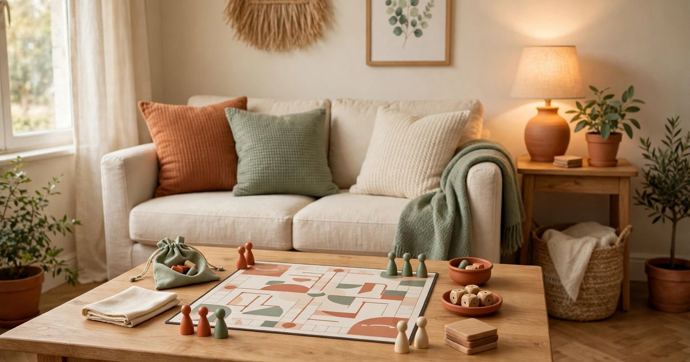
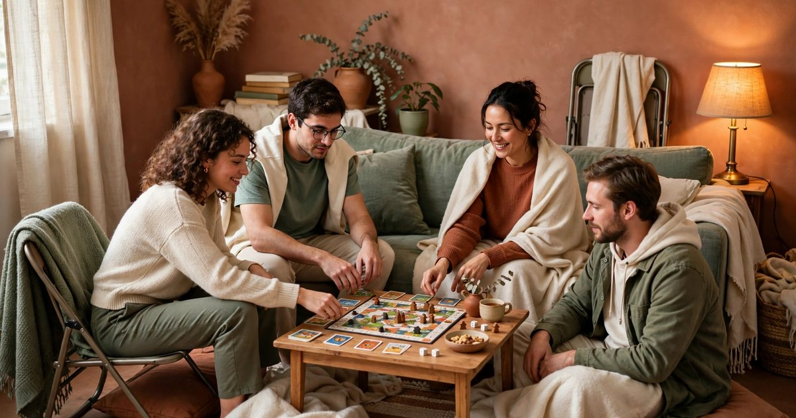
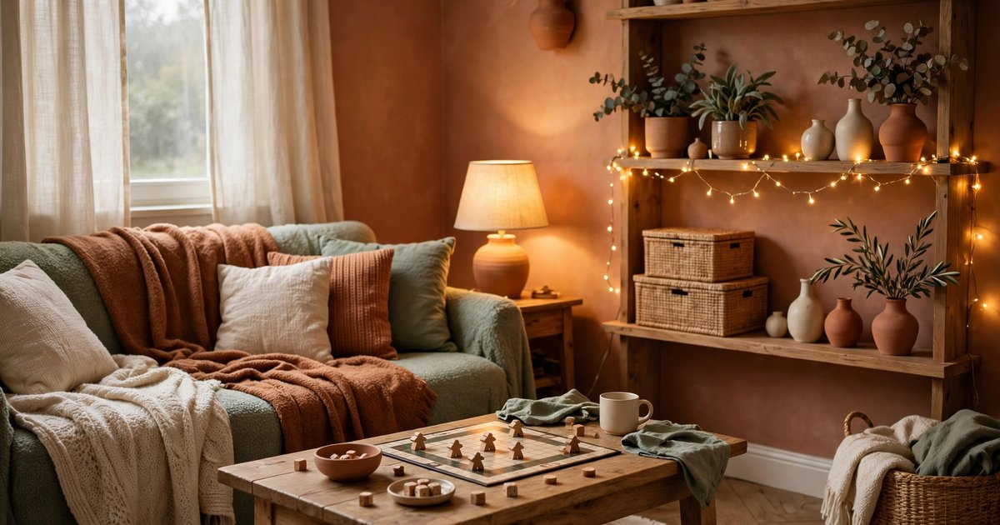
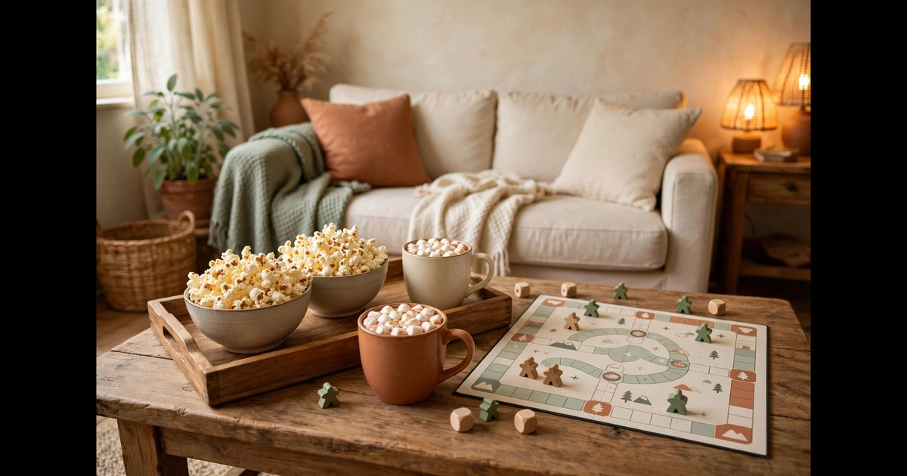
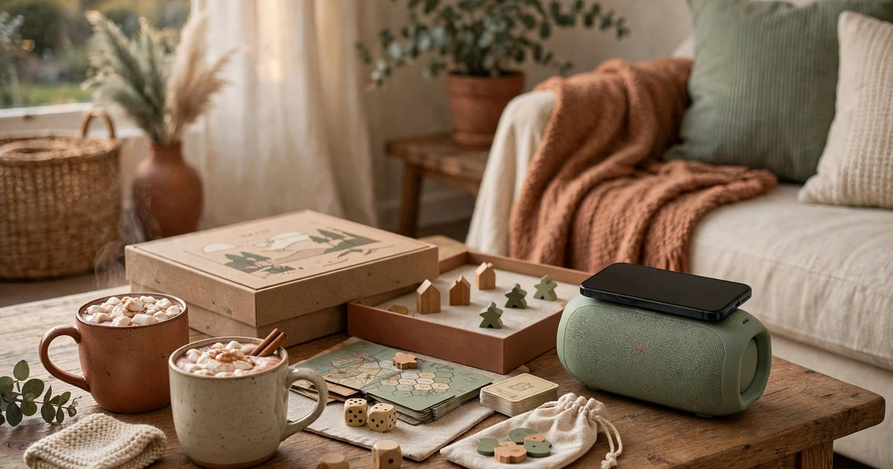
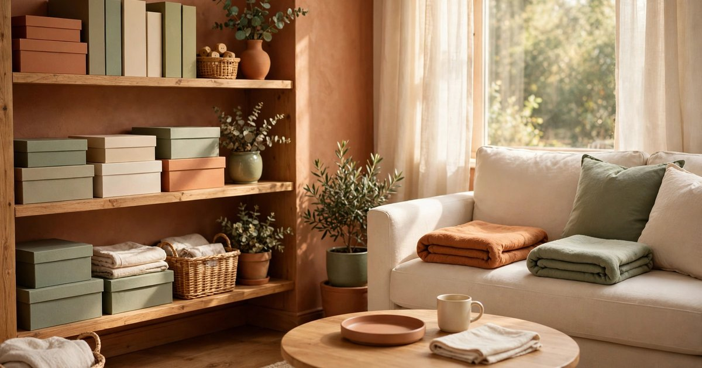

A winter games night is the perfect small-rental party: no one needs to dress up, nobody expects a three-course dinner, and the entertainment is a box you already own. When the evenings are dark and cold, a living room full of friends, a board game spread across the [coffee table](/winter-coffee-table-decor-ideas-small-apartments/) and a pot of [hot chocolate](/host-christmas-eve-small-rental-guide/) is the cosiest night in there is. The trick is planning for the space you actually have, not the space you wish you had — and that is where most games nights in small flats go wrong.

The good news is that a games night is one of the cheapest parties you can throw in a rental. You do not need new furniture, you do not need to buy games, and you do not need to decorate. You need a clear surface, enough places to sit, snacks that will not stain the carpet, and a plan for keeping the noise down.

### 1. Pick the Right Games for the Space

Start with the games, because they decide everything else: how much table space you need, how many people can play at once, and how loud the evening will get. In a small rental, the best games are the ones with a small footprint. Card games, word games and quick party games fit on a coffee table; a sprawling strategy board with a hundred pieces does not. Pick games that play in under an hour and suit the exact number of guests you have invited — nothing kills the mood faster than a game that seats four when six people have turned up.

Borrow before you buy. Ask each guest to bring one favourite game, and you will have a whole shelf of options for free. A games night built on borrowed games also solves the storage problem: nothing new stays in your flat afterwards. If you do want to buy something, charity shops are full of barely played board games for a pound or two, and a pack of cards plus a dice set covers dozens of games on their own.

Plan the mix: one chatty party game to warm everyone up, one proper board game for the middle, and one quick, silly game to finish. Avoid games that need players to stand up or shout across the flat — save those for a bigger space — and keep a backup ready so a game that falls flat can be swapped out in thirty seconds.

### 2. Clear and Set Up the Play Area

A games night needs one clear, flat surface, and in a small rental that is usually the coffee table. Clear it completely the day before, not an hour before guests arrive. Move the remote controls, the mail pile and the half-finished mug collection somewhere they will not be knocked over mid-game. Wipe the table down, then lay out the game you plan to start with so the first round begins the moment everyone sits down.

If your coffee table is too small or too low, use the dining table instead, or push two small tables together. A large tray on the coffee table works as a raised playing surface and keeps pieces contained — clearing up is then as simple as lifting the tray away. Keep a side table or stool free nearby for drinks, so nobody balances a mug on the edge of the board.

### 3. Seat Everyone Without Buying Furniture

Seating is the hardest part of hosting in a small rental, and the answer is never to buy more chairs. Borrow them. Ask a guest to bring a folding chair, pull the dining chairs into the living room, and fill the gaps with what you already own: floor cushions, a beanbag, a stack of folded blankets as a seat pad, or a pouffe. A games night is informal, so floor seating is part of the charm — just make sure everyone has something soft under them and a cushion behind their back.

Arrange the seating in a circle or horseshoe around the table so everyone can see the board and reach it. If some guests are on the floor and some on the sofa, put the board on the lowest surface so the heights work out. Test each spot yourself before anyone arrives, and rotate seats between games so nobody is stuck in the worst one all night.

Keep one spare seat free if you can — someone always brings a plus-one. And if your guest list is bigger than your floor space, split the group: one game at the table, one at the kitchen counter, swapping halfway through.

### 4. Set the Lighting and Atmosphere

Winter games nights live or die on atmosphere, and lighting does most of the work for free. Turn off the overhead light — it is harsh, it flattens the room, and it makes everyone look tired. Use lamps instead: a floor lamp in the corner, a table lamp on a sideboard, and a string of [fairy lights](/hang-christmas-lights-rental-guide/) along a shelf or window. Warm light makes a small room feel cosy rather than cramped, and it makes the whole evening feel like an occasion.

You still need enough light to read cards, so do not go too dim: a lamp aimed at the table, or a small battery lantern on the floor beside it, gives players the light they need without flooding the room. Fairy lights are ideal in a rental because they hang with removable hooks and leave no marks. Avoid real candles on or near the game table — one knocked-over candle is a disaster, and wax on a carpet is a deposit deduction waiting to happen. Battery candles give the same glow with none of the risk.

### 5. Snacks and Drinks That Won't Stain

The golden rule of games-night food is simple: if it stains, it does not come out. Red wine, curry, beetroot crisps and anything with tomato sauce are all banned from the game table. Popcorn is the perfect games-night snack — cheap, filling, and it brushes off the carpet — and a big bowl of it with a little sea salt costs almost nothing. Add crisps in bowls rather than open bags, so hands stay out of the packet and crumbs stay contained, and put a small plate under every bowl so spills land on a plate, not the sofa.

Hot chocolate is the winter drink of choice, and far cheaper than buying wine for six people. Make a big pot, set out mugs, marshmallows and cinnamon, and let people help themselves from the kitchen. Keep drinks in mugs with handles rather than open glasses — a mug is far harder to knock over than a wine glass, and hot chocolate wipes up far more easily than red wine. Keep kitchen paper and a damp cloth within reach, so a spill gets dealt with in seconds.

Serve food that can be eaten with one hand, because the other hand is holding cards: mini sandwiches, sausage rolls, cheese cubes, grapes and biscuits. Put the food on a side table, not on the game table, so crumbs and grease never reach the board, and ask about allergies when you invite people. The whole spread should cost under a tenner if you shop at a supermarket and make the hot chocolate yourself.

### 6. Keep the Noise Neighbour-Friendly

A games night gets loud. Someone wins a round, someone else loses spectacularly, and suddenly the whole room is cheering. In a small rental with neighbours on the other side of a thin wall, that is the one thing that can turn a great evening into a complaint. The fix is planning, not policing your friends. Tell your neighbours in advance — a quick knock or a friendly note saying you are having a few friends over until about eleven is worth more than any amount of soundproofing, and most neighbours are far more forgiving when they have been warned.

Keep the loudest games for earlier in the evening and save the quiet, thinky games for after ten. Party games that involve shouting or singing are brilliant at eight o'clock and a problem at midnight, so if the volume is rising, switch to a card game — the change of pace naturally brings the room down a notch. Close the windows, draw the curtains, and lay [a rug](/cosy-winter-rugs-small-rentals-under-25/) or thick blanket on wooden floors to absorb sound.

Set a finish time when you send the invitations, and stick to it. "Games until eleven, then we wind down" gives everyone a clear expectation and a natural reason to start the tidy-up. If the group wants to keep going, move to the kitchen or suggest a walk to the local pub. A games night that ends on time, with the neighbours happy, is one you can repeat every month.

### 7. A Playlist and Proper Breaks

Background music is the easiest way to make a games night feel like an event rather than a meeting, and it costs nothing. Put together a playlist before guests arrive — something warm and low-key, like acoustic covers, jazz or lo-fi — and keep the volume low enough that nobody has to raise their voice over it. A small Bluetooth speaker on a shelf is plenty for a small room; there is no need for anything bigger, and a big speaker is just another noise complaint waiting to happen.

Plan breaks into the evening, because four hours of solid play is exhausting. A break between each game is the natural rhythm: stretch, refill mugs, top up the popcorn, and let people check their phones. A ten-minute pause every hour keeps the energy up and gives you a chance to reset the table. If you have a balcony, stepping outside for fresh air for a few minutes is a great reset on a cold night.

### 8. A Tidy-Up Plan That Protects Your Deposit

The least glamorous part of a games night is the tidy-up, and it is the part that protects your deposit. Start before the night even begins: put a bin bag by the door, keep cleaning supplies where you can reach them, and choose games and snacks that cannot damage anything. When the evening ends, the tidy-up should take fifteen minutes, not an hour, because everything was planned to be easy to clear.

Do the quick jobs while guests are still there: ask everyone to take their mug to the kitchen, collect the bowls and fold the blankets — five people tidying for three minutes beats one person tidying for half an hour. Then, once everyone has left, check under the sofa and cushions for crumbs, check the carpet for spills, wipe the table, and put borrowed chairs back where they came from.

The deposit checklist is short: no stains on the carpet or sofa, no marks on the walls from moved furniture, no broken glasses, and everything back in its place. If something did spill, deal with it that night — a stain dealt with immediately usually comes out, and one left until morning often does not. Take a quick photo of the room once it is tidy, as a record that everything is as it was.

## A Small Room Is the Best Room for a Games Night

A big house with a games night feels empty; a small rental with six friends around a coffee table feels full in the best way. The closeness is the point — everyone can hear each other and reach the board. You do not need more space, more furniture or more money: just the right games, enough seats, snacks that will not stain, and neighbours who were warned in advance. Get those four things right and a winter games night in a small rental will be the best night in of the season.

## Shop this look: Games night essentials

- **Codenames board game** — a quick party game with a small footprint. [Shop Codenames](https://www.amazon.com/s?k=codenames+board+game&tag={{AMAZON_TAG}})
- **Pack of playing cards** — one pack covers dozens of games on its own. [Shop playing cards](https://www.amazon.com/s?k=playing+cards+pack&tag={{AMAZON_TAG}})
- **Dice set** — cards plus dice cover dozens of games. [Shop dice sets](https://www.amazon.com/s?k=dice+set+board+games&tag={{AMAZON_TAG}})
- **Folding chair** — bring one per guest to fill the gaps without buying furniture. [Shop folding chairs](https://www.amazon.com/s?k=folding+chairs+portable&tag={{AMAZON_TAG}})
- **Small Bluetooth speaker** — plenty for a small room, with no noise-complaint risk. [Shop Bluetooth speakers](https://www.amazon.com/s?k=small+bluetooth+speaker&tag={{AMAZON_TAG}})
- **Battery lantern** — light aimed at the table without flooding the room. [Shop battery lanterns](https://www.amazon.com/s?k=battery+lantern+led+portable&tag={{AMAZON_TAG}})

## Frequently Asked Questions

### How many people can I host for a games night in a small rental?

Four to six is the sweet spot: everyone can sit around one table and see the board, and the room does not feel crowded. More than six and you will need to split into two games, which works well if you have a kitchen table as a second spot.

### What are the best board games for a small space?

Card games, word games and quick party games with a small footprint — think Uno, Codenames, Bananagrams or a pack of cards. Avoid large strategy boards with lots of pieces unless your table is big enough to hold them comfortably.

### How do I stop a games night from annoying my neighbours?

Warn them in advance, keep the loudest games for earlier in the evening, close the windows, and set a finish time of around eleven. A rug on a wooden floor absorbs a surprising amount of sound.

### What snacks are safe for a games night in a rental?

Popcorn, crisps in bowls, biscuits, cheese cubes and grapes — all cheap, one-handed, and unlikely to stain. Serve food on a side table rather than the game table, and keep drinks in mugs with handles.

### How do I host a games night on a budget?

Borrow the games, borrow a folding chair or two, make hot chocolate and popcorn at home, and use fairy lights and lamps you already own for atmosphere. A games night for six people can easily cost under a tenner.
