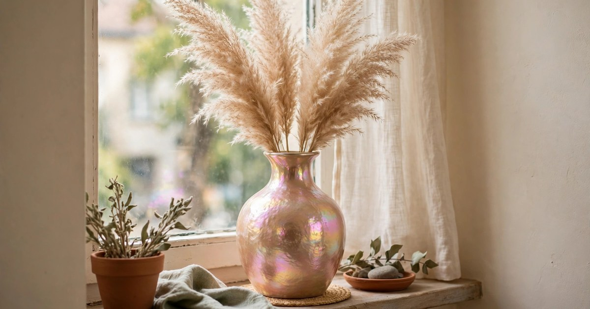
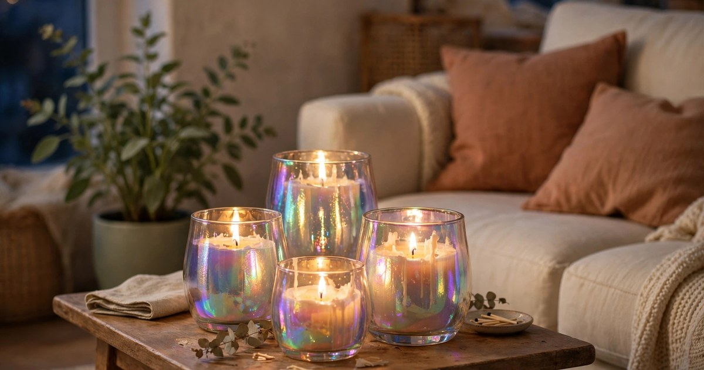
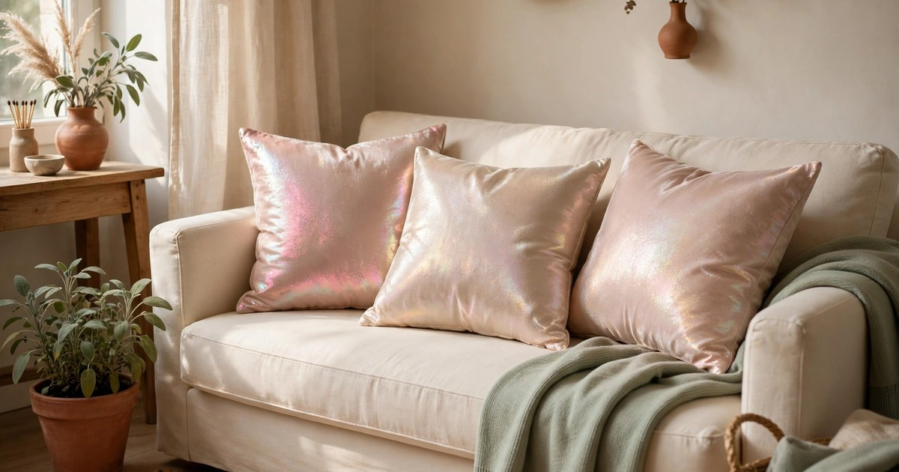
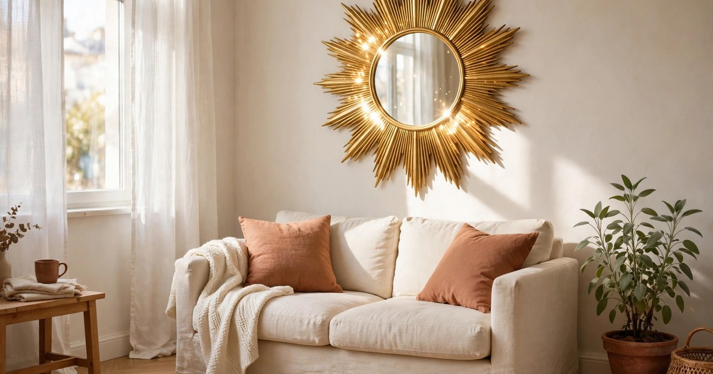
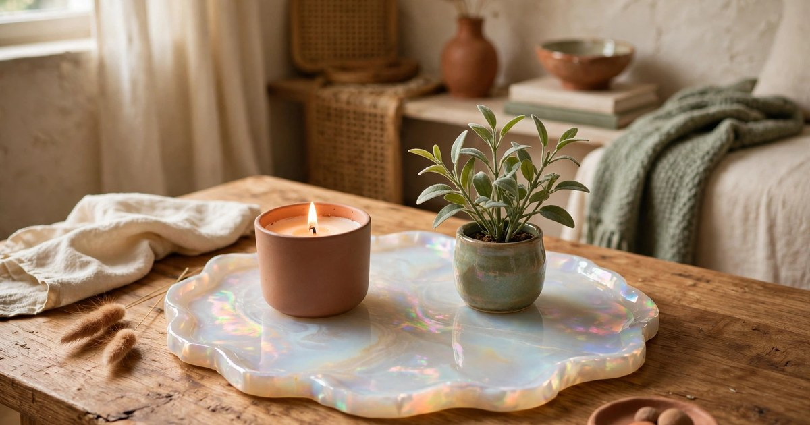
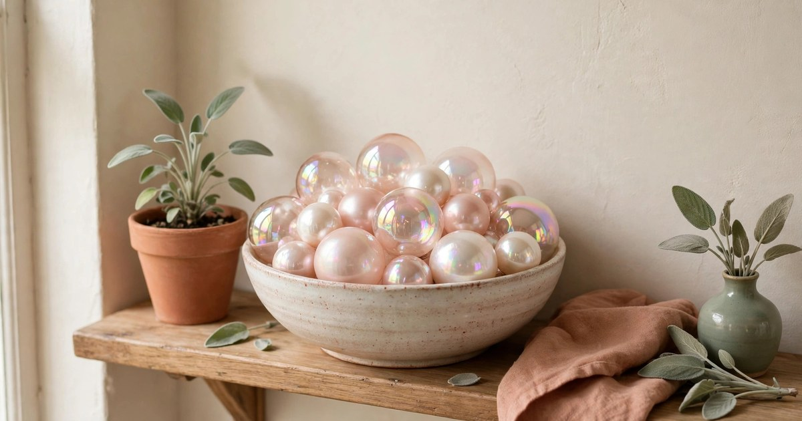
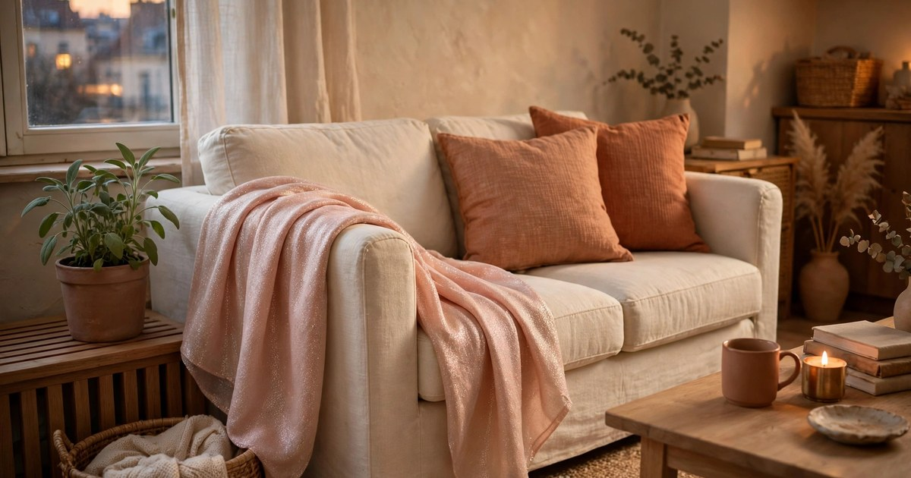
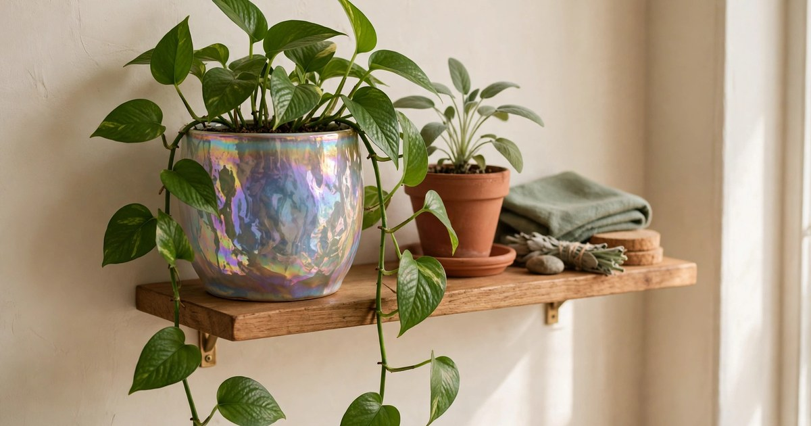
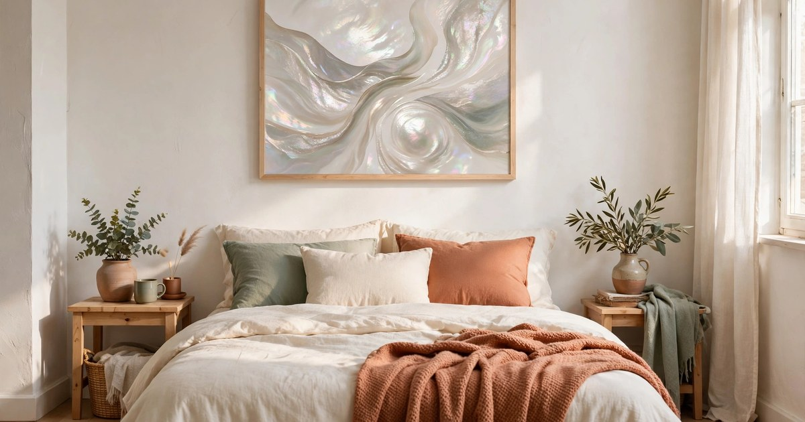

There is a particular kind of magic that happens when late-afternoon light hits a pearlescent surface. A plain vase suddenly glows pink, then gold, then the palest blue, and a corner of your flat that was perfectly ordinary a minute ago feels like somewhere special. That is the quiet power of iridescent decor: it does not shout, it shimmers. And for small apartments, it might be the cleverest trick in the book, because it adds colour, depth and personality without adding bulk, clutter or a single nail hole.

Iridescent finishes — pearlescent, opalescent, mother-of-pearl, holographic — shift colour as the light moves, so one small object can play several roles at once. In a tiny living room that means a vase can be a sculpture, a light catcher and a colour accent all at the same time, while taking up no more space than a vase. It is the opposite of the heavy, dark statement pieces that swallow small rooms whole. Instead of fighting for attention, iridescent pieces borrow light from the room and give it back, which makes a small space feel brighter, airier and a little bit enchanted.

It is also wonderfully renter-friendly. Iridescent decor is almost always small, light and freestanding: vases, trays, cushions, coasters and throws that sit on surfaces you already own. Nothing here needs drilling, painting or a landlord's permission, and almost everything can be packed into a single box when you move. The budget angle is just as friendly. Because the finish does so much of the work, you do not need expensive materials — a £6 pearlescent vase catches the light just as beautifully as a £60 one, and a shimmer cushion cover can transform a tired sofa for the price of a takeaway. Most of the ideas below cost under £20, several under £10, and every one of them earns its place in a small flat.

If you already love a touch of sparkle, this look pairs beautifully with our [celestial Christmas decor ideas for small apartments](/celestial-christmas-decor-ideas-small-apartments/), where moons, stars and opalescent baubles bring the same shimmering mood to the festive season. It also sits happily alongside the glamorous curves of our [neo-deco living room ideas for small apartments](/neo-deco-living-room-ideas-small-apartments/), because iridescent finishes and art-deco shapes were practically made for each other. Here are ten ways to bring the glow home.

### 1. A Pearlescent Vase on the Windowsill

Start with the simplest, loveliest idea of all: one pearlescent vase on the windowsill. The windowsill is prime real estate in a small flat — it catches the most light, costs no floor space and is usually the first thing your eye lands on — and a vase with a pearly, oil-slick finish turns that light into a slow colour show all day long. In the morning it glows soft pink, by midday it flashes gold, and at dusk it settles into a gentle lavender. You do not need fresh flowers to make it work; a few stems of dried pampas grass, eucalyptus or even bare twigs look sculptural against the shimmer.

Choose a vase with a simple shape — a rounded bud vase, a tall cylinder or a gentle amphora curve — because a clean silhouette lets the finish do the talking. Busy shapes and heavy patterns fight the iridescence and end up looking fussy. Glass and glazed ceramic both work well; glass gives you a lighter, more translucent glow, while ceramic reads warmer and more substantial. Expect to pay £6 to £15 for a good one from a homeware chain or a charity shop — pearlescent vases turn up second-hand constantly, because people buy them as gifts and never use them, which makes them a brilliant thrift find.

Keep the styling minimal. One vase, one or two stems, and a clear sill is all you need. If your windowsill is narrow, pick a bud vase no taller than 15 centimetres so it does not crowd the glass, and group it with a plain white candle or a small stack of books if the sill feels bare. The vase will do the rest.

### 2. Iridescent Candle Holders for Evening Glow

Candlelight and iridescence are a match made in heaven, because a flickering flame makes the colour shift constantly, so the holder never looks the same twice. A set of iridescent glass candle holders — tealights, taper holders or a single hurricane lantern — turns an ordinary evening into something that feels a little bit ceremonial, and in a small flat that atmosphere matters more than it does in a big house, where you can escape to another room. Here, the living room is the dining room is the reading nook, so a glow that makes it feel special is worth its weight in gold.

Look for holders in smoked iridescent glass or a thin pearlescent glaze, and mix two heights rather than buying a matching set. A tall taper holder beside a low tealight creates a little skyline of light on a coffee table or a shelf, and the uneven heights stop the display looking like a shop window. A set of three tealight holders costs around £5 to £10, and a single statement hurricane lantern runs £12 to £18. Battery-operated LED candles are the renter's best friend here — no smoke marks on the ceiling, no wax on the landlord's furniture, and you can leave them glowing while you pop out.

Place them where you actually sit in the evening, not where they look best in a photograph. A coffee table, a bedside table or the kitchen counter you eat at — that is where the glow earns its keep. Keep them away from curtains and cushions, and use a small tray underneath if your surfaces are precious.

### 3. Shimmer Cushion Covers That Change the Sofa

If your sofa is the tired, landlord-issue beige that so many rentals come with, shimmer cushion covers are the fastest, cheapest rescue available. A pair of iridescent or pearlescent cushion covers — in blush, champagne or a soft holographic silver — catches the light every time someone moves, and suddenly the sofa looks intentional instead of inherited. It is the same trick as a fresh coat of paint, except it costs under £15 and comes off in seconds.

The key is restraint. Two shimmer cushions on a two-seater sofa is plenty; three on a three-seater is the maximum. Pair them with plain cushions in cream, sage or terracotta so the shimmer has something calm to sit against — a whole sofa of iridescence looks like a disco ball, not a living room. Velvet-look covers with a pearlescent sheen feel the most grown-up, while sequinned covers read younger and louder, so choose according to your taste and your flatmates' tolerance.

Cushion covers are also the most practical way to test whether iridescent decor suits you. A pair of covers costs £8 to £15, takes up no storage space when folded away, and can be swapped seasonally — shimmer in winter, linen in summer. Wash them inside out on a cool cycle and they will last for years. If you fall in love with the look, the same blush or champagne tone can echo through the rest of the room in a throw or a tray.

### 4. A Starburst Mirror or Light as the Focal Point

Every small room needs one piece that does the heavy lifting, and a starburst mirror or light is the hardest-working focal point a tiny flat can have. The spiky, sputnik-style shape draws the eye upward, which makes the ceiling feel higher, and the mirrored or metallic rays bounce light into corners that would otherwise stay dim. A starburst mirror does double duty — decoration and light — while a starburst light adds a warm glow as well, so either one can replace two or three smaller pieces and free up surface space.

Hang a starburst mirror above the sofa, the bed or a console table, where it can catch the window light and throw it around the room. Most are light enough for a single command hook or a picture-hanging strip, which keeps your deposit safe, but check the weight first — anything over a kilogram deserves two hooks and a proper strip. A small starburst mirror costs £15 to £25, and a tabletop starburst light runs £12 to £20. Battery versions of the light need no socket and no trailing cable, which matters in a flat where every plug is already spoken for.

Keep the wall around it calm. A starburst shape is busy enough on its own, so give it breathing room — no gallery wall competing beside it, no patterned wallpaper behind it. One starburst, one clear wall, and the room suddenly has a centre.

### 5. An Opalescent Tray to Gather the Clutter

Small flats do not really have a clutter problem; they have a "nowhere to put the clutter" problem. Remotes, keys, lip balm, the charging cable, the candle you light every evening — they all end up scattered across the coffee table, and the room looks messy even when it is technically tidy. An opalescent tray solves it in one move: everything lives on the tray, the tray looks beautiful, and the coffee table reads as styled rather than strewn.

Choose a tray in a milky opalescent finish — glass, resin or lacquered wood all work — in a round or soft rectangular shape, roughly 30 to 40 centimetres across. Round trays soften a square coffee table; rectangular ones suit a long console or a bedside table. The opalescent surface does something a plain tray cannot: it reflects the light and the colours of whatever sits on it, so the whole arrangement glows a little. Expect to pay £8 to £18, and check charity shops first, because trays are one of the most donated homeware items.

Style it with three things: something tall (a candle or a small vase), something green (a tiny plant or a sprig of eucalyptus) and something useful (the remote, your keys, a coaster). Three objects is the sweet spot — fewer looks empty, more looks like a junk drawer with a border. When guests come over, you can lift the whole tray off the table in one hand and the room is instantly tidy.

### 6. Iridescent Baubles as Year-Round Decor

Here is a secret the Christmas aisle does not want you to know: iridescent baubles are far too beautiful to spend eleven months in a box. A small bowl or a glass cloche filled with pearlescent baubles makes a gorgeous year-round centrepiece — they catch the light, they come in every soft colour from blush to aqua, and they cost almost nothing, especially if you buy them in the January sales when a pack of twelve drops to £2 or £3.

The trick is to de-Christmas them. Skip the red and green entirely and choose a single colour family — all pearly white and blush, or all soft blue and silver — then display them somewhere that reads as decor, not as a tree that lost its way. A shallow ceramic bowl on a coffee table, a tall glass vase on a shelf, or a cloche on a bedside table all work. Mix two sizes for depth, and add a sprig of dried eucalyptus or a fairy light underneath for evening sparkle.

This is also the most renter-friendly idea on the list, because it weighs nothing, needs no fixing and packs flat. If you get bored of the colour, swap the baubles for a different shade — a new look for the price of a coffee. And if December rolls around, you already own the prettiest baubles in the house; our [celestial Christmas decor ideas](/celestial-christmas-decor-ideas-small-apartments/) show how to let them shine on the tree too.

### 7. Mother-of-Pearl Coasters for Everyday Luxury

Some of the best decor is the kind you touch every day without noticing — until it is gone. Mother-of-pearl coasters are exactly that: small, practical, quietly luxurious, and they make the most ordinary moment of the day — a cup of tea on the sofa — feel like a small ritual. The pearly surface shifts from white to pink to green as you move the mug, and because they are only ten centimetres across, they bring shimmer into a room without taking up any visual space at all.

Real mother-of-pearl coasters cost £10 to £20 for a set of four, while resin or glass lookalikes run £5 to £10 and are just as pretty from arm's length. Either way, they earn their keep: they protect the coffee table from rings, which matters a great deal when the coffee table belongs to your landlord, and they look deliberate sitting in a little stack when they are not in use. Keep the stack on the coffee table or a side table where it is always within reach, not hidden in a cupboard — a coaster in a cupboard protects nothing.

Pair them with a matching mother-of-pearl tray or a small pearlescent dish for keys, and you have a coordinated shimmer moment for under £20. It is the kind of detail guests notice and remember, and it costs less than a single takeaway dinner.

### 8. A Shimmer Throw for Cold Evenings

A throw is the hardest-working textile in a small flat: it warms you on cold evenings, hides a stained sofa arm, adds colour to a neutral room and folds away into almost nothing. A shimmer throw — in a soft metallic knit, a pearlescent fleece or a lightweight fabric with a subtle holographic thread — does all of that while catching the light every time it moves, so the sofa looks different in the morning, at noon and in the evening.

Drape it over one arm of the sofa or fold it neatly across the back, rather than spreading it flat across the whole seat. A throw that covers the entire sofa looks like a dust sheet; a throw that sits casually on one side looks like styling. Choose a colour that echoes something else in the room — blush to match the cushion covers, champagne to match the tray, silver to match the mirror — so the shimmer feels connected rather than random. A good shimmer throw costs £12 to £25, and the fleece and knit versions are machine washable, which matters when it lives on the sofa you eat on.

This is also the cosiest way to bring iridescence into a bedroom. Folded across the foot of the bed, a shimmer throw catches the morning light and makes the whole room glow, and it doubles as an extra layer on cold nights. One throw, two rooms, endless use.

### 9. An Iridescent Plant Pot for Your Greenery

If you already keep plants — and in a small flat, a plant is often the only living thing bigger than a cushion — an iridescent plant pot is the easiest upgrade you will ever make. The plant does the growing, the pot does the glowing, and together they turn a plain pothos or spider plant into a feature. The shimmer picks up the green of the leaves beautifully, and because the pot sits on a shelf or a windowsill, it adds colour at eye level, which is exactly where a small room needs it.

Look for a glazed ceramic pot with a pearlescent or oil-slick finish, in a size that fits the plant you already own — a 12 to 15 centimetre pot suits most trailing plants and small houseplants. Make sure it has a drainage hole or a matching saucer, because a beautiful pot that drowns its plant is a false economy. Prices run £5 to £12 for a small pot, and many garden centres sell them cheaper than homeware shops, so check both before you buy.

Group two or three iridescent pots together on a shelf or a plant stand for a stronger effect, mixing heights and leaf shapes — a trailing plant beside an upright one, a tall pot beside a squat one. The shimmer ties the group together even when the plants are completely different, which makes it a forgiving way to build a little indoor jungle without buying matching pots.

### 10. Pearlescent Wall Art That Needs No Nails

Bare walls are the saddest thing about a rented flat, but most landlords forbid nails, and blu-tack leaves marks that cost you at the end of the tenancy. Pearlescent wall art solves both problems: a framed print with a pearlescent, metallic or holographic finish catches the light like a window, fills a blank wall with colour that changes through the day, and hangs from a single command strip that peels off cleanly when you move.

Choose abstract art — soft waves, arcs, sunbursts or a simple gradient — rather than a detailed picture, because the shimmer is the star and a busy image competes with it. A print in blush, gold and cream suits a warm room; silver, blue and lilac suits a cooler one. An A4 or A3 print in a light frame costs £10 to £20, and you can print your own from a digital download for under £5 if you have access to a decent printer. Hang it where the light hits it — opposite a window, not beside one — so the pearlescent surface has something to reflect.

One piece is enough for a small bedroom or a hallway; two matching prints side by side work above a sofa. Keep the frame light — white, pale wood or thin gold — so the art feels airy rather than heavy. When you move, the print comes down, the strip peels off, and the wall is exactly as you found it.

## Frequently Asked Questions

### Is iridescent decor too much for a small apartment?

Not if you keep it to accents rather than whole pieces of furniture. One or two shimmering objects per room — a vase, a tray, a pair of cushions — add light and interest without overwhelming the space. The trick is to let plain, calm surfaces do most of the work and let the iridescence be the highlight.

### What colours work best with iridescent decor?

Soft, warm neutrals are the safest partners: cream, terracotta, sage, pale wood and warm white all let the shimmer shine. Blush, champagne and pearl are the easiest iridescent tones to live with, while stronger holographic finishes suit a single statement piece rather than a whole room.

### Is iridescent decor renter-friendly?

Yes — almost everything in this list is freestanding, lightweight and removable. Vases, trays, cushions, throws and coasters need no fixing at all, and wall art or mirrors hang from command strips that come off cleanly. Nothing here requires drilling, painting or a landlord's permission.

### Where can I find iridescent decor on a budget?

Homeware chains, charity shops and the January sales are your best friends. Pearlescent vases, trays and baubles are frequently donated or discounted, and cushion covers and throws go on sale seasonally. Start with one piece under £10 and build the look slowly rather than buying everything at once.

### Does iridescent decor suit a room with little natural light?

It does, because iridescence also responds beautifully to warm artificial light. Candle holders and a starburst light are the best picks for darker rooms, since they create their own glow, and a mirror opposite a lamp will bounce that light around. Avoid putting shimmer pieces in a completely dark corner, where there is no light to catch.
