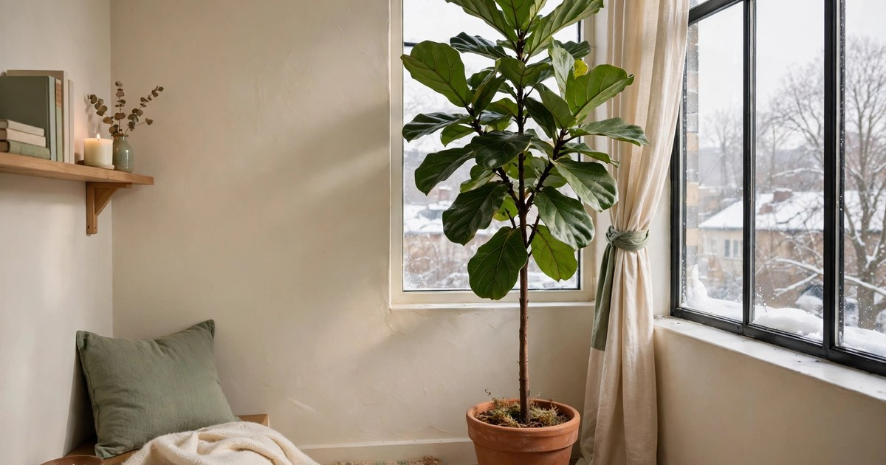
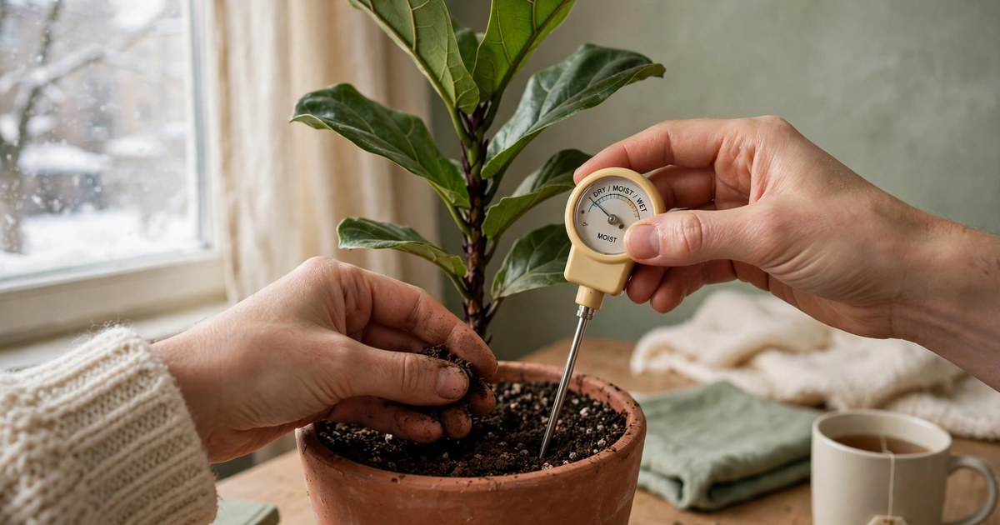
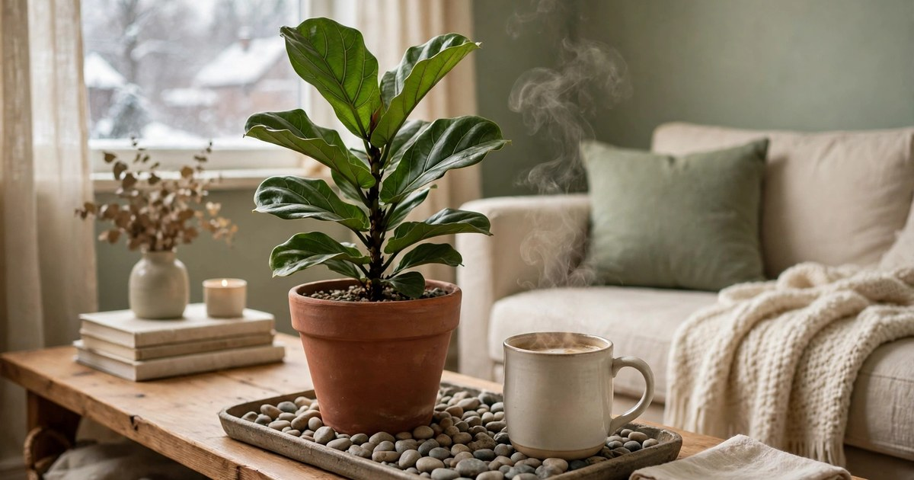
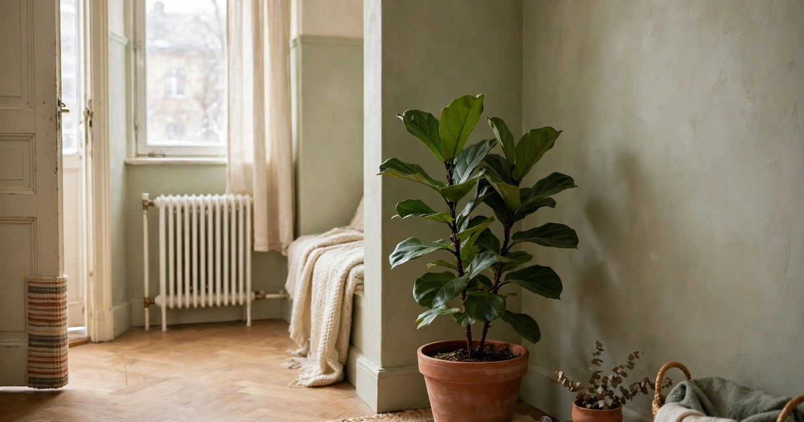
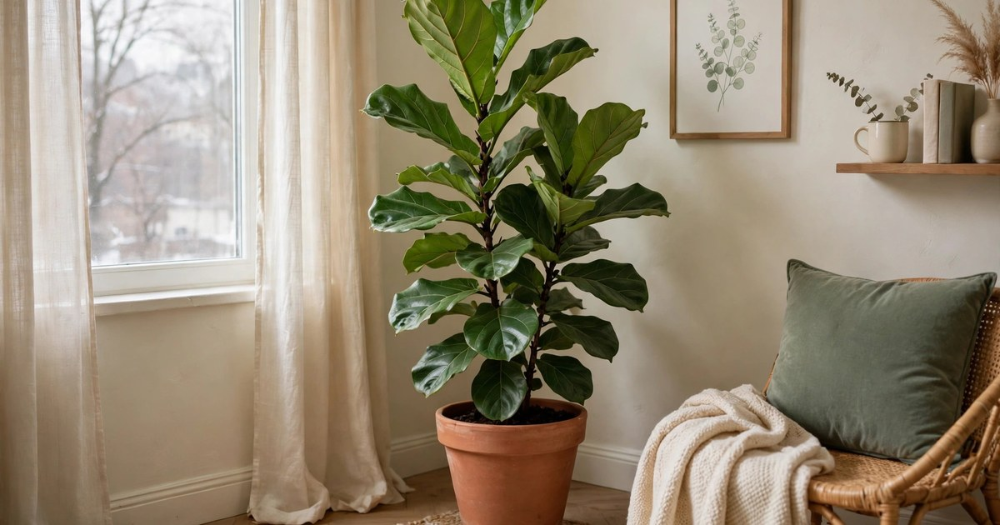
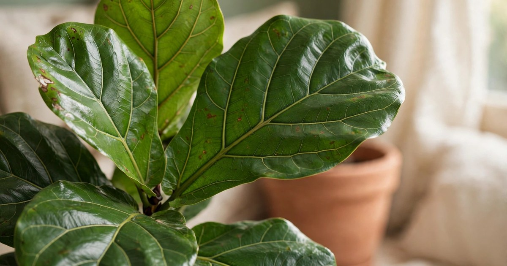
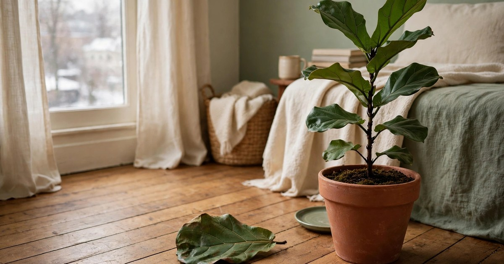
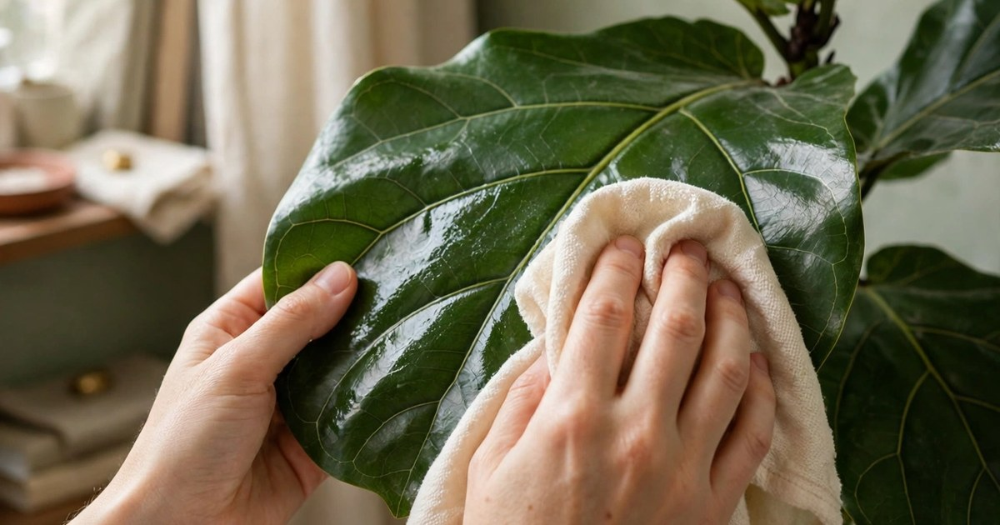

A fiddle leaf fig in winter is a test of patience. In summer it was the star of the room, throwing out glossy new leaves the size of dinner plates and making the whole flat feel like a conservatory. Then November arrives, the days shrink, the heating clicks on, and the plant you were so proud of starts sulking. A brown spot appears on a lower leaf. Then another. A leaf drops overnight and you find it on the rug in the morning like a small accusation. If you have ever stood in front of a fiddle leaf fig wondering what you did wrong, you are not alone — it is famously dramatic, and winter is when it is at its most theatrical.

Here is the reassuring part: most winter fiddle leaf fig problems are not your fault, and most of them are fixable with small, cheap changes. The plant is not dying because you are a bad plant parent. It is reacting to a season it never asked for. Fiddle leaf figs come from the warm, bright rainforests of West Africa, where the light is strong all year and the air is humid. A small apartment in winter is the opposite of that: short grey days, dry heated air, cold draughts from the front door and hot blasts from the radiator. Your job this winter is not to make the plant grow — it will barely grow at all between November and February — but to help it hold steady until spring. Keep it alive, keep it stable, and when the light returns it will reward you with new leaves.

The golden rule of winter fiddle leaf fig care is this: do less, but do it deliberately. Less water, no repotting, no moving it around, no sudden feeding. The plant wants routine and stability more than it wants attention, and almost every winter disaster comes from doing too much — watering on a schedule, shifting it to a "better" spot every week, or repotting it in December because it looked unhappy. Work through the eight steps below in order, and by the end you will have a winter routine that costs almost nothing, takes about ten minutes a week, and gives your fig its best possible chance of reaching spring with its leaves intact.

### 1. Give It the Brightest Spot You Have

Light is the single biggest factor in whether a fiddle leaf fig survives winter, and it is the one most renters underestimate. In summer, a spot two metres from the window was probably fine. In winter, the sun sits lower, the days are shorter, and the same spot may be getting a third of the light it got in June. A fiddle leaf fig needs bright, indirect light for as many hours as you can give it — ideally six or more — and in a small flat that usually means one place only: right beside your brightest window. If you have a south-facing window, that is the prize spot. East-facing is the next best, catching the gentle morning sun. A west-facing window works too, though the afternoon sun can be surprisingly strong even in winter, so keep the plant a hand's breadth back from the glass.

Do not put the leaves right against the glass. On a frosty night, a windowpane can be several degrees colder than the room, and a leaf pressed against it can develop a cold burn that looks like a dark, papery patch. Leave a gap of at least fifteen centimetres between the leaves and the glass, and if the window is single-glazed or especially draughty, hang a sheer curtain between the plant and the pane — it softens the cold without blocking much light. If your flat is north-facing or shaded by the building opposite, the honest answer is that natural light alone may not be enough, and the cheapest fix is a small [LED grow light](/grow-lights-dark-winter-apartments-under-25/). A slim bar that clips onto a shelf or a bulb that fits a standard lamp costs less than a takeaway, and run on a plug-in timer for ten to twelve hours a day it gives the fig a consistent day length even when the sky has been grey for a week.

The other thing to know about light is that a fiddle leaf fig hates being moved. Once you have found its bright spot, leave it there. These plants are notorious for dropping leaves after a relocation, and a plant that is already stressed by winter light will drop even more if you keep shifting it around the flat in search of perfection. Pick the best spot you have, put the pot there, and resist the urge to rearrange. If you want it to grow evenly rather than leaning towards the window, rotate the pot a quarter turn once a week — that is a gentle, predictable change the plant can cope with, and it keeps the canopy symmetrical.

### 2. Water Less — and Check Before You Water

Winter watering is where most fiddle leaf figs are lost, and the killer is almost always kindness. In summer, your fig might have needed a good drink every week, sometimes more. In winter, with short days, cool air and almost no new growth, it drinks far more slowly — and soil that stays damp for weeks in a cold flat is a perfect recipe for root rot, the quiet killer that shows up as brown spots and sudden leaf drop. The rule that never fails is simple: never water on a schedule, and never water because it is Saturday. Stick your finger about five centimetres into the soil before you even pick up the watering can. If it feels damp, walk away. If it feels dry at that depth, it is time to water.

When you do water, water properly. Give the pot a thorough soak until water runs freely out of the drainage holes, then tip the saucer away after ten minutes so the plant is never sitting in a puddle. A shallow sprinkle that only wets the top few centimetres is worse than useless: it encourages the roots to stay near the surface, where they dry out fast, and it leaves the deeper roots thirsty. Always use room-temperature water, not cold water straight from the tap, which can shock the roots on a cold day — fill the can the night before and leave it beside the plant so it warms to room temperature. Water in the morning, so any splashes on the leaves dry during the day rather than sitting in the cold overnight.

How often will that actually be? In most small flats, a fiddle leaf fig in a terracotta pot needs water every two to three weeks in winter, and a plant in a plastic or glazed ceramic pot may go even longer, because those pots hold moisture. That sounds alarmingly infrequent if you watered weekly all summer, but trust the finger test over the calendar. A cheap moisture meter, about the price of a coffee, takes the guesswork out entirely and is the single best purchase a nervous fig owner can make. Push the probe halfway into the soil; if it reads in the dry zone, water. If it does not, wait. The plant will tell you what it needs if you learn to check instead of guessing.

### 3. Raise the Humidity Without Buying a Humidifier

Central heating is the quiet enemy of the winter fiddle leaf fig. It keeps the flat warm, but it strips the moisture out of the air, and a plant that evolved in a humid rainforest starts to suffer: leaf edges turn brown and crisp, new growth stalls, and spider mites — which love hot, dry air — move in. You do not need to buy a humidifier to fix this. The simplest trick costs nothing at all: stand the pot on a shallow tray filled with pebbles and water, with the bottom of the pot sitting on the pebbles, above the waterline. As the water evaporates, it raises the humidity right around the plant, which is exactly where it is needed. Top the tray up every few days and wash it out once a fortnight so it does not get slimy.

Grouping your plants together helps too. A little cluster of houseplants on one windowsill or [plant stand](/winter-plant-stands-small-apartments-under-25/) creates its own pocket of slightly more humid air, as each plant releases moisture through its leaves. Your fig will be happier next to a couple of companions than standing alone in the middle of a dry room, and a grouping looks better too — a small jungle corner is one of the easiest ways to make a rented flat feel styled rather than furnished. The bathroom is another option if it has a window: the steam from showers keeps the air naturally humid, and a fig that fits on a bathroom floor or a sturdy stool can thrive there through the darkest months.

A light misting can help, but do it properly or not at all. Mist in the morning, once or twice a week, so the leaves dry before nightfall — leaves that stay wet in a cold room can develop fungal spots. Use room-temperature water in a fine spray bottle, and mist the air around the plant as much as the leaves themselves. And skip the misting entirely on days when the flat is cold and damp, when the leaves would not dry. The goal is a gentle lift in humidity, not a daily soaking. If you do decide to buy one thing for your fig this winter, make it a small hygrometer rather than a humidifier: it tells you the actual humidity in the room, and if it regularly reads below forty percent, that is your cue to add the pebble tray, group the plants, or move the fig a little further from the radiator.

### 4. Keep It Away from Draughts and Radiators

Fiddle leaf figs are tropical plants, and they are far more sensitive to temperature swings than most houseplants. A cold draught from a front door, a hallway, or a badly sealed window can shock the plant overnight — one icy blast is often all it takes to trigger a round of leaf drop the next morning. Hot, dry air is just as damaging: a fig parked beside a radiator gets blasted with dry heat every time the heating kicks in, and the leaves closest to the radiator will crisp at the edges and fall. The ideal winter temperature for a fiddle leaf fig is between fifteen and twenty-four degrees, and more important than the exact number is consistency. A plant that sits at a steady eighteen degrees all winter will do far better than one that swings between twelve and twenty-eight.

Walk around your flat and think like the plant. The danger zones are the obvious ones: right beside the front door, where every arrival brings a gust of cold air; directly under or beside a radiator; next to a window that rattles or lets in a draught; and in the path of a fan heater or a portable heater. The safest spot is usually an interior corner near a bright window but out of the direct line of any draught — a metre or so from the window, rather than pressed against it, and at least a metre from any radiator. In a small flat that can feel like a puzzle, but the trade is worth making: a slightly less bright spot that is draught-free will keep more leaves than a bright spot beside a cold, rattling window.

There are cheap renter-friendly fixes for the draughts themselves, and they help you as much as the plant. A draught excluder along the bottom of the front door costs a few pounds and stops the worst of the cold air. Self-adhesive foam draught strips around a rattling window frame are removable, leave no marks, and make the whole room warmer. A heavy curtain hung over the front door, on a tension rod if you cannot drill, is a classic renter trick that blocks cold air and looks intentional. Fix the draught, and you are not just saving the fig — you are making the flat warmer and cheaper to heat, which is a rare win where the plant and the energy bill agree.

### 5. Don't Move It, Don't Repot It, Don't Feed It

This is the hardest step in the whole guide, because it asks you to do nothing — and doing nothing feels wrong when your plant looks unhappy. But winter is the season for restraint. A fiddle leaf fig that is already stressed by [low light](/low-light-indoor-plants-dark-apartments/) and dry air does not need more change; it needs stability. The three things people most often do to a struggling winter fig — moving it to a new spot, repotting it into fresh soil, and feeding it to "perk it up" — are all likely to make things worse. Moving it triggers leaf drop. Repotting in winter disturbs the roots at the exact moment the plant is least able to recover, because it is not actively growing. Feeding a plant that is barely growing leaves excess fertiliser salts sitting in the soil, where they scorch the roots and turn leaf tips brown.

So the rule for the whole winter is: leave it alone. No repotting until spring, when the days lengthen and you can see new growth starting — late March or April is the right time, and only if the plant is actually root-bound, with roots circling the drainage holes. No feeding from November to February at all; the plant cannot use the nutrients, and the salts will do more harm than good. Resume feeding in spring at half strength, once a month, with a balanced liquid feed. And no moving it from room to room, or from one side of the living room to the other, just because it dropped a leaf. A dropped leaf in winter is usually a message about light or water, not about location, and chasing it with relocations just adds a second stress on top of the first.

There is one exception to the do-nothing rule, and it is worth knowing: if the plant is clearly sitting in waterlogged soil — the pot is heavy, the soil smells sour, and leaves are dropping fast — then you do need to act. Tip the pot, let it drain fully, and if the soil is still sodden after a day, slide the plant out of its pot, shake off the wettest soil, and repot it into dry, fresh compost in the same pot. That is emergency surgery, not routine care, and it is the only repotting that makes sense in winter. Otherwise, the most loving thing you can do for your fig between November and February is to let it rest. It is not being lazy. It is waiting for spring, and your job is to let it wait in peace.

### 6. Read the Brown Spots Before You Panic

Brown spots are the fiddle leaf fig's signature complaint, and they are also its most misunderstood one. Not every brown spot means the same thing, and the pattern of the spots tells you what is actually wrong — which means you can fix the cause instead of guessing. Start by looking at where the spots are and what they look like. Small brown spots on the edges of the leaves, especially the lower leaves, usually mean the air is too dry or the plant has been under-watered. Large, dark brown patches in the middle of a leaf, sometimes with a yellow halo, are more often a sign of overwatering and the beginnings of root rot. Tiny reddish-brown speckles on brand-new leaves are common and usually harmless: they are caused by uneven watering while the leaf was unfurling, and they often fade as the leaf matures.

The most important thing about a brown spot is that it will not heal. Once a leaf is damaged, that patch stays brown for the life of the leaf, no matter what you do. That does not mean the leaf is doomed, and it certainly does not mean you should cut it off. A leaf with a brown edge is still photosynthesising, still feeding the plant, and in winter — when every leaf counts — removing it does more harm than good. Leave spotted leaves in place unless they are more than half brown, yellowing all over, or clearly dead. The plant will shed them itself when it no longer needs them, and until then they are still working.

What you should do is fix the cause and watch the new growth. If the spots are on the edges, [raise the humidity](/humidify-houseplants-without-humidifier/) and check your watering. If they are large and dark and in the centre of the leaf, let the soil dry out properly between waterings and make sure the pot is draining. If the spots keep appearing on every new leaf, check for draughts and cold damage — a leaf that unfurled next to a cold window will often show it. The real test of whether your fix worked is not the old spots, which will never change, but the next leaves the plant produces. In winter that may take a while, because growth is slow. Be patient, and judge the plant by its newest leaves in spring, not by the scars on its oldest ones.

### 7. Deal with Leaf Drop Without Panicking

Few things are as alarming as coming home to find a perfectly good-looking leaf on the floor. A fiddle leaf fig dropping leaves feels like a crisis, but in winter it is often the plant's normal, if dramatic, way of adjusting to less light. The plant is shedding the leaves it can no longer support — usually the lowest, oldest leaves first — so it can put its limited energy into the leaves at the top that still get the most light. Losing a leaf or two over the course of the winter is normal. Losing several leaves in a single week is a signal that something needs to change, and the most common causes are the ones already covered in this guide: a sudden cold draught, a move to a new spot, overwatering, or a sharp drop in light.

The first thing to do when leaves start dropping is not to water more, feed it, or move it — it is to stop and check the basics. Is the soil wet or dry? Has the plant been moved recently? Has the heating come on, or has a cold snap arrived? Is the plant next to a door that has been opening and closing more than usual? Work through those questions before you change anything, because the fix for leaf drop is almost always one of the simple things: move it away from the draught, let the soil dry out, or accept that the light has dropped and the plant is adjusting. Resist the urge to do three things at once. Change one thing, wait a week, and see whether the dropping slows. If you change everything at once, you will never know what worked — and you may add a new stress while fixing the old one.

It also helps to know what is not worth worrying about. A fig that drops its lowest leaves but keeps its top canopy healthy is adjusting, not dying. A fig that drops leaves from the top down, or whose leaves turn yellow before they fall, needs a closer look at watering and root health. And a fig that drops a leaf or two after you bring it home from the shop, or after you move house, is simply sulking about the change — it will settle once its spot becomes familiar. Collect the fallen leaves, compost them, and keep the routine steady. The plant is not punishing you. It is a tropical tree trying to get through a northern winter in a small flat, and a few lost leaves are part of the bargain.

### 8. Clean the Leaves and Do a Weekly Winter Check

In winter, your fiddle leaf fig's leaves are doing more work than ever with less light than ever — and a layer of dust makes that harder. Dust blocks light, clogs the tiny pores the leaf breathes through, and gives spider mites somewhere to hide. A quick wipe once every couple of weeks makes a real difference, and it costs nothing. Take a soft, damp cloth — an old cotton t-shirt is ideal — and support each leaf from underneath with one hand while you wipe the top gently with the other. Work from the stem outwards, and do not press hard: fiddle leaves are sturdy, but a rough wipe can tear the edge. Plain lukewarm water is all you need. Skip the leaf-shine sprays and the milk-and-water mixtures you will see recommended online; they leave a residue that blocks light, and a clean leaf is a shiny leaf on its own.

While you are wiping, do the weekly winter check, which takes about five minutes and catches problems early. Look at the top and underside of a few leaves for the fine webbing and tiny dots that signal spider mites, the most common winter pest on a fig in dry, heated air. Check the soil with your finger — damp or dry? Look at the newest leaves for signs of growth or damage. Check that the pot is not sitting in water in its saucer. And look at the plant as a whole: is it leaning towards the window, and does it need a quarter turn? That is the whole routine. Five minutes, once a week, with a cloth in one hand and a cup of tea in the other, and you will spot trouble weeks before it becomes a crisis.

If you do find spider mites — fine webs, tiny pale dots on the leaves, a dusty look on the undersides — do not reach for a chemical spray first. Take the plant to the shower or the bath, if you can carry it, and give the leaves a firm rinse with lukewarm water, which washes most of the mites away. Wipe the leaves dry, raise the humidity around the plant, and repeat the rinse once a week for three weeks. Mites hate humidity and love dry air, so the pebble tray from step three is part of the treatment, not just prevention. A plant that is checked weekly, wiped regularly, and kept in stable conditions is a plant that will still be standing — leaves and all — when spring arrives, ready to grow again.

## Shop this look: fiddle leaf fig winter basics

- **LED grow light bar** — ten to twelve hours of steady light on a timer. [Shop LED grow light bars](https://www.amazon.com/s?k=led+grow+light+bar+indoor+plants&tag={{AMAZON_TAG}})
- **Soil moisture meter** — about the price of a coffee, and it takes the guesswork out of watering. [Shop soil moisture meters](https://www.amazon.com/s?k=soil+moisture+meter+indoor+plants&tag={{AMAZON_TAG}})
- **Pebble tray** — raises humidity right around the plant, no humidifier needed. [Shop pebble trays for plants](https://www.amazon.com/s?k=pebble+tray+for+houseplants&tag={{AMAZON_TAG}})
- **Fine mist spray bottle** — morning misting that dries before nightfall. [Shop plant mist spray bottles](https://www.amazon.com/s?k=fine+mist+spray+bottle+plants&tag={{AMAZON_TAG}})
- **Small hygrometer** — tells you the actual humidity in the room. [Shop room hygrometers](https://www.amazon.com/s?k=small+room+hygrometer+indoor&tag={{AMAZON_TAG}})
- **Terracotta pot with drainage** — dries out faster than plastic or glazed ceramic in winter. [Shop terracotta pots with drainage](https://www.amazon.com/s?k=terracotta+pot+with+drainage+hole+large&tag={{AMAZON_TAG}})

## Frequently Asked Questions

### How often should I water a fiddle leaf fig in winter?

Every two to three weeks is typical in a small flat, but never water on a schedule. Push your finger five centimetres into the soil: if it feels damp, wait; if it feels dry, water thoroughly until it runs out of the drainage holes, then empty the saucer. A moisture meter takes the guesswork out entirely.

### Why is my fiddle leaf fig dropping leaves in winter?

Usually it is adjusting to lower light, a cold draught, a recent move, or overwatering. Losing one or two lower leaves over the winter is normal. Losing several in a week means something changed — check the soil, check for draughts, and change one thing at a time rather than moving, watering and feeding all at once.

### What causes brown spots on fiddle leaf fig leaves?

Dry air and underwatering cause brown, crispy edges; overwatering and root rot cause large dark patches, often with a yellow halo; cold damage causes dark, papery patches. Brown spots never heal, so fix the cause and judge success by the health of new leaves in spring, not by the old marks.

### Should I repot my fiddle leaf fig in winter?

No — wait until spring, when the plant is actively growing again. Repotting in winter disturbs the roots when the plant is least able to recover. The only exception is an emergency: soil that is waterlogged and smells sour, in which case repot into dry compost in the same pot.

### Can a fiddle leaf fig survive in a north-facing apartment in winter?

It can, but it will struggle without help. A north-facing window gives the weakest winter light, so add a small LED grow light on a timer for ten to twelve hours a day, keep the plant as close to the glass as you safely can, and accept that growth will pause until spring. Clean leaves and a pebble tray will help it hold on.
