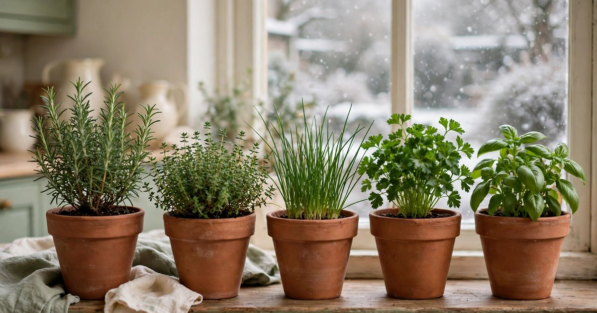
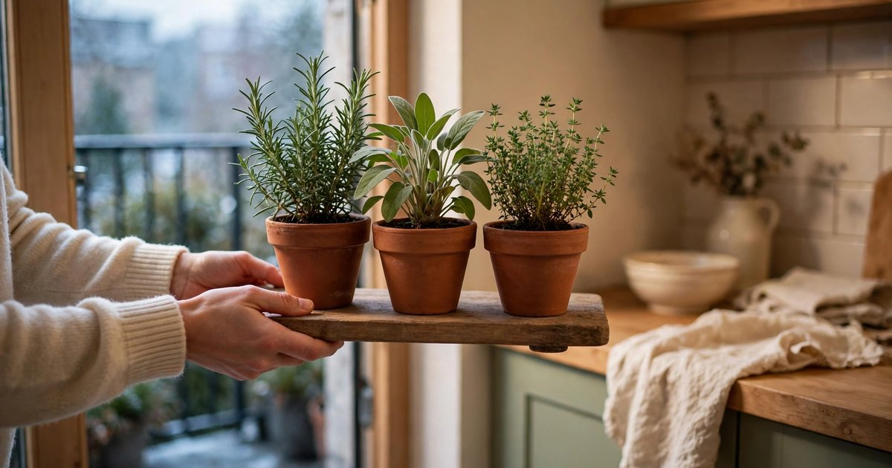
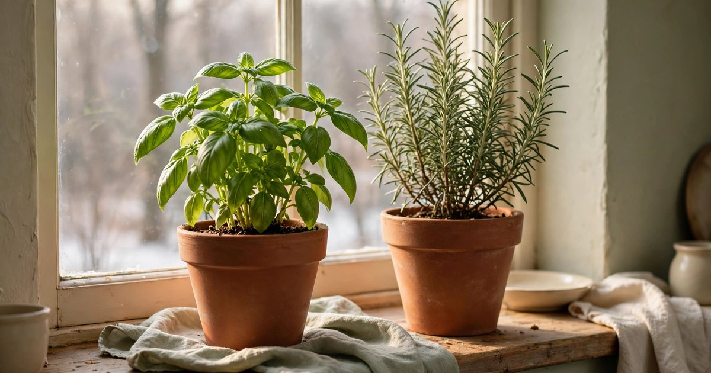
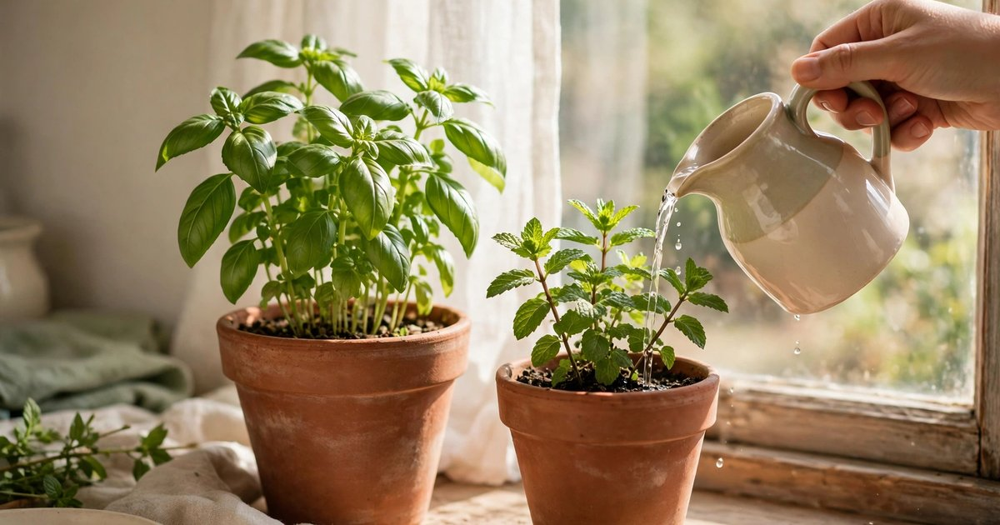
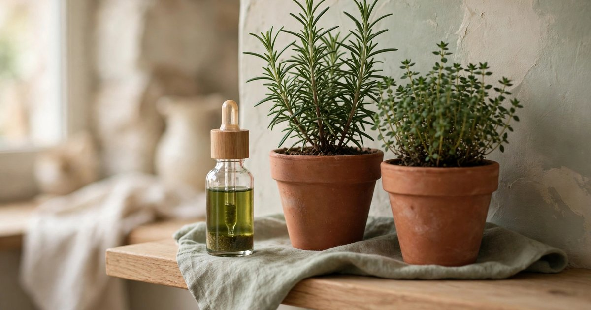
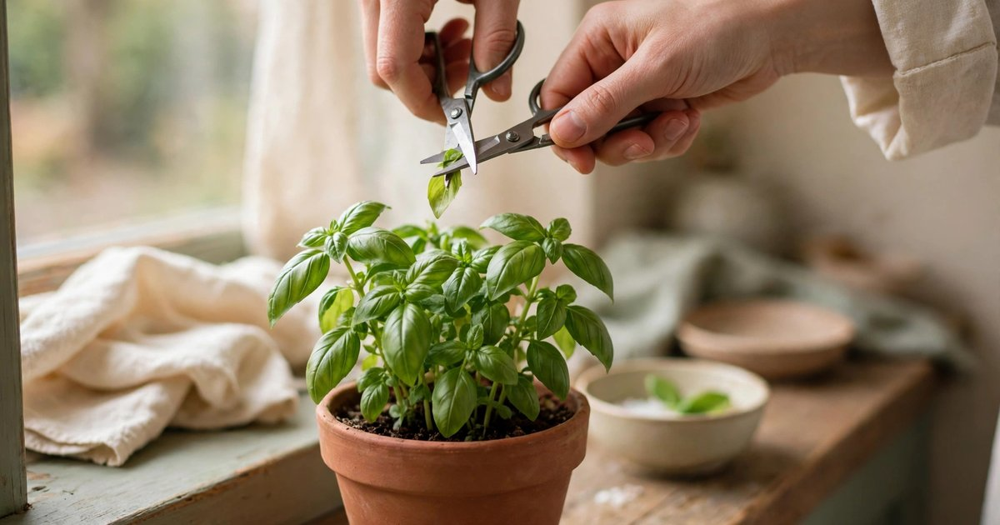
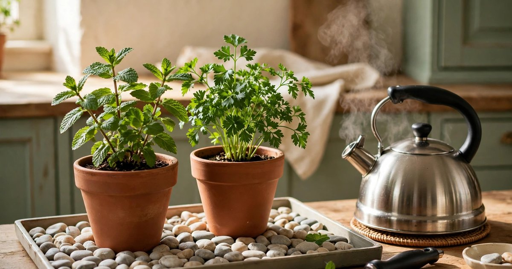
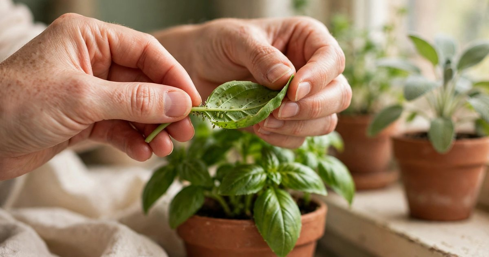

A pot of basil on the kitchen windowsill in November feels like a small act of defiance. Outside, the light is fading by four o'clock and the garden has gone quiet, but inside, that little plant is still putting out new leaves — and those leaves are going into tonight's pasta. That is the whole joy of an indoor herb garden in winter: fresh flavour, a bit of green in a grey season, and a living thing that asks very little of you in return. You do not need a greenhouse, a big budget, or a south-facing conservatory. A windowsill, a few terracotta pots, and a routine you can actually keep are enough.

The mistake most people make is treating winter herbs the same way they treated them in summer. In July, basil forgave everything, because the days were long and warm. In winter, the same plant is working with half the light, cooler air, and central heating drying the room out. The herbs that survive are the ones whose owners adjust: less water, more light, gentler feeding, and regular snipping.

### 1. Pick the Right Herbs for Winter Indoors

Not every herb is equally happy indoors in winter, so start with the ones that actually want to be there. Rosemary, thyme and chives are the hardy trio: they are used to cool weather, they grow slowly, and they tolerate the lower light of [a winter windowsill](/winter-windowsill-garden-guide/) without sulking. Parsley is nearly as forgiving and keeps producing leaves for months if you pick from the outside in. Mint is vigorous to the point of being a bully — give it its own pot, always, or it will crowd out its neighbours — but it is tough and bounces back from a hard cut. Basil is the diva of the group and the one most people lose first: it loves warmth, hates cold draughts, and will not forgive a windowsill that drops below about ten degrees at night, so give it your warmest, brightest spot. Choose four or five herbs you actually cook with, and buy small, healthy plants from a garden centre rather than starting from seed in November, when germination is slow and seedlings are leggy.

### 2. Move Herbs Indoors Before the First Frost

If your herbs spent the summer outside — on a balcony, a doorstep, or a fire escape — do not wait for the first frost to bring them in. One hard frost can finish basil overnight and set rosemary back weeks, and by the time you notice the blackened leaves, the damage is done. Bring them in while the nights are still mild, ideally when overnight temperatures start dipping towards seven or eight degrees. Harden them off in reverse: bring them in at night and put them back out during the day for three or four days, then keep them in permanently. Before they cross the threshold, check every leaf, top and underside, for aphids, whitefly and spider mites — one infested pot can spread pests to every plant in the flat within a fortnight. Give each pot a good rinse under the tap, pick off any yellowing leaves, and trim back any long, straggly stems by about a third so the plant is compact enough for a windowsill.

### 3. Give Them the Brightest Spot You Have

Light is the single biggest factor in winter herb survival, and it is the one most people underestimate. A windowsill that was blazing in June may get only a couple of hours of weak sun in December, and herbs need six hours of good light a day to grow properly. Your brightest window is almost always the south-facing one; east-facing is the next best, catching the morning sun, while a north-facing window in winter is really only good enough for mint and chives. Put your herbs as close to the glass as you can without them touching it — cold glass on a frosty night can scorch leaves — and turn the pots a quarter turn every week so they grow evenly instead of leaning towards the light. If your only window is north-facing or shaded by another building, a small [grow light](/grow-lights-dark-winter-apartments-under-25/) is the cheapest fix in this whole guide: a slim LED bar that sticks under a kitchen shelf costs less than a takeaway, and run on a plug-in timer for ten to twelve hours a day, it gives the herbs a consistent day length even when the sky is grey.

### 4. Water Less, But Water Properly

Winter watering is where most indoor herbs die, and the killer is almost always kindness. In summer, a herb in a terracotta pot on a sunny sill might need water every day. In winter, with short days, cool air and slow growth, the same plant may need water only once a week — sometimes less. The soil stays damp longer, the plant drinks more slowly, and roots sitting in cold, wet compost rot quietly until the plant collapses. The rule is simple and never fails: stick your finger two centimetres into the soil before you water. If it feels damp, walk away. If it feels dry, water. Do not water on a schedule, and never water just because it is Saturday. When you do water, water properly: give the pot a thorough soak until water runs out of the drainage holes, then tip the saucer away after ten minutes so the plant is never sitting in a puddle. Always use room-temperature water, not cold water straight from the tap, and water in the morning so any splashes on the leaves dry during the day.

### 5. Feed Gently Through Winter

Herbs are light feeders at the best of times, and in winter they need even less. A plant that is growing slowly in [low light](/low-light-indoor-plants-dark-apartments/) cannot use much fertiliser, and the excess salts build up in the compost, scorching roots and turning leaf tips brown. That is the opposite of the summer habit, when a weekly feed keeps basil pumping out leaves, and it catches a lot of people out. From November to February, feed at half strength, and only once a month at most. A balanced liquid seaweed feed is ideal: it is gentle, it is cheap, and it gives the plant a little of everything without pushing soft, leggy growth that the winter light cannot support. Skip the feed entirely if the plant is clearly dormant — rosemary and thyme barely grow in the depths of winter, and feeding a plant that is resting does it no good at all. The sign to look for is new growth: if you can see fresh leaves unfurling, a weak feed will help; if nothing has grown in three weeks, plain water is enough.

### 6. Prune and Harvest to Keep Them Bushy

The best thing you can do for a winter herb is to use it. Regular picking is not just cooking — it is pruning, and pruning is what keeps a herb bushy instead of tall, leggy and bare at the bottom. The rule for basil, mint and parsley is to pinch or snip the top of each stem just above a pair of leaves, which encourages two new shoots to grow from that point. Do it little and often, taking a few leaves from several stems rather than stripping one stem bare, and the plant will stay compact and keep producing all winter. For woody herbs like rosemary and thyme, snip the soft green tips rather than cutting into the old wood, which rarely regrows; a light trim every few weeks keeps them neat. Never take more than a third of the plant at once in winter, because the plant needs its leaves to photosynthesise in low light, and a hard cut in December can take weeks to recover from. The leaves you snip are dinner, so there is no waste: basil for pasta, thyme for roast vegetables, chives for scrambled eggs.

### 7. Raise the Humidity Without a Humidifier

Central heating is the quiet enemy of winter herbs. It keeps the flat warm, but it dries the air out, and herbs start to suffer: leaf edges turn brown and crisp, growth stalls, and spider mites — which love hot, dry air — move in. You do not need to buy a humidifier to fix it. The simplest trick costs nothing: stand the pots on a shallow tray filled with pebbles and water, with the bottom of the pot sitting on the pebbles, above the waterline. As the water evaporates, it [raises the humidity](/humidify-houseplants-without-humidifier/) right around the plants, which is exactly where it is needed. Top the tray up every few days and wash it out once a fortnight so it does not get slimy. The kitchen is naturally the most humid room in a small flat, thanks to kettles, cooking steam and the sink, which is one more reason it is the best home for a herb garden. A light misting once or twice a week helps basil and mint, but do it in the morning so the leaves dry before nightfall, and skip it for rosemary and thyme, which can develop mildew if they stay damp.

### 8. Watch for Pests and Problems

Winter pests are sneaky because they arrive with the plants and then thrive in the warm, still air of a heated flat. Aphids cluster on the soft new growth of basil and mint; whitefly flutter up in a little cloud when you brush a plant; spider mites are almost invisible, but they leave fine webbing under the leaves and a stippled, dusty look on top. Check your plants once a week, turning a leaf or two over to look at the underside, where most pests hide. Catching them early is everything: a dozen aphids wiped off with a damp cloth is a non-event, but a colony left for a month can finish a plant. The cheapest treatment is also the most effective for a kitchen herb you are going to eat: a strong spray of water to knock pests off, followed by a wipe with a cloth dampened in a weak solution of washing-up liquid and water, repeated every three or four days for a fortnight. Avoid chemical sprays on herbs you cook with, and never bring a new plant home without quarantining it on its own for a week first.

## A Windowsill That Works All Winter

You do not need a big kitchen or a green thumb to keep herbs alive indoors all winter — you need the brightest spot you have, a watering can you reach for only when the soil is dry, a pair of scissors you actually use, and a weekly glance at the undersides of the leaves. The herbs will repay you in the most practical way possible: a handful of basil in a pasta sauce, rosemary on roast potatoes, chives on scrambled eggs, mint in a cup of tea. Start with four or five plants you love to cook with, give them light and a little attention, and by the time the days lengthen in March, you will have a windowsill full of green and a kitchen that smells like a garden.

## Frequently Asked Questions

### Why is my basil dying indoors in winter?

Basil is the most cold-sensitive common herb, and it usually dies from cold or overwatering. Keep it in the warmest, brightest spot you have, away from cold window glass and draughts, water only when the top two centimetres of soil are dry, and never let it sit in a puddle. If the leaves turn black, the plant has been chilled and is unlikely to recover.

### How often should I water indoor herbs in winter?

Most indoor herbs need water only once a week in winter, sometimes less. Check the soil first with your finger: water only when the top two centimetres feel dry, then water thoroughly until it drains, and tip away any water left in the saucer after ten minutes. Rosemary and thyme need even less than basil and mint.

### Do indoor herbs need a grow light in winter?

They do if your only window is north-facing or heavily shaded. Herbs need around six hours of good light a day, and a small full-spectrum LED bar on a timer for ten to twelve hours a day is the cheapest reliable fix. On a bright south-facing windowsill, most herbs manage without one.

### Can I grow herbs from supermarket pots indoors in winter?

Yes, but supermarket pots are usually several seedlings crammed into one small pot, so they struggle. Split the clump gently into two or three smaller plants, repot each into fresh compost, trim the roots back a little, and give them a week in a bright spot to recover. They usually settle and grow well after that.

### Which herbs are easiest to keep alive indoors in winter?

Rosemary, thyme, chives and mint are the easiest — they tolerate cool air and lower light, and they forgive the odd missed watering. Parsley is nearly as forgiving. Basil is the hardest of the common kitchen herbs, because it needs warmth and strong light, so give it your best spot and your most careful watering.
