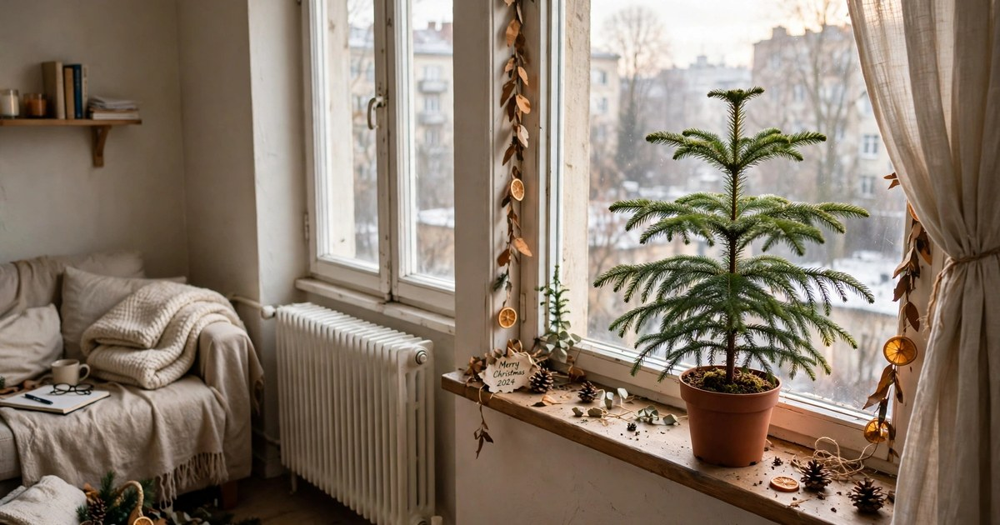
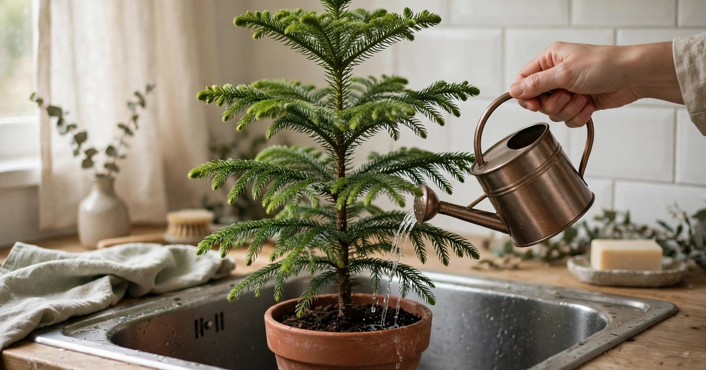
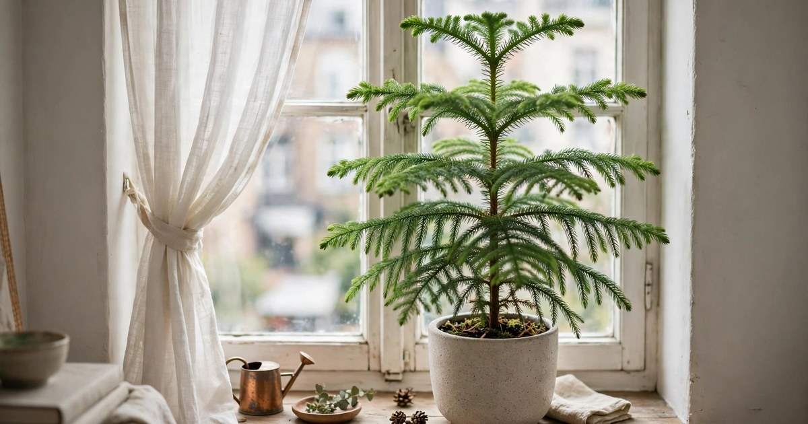
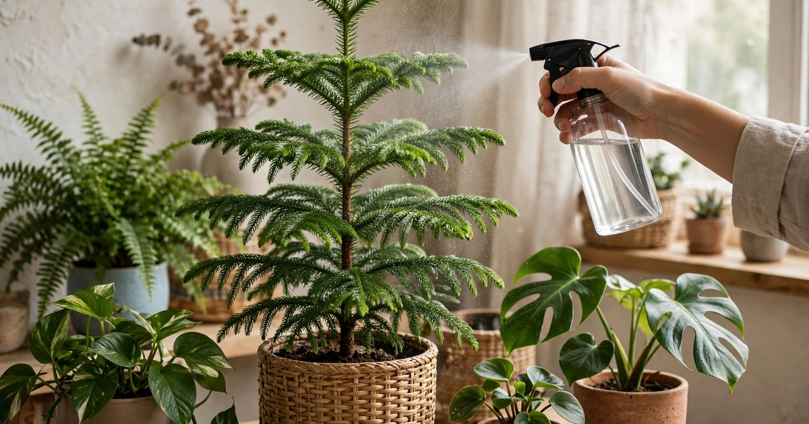
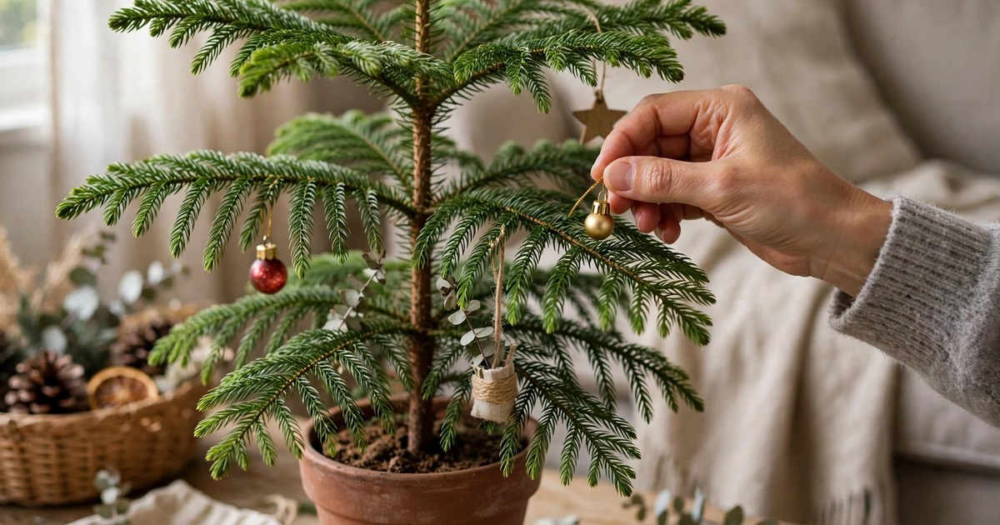
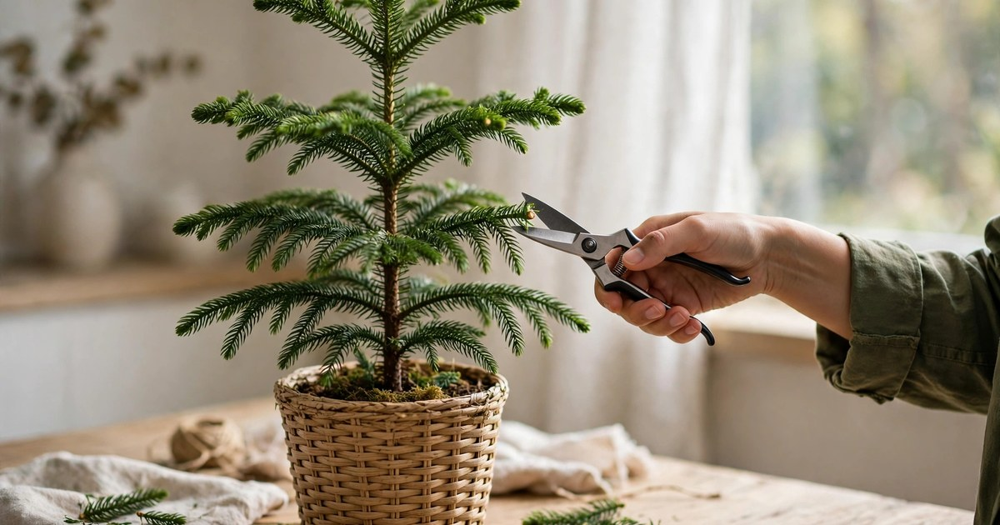
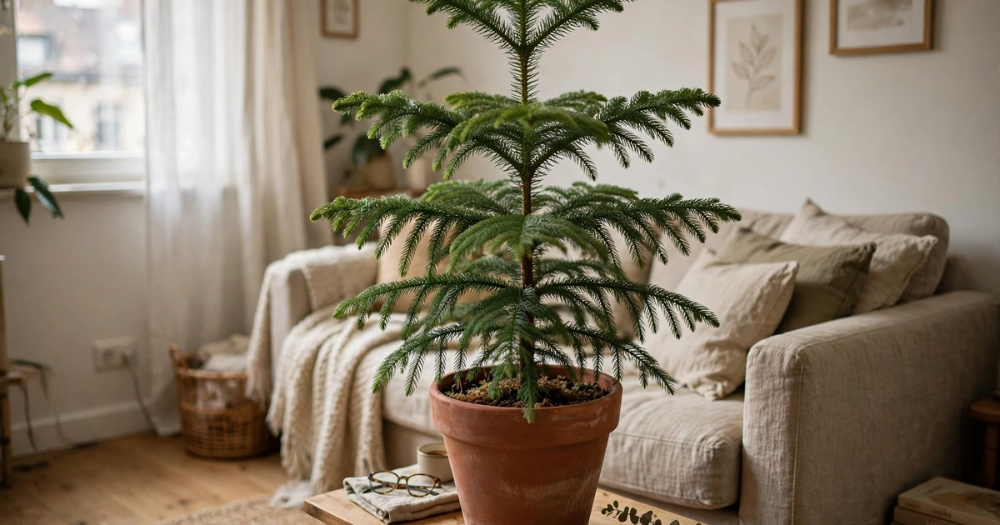
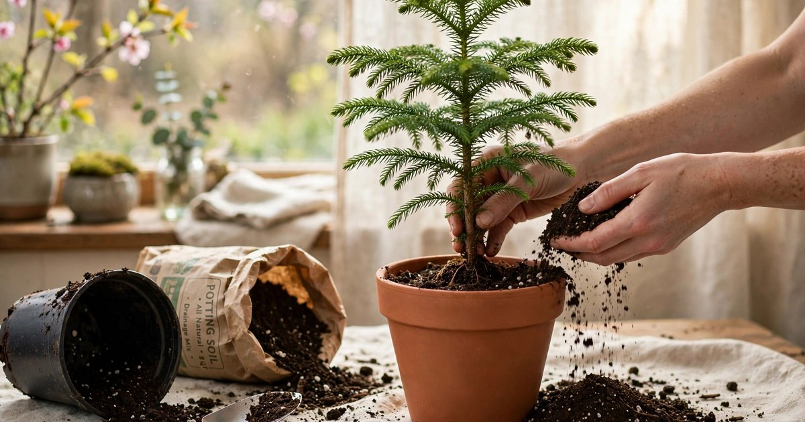

A Norfolk pine is the small-apartment Christmas tree that does not have to die in January. Unlike a cut tree, it is a living plant, and with a little care after the decorations come down it will grow into a handsome houseplant that lasts for years. Most Norfolk pines die because their owners treat them like Christmas decorations — kept in a hot room, watered when remembered, then abandoned — rather than like the tropical plant they are.

This guide covers the eight steps that keep a Norfolk pine alive through winter and into spring, from the day the baubles come off to the first new growth in March. None of it is difficult, none of it costs money, and all of it works in a small rented flat. Get these right and the little tree on your windowsill this Christmas becomes the big plant in the corner next Christmas.

### 1. Move It Away from the Heat

The first thing to do when Christmas ends is to move the Norfolk pine away from the radiator, the fireplace and any other heat source it spent December next to. Norfolk pines come from Norfolk Island in the South Pacific, where the air is mild and humid, and dry radiator heat is the fastest way to kill one. Brown, crispy branch tips in January are almost always heat damage, not a watering problem.

Put the tree in the coolest bright spot in the flat — a north- or east-facing windowsill, or a table near a window but out of direct sun. It can cope with a room at 15 to 20 degrees, and it would rather be slightly cool than warm and dry. Keep it away from draughty front doors too: cold blasts are almost as bad as radiator heat. If the only bright spot is near a radiator, put a tray of water beside the plant or hang a damp towel on the radiator to raise the humidity around it.

### 2. Set a Watering Routine

Norfolk pines like steady moisture, not floods and droughts. Water when the top two centimetres of soil feel dry — usually once a week in winter — and water thoroughly until it runs out of the drainage holes, then empty the saucer so the roots never sit in water. A plant that is watered a little every day stays soggy and rots; a plant that is drenched once a month dries out and drops branches.

Use room-temperature water rather than cold water straight from the tap, and water in the morning so the soil is damp during the day. If the soil has shrunk away from the sides of the pot, it has dried out completely: stand the pot in a bowl of water for twenty minutes so the soil rehydrates from the bottom up. Check the soil with a finger rather than a schedule, because a warm flat dries a pot out in days while a cool one takes a fortnight. For more on keeping plants alive through the festive season, see our [Norfolk pine decor ideas for Christmas](/norfolk-pine-decor-ideas-christmas/).

### 3. Give It Bright, Indirect Light

Light is the second thing a Norfolk pine needs after water, and winter is when it gets least. Give it the brightest spot you have that does not get direct midday sun — an east-facing window is ideal, a south-facing window with a sheer curtain works, and a north-facing window is acceptable if it is the best you have. Direct sun through glass scorches the soft needles, but too little light makes the branches droop and the growth leggy.

Turn the pot a quarter turn every week so all sides get light and the tree grows straight rather than leaning towards the window. If the lower branches are dropping and the top is reaching, the plant is telling you it needs more light — move it closer to the window or onto the windowsill itself. A Norfolk pine that gets enough light in winter will start pushing out soft new green tips in late February, which is the first sign it has survived.

### 4. Raise the Humidity

Central heating dries the air in a small flat to desert levels, and a Norfolk pine notices. Brown tips, dropping needles and a generally crispy look are all humidity problems. Mist the branches two or three times a week with a spray bottle, group the pine with other houseplants so they humidify each other, or stand the pot on a tray of pebbles with water in it — the evaporating water raises the humidity right around the plant.

A bathroom with a window is an excellent winter home for a Norfolk pine, because the steam from showers keeps the air humid and the light is usually good. If the plant has to stay in the living room, the pebble tray is the most reliable fix: fill a shallow tray with pebbles, add water to just below the top of the pebbles, and stand the pot on top so the roots never sit in the water. Refill the tray when it dries out, which in a heated flat is every few days.

### 5. Take the Decorations Off Gently

Taking the decorations off is where most Norfolk pines get damaged, because baubles and tinsel get tangled in soft branches and pulling them out snaps the growing tips. Remove ornaments one at a time, supporting the branch with your other hand, and unwind tinsel rather than pulling it. A snapped branch tip does not regrow, and a tree with several snapped tips looks lopsided for a year.

Take the lights off first, then the baubles, then any ribbon, and check each branch as you go for damage. If a branch is broken, trim it cleanly back to the main stem with sharp scissors rather than leaving a ragged tear. Put the decorations away in a labelled box while the tree is still in front of you, so next December you are not hunting for the baubles that fit a small tree.

### 6. Prune Lightly and Shape Carefully

A Norfolk pine rarely needs pruning, and when it does, less is more. In late winter, trim any dead or brown branch tips back to healthy green wood, and remove any branch that is crossing another or growing straight down. Never cut the top of the tree — the leading shoot is what keeps it growing upwards, and cutting it off makes the tree fork into two or three leaders and lose its Christmas-tree shape permanently.

Use sharp, clean scissors and cut at an angle just above a healthy side branch, so water runs off the cut rather than sitting on it. Do not prune in the depths of winter when the plant is barely growing; late February or March, when the days lengthen and new growth starts, is the right time. A Norfolk pine that is pruned once a year and otherwise left alone will keep its shape for years.

### 7. Style It as a Houseplant, Not a Tree

Once the decorations are off, the Norfolk pine needs to stop looking like a Christmas tree and start looking like a houseplant. Move it into a proper pot — terracotta suits it best, and the warm clay complements the soft green needles — and place it where a houseplant belongs: on a plant stand, a side table or the floor by a window, not in the middle of the room where the tree stood. A Norfolk pine in a terracotta pot with a clean saucer reads as a deliberate plant, not a leftover decoration.

Add a top dressing of small pebbles or moss over the soil to hide the bare compost and keep moisture in, and pair it with a trailing plant or a small fern nearby so it reads as part of a plant collection rather than a solitary survivor. If the tree still looks sparse after Christmas, be patient: new growth in spring fills out the branches, and by summer it will look like a different plant. For more winter plant styling, see our [winter greenery decor ideas that are not Christmas](/winter-greenery-decor-ideas-not-christmas/).

### 8. Repot in Spring, Not Winter

Do not repot a Norfolk pine in winter. The plant is barely growing, the roots are not taking up water quickly, and disturbing them in the cold season invites rot. Wait until March or April, when new growth starts, then move it into a pot just 3 to 5 centimetres wider than the old one — a pot that is too big holds wet soil around small roots and causes the very rot you are trying to avoid.

Use a free-draining houseplant compost with a handful of perlite or coarse sand mixed in, and make sure the new pot has drainage holes. Water thoroughly after repotting, then leave the plant alone for a week while it settles. A Norfolk pine only needs repotting every two or three years, so if the roots are not coming out of the drainage holes and the plant is growing well, leave it where it is — repotting a happy plant is a solution in search of a problem.

## Frequently Asked Questions

### Why is my Norfolk pine turning brown after Christmas?

Brown tips are almost always dry air or heat damage, not a watering problem. Move the tree away from radiators, raise the humidity with misting or a pebble tray, and trim the brown tips back to healthy green wood. New growth in spring will replace the damaged branches.

### How often should I water a Norfolk pine in winter?

Water when the top two centimetres of soil feel dry, usually once a week in a heated flat. Water thoroughly until it runs out of the drainage holes, then empty the saucer. Never let the roots sit in water, and use room-temperature water rather than cold water from the tap.

### Can a Norfolk pine live indoors all year?

Yes. Norfolk pines are tropical plants that grow indoors year-round in most climates, and they can live for decades as houseplants, reaching over a metre tall. Give them bright indirect light, steady moisture and humid air, and they will keep growing long after the Christmas decorations are packed away.

### Should I cut the top off my Norfolk pine to keep it small?

No. Cutting the top off a Norfolk pine makes it fork into two or three leaders and lose its symmetrical shape permanently. If the tree gets too tall, move it to a larger room or give it away — but never top it. Prune only dead or crossing side branches, in late winter or early spring.
