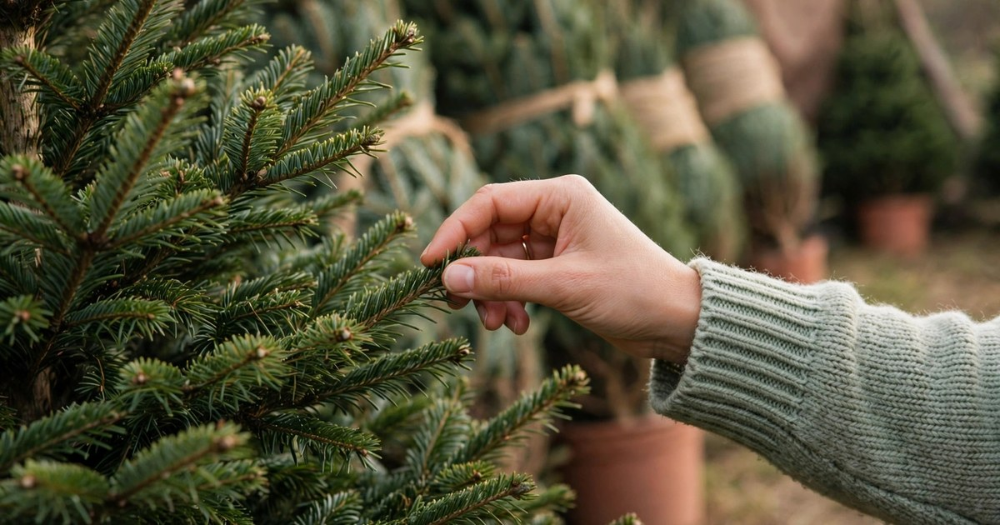
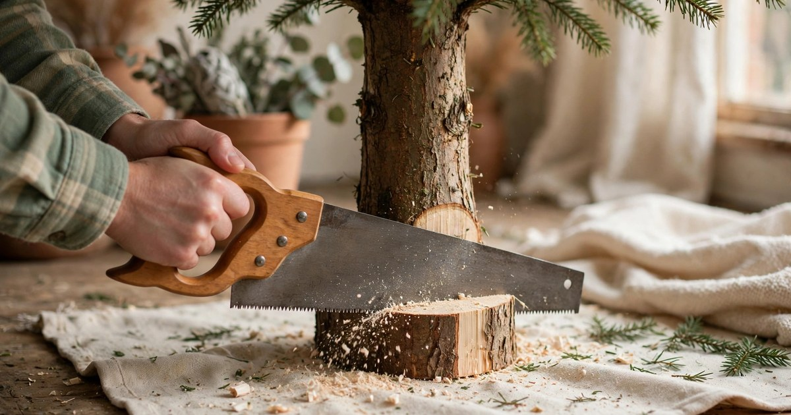
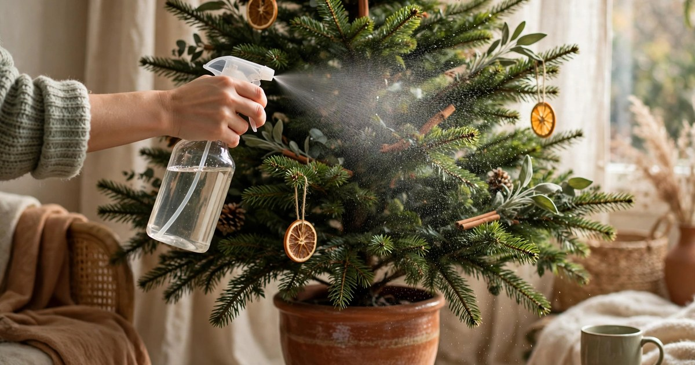

A real Christmas tree in a small apartment is a commitment: it smells wonderful, it looks wonderful, and it will punish you for every mistake by dropping needles across a floor you have to vacuum by hand. The good news is that keeping a real tree alive is not complicated — it is mostly about water, placement, and choosing the right tree in the first place. Follow these eight steps and your tree will still be green, fragrant, and firmly attached to its needles on New Year's Day.

### Step 1. Choose a fresh tree, not just a pretty one

Freshness is the single biggest predictor of how long a tree will last, and it is easy to check. Run your hand along a branch: fresh needles bend without snapping and stay attached when you tug gently. Lift the tree and drop it lightly on its base — a fresh tree drops almost no needles, while a dry one sheds a shower. Check the cut end of the trunk: it should be pale and slightly sticky with sap, not grey and dry.

In a small apartment, freshness matters even more, because a dry tree in a warm, small room deteriorates fast. Buy from a lot that stores trees upright and out of wind, not from a pile lying flat in the sun. Ask when the trees were cut — within the last week is ideal — and if you are buying early in December, choose a variety known for needle retention, like Nordmann fir or Noble fir, which hold their needles far longer than a spruce.

### Step 2. Make a fresh cut before it goes in the stand

A cut tree seals its trunk within hours of being cut, forming a layer of sap that blocks water uptake. That is why a tree that was fresh at the lot can still dry out at home: it cannot drink. The fix is a fresh cut — saw 2-3 centimetres off the base, straight across, just before you put the tree in its stand. This reopens the water channels and lets the tree drink properly for the first time since it was felled.

Do this at home, not at the lot, unless you are putting the tree straight into water within the hour. If the tree will sit in a hallway or on a balcony for a day before decorating, keep the cut end damp by wrapping it in a wet towel or standing it in a bucket of water. Never drill a hole in the base or whittle the sides — both are old myths that reduce, rather than improve, water uptake, because they damage the very channels the tree drinks through.

### Step 3. Pick a stand that holds enough water

A tree drinks astonishing amounts of water in its first days — a large tree can take in 3-4 litres in the first 24 hours — and a stand that holds only a cupful will run dry before you notice. Choose a stand with a reservoir of at least 4 litres, and check that it grips the trunk firmly without needing to whittle the trunk down to fit. A wobbly tree in a small flat is a disaster waiting for a cat, a child, or a careless elbow.

In a small apartment, the stand also needs to fit the space: measure the footprint before you buy, and remember that the stand plus the lowest branches need more floor than the trunk alone suggests. Put a waterproof tray or an old towel under the stand — water spills happen, especially when you are topping up in the dark — and check the water level every morning, not just when you remember. A tree that runs dry for even a few hours starts sealing its trunk again.

### Step 4. Keep the tree away from heat sources

Heat is the fastest killer of a real Christmas tree, and small apartments are full of it: radiators, fireplaces, underfloor heating, and televisions that run hot. A tree next to a radiator can lose its needles in a week, while the same tree across the room lasts a month. Place the tree in the coolest corner of the room, away from radiators, vents, and south-facing windows that get strong winter sun.

This is also a safety rule, not just a care tip. A dry tree near a heat source is a fire risk, and in a small flat the distance between a tree and a radiator is often shorter than you think. Keep at least a metre between the tree and any heat source, and if the only available corner is near a radiator, turn that radiator down or off for December — the tree's own presence and the room's other heating will usually compensate, and your needles will thank you.

### Step 5. Water daily, and water properly

Watering is the step everyone knows and almost everyone underdoes. A real tree needs its stand reservoir kept full, every single day, for the whole of December. Check it every morning as part of your routine — while the kettle boils, for example — and top it up before it drops below the cut end of the trunk. The moment the water level falls below the cut, the trunk starts sealing again, and no amount of later watering fully reopens it.

Plain tap water is all a tree needs. The old additives — sugar, aspirin, bleach, fizzy drinks — have been tested repeatedly and make no measurable difference, and some can actually harm the tree or leave residue in the stand. What matters is quantity and consistency: keep the reservoir full, every day, without fail. If you are away for a weekend, ask a neighbour to top it up, or use a large reservoir stand that holds several days' worth — a dry weekend can undo three weeks of careful watering.

### Step 6. Mist the branches to slow needle loss

Small apartments in winter are dry — central heating, sealed windows, and small rooms all push the humidity down, and dry air pulls moisture out of needles faster than the trunk can replace it. Misting the branches with a spray bottle every day or two slows this down noticeably, especially on the outer branches that dry first. Mist in the morning so the branches dry during the day, and keep the spray light rather than drenching.

Misting also helps with the other small-apartment tree problem: dust and static. A light mist settles the dust that collects on branches in a small, lived-in room, and it keeps the tree smelling fresh rather than dusty. Be careful with electrical decorations — mist with the lights off, let the branches dry before switching them back on, and never mist directly onto plugs or transformers. A few minutes of care here buys you a week or more of extra green.

### Step 7. Decorate light to protect the branches

Heavy ornaments are the enemy of a small-apartment tree, because small trees have thinner, weaker branches than the big trees they imitate. A heavy glass bauble on a thin branch bends it downward, stresses the branch, and accelerates needle loss on that branch. Use lightweight ornaments — plastic, felt, wood, and paper — on the outer and upper branches, and save anything heavy for the thickest branches near the trunk, where it can be supported properly.

String the lights before the ornaments, and keep the light strings light too — LED strings are far lighter than old incandescent ones and run cool, which matters for a tree that is already fighting dry air. When you decorate, work from the inside out and the top down, so you are not reaching through finished branches and snapping them. A tree decorated gently lasts longer than one decorated enthusiastically, and it looks better too, because the branches hold their natural shape.

### Step 8. Know when to let go, and recycle properly

Even a perfectly cared-for tree has a lifespan, and knowing when to retire it is part of keeping it alive — because a tree kept too long becomes a fire risk, not a decoration. The signs are clear: needles that fall in handfuls when you brush a branch, branches that snap rather than bend, and a trunk that no longer takes up water even when the reservoir is full. When you see all three, it is time, even if it is only the 28th of December.

Take the tree down carefully — remove ornaments first, then lights, then carry it out in a sheet or a tree bag to contain the needles — and recycle it properly. Most councils run a Christmas tree collection in January, and many turn collected trees into mulch or compost. A tree that spent December in your flat and January as mulch has had a good life; a tree left to dry out in a hallway until February is a fire hazard and a mess. Check your council's collection dates before Christmas, so the tree's exit is planned, not panicked.

## A Tree That Lasts the Season

Keeping a real tree alive in a small apartment comes down to three things, repeated daily: water, cool air, and gentle handling. Choose fresh, cut fresh, stand it in a big reservoir, keep it away from heat, water it every morning, mist it when the air is dry, decorate it lightly, and retire it when it tells you it is done. None of this is difficult; all of it is easy to forget on a busy December day. Put the watering into your morning routine, next to the kettle, and the tree will mostly take care of itself.

The reward is a tree that still smells like a forest on New Year's Eve, still holds its needles when you take the ornaments off, and still feels like the best decision you made all December. In a small flat, that is no small thing.

## Frequently Asked Questions

### How much water does a real Christmas tree need per day?
A freshly cut tree can drink 3-4 litres in its first 24 hours, then settles to around 1 litre a day. Keep the stand reservoir full every day — check it every morning — and never let the water level drop below the cut end of the trunk, or the trunk will seal and stop drinking.

### Why is my Christmas tree dropping needles already?
The most common causes are a dry stand, a tree placed near a radiator or other heat source, and a trunk that sealed before it went into water. Check the water level first, move the tree away from heat if needed, and mist the branches to slow further loss. A tree bought already dry will drop needles no matter how well you care for it, which is why freshness at purchase matters most.

### Should I add sugar or aspirin to my Christmas tree water?
No — plain tap water is all a tree needs. Sugar, aspirin, bleach, and fizzy drinks have been tested and make no measurable difference to needle retention, and some can leave residue in the stand. What matters is keeping the reservoir full, every day, without fail.

### How long will a real Christmas tree last in a warm apartment?
With daily watering, a cool spot away from radiators, and regular misting, a fresh fir will last 4-5 weeks — comfortably from early December to New Year. In a very warm flat, or with a tree that was already dry at purchase, expect 2-3 weeks. If needles fall in handfuls and branches snap, retire the tree: it has become a fire risk.
