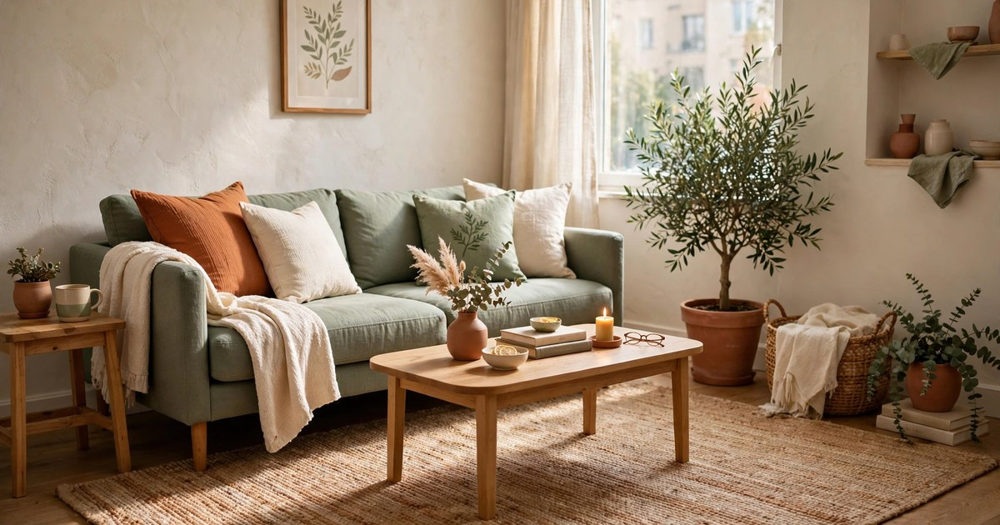
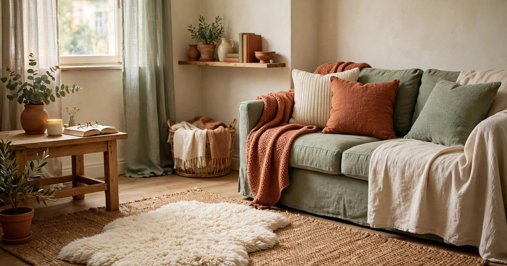
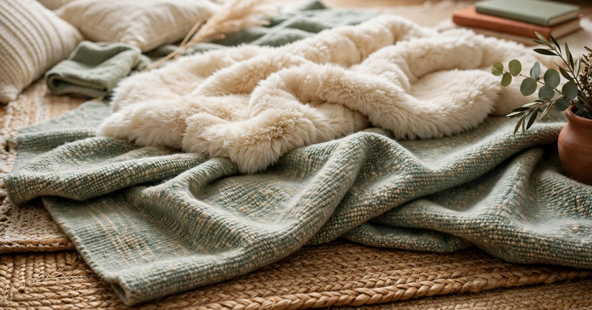
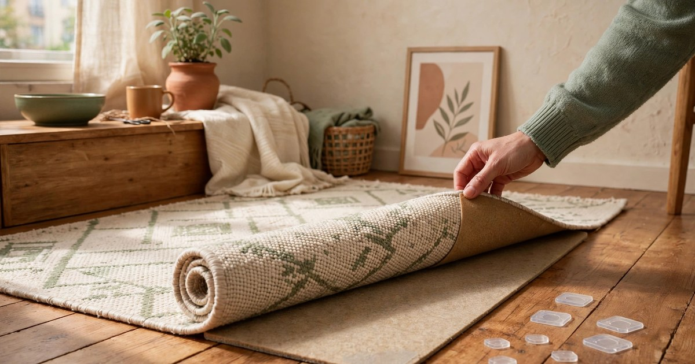
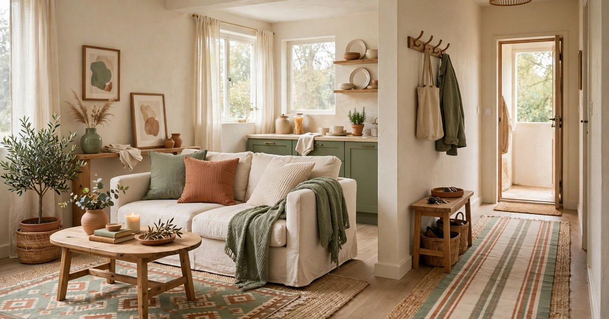
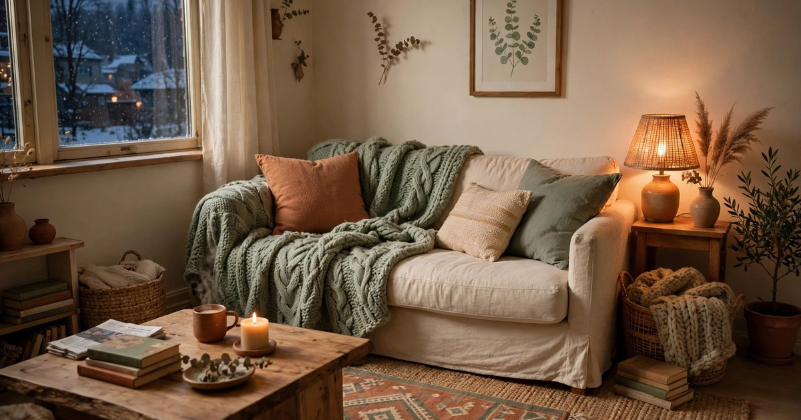
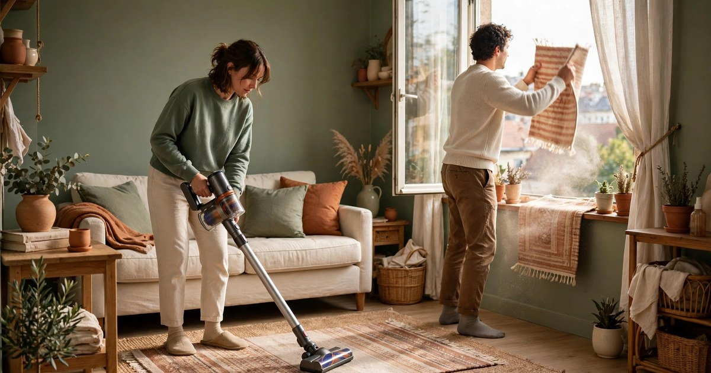

A bare floor in winter is the enemy of a cosy small apartment. Wood, tile and laminate look lovely in summer, but on a cold morning they suck the warmth straight out of your feet — and in a rental you cannot rip them up, lay underfloor heating or glue anything down. Layering rugs is the renter-friendly answer: two (or even three) rugs, stacked with intention, insulate a cold floor far better than one, soften the echo of a hard-floored room, and make a small space feel finished and warm. Best of all, nothing is fixed to anything, so every layer moves with you when your tenancy ends.

Layering sounds fancy, but it is really just common sense with a little planning. A big, flat rug goes down first to cover the cold floor and define the room. A smaller, softer rug goes on top where your feet actually land. Texture, colour and pattern do the rest. Done well, a layered floor looks like a deliberate design choice rather than a pile of rugs you could not decide between — and it costs far less than you might think, especially if you start with the budget-friendly picks in our guide to [cosy winter rugs under $25](/cosy-winter-rugs-small-rentals-under-25/). Follow the eight steps below and your small apartment will feel warmer by tonight.

### 1. Measure First: Get the Sizing Right

Every good layered floor starts with a tape measure, not a shopping basket. In a small apartment the margin for error is tiny: a base rug that is too small makes the room feel chopped up, while one that is too big creeps under furniture and bunches at the edges. Measure the area you want to cover, then subtract about 15–20 cm from each side so a border of floor shows around the rug — that breathing room is what makes a small space feel bigger rather than carpeted wall to wall.

For a living room, the base rug should be large enough for the front legs of your sofa and chairs to sit on it. In a bedroom, it should extend at least 45 cm beyond each side of the bed, so your feet land on rug, not cold floor, when you get up. Hallways and kitchens need a runner or a narrow rectangle that leaves a clear walking path. Write the measurements down and keep them on your phone when you shop, because rug sizes are rarely standard and "small" means something different to every seller.

If you are torn between two sizes, go bigger for the base layer — you can always overlap a smaller rug on top, but you cannot stretch a rug that is too small. And remember that layering forgives a lot: a base rug that is slightly off in colour or pattern disappears under the top layer, so spend your sizing energy on the bottom rug and your style energy on the one you will actually see.

### 2. Start with a Big, Flat Base Rug

The base layer is the workhorse of your layered floor, and it should be flat, firm and forgiving. A low-pile or flat-weave rug — jute, cotton, a thin wool blend or a washable flat-weave — covers the cold floor, adds a first layer of insulation and gives the softer rug on top something stable to sit on. Avoid a thick shaggy rug as your base: it is uneven, it slides, and the top rug will never lie flat on it.

Keep the base rug neutral. Natural jute, warm cream, soft grey or a muted terracotta lets the top layer carry the colour and pattern, and a plain base works with every cushion, throw and curtain you already own. It also means you can swap the top rug with the seasons — a light cotton layer in summer, a deep shaggy one in winter — without buying a new base every time. A neutral base is the most versatile thing you will buy for your floor.

Budget-wise, the base rug is where to spend the least. Because it is mostly covered, nobody will admire its pile — they will feel its warmth and see its edges. A good-sized flat-weave rug under $25 does the job perfectly, and washable options are a gift in a small flat where the rug is also the dining room, the hallway and the dog's favourite spot. Look for a [flat-weave jute rug](https://www.amazon.com/s?k=flat+weave+jute+area+rug+large&tag={{AMAZON_TAG}}) in the largest size your room and budget allow, and let it do the quiet, heavy lifting.

### 3. Add a Smaller, Softer Rug on Top

Now comes the fun part: the top rug, the one your feet actually meet. This is where the softness lives, so choose pile over practicality. A plush shaggy rug, a faux fur throw rug or a thick wool-blend rug in a smaller size — roughly two-thirds the width of your base rug — goes on top, placed where bare feet land most: beside the sofa, beside the bed, or in the middle of the living room where you sit on the floor with a cup of tea.

Position matters more than perfection. Centre the top rug on the base, or angle it slightly for a relaxed, lived-in look — a small rotation of ten or fifteen degrees stops a layered floor from looking like a showroom display. In a bedroom, place it so it peeks out from under the bed on the side you get out of; in a living room, let it sit under the coffee table with its edges visible on all sides. The overlap is the point: the eye should read two distinct layers, not one rug hiding another.

This is also the layer where colour and pattern earn their keep. A deep terracotta, sage green or warm blush top rug adds the winter colour a small room needs, while a subtle pattern — a faded vintage print, a simple geometric — adds interest without overwhelming the space. Keep one layer plain and let the other carry the pattern; two busy patterns fighting on the same floor is the fastest way to make a small room feel chaotic. If you need inspiration for affordable top layers, our [cosy winter rugs under $25](/cosy-winter-rugs-small-rentals-under-25/) roundup is full of plush, shaggy and faux fur picks that work beautifully as a second layer.

### 4. Mix Textures for Warmth That You Can Feel

A layered floor should feel warm as well as look warm, and that comes from mixing textures rather than matching them. Pair a firm, flat base with a soft, deep top: jute under wool, cotton under faux fur, a woven flat-weave under a shaggy pile. The contrast is what makes each layer noticeable, and the combination traps more air — and therefore more warmth — than two rugs of the same texture ever could.

Think in threes when you shop: one rough or natural texture, one soft texture, and one smooth one somewhere nearby, such as a velvet cushion or a knitted throw on the sofa. That trio stops a room from feeling flat, and it gives a small space the layered, collected feel that makes winter interiors so inviting. A sheepskin-style throw draped over the top rug's edge, or a small faux fur mat beside the bed, adds another texture without another full rug.

Texture also hides the practical sins of small-space living. A busy weave forgives crumbs, pet hair and the odd muddy footprint far better than a smooth plain rug, which is worth remembering if your layered floor sits in a high-traffic spot. Choose darker or mottled textures for hallways and entryways, and save the pale, fluffy layers for the bedroom and the sofa area, where they stay cleaner for longer. The result is a floor that looks intentional, feels warm underfoot, and survives real life.

### 5. Keep Rugs in Place Without Damaging Rental Floors

Layered rugs slide. Two rugs on top of each other, on a smooth wood or tile floor, will creep apart within a day unless you anchor them — and in a rental, the fix must leave zero trace. Never use double-sided tape, glue or anything adhesive directly on a rental floor: it leaves residue, can lift varnish, and can cost you part of your deposit. The renter-safe answer is a non-slip rug pad and rug grippers.

Start with a thin non-slip rug pad under the base rug, cut slightly smaller than the rug itself so it does not peek out at the edges. A felt-and-rubber pad grips the floor without sticking to it, adds a little extra insulation, and stops the base layer from bunching. Then, between the two rug layers, use small reusable rug grippers — the corner pads that cling by grip rather than glue. They hold the top rug in place, peel off cleanly, and can be reused when you rearrange or move flat.

Check the grip every couple of weeks, especially in the first month, and lift the layers to air them out and check the floor beneath — trapped moisture is the real enemy of a rental floor, not the rug itself. If a corner keeps curling, a small, heavy object like a book or a plant pot will train it flat over a few days. And when you move out, the whole system lifts away in minutes, leaving the floor exactly as you found it — which is the whole point of renter-friendly decorating.

### 6. Layer by Zone: Living Room, Bedroom and Hallway

In a small apartment, rugs do more than warm your feet — they draw the map of the room. An open-plan living area, a studio flat or a combined living and dining space has no walls to separate one zone from another, and layered rugs are the gentlest way to mark where each zone begins and ends. Use a different layering recipe in each zone so the flat feels organised rather than cluttered.

In the living room, go boldest: a large flat base rug under the sofa and coffee table, with a smaller plush rug on top in the centre. In the bedroom, go softest: a flat base that extends past the bed, with a thick, fluffy rug beside it where your feet land first thing in the morning. In the hallway, go toughest: a narrow flat-weave runner as the base, with a small washable rug on top at the door to catch winter mud and wet boots. The hallway top layer is the one you will wash most, so make it the cheapest and most washable of the three.

Keep the colour story consistent across zones — the same terracotta, sage or cream family throughout — so the flat feels like one home rather than three separate rooms. Repeating one colour in each zone ties the layers together, even when the textures differ. If your flat is draughty as well as cold-floored, pair your rug layers with the fixes in our [winter-proofing guide for draughty rentals](/winter-proof-drafty-rental-guide/), and the whole space will feel warmer, not just the floor.

### 7. Add Winter Warmth Around the Edges

Rugs warm the floor, but a cosy winter room needs warmth at every level — and the layers on your floor work best when the rest of the room echoes them. Drape a knitted or fleece throw over the arm of the sofa so it hangs down towards the rug, stack a couple of textured cushions in the same palette as your top rug, and let a warm-toned throw blanket spill onto the floor beside the sofa. The eye travels from rug to cushion to throw and reads the whole room as warm, not just the floor.

Lighting does the same work after dark. A small warm-white lamp or a string of fairy lights at floor level bounces soft light off the rug pile and makes the texture glow, which is far cosier than a single harsh ceiling light. Our [renter-friendly winter lighting ideas](/renter-friendly-winter-lighting-ideas/) are full of damage-free options — adhesive-free, freestanding and battery-powered — that pair perfectly with a layered floor.

Finally, mind the edges. A rug layer that stops a few centimetres short of a cold draught from a door or window feels like a job half done, so pull the base rug closer to the draughty side of the room, or add a small extra rug — even a cheap door mat in a matching tone — at the threshold. Little edges of cold floor are what your feet notice at 7 a.m., and covering them is the cheapest warmth you will buy all winter.

### 8. Clean and Care for Layered Rugs

Layered rugs trap dust between the layers, so they need a slightly different cleaning routine from a single rug — but it is a simple one, and it keeps both layers looking and smelling fresh all winter. Once a week, lift the top rug and vacuum the base rug underneath, then vacuum the top rug on both sides before laying it back down. It takes five minutes and stops grit from grinding into the fibres of the bottom layer.

Shake smaller top rugs outside when you can, and spot-clean spills immediately with a damp cloth and a little mild soap — never soak a layered rug in place, because water trapped between two layers takes days to dry and can smell musty. For winter mud and salt, a washable top rug is worth its weight in gold: pop it in the machine on a gentle cycle, dry it flat, and it is back on the floor the same day. Keep a [washable small rug](https://www.amazon.com/s?k=washable+small+area+rug+machine+washable&tag={{AMAZON_TAG}}) as your hallway or kitchen top layer, where it will earn its keep.

At the end of winter, roll both layers separately — never fold a rug, which creases the pile — and store them somewhere dry with a cedar block or a lavender sachet to keep moths away. When the cold returns, unroll the base, lay the top rug back on it, and your warm floor is back in ten minutes. That is the real beauty of layering: it is seasonal, flexible and entirely reversible, just like all good renter-friendly decorating.

## Frequently Asked Questions

### Can you layer rugs on carpet in a rental?

Yes, and it works well. A flat-weave rug over rental carpet adds warmth and defines a zone, while a soft top rug adds the comfort. Use a non-slip pad between the carpet and the base rug to stop creeping, keep the base rug flat and low-pile so doors still clear it, and avoid anything with a rubber backing that could mark the carpet underneath.

### How many rugs can you layer in a small apartment?

Two is the sweet spot for a small apartment: a flat base and a soft top. A third layer works only as a tiny accent — a sheepskin-style throw or a small mat beside the bed — and only if the room still has clear walking space. More than that, and the floor starts to look cluttered and becomes a trip hazard.

### Will layered rugs damage a wooden rental floor?

Not if you layer them correctly. Use a felt-and-rubber rug pad underneath, never tape or glue, and lift the rugs every couple of weeks to air the floor beneath. Trapped moisture is the risk, not the rugs themselves, so keep the layers dry and never let a wet rug sit on wood.

### What size should the top rug be compared to the base rug?

Aim for the top rug to be about two-thirds the width of the base rug, so a clear border of the base shows on all sides. That visible border is what makes the layering read as intentional. If the top rug is almost the same size as the base, the layers blur together and the effect is lost.

### Are layered rugs warm enough to replace slippers?

They make a real difference — a double layer of rug insulates a cold floor far better than a single one, and your feet will notice it immediately. On the coldest mornings you may still want slippers, but a well-layered floor turns a freezing floor into a comfortably cool one, which is a big win in a draughty rental.
