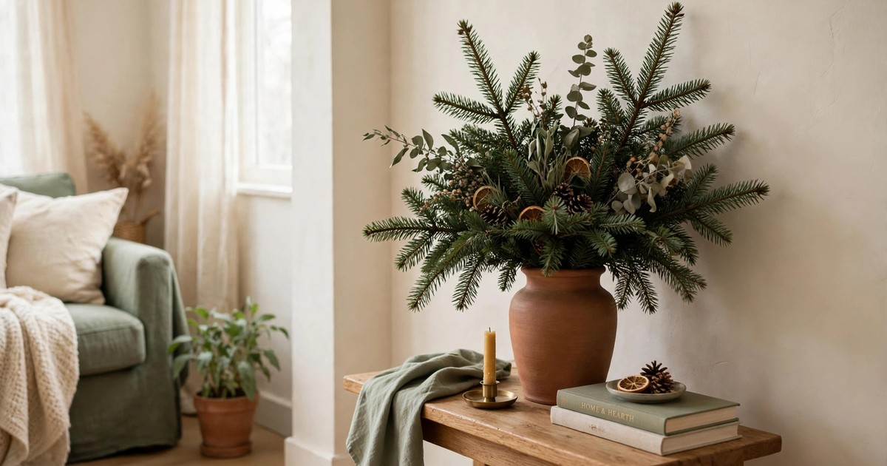
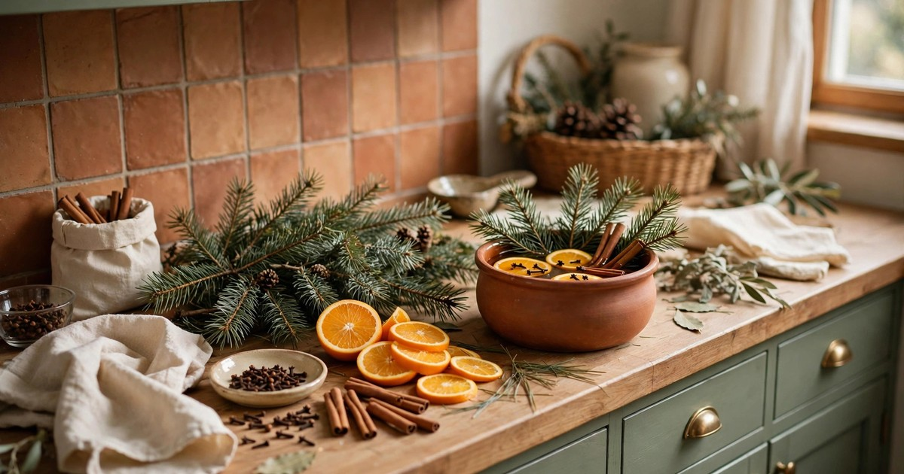
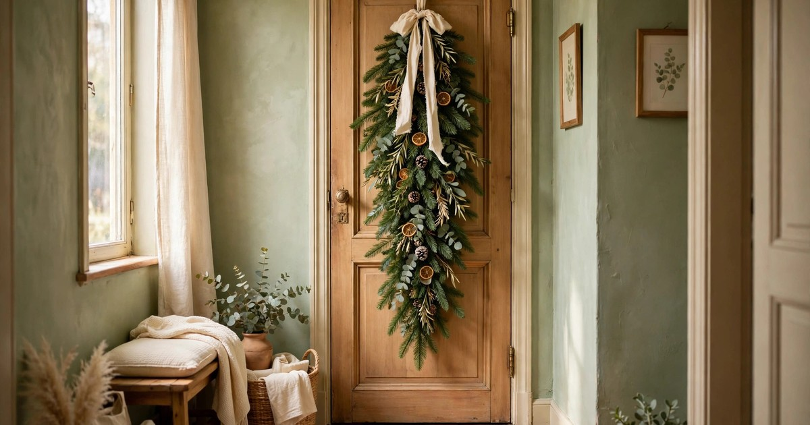
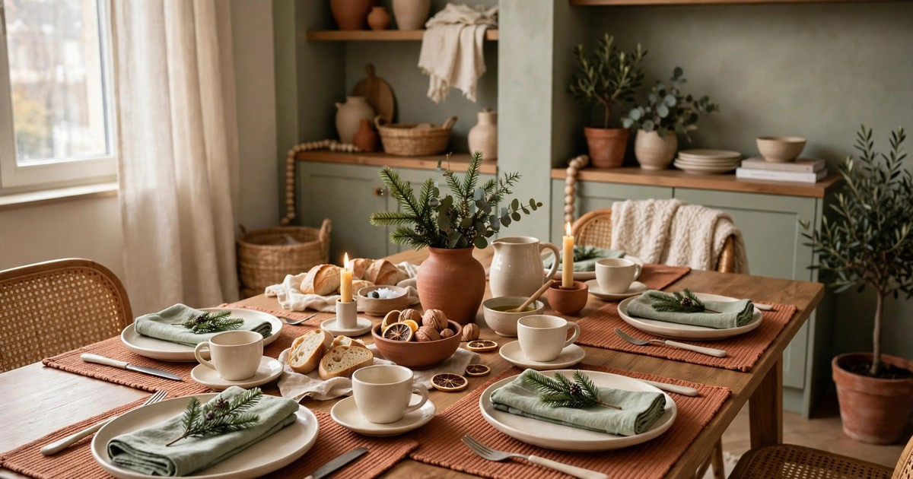

Every [Christmas tree](/small-apartment-christmas-tree-ideas/) leaves a pile of branches behind. The bottom is trimmed so the tree sits straight in its stand, the sides are shaped to fit the corner, and by the time the tree is up, there is a small forest of offcuts on the floor. Most of them go straight in the bin, which is a shame — those branches are free, fresh, fragrant greenery, and they are exactly the material that florists charge good money for.

Before you throw them away, look at what you have: short, sturdy branches with dense needles, already cut and ready to use. They will not last as long as a whole tree, but they will last two to three weeks with a little care, which is plenty for the festive season. Here are ten ways to turn tree offcuts into decor that looks deliberate, costs nothing, and fills a small apartment with the smell of Christmas.

### 1. A mini wreath for an interior door

The classic use, and still the best. Take a small wire frame — or bend a coat hanger into a circle — and wire short branches around it in overlapping bundles, working in one direction until the ring is full. A mini wreath made from tree offcuts is perfect for an interior door, a bedroom door or a bathroom door, where a full-size wreath would be too much. It takes twenty minutes and a handful of branches.

What makes this work so well is scale. Interior doors in small apartments are narrow, and a small wreath suits them far better than a shop-bought one designed for a front door. Hang it from an over-door hook or a removable adhesive hook, and it comes down in January without a mark. Add a single dried orange slice or a small pinecone if you like, but the branches alone — dense, fresh and fragrant — are honestly enough.

### 2. A garland for the mantel or shelf

Lay branches end to end along a mantel, a shelf or the top of a bookcase, overlapping each one over the stems of the last, and you have a [garland](/renter-friendly-christmas-garland-ideas/) that cost nothing. No wiring needed if the surface is flat — gravity does the work — though a few twists of florist wire will hold it together if you want to drape it over a doorway or a picture rail. Tuck in a string of [fairy lights](/hang-christmas-lights-rental-guide/) and the whole display glows.

This is the easiest idea on the list and one of the most effective, because a garland transforms a surface that otherwise sits empty. In a small apartment, the top of a bookcase or a long shelf is often the only horizontal surface available for festive display, and a branch garland fills it beautifully. Mist it lightly every few days to keep it fresh, and it will last until the tree comes down. When it finally dries out, it still looks good — dried pine has a rustic charm all its own.

### 3. A fragrant bundle in a vase

The simplest idea of all: gather three or four branches, trim them to different lengths, and stand them in a vase, a jug or even a large jar. It looks like a deliberate floral arrangement, it costs nothing, and it brings the smell of the tree into a room the tree is not in — the bedroom, the bathroom, the hallway. Add a few bare twigs or a stem of eucalyptus if you have them, and the arrangement gains height and texture.

This works because branches in a vase read as intentional, not leftover. The trick is the vase: choose one with a bit of weight and a narrow enough neck that the branches stand upright rather than splaying. A terracotta pot, a ceramic jug or a tall glass all work. Keep the water topped up — branches drink surprisingly fast — and change it every few days to prevent a stale smell. One vase of branches by the bed will make the whole bedroom smell like Christmas morning.

### 4. A natural table runner

Lay short branches flat down the centre of the dining table, overlapping them slightly to form a loose, natural runner, and you have a centrepiece that took five minutes and cost nothing. Tuck a few tealights in glass holders among the branches — never directly on the foliage — and add a scattering of pinecones or dried orange slices for colour. The table looks dressed, the room smells wonderful, and the whole display lifts off in one motion when dinner is served.

The key safety rule here is the candles: always in glass holders, always with a gap between flame and foliage, and never left unattended. If that feels too risky, battery tealights give the same glow with no worry at all. The branch runner works best on a table that is not too crowded — it needs a clear strip down the centre — but on a small table, a slim line of branches takes up far less room than a traditional centrepiece and looks far more natural.

### 5. Gift wrapping with a sprig

A small sprig of tree branch tucked under the twine on a wrapped gift is the kind of detail that makes people stop and look. It turns plain brown paper into beautiful wrapping, it costs nothing, and it makes every gift under the tree smell faintly of pine. Cut sprigs about 10 centimetres long, tie them to the parcel with twine or ribbon, and add a dried orange slice or a cinnamon stick if you want to go further.

This idea earns its place because it solves the wrapping problem and the decoration problem at once. Gifts are already part of the Christmas display — they sit under the tree for days or weeks — so decorating them decorates the room. Keep the sprigs small and fresh, and wrap gifts a day or two before giving them so the foliage does not dry out and shed all over the recipient. In a small apartment, where every surface is on display, beautifully wrapped gifts are genuinely part of the decor.

### 6. A scented simmer pot ingredient

Not every branch needs to be displayed — some can be used for scent. A small handful of pine needles and a short branch tip, simmered in a pot of water with orange peel, cinnamon sticks and cloves, will fill a small apartment with Christmas scent within half an hour. This is the fastest, cheapest air freshener there is, and it uses the smallest, scraggliest offcuts that are too thin for decorating.

The simmer pot is worth knowing about because scent is the most powerful festive cue and the one that takes up no space at all. Set the pot on the lowest heat, keep an eye on the water level, and let it simmer for an hour before guests arrive or while you are wrapping gifts. The smell will linger long after the pot is off the stove. Use only clean, untreated branches — never branches that have been sprayed with artificial snow or flame retardant — and compost the pot's contents when you are done.

### 7. A door swag for a narrow hallway

A swag is a wreath's slimmer cousin: a bundle of branches tied at the top and fanning out downward, hung vertically on a door or a wall. It suits narrow hallways and small doors far better than a round wreath, because it takes up vertical space rather than width. Gather five or six branches of graduated lengths, bind the stems together with wire or twine, and hang the bundle from a hook with the longest branch at the bottom.

The swag is forgiving to make — there is no ring to fill evenly, no overlapping technique to master — and it looks deliberately rustic, which suits the rough texture of tree offcuts perfectly. Add a bow at the binding point and a pinecone or two among the foliage, and you have a hallway decoration that took fifteen minutes. Hang it on the inside of the front door, where it greets everyone who walks in, or on a bedroom door for a touch of festivity in a room the tree never reaches.

### 8. A festive ice bucket or planter filler

If you have a planter by the door, a large pot on the balcony, or even a bucket you use for chilling drinks, branches make a brilliant filler. Push short, sturdy branches upright into the soil or into a block of florist foam, packing them tightly so they form a dense, bushy display. Add a few taller branches in the centre for height, and the planter looks like a miniature Christmas tree — festive, fragrant and completely free.

This works especially well for outdoor spaces, where branches last longer in the cold and where a full decoration would be wasted on a small balcony. A planter of branches by the front door welcomes guests before they even step inside, and it survives wind and frost far better than a delicate arrangement. Water the soil occasionally if the planter is indoors, and keep the display away from radiators. When January comes, the whole thing composts in minutes.

### 9. Place setting decorations

A tiny sprig of pine laid across each plate, or tucked into a folded napkin, turns an ordinary [table setting](/small-apartment-christmas-table-setting-ideas/) into a festive one. It costs nothing, takes seconds per place, and gives each guest a small, fragrant detail that makes the table feel considered. Pair the sprig with a handwritten place card for a setting that looks like it came from a magazine, or keep it simple — just the sprig, laid diagonally across the plate.

The beauty of this idea is its scale. On a small table, where a large centrepiece would crowd the plates, tiny individual decorations give each place its own festive touch without taking up any shared space. Use the smallest, neatest sprigs for this — the tips of branches, about 8 to 10 centimetres long — and make sure they are clean and dry so they do not shed needles onto the food. Guests can take them home or leave them on the table; either way, the table looks dressed.

### 10. A dried branch bundle for January

When the fresh branches finally dry out, do not throw them away just yet. Tie a bundle of dried branches together with twine, hang it upside down for a week to dry fully, and you have a rustic decoration that lasts well into January and beyond. Dried pine keeps its shape and a faint scent, and a bundle hung on a wall or laid on a shelf brings a natural, woodland texture to a room that has just lost its Christmas decorations.

This is the idea that extends the life of your tree offcuts furthest. While everything else festive comes down in January, a dried branch bundle stays — it reads as natural decor rather than Christmas decor, so it does not look out of place in February. Pair it with dried oranges or a few pinecones, and it becomes a permanent piece of the flat's styling. It is also the most sustainable ending for your tree: nothing wasted, everything used, and the last branches of Christmas still on display weeks after the tree itself is gone.

## Nothing Wasted

A Christmas tree's offcuts are not waste — they are free, fresh, fragrant decorating material, already cut and sitting on your floor. From a mini wreath to a table runner, from gift wrapping to a simmer pot, ten different decorations can come out of branches that would otherwise go in the bin. The cost is zero, the time is minutes per idea, and the result is a flat that smells like Christmas in every room, not just the one with the tree.

Next time you trim the tree, keep the branches. Put them in a bucket of water by the door, and work through this list over the following week. By Christmas, the whole flat will be decorated — and you will not have spent a penny on greenery.

## Frequently Asked Questions

### How long do leftover Christmas tree branches last as decor?
Fresh branches last two to three weeks indoors with light misting and kept away from radiators. In a vase of water they last longer, and outdoors in the cold they can last a month or more. As branches dry, they still look good — dried pine has a rustic charm — so even faded branches have a second life as dried decor.

### Are Christmas tree branches safe around candles?
Fresh pine is flammable, so never place open flames directly on or beside branch displays. Use candles in glass holders with a clear gap from the foliage, never leave them unattended, or switch to battery-operated candles for complete safety. This rule applies to table runners, garlands and wreaths alike.

### Can I use branches from an artificial tree?
No — this list is for real tree offcuts only. Artificial branches are plastic and wire, they do not smell like Christmas, and they cannot be composted. If you have an artificial tree, its spare branches are best kept as spares for the tree itself rather than used as separate decor.

### What do I do with branches once they are fully dried out?
Compost them, or use them as garden mulch if you have outdoor space. Pine needles are acidic, so mix them with other compost rather than piling them alone. Dried branch bundles can also stay on display as rustic decor well into the new year before they are finally composted.
