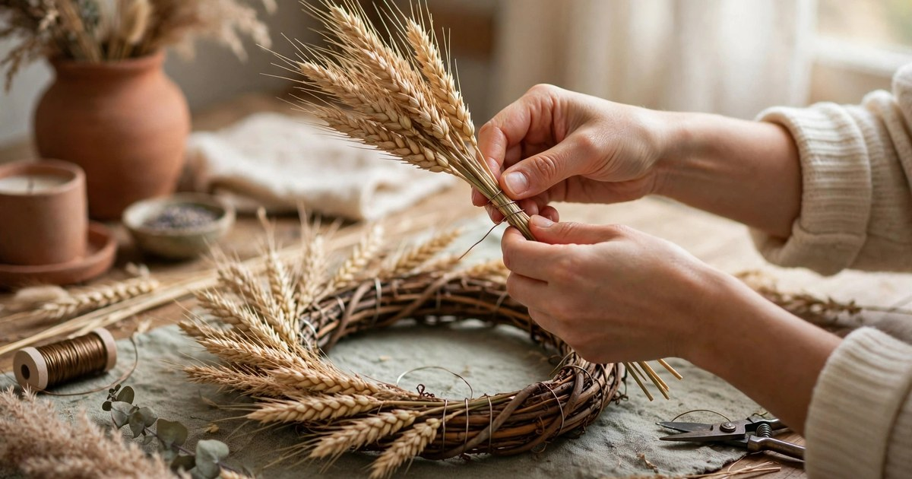
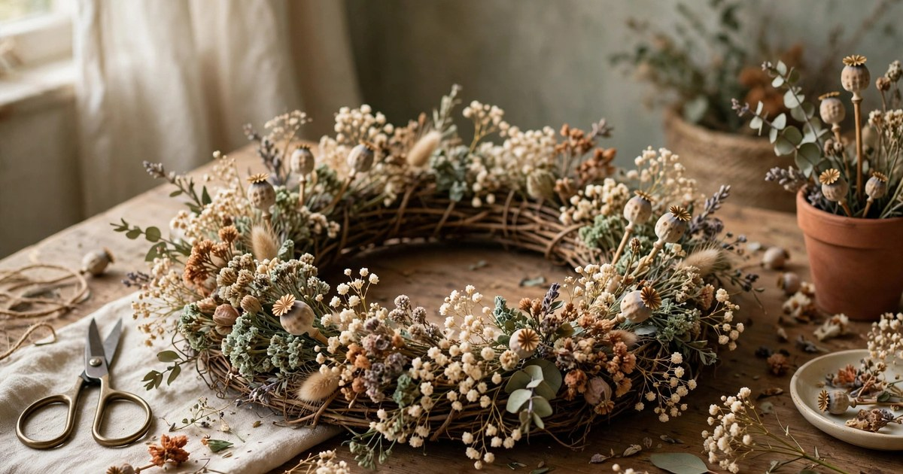

A dried flower wreath is the wreath for people who want greenery without the Christmas clichés and without the needle drop. No fresh branches, no watering, no wilting — just dried flowers, grasses and seed heads, wired onto a ring, that will last from November until spring without a single day of care. It suits a modern flat, a rented home and anyone who would rather hang a wreath once and forget about it than mist one every other day. Best of all, you can make it from flowers you already have: a bunch of lavender, a few stems from a supermarket bouquet, or the seed heads from the garden.

This guide works in order, from drying your flowers to hanging the finished wreath, and it takes an afternoon — most of it waiting for glue to dry. Nothing here needs a fresh branch, a florist or a big budget: a wreath ring, some wire, a few dried stems and a ribbon are the whole shopping list.

### 1. Choose and Dry Your Flowers

The first step is choosing flowers that dry well, because not every flower survives the drying process. Lavender, strawflower, statice, baby's breath, wheat, oats, honesty and dried grasses are the safest choices — they keep their colour and shape for months. Roses dry too, but they darken and shrink, so use them sparingly and expect a deep, vintage colour rather than a bright one. Avoid flowers with thick, fleshy petals, like lilies and tulips, because they rot before they dry.

Dry your flowers by tying them in small bunches with string and hanging them upside down in a dark, dry, airy place — a cupboard, a wardrobe or a spare room — for two to three weeks. Darkness keeps the colours bright, and airflow stops mould. If you are in a hurry, buy ready-dried flowers from a craft shop or online: a mixed bunch costs a few dollars and saves three weeks. Either way, handle the dried flowers gently once they are ready — they are brittle, and a snapped stem cannot be glued back convincingly.

### 2. Pick the Right Wreath Ring

The ring is the skeleton of your wreath, and the right one makes the whole job easier. A grapevine ring is the best choice for a dried flower wreath: it is light, it has a natural texture that shows through the flowers, and its twiggy surface gives the wire something to grip. A wire ring works too, but it needs moss or fabric wrapped around it first, or the flowers will slide. A foam ring is the worst choice — it sheds, it is hard to wire into, and it looks cheap if the flowers thin out.

Choose a ring of 30 to 40 centimetres for a flat door or a wall, and 25 centimetres for a bedroom door or a small space. A ring that is too big overwhelms a small flat and eats flowers; a ring that is too small disappears. Buy the ring from a craft shop or make one from flexible garden prunings — willow, hazel or grapevine — twisted into a circle and tied with string. A handmade ring costs nothing and looks better than a shop-bought one, because its irregular shape suits dried flowers perfectly.

### 3. Gather Your Tools and Materials

Before you start wiring, lay out everything you need within arm's reach: the dried flowers, the ring, a reel of thin florist wire, a pair of sharp scissors or secateurs, a glue gun if you have one, and a length of ribbon for hanging. A glue gun is not essential, but it is the fastest way to fix small, fiddly pieces — a dab of hot glue holds a seed head in seconds, where wire would take a minute. If you do not own one, thin wire and a little patience will do the same job.

Sort your flowers into piles before you begin: large focal flowers in one pile, medium filler flowers in another, and small grasses and seed heads in a third. Cut the stems to about ten centimetres — long enough to wire, short enough not to poke through the back of the ring. Keep a small bowl of spare wire pieces and a dustpan nearby, because dried flowers shed, and a wreath made over a clean table is a wreath you can actually see. Preparation takes ten minutes and saves an hour of hunting for the right stem mid-wreath.

### 4. Build the Base Layer First

Start with the base layer, not the pretty flowers. Take small bunches of dried grasses, wheat or oats — three or four stems at a time — lay them on the ring pointing in the same direction, and wire each bunch tightly to the ring with two turns of florist wire. Work your way around the ring, overlapping each bunch over the last one's stems, so the base layer forms a continuous, flowing circle with no gaps. This layer is the foundation: it covers the ring, gives the wreath its shape, and provides a bed for the flowers to sit on.

Keep the bunches small and the wire tight, because a loose base layer will shift and shed as soon as the wreath is hung. Turn the ring over every few bunches and check the back — the wire should be neat and flat, not a bird's nest, or the wreath will not hang straight. The base layer takes the longest of any step, about half an hour for a 35-centimetre ring, but it is the step that makes the difference between a wreath that looks handmade and one that looks homemade. Take your time, and the rest of the wreath will be easy.

### 5. Add the Focal Flowers

Once the base layer is complete, add the focal flowers — the large, eye-catching blooms that give the wreath its character. Strawflowers, dried roses, lavender bunches and honesty seed heads are the best focal flowers: they are big enough to see from across the room, they hold their colour, and they are sturdy enough to wire. Place them in a loose triangle around the ring — one at the top, one at the bottom left and one at the bottom right — rather than spacing them evenly, because a triangle looks natural and an even spacing looks like a clock face.

Wire each focal flower individually, pushing the wire through the stem and around the ring, then tucking the wire end underneath so it does not scratch the door. Step back after each flower and look at the wreath from a distance: a focal flower that looks perfect up close can unbalance the whole ring from two metres away. Use five to seven focal flowers on a 35-centimetre ring — fewer looks sparse, more looks crowded — and save the best flower for the bottom centre, where the eye lands first.

### 6. Fill the Gaps with Small Flowers and Seed Heads

With the focal flowers in place, fill the gaps with small flowers and seed heads: baby's breath, statice, tiny dried grasses and seed heads, tucked into the spaces between the big blooms. This is the step that makes the wreath look full and professional, because a wreath with gaps looks unfinished, while a wreath with every gap filled looks abundant. Work in small tufts, wiring or gluing each one into place, and keep stepping back to check the balance — a wreath should look full from every angle, not just from the front.

Use the smallest pieces last, poking them into the remaining holes with a dab of hot glue or a twist of wire. A few sprigs of dried eucalyptus or rosemary add scent as well as texture, and a handful of tiny pinecones adds a winter feel without any Christmas clichés. This step is the most satisfying part of the whole project, because the wreath goes from "almost there" to "finished" in about twenty minutes, and every gap you fill makes it look more expensive.

### 7. Add a Ribbon and a Hanging Loop

A wreath is not finished until it can be hung, and the ribbon is both the hanger and the final decoration. Choose a ribbon that matches your room — velvet for a cosy flat, linen for a modern one, satin for a glam one — and cut a length about twice the height of the wreath. Thread it through the top of the ring, tie it in a loop, and then tie a bow at the front where the ribbon meets the flowers. The bow should sit at the top of the wreath, slightly to one side, because a centred bow looks stiff and a slightly off-centre bow looks handmade.

Wire the ribbon to the ring as well as tying it, because a wreath is heavier than it looks and a knot alone can slip. If you are hanging the wreath on a door, use a removable adhesive hook rated for the wreath's weight — a dried flower wreath weighs less than a fresh one, so most hooks will hold it — and hang it on the inside of the front door if your landlord controls the outside. A wreath hung on a bedroom door or a living-room wall works just as well, and it lasts longer out of the draught.

### 8. Care for Your Wreath All Winter

A dried flower wreath needs almost no care, which is the whole point of making one, but a little attention will keep it looking good until spring. Hang it out of direct sunlight, because sun bleaches dried flowers and turns lavender grey within weeks. Keep it away from radiators and steamy bathrooms, because heat and humidity make dried flowers brittle and mouldy. Dust it once a month with a soft brush or a hairdryer on its coolest setting, held at arm's length — never use water, and never use a damp cloth.

If a stem snaps or a flower falls off, glue it back with a dab of hot glue and nobody will ever know. When spring comes, the wreath can move to a bedroom or a hallway, or be taken apart and the flowers reused in a vase — dried flowers last for months in a jar, and a wreath that becomes a bouquet is a wreath that never wastes a stem. A dried flower wreath made in November is still beautiful in March, and that is why it is worth an afternoon of your time.

## Frequently Asked Questions

### How long does a dried flower wreath last?

A dried flower wreath kept out of direct sun and away from humidity will last four to six months — from November until spring — without any care beyond a monthly dusting. Keep it indoors, because rain and damp will ruin dried flowers in days.

### What flowers dry best for a wreath?

Lavender, strawflower, statice, baby's breath, wheat, oats, honesty and dried grasses dry best, because they keep their colour and shape. Roses dry well too but darken. Avoid flowers with thick, fleshy petals, like lilies, because they rot before they dry.

### Can I make a dried flower wreath without a glue gun?

Yes. Thin florist wire holds every stem just as well as glue, it just takes a little longer. Wire each bunch tightly to the ring with two turns, and tuck the wire ends underneath so they do not scratch the door or snag on clothes.

### How do I hang a dried flower wreath in a rental?

Use a removable adhesive hook rated for the wreath's weight, and hang it on the inside of the front door or on a bedroom door or wall. A dried flower wreath is lighter than a fresh one, so most adhesive hooks hold it easily, and it leaves no holes when it comes down.
