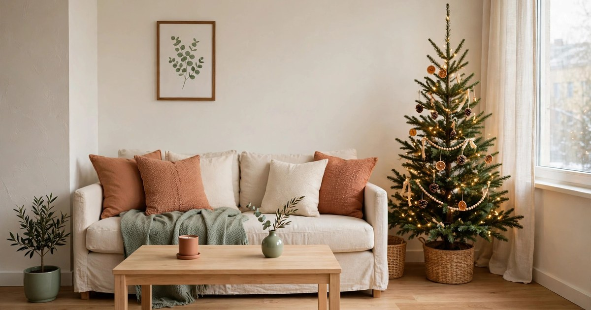
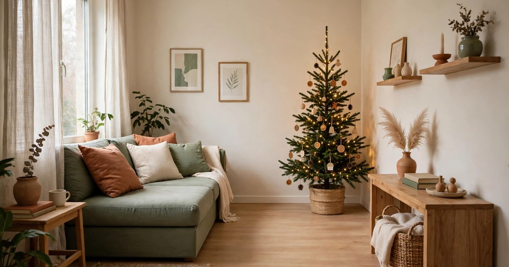
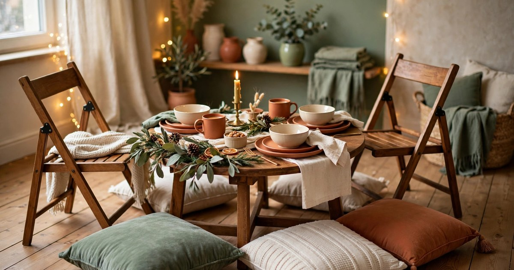
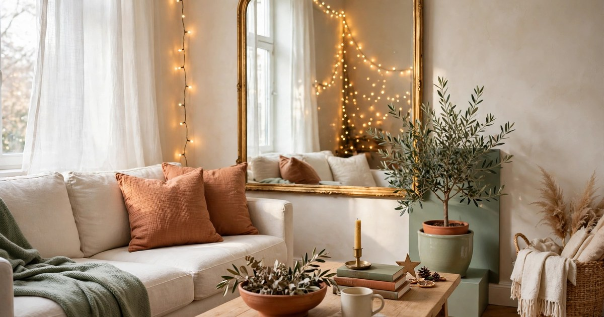
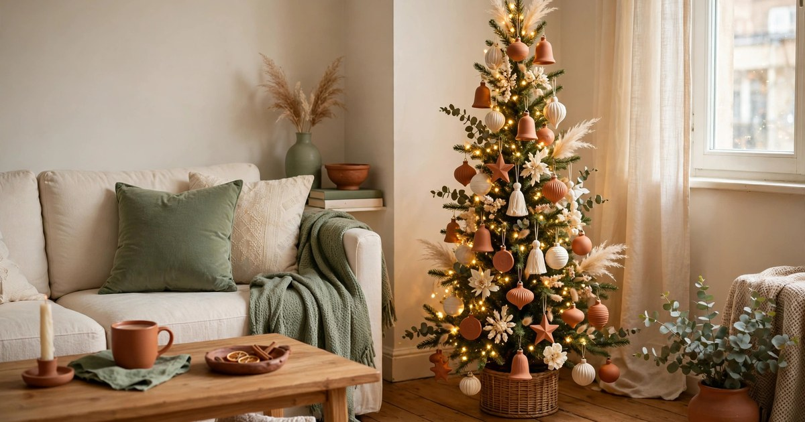
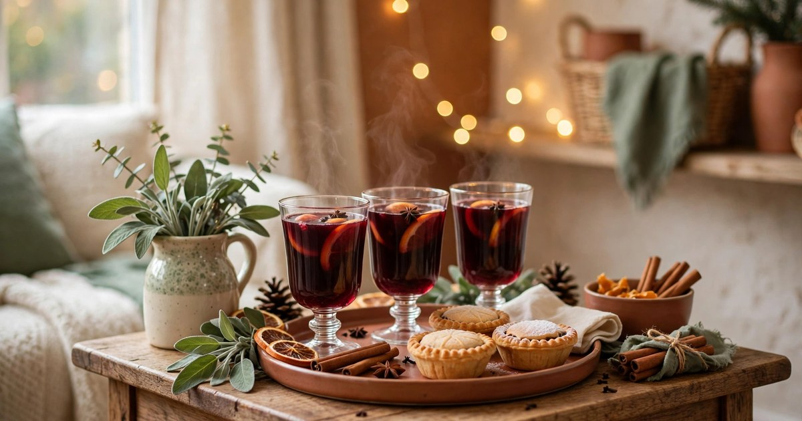
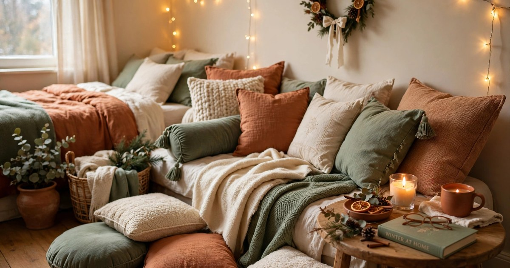
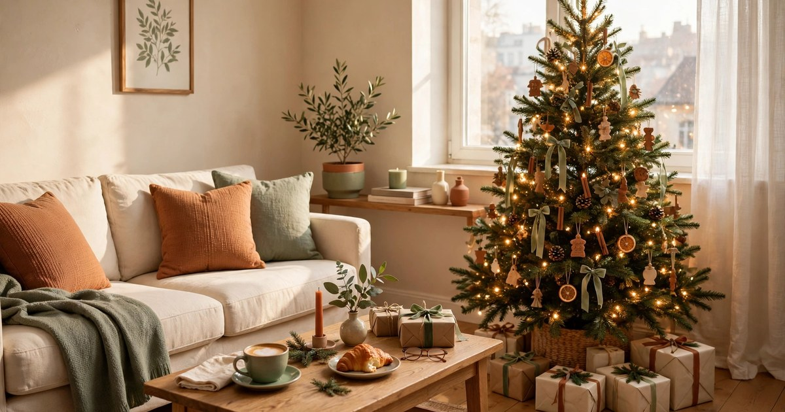

Christmas guests are coming, and your flat is not getting any bigger. There is the tree in the corner, the presents piling up behind the sofa, the extra chairs you borrowed from a neighbour, and a dining table that suddenly has to seat six people instead of two. In a small apartment, Christmas does not just add decorations — it adds clutter, furniture and bodies, all in a space that was already doing its best.

The good news is that a small flat can feel surprisingly generous at Christmas, and you do not need to knock down a wall or buy new furniture to make it happen. What you need is a plan: clear the visual clutter, open up the floor, borrow seating that folds away afterwards, and use light and layout the way a stage designer would. Every trick in this guide is renter-friendly, costs little or nothing, and can be done in a day or less — most of them in under an hour.

Think of it as making room rather than making space. You cannot add square metres, but you can remove the things that make a room feel cramped: the piles on surfaces, the furniture blocking the walkway, the dark corners, the tree swallowing half the living room. Do the steps in order, starting a day or two before your guests arrive, and your flat will feel bigger, brighter and calmer — which is exactly how you want it to feel on Christmas Day.

### 1. Do a Ruthless One-Bag Declutter Sweep

Nothing makes a small flat feel smaller than clutter, and Christmas is clutter season. Before you move a single piece of furniture, grab a bin bag and walk through every room your guests will see. Anything that does not belong in that room goes in the bag: the laundry airer, the pile of unopened post, the shoes by the door, the charging cables draped over the arm of the sofa, the magazines stacked on the coffee table. You are not deep-cleaning the flat — you are clearing the sightlines.

Work top to bottom and be honest about surfaces. A coffee table with three things on it looks calm; a coffee table with twelve things on it looks chaotic, and in a small room that chaos reads as cramped. Keep one festive item per surface — a candle, a small bowl of baubles, a sprig of evergreen — and put the rest away. The same goes for the kitchen worktops: clear them now, because they become your serving space later.

The bag is the trick that makes this fast. Instead of deciding where everything lives, you just get it out of sight for the day. Stash the bag in a bedroom cupboard or under the bed, and deal with it after Christmas. Our guide to [hiding Christmas presents in a small apartment](/hide-christmas-presents-small-apartment-guide/) uses the same out-of-sight principle for gifts, and it works just as well for everyday clutter. Thirty minutes of ruthless clearing buys you more perceived space than any furniture rearrangement ever will.

### 2. Push Furniture to the Walls and Open a Traffic Lane

In a small flat, the middle of the room is the most valuable real estate you have, and most of us fill it. Pull the sofa a few centimetres closer to the wall, slide the armchair into the corner, and move the coffee table to one side — or out of the room entirely for the day. What you are creating is a clear traffic lane: an unobstructed path from the front door to the kitchen to the seating area, wide enough for two people to pass without shuffling sideways.

This matters more at Christmas than at any other time of year because guests move around constantly: to the kitchen for a drink, to the tree to admire the presents, to the bathroom, back to the sofa. Every time someone has to squeeze past a chair or step around a side table, the flat feels smaller. A clear lane makes the same room feel twice as big, because people can actually move through it.

Pay attention to the corners. A chair angled diagonally into the room eats far more floor space than the same chair pushed flat against a wall, and it blocks the eye from travelling to the corner — which is what makes a room feel boxed in. Push everything flush, leave the corners visible, and you will be amazed at how much bigger the room looks. If you have a rug, centre it on the seating area rather than letting it drift into the walkway; a rug that defines one zone makes the rest of the floor read as open space.

### 3. Borrow Seating That Folds Away Afterwards

The seating problem is the classic small-flat Christmas dilemma: you need six seats for one day and two seats for the other 364. The answer is seating that disappears. Borrow folding chairs from a neighbour or a family member, or pick up a pair of cheap folding wooden chairs that stack flat in a cupboard afterwards. Folding stools, poufs and floor cushions work just as well, and they double as footrests once dinner is over.

Mix your seating on purpose. Put your two best chairs at the heads of the table, use folding chairs along the sides, and keep a couple of floor cushions by the sofa for anyone who prefers to perch. Nobody minds a folding chair when the food is good and the company is better — and a mismatched, cosy collection of seats looks far more charming than a row of identical dining chairs crammed around a table that is too small for them.

Where you store the extra seating matters too. Keep the folded chairs in the hallway or behind a door until people actually sit down, rather than setting them all out in advance and filling the room before anyone arrives. Set the table for the number of people eating, not the number of chairs you own, and bring extras out only as needed. That way the room stays open while guests arrive, and the seating appears exactly when it is wanted.

[buy on Amazon](https://www.amazon.com/s?k=folding+wooden+chairs+stackable&tag={{AMAZON_TAG}})

### 4. Add Mirrors and Warm Light to Open the Room

A mirror is the cheapest way to add the illusion of space, and Christmas is the perfect excuse to use one. Hang or lean a large mirror opposite a window or across from the tree, and it will bounce light around the room and double the visual depth. A mirror opposite the Christmas lights is especially effective: the fairy lights reflect and multiply, the room glows, and the wall behind the mirror seems to disappear.

You do not need to buy a statement mirror. A large, plain mirror leaned against a wall at floor level works beautifully in a rental, needs no fixings, and can be moved back after Christmas. If you already have a mirror, move it to the spot where it catches the most light — often the wall opposite the window — rather than leaving it in a dark hallway where it does nothing.

Light does the rest. Small flats feel cramped when they are dim, so layer your lighting for the evening: switch the overhead light off, turn on a floor lamp and a table lamp, and let the Christmas lights do the heavy lifting. Warm white fairy lights, a few battery candles on the mantel or windowsill, and a lamp in the darkest corner will make the room feel warm and spacious instead of small and shadowy. Keep the light warm — cool white bulbs make a small room feel like an office, while warm light makes it feel like a hug.

[buy on Amazon](https://www.amazon.com/s?k=battery+operated+led+candles+warm+white&tag={{AMAZON_TAG}})

### 5. Shrink the Tree (or Move It Off the Floor)

A full-size Christmas tree is the single biggest space thief in a small flat. A standard 6-foot tree with a 4-foot spread eats roughly the same floor area as an armchair — and unlike an armchair, nobody can sit on it. If your tree is swallowing the room, consider going slim: a pencil tree or a slim-profile artificial tree gives you the full height and all the decorations with half the footprint, and it tucks neatly into a corner that a wide tree never could.

A tabletop tree is the other option, and it is genuinely charming in a small flat. A 3-foot tree on a side table or a sturdy stool puts the decorations at eye level, frees the entire floor, and still looks properly festive — especially when you dress it with the same care as a full-size tree. Put it on the surface you would otherwise clutter with ornaments, and it earns its place twice over.

Wherever the tree goes, keep it in a corner and keep the presents underneath it, not beside it. Presents stacked around the base of the tree look intentional; presents spread across the floor look like clutter. If you are short on hiding spots for gifts before the big day, our guide on how to [hide Christmas presents in a small apartment](/hide-christmas-presents-small-apartment-guide/) has renter-friendly ideas that keep them out of sight without taking up floor space. And if you are still deciding on the morning itself, our [Christmas morning guide for small apartments](/christmas-morning-small-apartment-guide/) covers how to stage the present-opening so the room stays calm rather than chaotic.

### 6. Set Up a Drinks and Snacks Station Out of the Way

The kitchen is where everyone gathers, which is a problem when the kitchen is the size of a cupboard. The fix is to move the drinks and snacks out of the kitchen and onto a dedicated station somewhere else: a side table, a bar cart, a cleared bookshelf, even the top of a chest of drawers. Put the glasses, the bottles, the mulled wine, the mince pies and the nuts all in one place, and guests will help themselves without queueing in the doorway.

This single move transforms how a small flat feels during a gathering. The host is not trapped in the kitchen pouring drinks, guests are not crowding the worktops, and the cook can actually cook. It also stops the classic Christmas traffic jam: one person at the fridge, one at the oven, one trying to get past both with a tray.

Keep the station compact and self-contained. A tray corrals everything and makes it easy to move the whole station if you need the surface back. Put a small bin or a bowl for empties nearby so glasses do not migrate to every flat surface in the room. And keep the good glasses on the station, not in a high cupboard — if guests have to ask where things are, they will hover in the kitchen instead of relaxing in the living room.

### 7. Create a Cosy Overflow Zone in the Bedroom or Hallway

Not everyone needs to be in the same room at the same time. If your living room seats four comfortably and six are coming, create a second, smaller zone somewhere else: a couple of cushions and a small side table in the bedroom, a chair and a lamp in a wide hallway, or even a cleared corner of the kitchen with two stools. Give it a purpose — the quiet corner for a cup of tea, the kids' corner with a few games, the spot for the phone call to relatives — and people will use it naturally.

This works because Christmas gatherings are not one long sit-down; they are waves. People drift, chat in pairs, escape for a breather, and come back. A flat with two small zones feels bigger than a flat with one crowded room, because guests can spread out instead of perching on armrests. It also gives you somewhere to send the coats, the bags and the extra wrapping paper — the overflow zone doubles as overflow storage.

Make the zone inviting, not an afterthought. A string of fairy lights, a cushion or two, a small tray with a candle and a couple of glasses: that is all it takes. If the bedroom is your overflow zone, make the bed properly, throw a festive throw over it, and it becomes a perfectly good place to sit. For more ideas on keeping a small flat warm and welcoming through the cold months, our [cosy small apartment winter guide](/cozy-small-apartment-winter-guide/) covers the layering, lighting and texture tricks that make tiny rooms feel like a retreat rather than a squeeze.

### 8. Do a 20-Minute Reset on the Day

All the preparation in the world will not help if the flat is a mess when the doorbell rings. The final step is a 20-minute reset on the day itself, done an hour before guests arrive. Set a timer and work through it in order: open the windows for five minutes to let in fresh air, fluff the cushions and fold the throws, clear every surface back to one festive item, empty the bins, put the coats and shoes away, and light the candles.

Then do the sensory pass. Put music on — something low and warm, not a blaring playlist. Check the temperature: a small flat full of people heats up fast, so turn the heating down a notch before anyone arrives. Put a drink in your own hand before you open the door, because a relaxed host makes a relaxed room, and guests take their cue from you.

Finally, step outside your own front door and walk back in as if you were a guest. What do you see first? That first impression is what your guests will feel, and after your reset it should be warmth, light and space — not a pile of shoes and a blocked hallway. If something still catches your eye, fix that one thing and stop. The flat does not need to be perfect; it needs to feel welcoming, and a small flat that is tidy, warm and well-lit feels more welcoming than a big house that is not.

## Frequently Asked Questions

### How many guests can a small apartment realistically host at Christmas?

It depends on the layout more than the square footage. A one-bedroom flat with an open living area can comfortably host six to eight people for drinks and nibbles, and four to six for a sit-down dinner. The trick is to stop thinking in chairs and start thinking in zones: a dining table for the meal, floor cushions and the sofa for after, and an overflow corner for anyone who wants a breather. If you are over eight, consider a buffet-style meal where people serve themselves and sit where they like, rather than squeezing everyone around one table.

### Should I move furniture around for Christmas Day?

Yes, but only temporarily. Push the sofa to the wall, move the coffee table out of the room, and open a clear traffic lane from the door to the kitchen — then put everything back on Boxing Day. The mistake is trying to create a permanent new layout for one day. Treat it as a stage set: rearrange in the morning, enjoy the space, and restore it afterwards. Nothing in this guide needs a single screw or a permanent change, so your deposit is safe.

### What is the best Christmas tree for a small apartment?

A slim or pencil tree is the best all-rounder: full height, half the footprint, and it fits in a corner that a wide tree cannot. If even that feels too big, a tabletop tree on a sturdy side table gives you all the festive impact with zero floor space. Whichever you choose, keep the decorations to a consistent palette — terracotta, cream and gold, for example — because a small tree with a calm colour scheme looks deliberate, while a small tree covered in clashing colours looks cluttered.

### How do I keep a small flat from feeling cluttered on Christmas Day?

Clear surfaces before guests arrive, then maintain them with the 20-minute reset rule: every hour or so, do a quick pass to collect empty glasses, fold the throws and put the wrapping paper in a bag. Keep presents under the tree rather than spread across the floor, and give everything a home — a tray for drinks, a bowl for empties, a hook or a chair for coats. Clutter is not about how much you own; it is about how much is visible. Control what is visible and the flat stays calm.

### Can I host Christmas dinner in a studio flat?

Yes, with a little creativity. Use a drop-leaf or extendable table if you have one, or push two small tables together. Serve buffet-style from the kitchen worktop so the table only needs room for plates and glasses, not serving dishes. Borrow folding chairs and stack them in the hallway until dinner, and seat guests in the order that makes conversation flow — the best seat in a small flat is the one near the window, not the one at the head of the table. Keep the menu simple: one main, two sides and a pudding you made the day before, so you are hosting, not cooking, when guests arrive.
