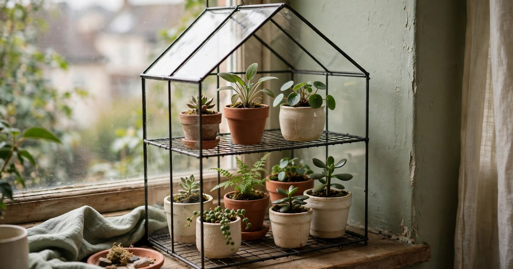
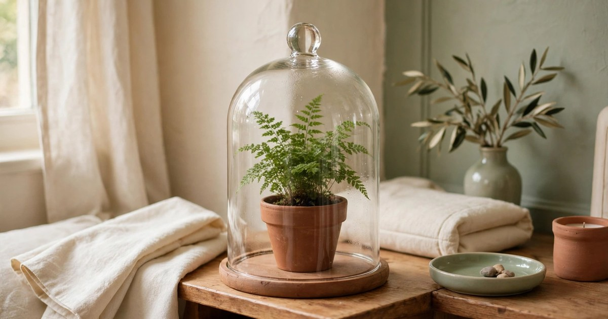
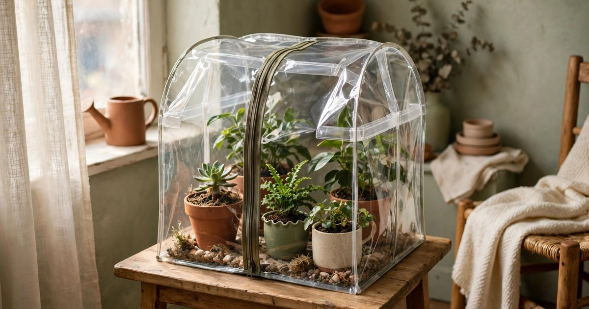
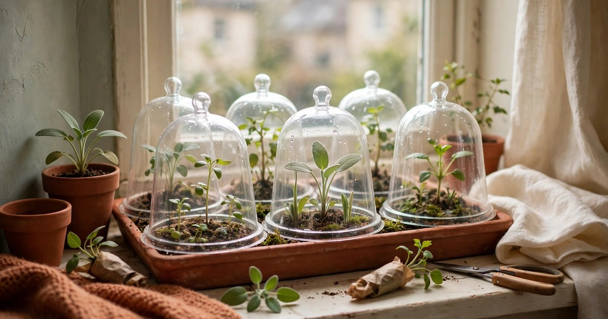
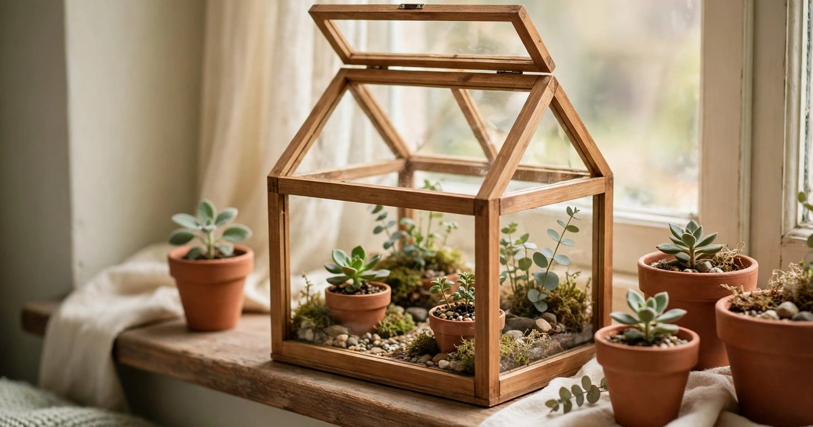
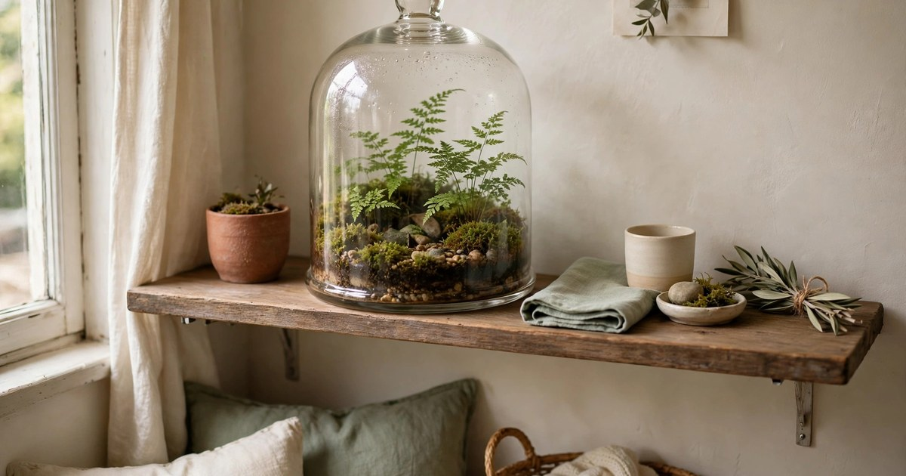
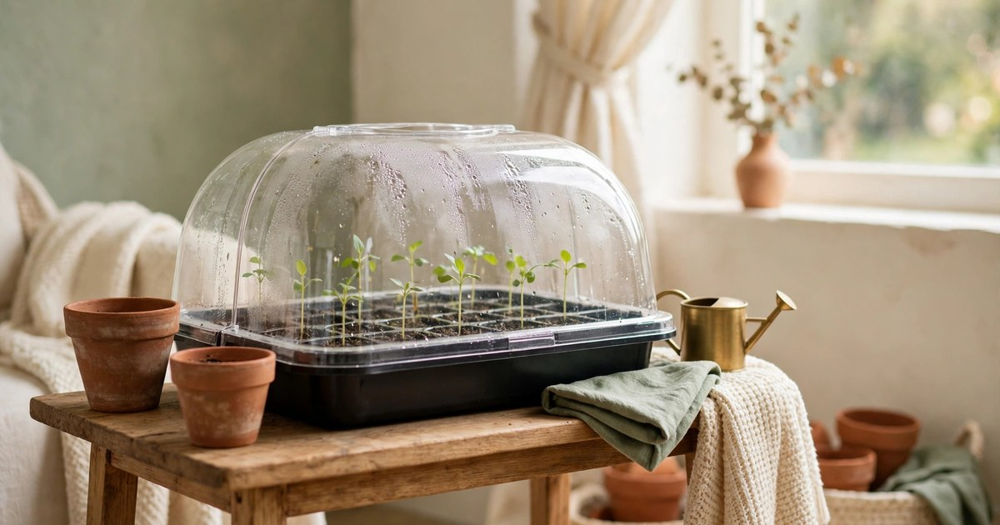
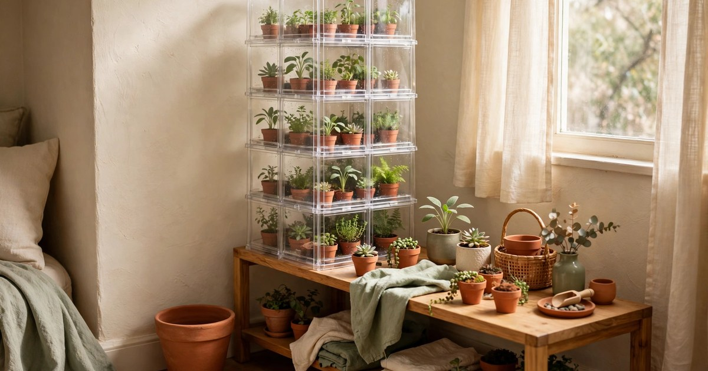
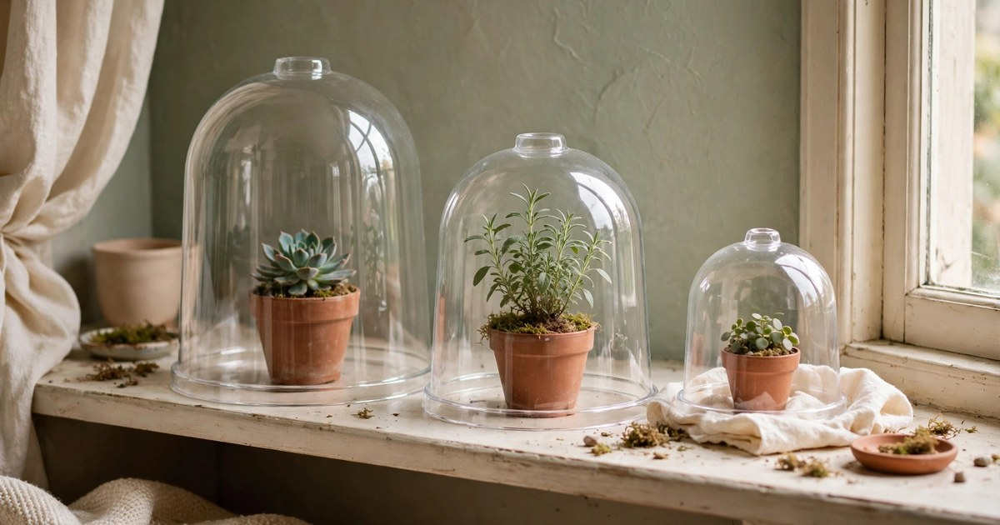

Winter is the season your houseplants secretly dread. The heating comes on, the air turns bone dry, and every time you open the front door a cold draught sweeps straight across the sill. One week your calathea is glorious; the next its leaf edges have crisped like burnt paper and your fern is dropping fronds all over the carpet. Sound familiar? You don't need a humidifier humming away in the corner, and you certainly don't need to turn your flat into a jungle conservatory. What you need is a tiny greenhouse — a pocket of warm, humid air that sits right where your plants already live.

Mini greenhouses and plant cloches are the renter's answer to winter plant care. They're small, freestanding, and entirely deposit-safe: nothing is screwed into a wall, nothing is glued to a window, and the whole thing packs flat into a cupboard come spring. For under $25 each, they trap the moisture your plants lose to heated air, shield them from icy draughts, and — honestly — they look gorgeous on a shelf. A glass cloche over a single fern turns a sad corner into a styled vignette.

This roundup covers nine picks, all under $25, all suited to small flats and rental living. Some hold a whole shelf of plants; others protect a single treasured cutting. Every one of them is freestanding, removable, and easy to find online. Prices are approximate and will wobble with sales and stock, so treat the $25 cap as a shopping target rather than a guarantee — check before you buy, and look for the same styles at charity shops and discount stores too. If your windowsill needs a full winter makeover first, start with our [winter windowsill garden guide](/winter-windowsill-garden-guide/) and then come back here to give each plant its own little glass house.

## How to choose the right mini greenhouse

Before you shop, think about what your plants actually need. Humidity-loving plants like ferns, calatheas and fittonias want an enclosed space that holds moisture in. Seedlings and fresh cuttings want a warm, still pocket of air with gentle light. A big-leafed monstera, on the other hand, won't fit under a bell cloche at all — it needs a shelf-style greenhouse with room to spread.

Measure your space first. A windowsill that is 90 cm wide and 15 cm deep will not hold a 60 cm deep greenhouse, however tempting the price. Count how many plants need protecting, and remember that cramming is the enemy: plants crammed shoulder to shoulder invite mould, and mould in a sealed little greenhouse spreads fast. Leave air gaps between leaves, and open the cover for an hour or two every day or two to let fresh air in.

Ventilation matters more than most people realise. The best budget greenhouses have a zip door, a vent flap, or a lid you can prop open. The best cloches lift off easily. If a cover is completely sealed, your plants will steam — and a steamed plant rots just as surely as a dried-out one. Look for a vent, or plan to lift the cover daily.

One more renter note: everything in this roundup is freestanding. No screws, no wall plugs, no adhesive that might take paint with it in April. If a greenhouse has a fabric cover, it drapes over a frame that stands on its own feet; if it's a cloche, it simply sits over the pot. Your deposit stays exactly where it belongs.

## 1. Tabletop mini greenhouse with shelves

This is the workhorse of the roundup, and the one to buy if you only buy one. A tabletop greenhouse is essentially a tiny freestanding shelving unit — usually two or three wire shelves inside a clear plastic cover with a zip-up front. It stands on a windowsill, a sideboard, or a small table, and it can hold a dozen small pots at once. For a renter with a growing collection, it is the cheapest way to give every plant its own humid microclimate in one go.

Why it works: the cover traps the moisture that evaporates from the soil and the leaves, so the air inside stays noticeably more humid than the rest of the room. Your ferns and calatheas stop crisping, and you water less often because the soil dries out more slowly. The zip front means you can open it fully on mild days for airflow, then close it up when the heating kicks in or a cold snap hits. The shelves also solve a styling problem — instead of a chaotic row of pots, you get a neat vertical display that looks intentional.

Where it fits: a wide windowsill, the top of a bookcase, or a small plant table near a bright window. Measure first — most budget models are around 70 cm wide and 50 cm tall, which suits a standard sill. Keep it a few centimetres back from the glass so leaves never touch a freezing pane; our [winterize indoor plants renter guide](/winterize-indoor-plants-renter-guide/) explains why that gap matters.

Renter tip: the cover lifts off completely in spring, so the frame doubles as a plain plant shelf for the rest of the year. Nothing to store, nothing wasted.

Shop this style: [tabletop mini greenhouse with shelves on Amazon](https://www.amazon.com/s?k=tabletop+mini+greenhouse+shelves+indoor&tag={{AMAZON_TAG}})

## 2. Glass cloche for a single plant

A glass cloche is the most beautiful thing on this list, and possibly the simplest. It's a bell-shaped dome of glass (or thick clear plastic on the cheaper end) that sits over a single potted plant, usually on a little wooden or ceramic base. No zips, no frames, no assembly — just lift it on, lift it off. It turns one plant into a display piece.

Why it works: a cloche creates a sealed, humid pocket around a single plant, which is exactly what humidity-hungry plants like maidenhair ferns, nerve plants and baby calatheas crave. The glass also diffuses the light slightly, which suits plants that scorch in direct sun. And because the dome is transparent, you still see the plant — the whole point of having it. There's something quietly luxurious about a fern under glass; guests will assume you spent far more than you did.

Where it fits: a side table, a bedside table, a bathroom shelf, or anywhere one special plant deserves the spotlight. Cloches come in sizes from about 15 cm to 30 cm tall, so match the dome to the plant — the leaves should never press against the glass, or condensation will sit on them and invite rot.

Renter tip: lift the cloche for ten minutes every day or two to air it out, and wipe the inside of the glass when condensation builds up. A cheap cloche with a knob handle is easier to lift one-handed than a smooth dome.

Shop this style: [glass plant cloche dome on Amazon](https://www.amazon.com/s?k=glass+plant+cloche+dome&tag={{AMAZON_TAG}})

## 3. Plastic mini greenhouse with a zip cover

If the tabletop shelf greenhouse is the workhorse, this is its tougher little sibling. A plastic mini greenhouse with a zip cover is usually a single tall frame — no shelves, just open space under a clear PVC cover that zips up the front. It's the cheapest full-size option in this roundup, often well under $20, and it holds taller plants that won't fit on a shelf unit.

Why it works: the zip cover gives you total control. Zip it shut on freezing nights and dry heated days; unzip it halfway when the sun comes out and the inside starts to warm up. The open interior means you can fit a couple of medium pots, a tray of seedlings, or one dramatic plant that needs its own tent. The plastic is light enough to move with one hand, so you can shift the whole thing toward the light as the sun moves through the day.

Where it fits: on the floor beside a bright window, on a low table, or in a sunny corner where a taller plant lives. It suits flats where the windowsill is too narrow for a shelf unit but the floor by the window is free. Just keep it away from radiators — a plastic cover next to a hot radiator will warp, and the heat defeats the purpose.

Renter tip: because these are so light, they can topple if a cat or a clumsy elbow gets involved. Sit the frame inside a shallow tray or place a heavy pot at the base to anchor it. Nothing is fixed to the wall, so it's still fully deposit-safe.

Shop this style: [plastic mini greenhouse zip cover on Amazon](https://www.amazon.com/s?k=mini+greenhouse+zip+cover+plastic&tag={{AMAZON_TAG}})

## 4. Bell cloche for cuttings and seedlings

A bell cloche is the smaller, humbler cousin of the glass dome — a compact bell, usually clear plastic or thin glass, sized for one small pot, a seed tray cell, or a single cutting. It's the propagation lover's best friend, and it costs next to nothing. You can often buy them in sets of three or four for under $15, which makes them the best value per plant on this list.

Why it works: cuttings and seedlings are the most vulnerable plants in your collection. They have no root system to speak of, so they lose moisture through their leaves faster than they can replace it — which is why so many cuttings wilt and die in dry heated air. A bell cloche traps a bubble of humid air around them, and suddenly your success rate jumps. It's the same principle as a propagation box, just prettier and sized for one pot at a time.

Where it fits: on a windowsill among your other pots, on a propagation shelf, or on a desk where you're rooting cuttings in water and soil. Because they're small, you can tuck one into a gap between bigger pots without rearranging anything. They're also brilliant for protecting a single seedling from a draught while the rest of the tray sits uncovered.

Renter tip: buy a set rather than a single. You'll always have more cuttings than you planned for, and a spare cloche is the difference between a cutting that roots and one that crisps. If you're new to propagating, our [humidify houseplants without a humidifier](/humidify-houseplants-without-humidifier/) guide has more low-cost tricks that pair well with cloches.

Shop this style: [bell cloche for seedlings and cuttings on Amazon](https://www.amazon.com/s?k=bell+cloche+seedlings+cuttings+plastic&tag={{AMAZON_TAG}})

## 5. Wooden-frame mini greenhouse

A wooden-frame mini greenhouse is the one that looks like furniture rather than gardening equipment. A slim timber frame — often pine or bamboo — with clear panels, a hinged lid or door, and a footprint not much bigger than a large tray. It costs a little more than the plastic options, but budget versions still sneak in under $25, especially the smaller tabletop sizes.

Why it works: the rigid frame and hinged lid make it the easiest greenhouse on this list to use every day. You flip the lid open to water, close it to trap humidity, and the whole thing stays put — no flapping plastic, no zip to wrestle. The wood also looks warm and intentional in a way that clear PVC never quite manages; it reads as decor, not as a gardening afterthought. In a small flat where everything is on display, that matters.

Where it fits: a windowsill, a kitchen counter, or a shelf where you want the plants to look styled rather than stored. The hinged lid needs a few centimetres of clearance above it to open fully, so check the space above your sill before you buy. It's ideal for a small collection of herbs or a few prized succulents that want protection without hiding.

Renter tip: wood and constant moisture are not natural friends, so wipe the frame dry if condensation pools, and keep the greenhouse out of direct contact with a wet saucer. A quick wipe once a week keeps it looking good for years.

Shop this style: [wooden frame mini greenhouse tabletop on Amazon](https://www.amazon.com/s?k=wooden+mini+greenhouse+tabletop&tag={{AMAZON_TAG}})

## 6. Terrarium-style enclosed planter

A terrarium-style enclosed planter is a glass container with a lid — sometimes a geometric glass box, sometimes a jar with a cork or glass top — that holds the plant, the soil and the humidity all in one self-contained unit. It's less a greenhouse and more a tiny ecosystem, and for small humidity-loving plants it's one of the most forgiving setups you can own.

Why it works: once you plant it up and close the lid, a terrarium largely looks after itself. Moisture evaporates from the soil, condenses on the glass, and drips back down — a miniature water cycle that means you might water once a month or less. Ferns, mosses, fittonias and baby pileas thrive in this setup, and because the whole thing is enclosed, it shrugs off dry heated air and cold draughts alike. It's the lowest-maintenance pick on this list.

Where it fits: a shelf, a desk, a bathroom windowsill — anywhere a small glass box can sit and catch the light. Terrariums need bright indirect light rather than direct sun (direct sun through glass cooks the plants inside), so a north- or east-facing spot is ideal. Our [winter terrarium ideas for small apartments](/winter-terrarium-ideas-small-apartments/) has planting combinations that work beautifully in these.

Renter tip: if condensation coats the glass so thickly you can't see the plants, leave the lid off for a day. That's the terrarium telling you it's too wet. A layer of pebbles at the bottom for drainage is non-negotiable — without it, roots sit in water and rot.

Shop this style: [enclosed terrarium glass planter with lid on Amazon](https://www.amazon.com/s?k=enclosed+terrarium+glass+planter+lid&tag={{AMAZON_TAG}})

## 7. Heated propagation tray greenhouse

A heated propagation tray greenhouse is a shallow tray with a clear domed lid and a gentle heat mat built into the base. It plugs in, warms the soil from below, and gives cuttings and seedlings the two things they want most in winter: bottom heat and humid air. Budget models with a small mat still come in under $25, especially the single-tray sizes.

Why it works: warmth from below speeds up rooting dramatically. A cutting that might take six weeks to root on a cold sill can root in three with gentle bottom heat, and seedlings germinate faster and more evenly. The clear lid keeps humidity high while the mat keeps the soil a few degrees above room temperature — a combination that mimics spring, even in January. If you're the kind of plant person who propagates everything, this pays for itself in saved cuttings within a season.

Where it fits: on a table or shelf near a power socket, away from direct sun (the lid plus a heater can overheat fast in strong light). It's a working tool rather than a display piece, so a utility corner, a spare desk or the top of a bookcase is ideal. The tray footprint is small — roughly the size of a laptop — so it fits in flats where a full greenhouse never would.

Renter tip: it's fully portable and unplugs in seconds, so there's nothing permanent about it. Use a timer plug if yours doesn't have one built in, and never leave the lid sealed shut on a warm day — lift it for airflow, just as you would with any cloche.

Shop this style: [heated propagation tray greenhouse on Amazon](https://www.amazon.com/s?k=heated+propagation+tray+greenhouse&tag={{AMAZON_TAG}})

## 8. Stackable mini greenhouse

A stackable mini greenhouse is a clever modular design: individual clear boxes or short shelf units that click or sit on top of one another, so you build upward instead of outward. Each unit holds a few pots, and you add or remove tiers as your collection grows or shrinks. In a small flat, vertical storage is the only storage that doesn't cost floor space — and this applies the same logic to your plants.

Why it works: you get the humidity benefits of a covered greenhouse with the flexibility of a modular system. One tier for the ferns, one for the cuttings, one for the herbs — each with its own little climate. Because the units stack, a three-tier tower takes up no more floor space than a single pot, which is a genuine win in a studio or one-bedroom flat. And if one tier gets too crowded, you simply lift it off and start a second tower.

Where it fits: a corner by a bright window, beside a bookshelf, or on a sturdy side table. The tower needs a flat, stable base — a wobbly table is a bad idea for a three-tier stack of glass and soil. Keep the tallest, heaviest pots at the bottom for stability, and the lightest at the top.

Renter tip: stackable units are easy to split across rooms. Put the humidity lovers together in the bathroom tower and the light lovers by the living-room window — no single piece of furniture is committed, and everything moves with you when you move flat.

Shop this style: [stackable mini greenhouse shelves on Amazon](https://www.amazon.com/s?k=stackable+mini+greenhouse+indoor&tag={{AMAZON_TAG}})

## 9. Budget clear plastic cloche set

The budget clear plastic cloche set is the cheapest way to protect a lot of plants at once. For under $25 you can often get six, eight or even ten lightweight clear domes in a mix of sizes — enough to cover every small pot on your sill. They won't win any design awards, but they do the job, and when you're protecting a dozen plants on a tight budget, quantity beats prettiness.

Why it works: plastic cloches do exactly what glass ones do — trap a bubble of humid, still air around each plant — at a fraction of the price and with zero breakage risk. That's a real consideration in a small flat: a glass dome knocked off a sill by a cat is a mess and a cost; a plastic dome just bounces. The sets usually include a few sizes, so you can match small domes to cuttings and larger ones to bushy ferns, and swap them around as plants grow.

Where it fits: anywhere you have a lot of small pots — a full windowsill, a plant shelf, a propagation station. Because they're so light, they're ideal for renters who rearrange often; you can lift a whole set off, dust the sill, and put them back in a minute. They also pack flat-ish for storage, which matters when your cupboard space is already spoken for.

Renter tip: plastic scratches and clouds over time, so replace the set every year or two rather than mourning the clarity. At this price, that's fine — and the old ones make handy covers for outdoor seedlings in spring. Just remember to vent: lift each dome for a few minutes every day or two, and wipe away condensation so mould never gets a foothold.

Shop this style: [clear plastic cloche set for plants on Amazon](https://www.amazon.com/s?k=clear+plastic+plant+cloche+set&tag={{AMAZON_TAG}})

## How to use your mini greenhouse all winter

A mini greenhouse is not a set-and-forget device. The best routine is simple: check inside once a day. Lift the cover or open the zip for an hour to let fresh air circulate, wipe condensation off the inside of the glass or plastic, and feel the soil before you water — covered soil stays damp far longer than open soil, and overwatering is the number one way to kill a plant inside a greenhouse.

Watch for mould, especially in the first fortnight. A white fuzzy patch on the soil surface usually means too much moisture and not enough air; open the cover longer, remove the affected top layer of soil, and sprinkle a little cinnamon on the surface (a genuine old gardener's trick — cinnamon is mildly antifungal). If a plant's leaves go yellow and soft, it's too wet; if they crisp at the edges despite the cover, it needs more water or a better seal.

Come spring, don't just rip the covers off. Harden your plants off gradually — open the greenhouse a little longer each day over a week or two — so they adjust to normal room humidity instead of going into shock. Then pack the covers away, and your plants will face summer stronger for their winter holiday.

## Frequently Asked Questions

### Do mini greenhouses really help houseplants in winter?

Yes — for the right plants. A mini greenhouse raises humidity and blocks cold draughts, which are the two biggest winter killers for tropical houseplants like ferns, calatheas and fittonias. It won't fix low light on its own, so pair it with a bright spot or a cheap grow light. Plants that like dry air, like succulents and cacti, generally don't need one.

### Will a cloche or mini greenhouse cause mould?

It can, if you never ventilate. Mould thrives in still, damp air, so open the cover or lift the cloche for an hour every day or two. Wipe condensation off the inside, avoid overwatering, and leave space between plants for air to move. With that routine, mould is rarely a problem.

### Are mini greenhouses renter-friendly?

Completely. Every pick in this roundup is freestanding — nothing is screwed, glued or fixed to the property. They sit on a sill, a table or the floor, and they pack away in minutes. There's nothing for a landlord to object to, and nothing to repair when you move out.

### Can I use a mini greenhouse for seedlings and cuttings?

Yes, and that's one of their best uses. Cuttings and seedlings lose moisture fast in dry heated air, so a cloche or a heated propagation tray dramatically improves rooting success. Keep the cover vented once roots appear, and harden seedlings off gradually before moving them into open air.

### What's the cheapest way to start?

A set of clear plastic cloches is the lowest-cost entry point — often under $15 for a set that covers several pots. If you have more plants, a plastic zip-cover greenhouse gives you the most protected space per pound or dollar. Start small, see which of your plants respond best, and expand from there.
