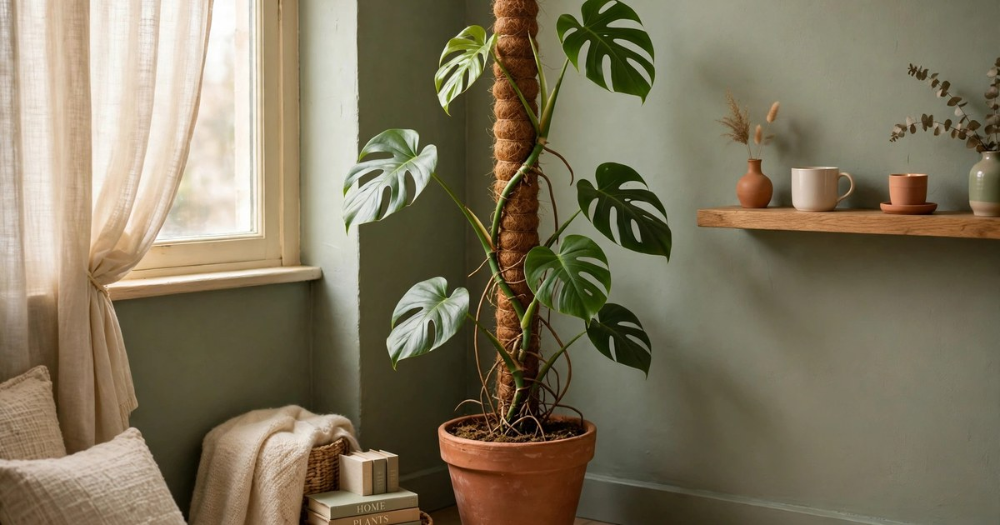
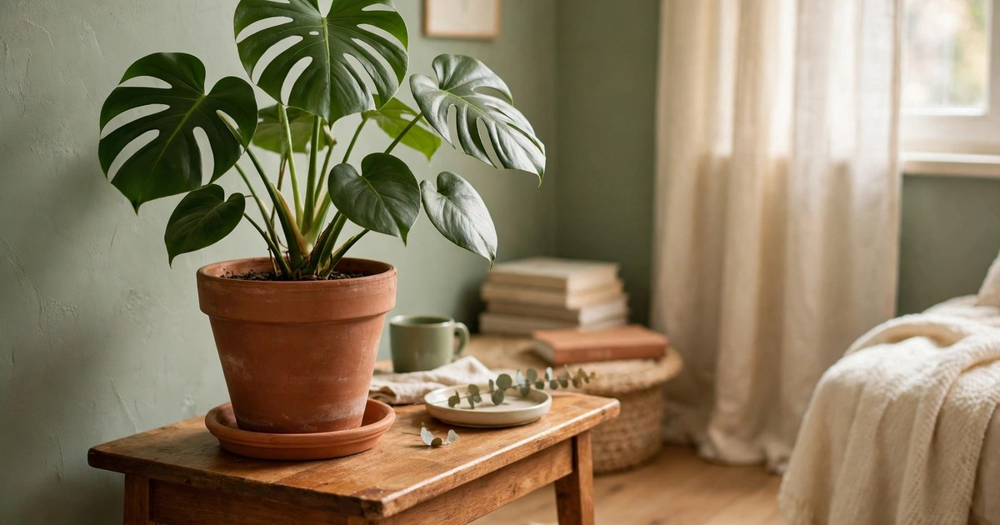
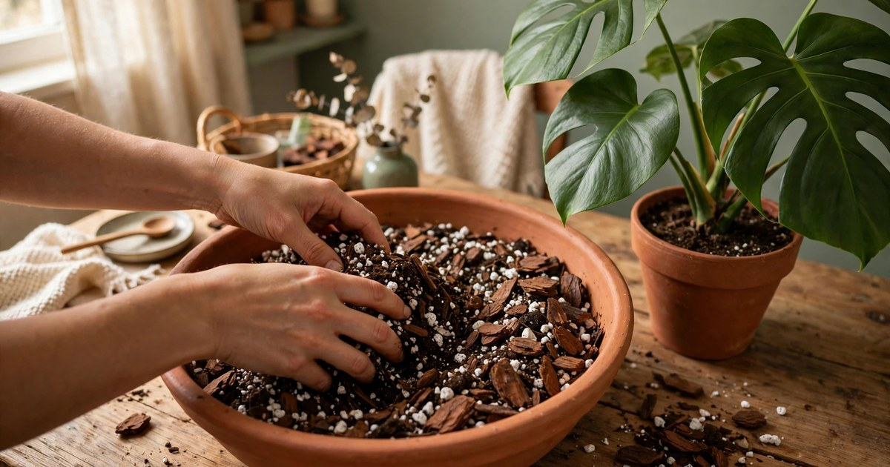
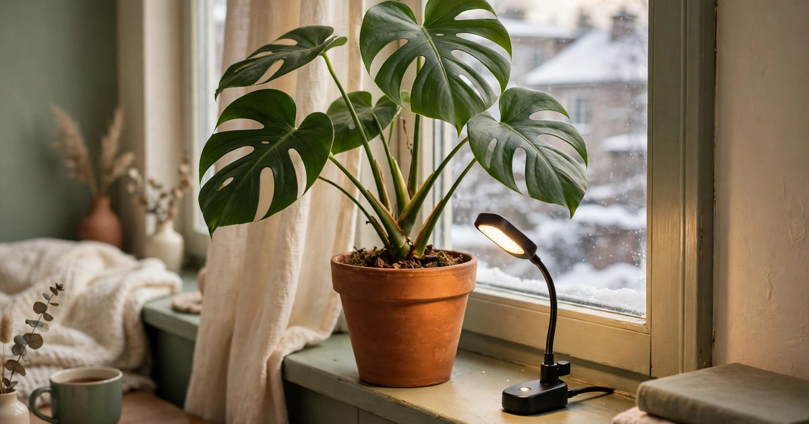
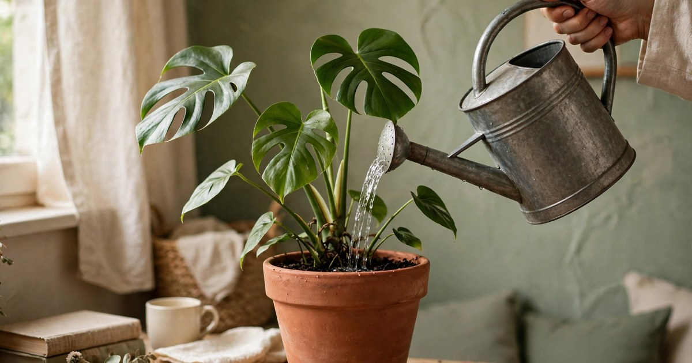
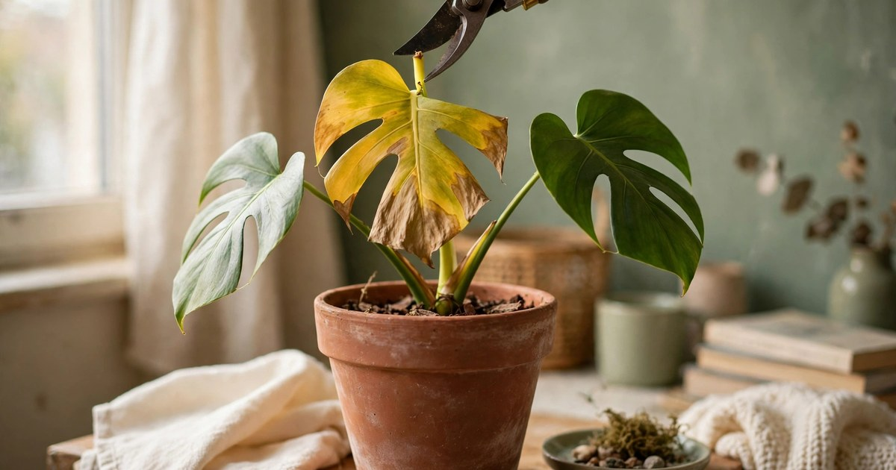
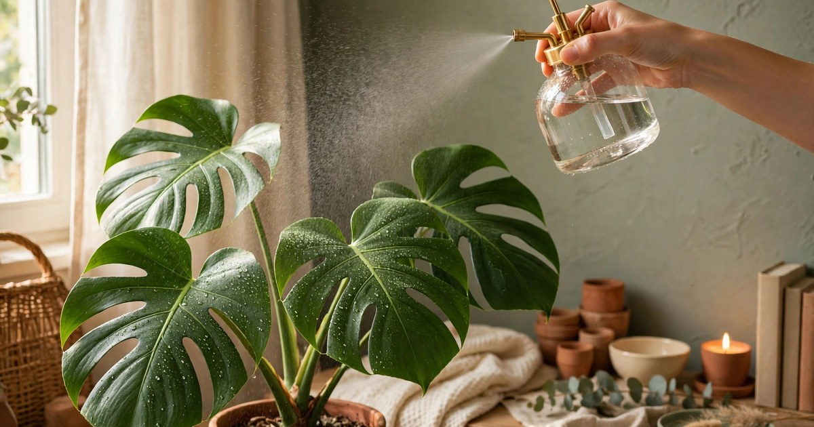
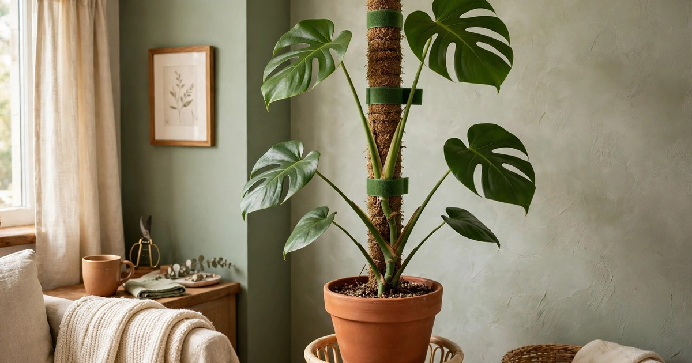
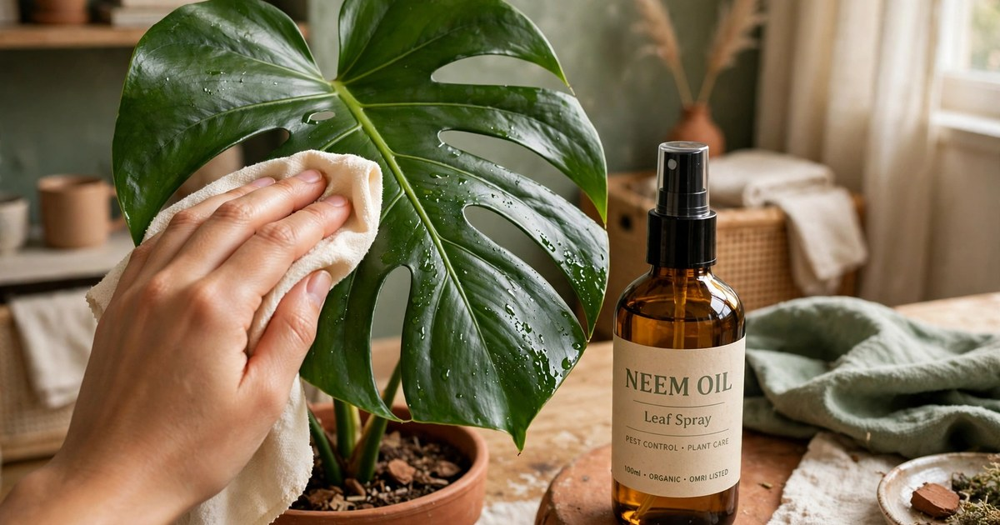

A monstera is the plant that makes a small flat feel like a jungle. One healthy plant with big, split leaves fills a bare corner, softens a plain white wall and makes a rented room feel like a home rather than a box. The good news is that a monstera does not need expensive kit to thrive. It needs the right kit, and almost all of it costs less than $25 a piece.

Winter is when those essentials earn their keep. Light levels drop, radiators dry the air out, and growth slows right down, so the mistakes that a monstera forgives in summer — soggy soil, a dark corner, a forgotten watering — turn into yellow leaves and stalled growth in winter. A small grow light, chunky soil and a humidity tray are the difference between a plant that limps through to spring and one that keeps growing.

Everything in this roundup is renter-friendly and budget-first: no drilling, no permanent changes, nothing that risks a deposit. Each pick costs under $25, fits in a small flat without taking over the room, and works just as well in a studio as in a one-bedroom. Buy them one at a time, starting with the pot and the soil.

### 1. Moss Pole or Coir Pole

In the wild, a monstera climbs trees, and its aerial roots grip the bark as it grows upward. In a flat, a moss pole or coir pole gives it that same support, and it is the single best thing you can buy for bigger, more split leaves. A plant that climbs produces larger leaves with deeper fenestrations than one left to sprawl across a shelf, so a pole is not decoration — it is how you get the look you bought the plant for.

Choose a pole that is at least as tall as the plant, ideally a stackable one you can extend as it grows. Push it firmly into the pot, close to the main stem, and loosely tie the stem to it with plant ties so the aerial roots can find the pole and grip. A decent coir pole costs around $10–$15, and one pole will last the plant for years.

[buy on Amazon](https://www.amazon.com/s?k=monstera+moss+pole+coir+pole&tag={{AMAZON_TAG}})

### 2. A Pot With Drainage (Terracotta or Ceramic)

A monstera's worst enemy is sitting in wet soil, and a pot without drainage holes is the fastest way to get there. Root rot is the number-one killer of indoor monsteras, and it is worse in winter, when cooler rooms and weaker light mean the soil dries out far more slowly. A pot with a drainage hole and a matching saucer lets excess water escape instead of pooling around the roots.

Terracotta is the budget pick for a reason: the porous clay breathes, wicking moisture away from the soil so it dries evenly between waterings. Ceramic looks smarter on display, but check it has a drainage hole — plenty of pretty pots do not. Go only 2–3 cm wider than the current pot when you repot; too much empty soil stays wet and invites rot. A good terracotta pot with a saucer costs around $8–$15.

[buy on Amazon](https://www.amazon.com/s?k=terracotta+pot+with+drainage+hole+saucer&tag={{AMAZON_TAG}})

### 3. Chunky Aroid Soil Mix

A monstera does not grow in dense garden soil in the wild — it grows in loose, airy leaf litter on the forest floor. A chunky aroid mix copies that: orchid bark, perlite and coco coir or peat, with a little compost for nutrients. The chunks create air pockets around the roots, so water drains through quickly and the roots can breathe, which is exactly what stops root rot before it starts.

This matters most in winter. When growth slows, a monstera drinks less, and ordinary potting soil can stay soggy for weeks. A chunky mix dries out at a sensible pace even in a cool flat, so you can water on a normal routine without guessing. A ready-made bag costs around $12–$18 and repots a medium monstera with enough left for a spring top-up. If the soil smells sour and stays wet in winter, do not wait for spring: a fresh chunky mix is a rescue.

[buy on Amazon](https://www.amazon.com/s?k=chunky+aroid+soil+mix+monstera&tag={{AMAZON_TAG}})

### 4. A Small Grow Light

A monstera needs bright, indirect light to make those split leaves, and in winter a north-facing flat or a short grey day often cannot provide it. A small grow light is the cheapest fix: a clip-on LED bar or a bulb in a desk lamp, aimed at the plant for 10–12 hours a day, makes up for the light the season takes away. It is also completely renter-friendly — it clips to a shelf or a [winter plant stand](/winter-plant-stands-small-apartments-under-25/) and leaves no marks at all.

Look for a full-spectrum LED, which looks like ordinary white light rather than the purple glow of older grow lights, so it will not make your living room look strange. A clip-on bar that costs around $15–$22 is plenty for one monstera; you do not need a big panel. Set it 30–45 cm above the leaves on a cheap timer plug, and keep it running through the darkest months. If your monstera has gone months without a new leaf, a grow light is usually the missing piece.

[buy on Amazon](https://www.amazon.com/s?k=clip+on+LED+grow+light+indoor+plants&tag={{AMAZON_TAG}})

### 5. A Narrow-Spout Watering Can

Watering a monstera sounds simple until you try it with a jug or a glass: water splashes over the leaves, runs down the outside of the pot and pools on the floor, and half of it never reaches the roots. A narrow-spout watering can solves all of that. The thin spout lets you aim water directly at the soil, slowly and evenly, so it soaks in instead of running off — and you can water without moving a heavy plant off its stand.

Size matters in a small flat. A one-litre can is ideal: light enough to lift with one hand, small enough to tuck on a shelf, and big enough to water a medium monstera in one go. In winter, use it sparingly — water only when the top 5 cm of soil feels dry, then water thoroughly until a little runs out of the drainage hole, and empty the saucer after 15 minutes so the roots never sit in water. A good one costs around $10–$18 and lasts for years.

[buy on Amazon](https://www.amazon.com/s?k=narrow+spout+watering+can+indoor+plants+1+litre&tag={{AMAZON_TAG}})

### 6. Pruning Shears or Secateurs

A monstera sheds old leaves as it grows, and a yellow or damaged leaf left on the plant just drains energy and looks untidy. Sharp pruning shears or secateurs let you remove it with one clean cut, which heals fast and keeps the plant looking its best. Blunt kitchen scissors crush the stem instead of cutting it, leaving a ragged wound that can invite infection — so this is one tool worth buying properly.

You do not need big garden secateurs for an indoor plant. A small, sharp pair with a spring action costs around $10–$15 and fits in a kitchen drawer. Cut a yellowing leaf off at the base of its stalk, close to the main stem, and wipe the blades with rubbing alcohol between plants so you never spread pests or disease from one pot to another. In winter, prune lightly — only dead or yellow leaves — and save any big shaping for spring, when the plant is growing fast enough to replace what you remove.

[buy on Amazon](https://www.amazon.com/s?k=small+pruning+shears+secateurs+indoor+plants&tag={{AMAZON_TAG}})

### 7. A Mister or Humidity Tray

Central heating is a monstera's winter enemy. Radiators dry the air out, and a tropical plant used to 60% humidity starts showing brown, crispy leaf edges when the flat drops below 30%. A mister or a humidity tray is the budget answer, and either one costs well under $25. A glass mister looks lovely on a shelf and lets you give the leaves a light spray a few times a week, which also keeps dust off them so they can photosynthesise properly.

For steadier results, pair the mister with a humidity tray: a shallow tray filled with pebbles and water, with the pot sitting on the pebbles above the waterline. As the water evaporates it raises the humidity right around the plant, all day, with no effort and no electricity. You can make one from a baking tray and a bag of pebbles for a few pounds, or buy a ready-made one. If you want to go further, our guide to [humidify houseplants without a humidifier](/humidify-houseplants-without-humidifier/) covers grouping plants together and other free tricks that work alongside a tray.

[buy on Amazon](https://www.amazon.com/s?k=glass+plant+mister+spray+bottle+humidity+tray&tag={{AMAZON_TAG}})

### 8. Plant Ties or Velcro Ties

A monstera left to its own devices sprawls. Stems lean toward the light, leaves flop over the edge of the pot, and before long the plant is twice as wide as the corner it lives in. Plant ties fix that for pennies. A roll of soft velcro ties or garden twine lets you guide each stem up the moss pole, keeping the plant tall and narrow instead of wide and messy — exactly what a small flat needs.

Velcro ties are the best choice for a monstera because they are adjustable: wrap them loosely around the stem and the pole, and as the stem thickens you can loosen and reposition them in seconds without cutting anything. Never tie tightly — a pinched stem cannot carry water to the leaves above it, and a damaged stem in winter heals slowly. A roll costs around $5–$8 and lasts for years.

[buy on Amazon](https://www.amazon.com/s?k=velcro+plant+ties+soft+garden+ties&tag={{AMAZON_TAG}})

### 9. Neem Oil Leaf Spray

A bottle of ready-to-use neem oil spray is the closest thing to a monstera first-aid kit. Neem oil is a natural, plant-based treatment that discourages spider mites, thrips and other pests that love dry, heated winter air, and it doubles as a leaf shine: sprayed on a cloth and wiped over the leaves, it lifts dust and leaves them glossy and green. Clean leaves catch more light, which matters when winter daylight is already in short supply.

Use it as prevention, not just as a cure. Once a month, wipe the top and underside of each leaf with a neem-dampened cloth, and check the undersides as you go — that is where pests hide first. If you spot fine webbing or tiny pale dots, spray the whole plant thoroughly, including under the leaves, and repeat weekly for three weeks to catch each new hatch. A ready-to-use bottle costs around $8–$12 and lasts months.

[buy on Amazon](https://www.amazon.com/s?k=neem+oil+spray+ready+to+use+houseplants&tag={{AMAZON_TAG}})

## Frequently Asked Questions

### Can a monstera survive winter in a small flat?

Yes, as long as you adjust for the season. Keep it away from radiators and cold draughts, cut watering back to when the top 5 cm of soil is dry, and give it as much light as you can — a small grow light makes a real difference on short, grey days. Growth will slow, and that is normal; a healthy monstera simply rests in winter and picks up again in spring. The same winter logic applies to other tropical houseplants, so if you have more than one, read our guide on how to [keep a fiddle-leaf fig alive through winter](/keep-fiddle-leaf-fig-alive-winter-guide/) too.

### How often should I water a monstera in winter?

Less often than in summer — usually every two to three weeks, depending on how warm your flat is. Always check the soil first: push a finger 5 cm in, and water only if it feels dry. Water thoroughly until a little drains out of the bottom, then empty the saucer. A monstera that is overwatered in winter is far more likely to develop root rot than one that is slightly underwatered.

### Why isn't my monstera getting split leaves?

Split leaves, or fenestrations, appear on mature leaves when the plant gets enough bright, indirect light and has something to climb. Move it closer to a window or add a grow light, give it a moss pole to climb, and be patient — new leaves on a happy plant will start splitting once the plant is old enough and well-lit.

### Do I need a grow light for my monstera?

Not always, but in a small flat with limited window space it is often the single most useful purchase. If your monstera sits near a bright east- or south-facing window, natural light may be enough. If it is more than a metre from a window, or your flat faces north, a small clip-on grow light running 10–12 hours a day will keep new leaves coming through the darkest months.

### Is a moss pole worth it in a rental?

Yes. A moss pole needs no drilling, no wall fixings and no permanent change to the flat — it simply stands in the pot. It keeps the plant upright and narrow, which saves floor space in a small room, and it encourages the bigger, split leaves that make a monstera worth growing. A stackable pole can grow with the plant, so it is a one-time buy that lasts for years.
