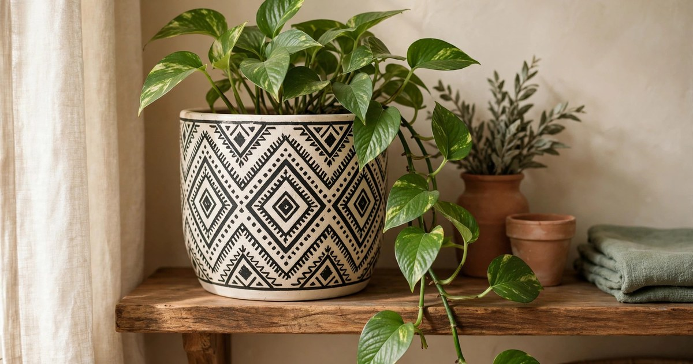
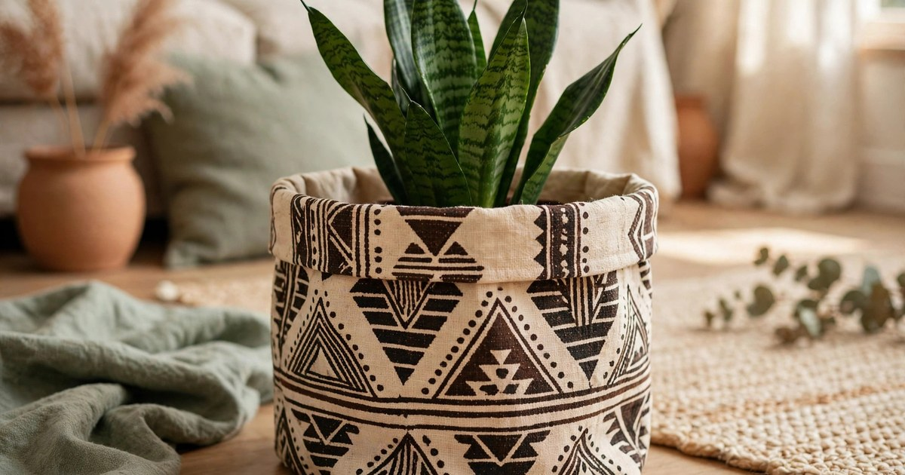
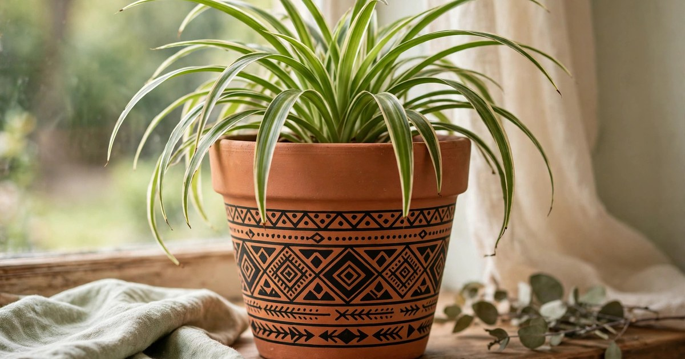
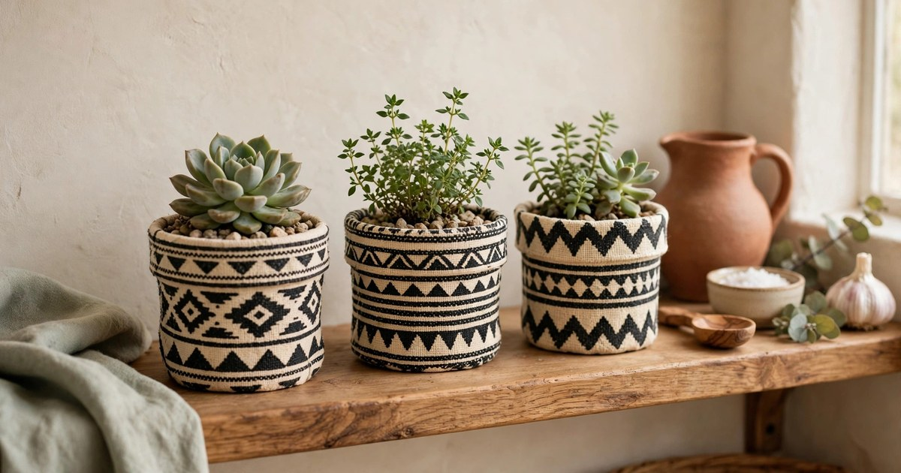
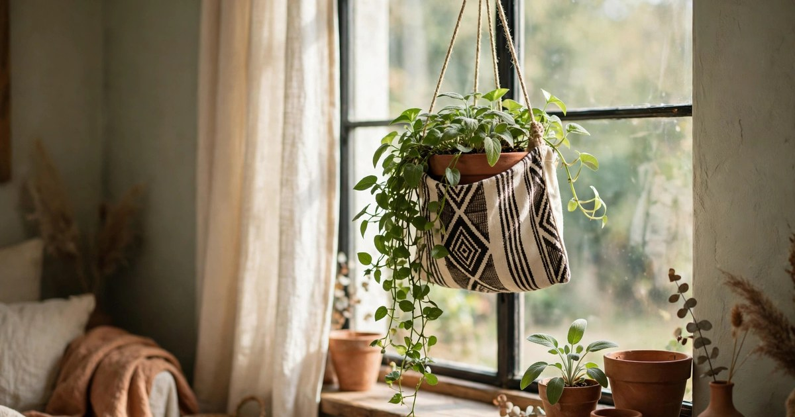
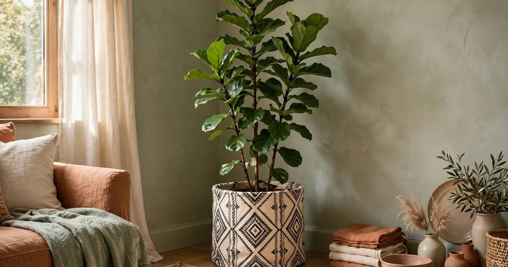
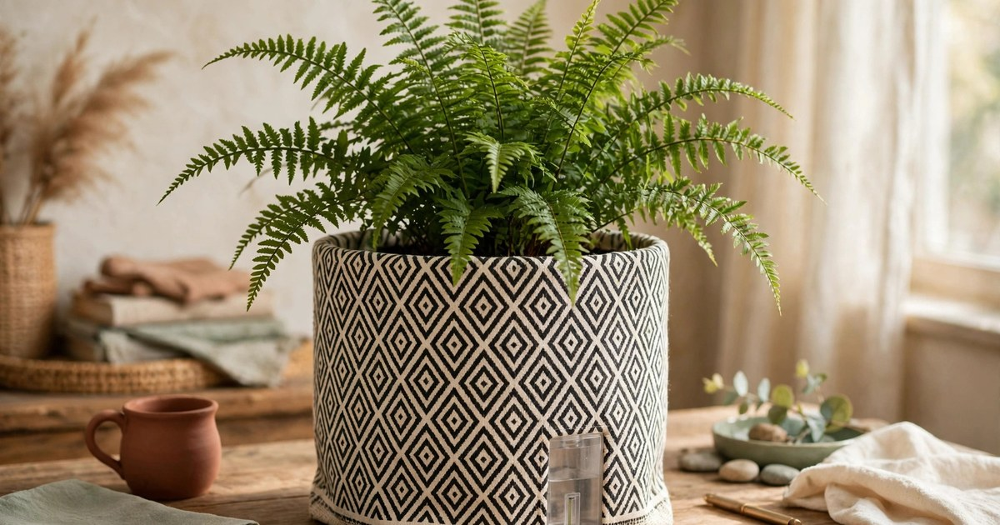
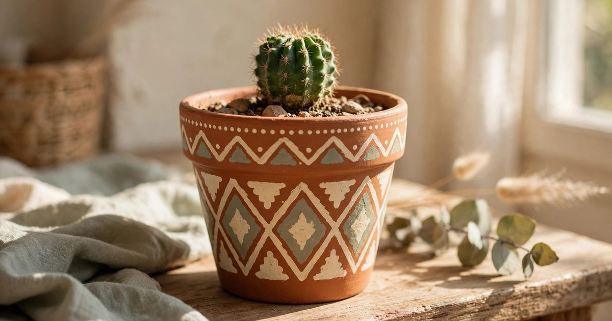
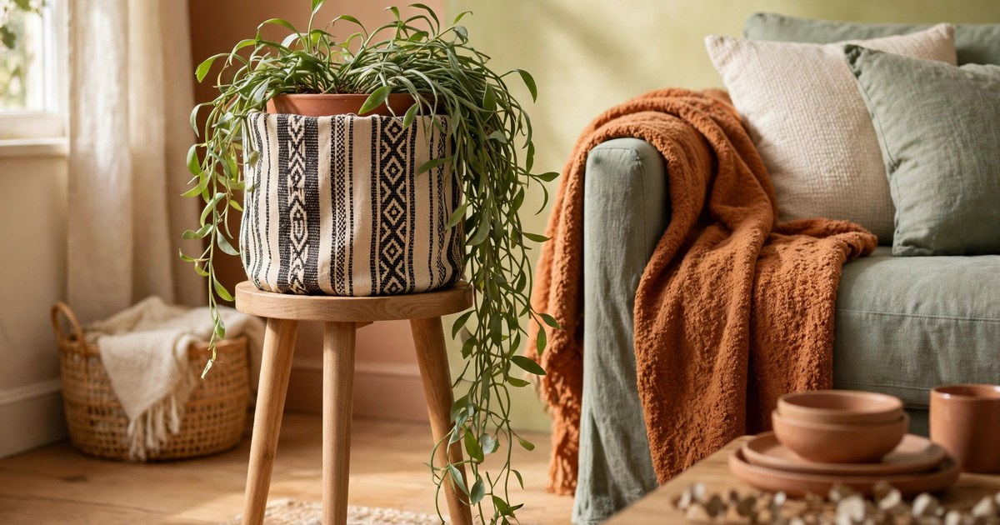

Mudcloth — the black-and-cream patterned textile of Mali, with its hand-drawn geometry of dots, lines and diamonds — is the pattern at the heart of the Afrohemian trend, and it translates beautifully to planters. A mudcloth pot does two things a plain pot cannot: it gives a plant shelf a pattern, and it gives a room a story. The black-and-cream geometry reads as both graphic and handmade, which is why it sits so comfortably beside terracotta, woven baskets and trailing greenery. And because the pattern is bold, a little goes a long way — two or three mudcloth planters on a shelf are a statement; a shelf full of them is a shout.

Every planter below costs under $25, suits a winter plant shelf, and works with the plants most of us actually own — pothos, snake plants, spider plants and the winter herbs that live on a kitchen sill. Each pick includes a why-it-works note and a where-it-fits note. If you want the wider Afrohemian story, our roundup of [Afrohemian decor finds under $25](/afrohemian-decor-finds-under-25/) covers the trend across the home, and our guide to [styling mudcloth pillows](/mudcloth-pillow-styling-guide/) shows how the same pattern works in soft furnishings.

## 1. Classic black-and-white mudcloth ceramic planter

The classic: a ceramic planter ($15–22) in cream with a hand-painted-look mudcloth pattern in black — diamonds, dots and broken lines wrapping around the pot. It is the most versatile pick on this list, because the black-and-white palette goes with every plant and every shelf, and the ceramic weight keeps a top-heavy plant stable. Look for one with a drainage hole and a matching saucer, so watering never reaches the shelf.

**Why it works:** the bold pattern turns an ordinary pothos into a display piece, and the black-and-white palette acts as a neutral — it reads as pattern rather than colour, so it never clashes with the terracotta and sage around it.

**Where it fits:** the centre of a plant shelf, a sideboard, or a desk where it will be seen every day. [Shop mudcloth ceramic planters](https://www.amazon.com/s?k=mudcloth+ceramic+planter+black+white&tag={{AMAZON_TAG}})

## 2. Mudcloth-print fabric planter basket

A fabric planter basket ($12–18) printed with a mudcloth pattern is the soft version of the look: lightweight, foldable, forgiving of a plant that outgrows it, and kind to floors and shelves alike. Set the plant's nursery pot inside the basket and the basket becomes a decorative cover — no repotting, no drainage worries, and the whole thing moves with the plant when you rearrange. Choose a basket with a sturdy woven-look texture rather than a thin printed fabric, so it holds its shape when the plant is lifted out.

**Why it works:** fabric softens the geometry of the mudcloth pattern, so it reads as textile rather than graphic, and it is the lightest way to bring the pattern to a large plant that a ceramic pot would make too heavy to move.

**Where it fits:** floor plants, large snake plants, or a plant shelf where a heavy ceramic pot would be a risk. [Shop mudcloth fabric planter baskets](https://www.amazon.com/s?k=mudcloth+print+fabric+planter+basket&tag={{AMAZON_TAG}})

## 3. Terracotta mudcloth-patterned pot

Terracotta and mudcloth are natural partners — both are earthy, handmade-feeling materials — and a terracotta pot ($10–18) with a black mudcloth pattern painted or printed around it brings the two together in one piece. The terracotta breathes, which spider plants and herbs love, and the pattern keeps it from looking like every other terracotta pot on the windowsill. If you cannot find one ready-made, a plain terracotta pot and a black paint pen will get you most of the way there in an evening.

**Why it works:** it bridges the Afrohemian pattern with the terracotta palette most plant shelves already have, so it ties the shelf together instead of introducing a new colour story.

**Where it fits:** windowsills, kitchen herb shelves, or anywhere a terracotta pot already lives. [Shop terracotta mudcloth pots](https://www.amazon.com/s?k=terracotta+pot+mudcloth+pattern&tag={{AMAZON_TAG}})

## 4. Set of three mini mudcloth pots

A set of three mini pots ($15–20 for the set) is the fastest way to put the pattern on a shelf: three small pots, three small plants, one composition. Fill them with succulents, small herbs or rooted cuttings, and line them up on a kitchen shelf, a windowsill or a desk. The set reads as one purchase and one idea, which is why it looks more deliberate than three separate pots bought on three separate trips.

**Why it works:** repetition is what makes a pattern feel like a scheme rather than an accident, and three small doses of mudcloth give you the rhythm without the commitment of a large patterned pot.

**Where it fits:** kitchen shelves, windowsills, desks, or a bathroom shelf. [Shop sets of mini mudcloth pots](https://www.amazon.com/s?k=set+of+3+mini+mudcloth+pots&tag={{AMAZON_TAG}})

## 5. Mudcloth hanging planter

A hanging planter ($14–22) in a mudcloth-print fabric or a ceramic pot with a macramé hanger puts the pattern at eye level, where it is seen far more than a pot on a shelf. Hang it near a bright window with a trailing pothos or string of pearls inside, and the pattern becomes part of the room's vertical decoration rather than its horizontal clutter. Check the hanger's weight rating and the hook before you hang it — a watered plant is heavier than it looks.

**Why it works:** it lifts the pattern off the shelf and into the air, where it catches the light and the eye, and it frees shelf space for the plants that cannot hang.

**Where it fits:** near bright windows, in a corner that needs height, or above a sideboard. [Shop mudcloth hanging planters](https://www.amazon.com/s?k=mudcloth+hanging+planter&tag={{AMAZON_TAG}})

## 6. Large mudcloth floor planter

A large floor planter ($20–25 at the budget end) is the anchor piece: one big mudcloth pot, one tall plant — a fiddle leaf fig, a snake plant, a monstera — in the corner that currently holds nothing. The scale of the pattern matches the scale of the plant, so the whole corner reads as one intentional composition, and the black-and-white geometry stops a large green plant from feeling like a jungle that escaped.

**Why it works:** a large patterned pot does the work of a piece of furniture — it fills a corner, defines a zone, and gives the room a focal point — for the price of a pot.

**Where it fits:** living room corners, beside a sofa, or in an empty entryway. [Shop large mudcloth floor planters](https://www.amazon.com/s?k=large+mudcloth+planter+pot&tag={{AMAZON_TAG}})

## 7. Mudcloth-print self-watering planter

A self-watering planter ($16–24) with a mudcloth-print outer pot is the practical pick: a water reservoir at the base keeps the soil evenly moist for a week or two, which is exactly what ferns and other thirsty plants need in dry winter air, and the mudcloth pattern means the practical choice is also the pretty one. Look for a visible water-level indicator, so you know when to refill without lifting the plant out.

**Why it works:** winter is when most houseplants die — dry air, irregular watering, radiators — and a self-watering pot removes the most common cause of death while looking like a design choice rather than a gadget.

**Where it fits:** desks, ferns, calatheas, or any plant you keep forgetting to water. [Shop mudcloth self-watering planters](https://www.amazon.com/s?k=mudcloth+self+watering+planter&tag={{AMAZON_TAG}})

## 8. Hand-painted mudcloth-look pot

A hand-painted pot ($12–20) — whether painted by the seller or by you — is the most personal version of the trend. The slightly irregular lines and dots are the point: real mudcloth is hand-drawn, so a hand-painted pot looks more authentic than a perfectly printed one. If you paint your own, a plain terracotta pot, a black paint pen and a steady hand are the whole toolkit, and an evening's work gives you a pot no one else owns.

**Why it works:** the handmade quality is what makes Afrohemian decor feel collected rather than bought, and a hand-painted pot carries that quality in a way a factory print cannot.

**Where it fits:** cacti and succulents on a sunny shelf, a desk plant, or a gift for a plant-loving friend. [Shop hand-painted mudcloth pots](https://www.amazon.com/s?k=hand+painted+mudcloth+pot&tag={{AMAZON_TAG}})

## 9. Mudcloth planter with a wooden stand

A planter on a wooden stand ($18–25) lifts the plant off the floor and into the room, which makes it look taller, catches more light, and keeps the pot away from cold draughts at floor level in winter. The combination of black-and-cream pattern with warm wood is the Afrohemian palette in miniature, and the stand itself — usually mid-century in style — adds a second design note without a second purchase.

**Why it works:** height is the most underused tool on a plant shelf, and a stand gives a medium plant the presence of a large one, while the wood warms up the graphic black-and-white pattern.

**Where it fits:** beside a sofa, in a hallway, or anywhere a floor plant needs to feel like furniture rather than clutter. [Shop mudcloth planters with wooden stands](https://www.amazon.com/s?k=mudcloth+planter+wooden+stand&tag={{AMAZON_TAG}})

## Frequently Asked Questions

### Is mudcloth pattern too bold for a small flat?
No, if you limit it to two or three pieces. The black-and-white palette is a neutral, so it behaves like a pattern rather than a colour, and a small number of patterned pots among plain ones reads as a scheme rather than a shout.

### What plants look best in mudcloth planters?
Trailing plants — pothos, philodendron, string of pearls — because the trailing green softens the graphic pattern. Upright snake plants and fiddle leaf figs also work well, since their strong shapes match the strong pattern. Avoid very delicate plants, which can look overwhelmed.

### Do mudcloth planters need drainage holes?
Yes, like any planter. If the pot you love has no hole, use it as a cover pot: keep the plant in its nursery pot inside the mudcloth pot, and empty any water that collects after watering. Never let a plant sit in standing water.

### Can I make my own mudcloth planter?
Yes, and it is one of the easiest decor DIYs there is. A plain terracotta or ceramic pot, a black paint pen or acrylic paint, and a simple pattern of dots, lines and diamonds — drawn freehand, slightly irregular — will look convincingly like real mudcloth, and the irregularity is part of the charm.
