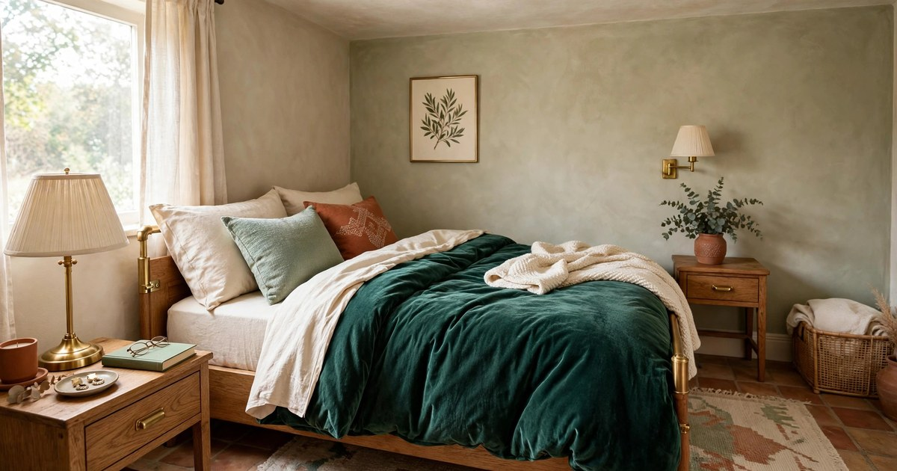
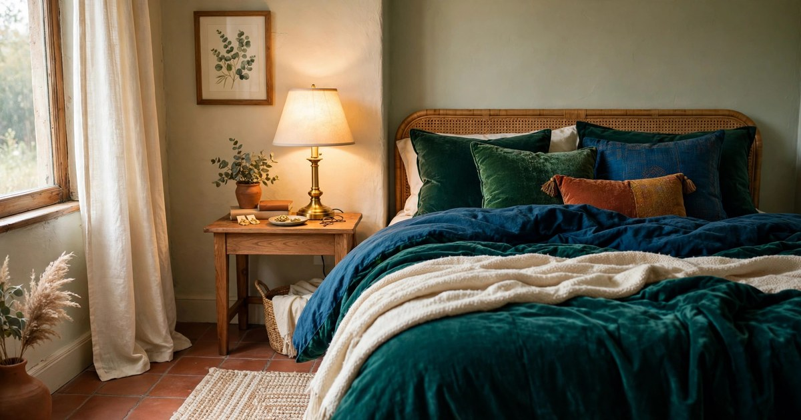
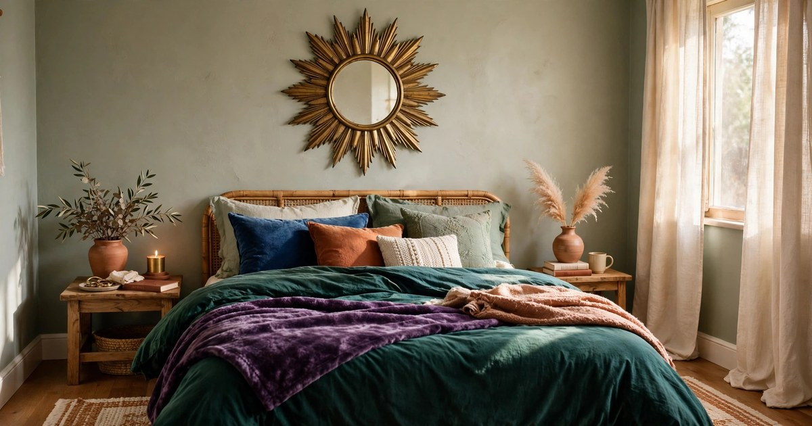
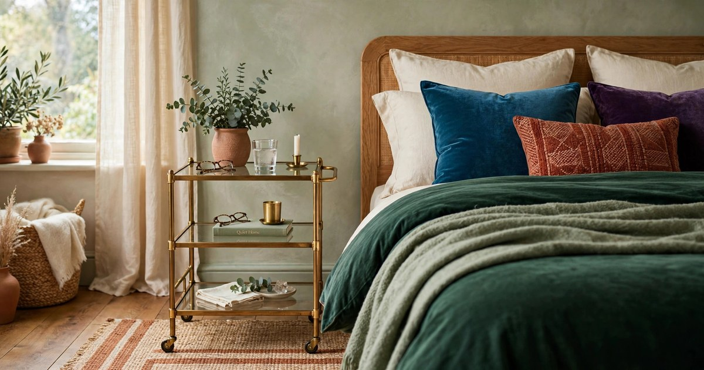
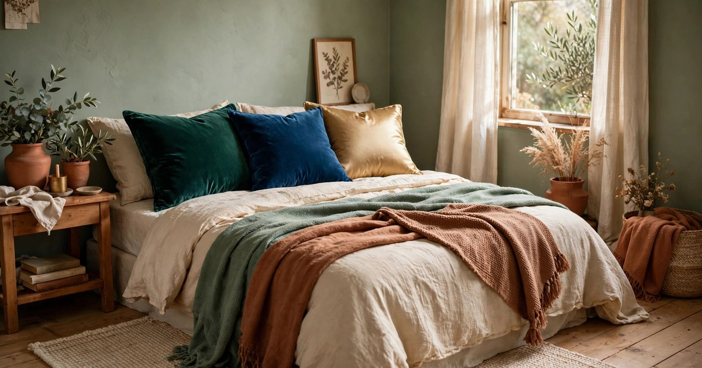
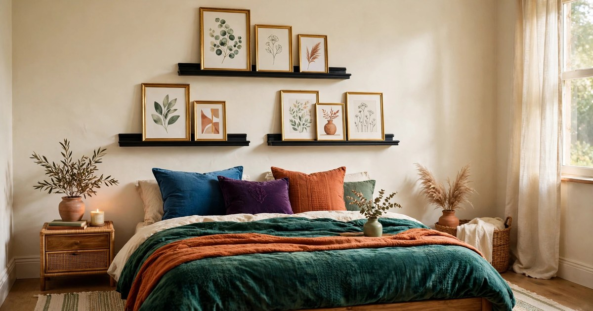
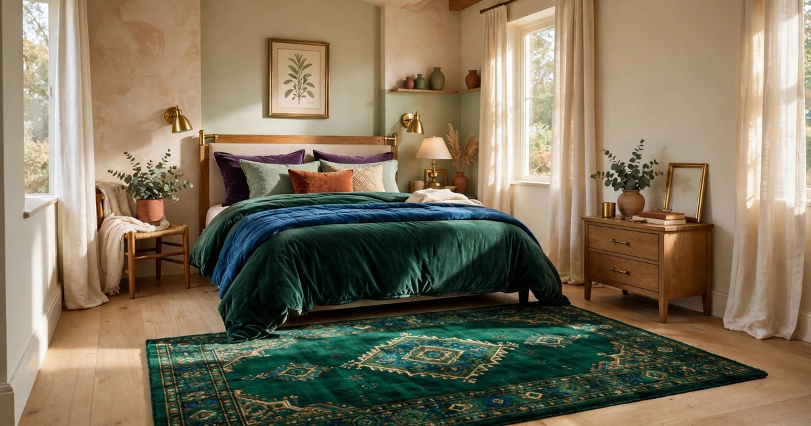
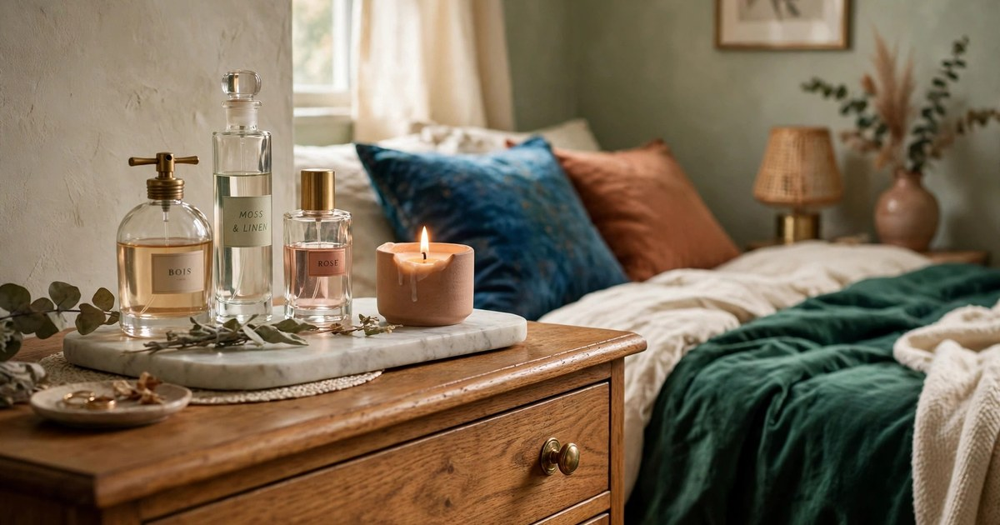

Neo Deco is the most forgiving glamour a small rented bedroom can ask for. It takes the bold geometry, brass shine and jewel tones of 1920s art deco, softens them with modern curves and cosy textures, and — crucially for renters — delivers almost all of its drama through things you can carry in, set down and carry out again. No paint, no drilling, no landlord negotiations and no deposit risk. Just a bed dressed in emerald, a brass lamp glowing in the corner and a sunburst mirror catching the morning light.

The style works so well in small bedrooms precisely because small rooms punish clutter and reward intention. A Neo Deco bedroom does not need twenty objects. It needs five or six confident moves, repeated with discipline: one jewel-tone anchor, one brass focal point, one geometric shape, one rich texture and one warm glow. Everything else stays calm — cream walls, plain wood, a simple bed frame — so the glamorous pieces have room to breathe. That restraint is also what keeps the budget low. You are buying a handful of pieces, not refurnishing a room.

This guide walks through the look in eight steps, in the order that makes the most sense to shop and style. Each step is renter-friendly and budget-first, and each one can stand alone: if you only do the first three, you will still walk into a room that feels unmistakably Neo Deco. Work through them at your own pace, hunt for second-hand pieces where you can, and let the room build up over a few weekends rather than in one expensive afternoon.

If you have already dressed your living room in the same palette, our [Neo Deco living room ideas for small apartments](/neo-deco-living-room-ideas-small-apartments/) show how to carry the brass and jewel tones through the whole flat without repeating yourself. And if you fancy a warmer, earthier take on the same small-bedroom footprint, the [Afrohemian bedroom ideas for small apartments](/afrohemian-bedroom-ideas-small-apartments/) use a similar renter-friendly, budget-first approach with a very different mood.

### 1. Start with a jewel-tone bedding base

The bed is the biggest surface in a small bedroom, so it is where the Neo Deco palette should land first. A jewel-tone duvet set — emerald, sapphire, ruby or deep teal — instantly sets the mood, and it costs no more than the plain white set you were going to buy anyway. This is the cheapest big move in the whole scheme, and it is also the most forgiving: if the colour feels too strong once it is on the bed, a cream throw folded across the foot softens it in seconds.

Choose the tone that suits your light. North-facing rooms with cool, grey light take emerald and sapphire beautifully, because the richness warms the room up. South-facing rooms with strong sun can carry ruby and deep plum without the colour turning muddy. Whichever you pick, keep the sheets underneath pale — cream or soft white — so the jewel tone reads as a deliberate layer rather than a dark cave. A single jewel-tone pillow sham or a contrasting cushion in a second jewel tone adds depth without cluttering a small bed.

Budget hunters should look at duvet sets rather than separate pieces. A three-piece set in a cotton or cotton-blend sateen gives you the duvet cover and two pillow shams for the price of one impulse buy, and the slight sheen of sateen suits the deco mood far better than flat matte cotton. Wash it once before the first night: jewel dyes can be stiff out of the packet, and a single wash softens the fabric and settles the colour. From here on, every other step in this guide is really just echoing this one choice — brass against emerald, geometry against sapphire, velvet against ruby — so take your time getting the base right.

### 2. Add a brass-finish focal light with no wiring

Deco lighting is all about warm pools of light and gleaming metal, and renters can have both without touching a single wire. A brass-finish table lamp on the nightstand — or a brass floor lamp tucked into the corner if there is no nightstand — is the focal light of the room. Look for a simple drum or empire shade in cream or ivory, which throws a warm glow and keeps the brass as the star. A lamp with a dimmer, or a warm-white smart bulb, lets you drop the light to a golden evening level that makes the whole room feel like a hotel suite.

The trick is to treat the lamp as jewellery, not just lighting. Brass-finish lamps are everywhere at the moment — high-street homeware shops, charity shops, second-hand marketplaces — and the finish matters more than the brand. Polished brass reads glamorous and period; brushed or antique brass reads softer and more modern. Either works in a Neo Deco bedroom, but do not mix them: pick one finish and repeat it in the mirror frame, the tray and the picture ledges so the room feels curated rather than collected at random.

If your budget only stretches to one lamp, put it on the side of the bed you use most, and balance the other side with a small battery-operated candle in a brass holder. The flicker costs almost nothing, needs no plug socket and gives you the same warm glow on the far side of the bed. Keep spare batteries in the drawer and the effect never dies. And remember the golden rule of small bedrooms: light low, not high. A table lamp at bed height makes the room feel intimate and expensive; a harsh ceiling light makes it feel like a waiting room.

### 3. Geometry with a fan or sunburst mirror

Every Neo Deco room needs one piece of unapologetic geometry, and a fan or sunburst mirror is the easiest version to live with. The radiating rays read as glamour and pattern at once, the brass finish echoes your lamp, and the mirror itself doubles the sense of space by reflecting the window — the oldest small-room trick there is, and still the best. Hang it centred above the bed, with the bottom of the mirror about fifteen to twenty centimetres above the headboard, so it feels connected to the bed rather than floating near the ceiling.

Size matters more than price. A mirror that is too small above a double bed looks lost; aim for one roughly two-thirds the width of the bed, and if your budget only stretches to a smaller piece, hang it above a chest of drawers or a dressing table instead, where the proportions work in your favour. Lightweight resin and metal versions cost very little and hang from a single adhesive picture strip or a Command hook rated for the weight, so there is no drilling, no holes and no deposit deduction at the end of the tenancy.

Keep the wall around the mirror plain. A sunburst mirror does not want competition from a gallery wall, and in a small bedroom a single strong shape beats a busy arrangement every time. If the wall opposite the window is blank, that is the spot: the mirror will catch the daylight and throw it back across the room, which makes the jewel-tone bedding glow rather than sink. Dust the rays once a week — brass-finish mirrors show dust faster than plain glass, and a thirty-second wipe keeps the whole room looking polished.

### 4. A bar-cart-style nightstand with an antique look

A traditional nightstand in a small bedroom is often a dark wooden box that eats light and offers one drawer you never use. A bar-cart-style nightstand — a small two-tier trolley with a brass or gold-tone frame and glass or mirrored shelves — does the same job and adds glamour, reflection and a sense of occasion. It holds a lamp, a book and a glass of water on the top tier, and a spare cushion, a journal or a small plant on the lower one, all while looking like it belongs in a cocktail bar rather than a box room.

The second-hand market is your friend here. Bar carts and drinks trolleys turn up constantly in charity shops and online marketplaces, often for the price of a takeaway, because people buy them for parties and then run out of floor space. Look for a sturdy frame, smooth-rolling castors and shelves that sit level; wobbly wheels can be tightened or replaced for pennies. If the finish is scuffed, a rub with brass polish or a coat of metallic spray paint made for metal will bring it back — and because the cart is freestanding furniture, none of this touches the flat itself.

Style it with restraint. A lamp, a small stack of two books and a tiny vase is enough; the shelves are glass, so clutter underneath shows through and ruins the effect. Keep the lower tier for one or two beautiful things — a folded throw, a scented candle, a jewellery box — and hide the practical clutter in the wardrobe. The castors are a bonus in a small room: wheel the cart aside when you need floor space, then roll it back when the room is dressed again. It is the hardest-working piece of furniture in this whole guide, and it costs less than most nightstands.

### 5. Velvet and satin textures on a budget

Neo Deco without velvet is like a cocktail without the garnish — technically fine, but missing the point. Velvet is the texture that makes jewel tones look expensive: its pile catches light differently from every angle, so even a flat emerald cushion looks layered and rich. The good news is that velvet cushion covers are one of the cheapest luxuries in homeware. A pair of covers in emerald or sapphire, slipped over cushions you already own, transforms the bed for less than the cost of a dinner out.

Mix velvet with satin for the full deco effect. A satin cushion in a champagne or gold tone, placed between two velvet ones, adds a flash of sheen that stops the bed looking heavy. Keep the count low — three cushions on a double bed, two on a single — because in a small bedroom every extra cushion is one more thing to move at night and one more thing cluttering the chair. The covers should be removable and washable; velvet attracts dust and pet hair, and a cover you can unzip and wash will look new for years while a sewn cushion slowly greys.

Shop smart and the whole texture layer costs very little. End-of-line colours, multipacks and plain covers you dress up yourself all beat buying named sets. A velvet throw draped across the foot of the bed does the same job as a third cushion for less money and more warmth, and it is the piece you will actually reach for on a cold evening. The rule is simple: if it looks rich and feels soft, it belongs; if it looks rich but feels scratchy, it will spend its life in a drawer.

### 6. Black-and-gold picture ledges on Command strips

Picture ledges are the renter's answer to a gallery wall: a narrow shelf that holds framed prints leaning against the wall, with no nails, no holes and no commitment. In black with gold brackets — or black ledges with gold-framed prints — they bring the deco palette onto the wall in a way that feels architectural rather than decorative. Two short ledges, one above the other or side by side, give you a changing display you can rearrange in minutes.

Hang them with Command picture-hanging strips rated for the weight, following the packet instructions exactly: clean the wall with the wipe provided, press firmly for thirty seconds, and wait an hour before loading the ledge. That patience is what keeps them up. Load them lightly — three or four small frames per ledge, leaning at a slight angle — and keep the heaviest frame nearest the brackets. Prints in black and white, gold line art or vintage travel posters all suit the scheme; what matters is the colour discipline, not the subject.

The real joy of ledges is that they let you change the room with the seasons. Swap a print for a small brass object, a postcard from a trip, or a framed piece of fabric, and the wall feels new without a single new purchase. When you move out, the strips peel off cleanly and the ledges pack flat. It is the closest thing to a permanent feature a renter can own, and it costs less than one framed print from a high-street shop.

### 7. A jewel-tone rug to anchor the room

A small bedroom with bare floorboards or tired rental carpet can feel unfinished no matter how beautiful the bed looks. A jewel-tone rug fixes that in one move: it anchors the bed, warms the floor underfoot on winter mornings, and pulls the colour from the bedding down to floor level so the room feels designed from top to bottom. Choose a tone that echoes the bedding — emerald with emerald, sapphire with sapphire — or pick the second jewel tone from your cushions so the rug ties the whole scheme together.

Size is the mistake most people make. A rug that only peeks out from under the bed looks like an afterthought; one that extends at least sixty centimetres beyond the sides of the bed and past the foot reads as intentional and makes the room feel bigger, not smaller. In a truly tiny bedroom, a runner along one side of the bed can do the same job for less money and less visual weight. A low pile is practical — it sits flat under the door, hoovers easily and does not trip you at 3 a.m. — and a subtle geometric or art deco border pattern adds the geometry the room needs without shouting.

Buy the rug last, once the bedding and cushions are in place, so you can match the tone in real light rather than from memory. Washable rugs are worth the small premium in a bedroom: they survive spilled tea, muddy paws and the occasional dropped breakfast, and being able to throw the rug in the machine beats hiring a carpet cleaner every spring. A rug pad underneath stops it sliding on hard floors and adds a layer of softness your feet will notice every single morning.

### 8. Finishing touches: marble, glass and scent

The final step is the smallest and the most satisfying: the finishing touches that make the room feel finished rather than furnished. A marble tray on the dresser or nightstand gathers the loose ends — perfume bottles, a watch, a pair of earrings — into one deliberate display, and the cool white stone against warm brass is the classic deco contrast. Glass does the same work: a small bud vase with a single stem, a glass candle holder, a lidded jar for cotton wool. None of these pieces costs much, and together they make the surfaces look styled rather than cluttered.

Scent is the invisible finishing touch, and in a small bedroom it matters more than in any other room. A candle in a warm, woody scent — sandalwood, amber, cedar — suits the jewel tones and the brass far better than a sharp citrus or a sweet floral. Burn it for an hour before bed rather than all evening, keep it on the marble tray away from the curtains, and never leave it unattended. A reed diffuser is the safer, always-on alternative, and a small one on the dresser scents the whole room without a flame.

Step back now and look at the room as a whole. Brass in the lamp, the mirror and the tray; jewel tones in the bedding, the cushions and the rug; geometry in the mirror and the rug border; velvet and satin on the bed; scent in the air. Nothing is painted, nothing is drilled, and nothing is permanent — yet the room feels like it was designed that way from the start. That is the whole point of Neo Deco in a rental: glamour you can pack into a suitcase, and a deposit you get back in full.

## Shop this look: Neo Deco bedroom basics

- **Brass table lamp** — the warm focal light every Neo Deco bedroom needs. [Shop brass table lamp](https://www.amazon.com/s?k=brass+table+lamp&tag={{AMAZON_TAG}})
- **Sunburst mirror** — instant geometry and reflected light above the bed. [Shop sunburst mirror](https://www.amazon.com/s?k=brass+sunburst+mirror&tag={{AMAZON_TAG}})
- **Velvet cushion covers** — jewel-tone velvet that makes the bed look expensive for very little. [Shop velvet cushion covers](https://www.amazon.com/s?k=emerald+velvet+cushion+covers&tag={{AMAZON_TAG}})
- **Black picture ledges** — renter-friendly display shelves for prints and brass objects. [Shop black picture ledges](https://www.amazon.com/s?k=black+picture+ledge+shelf&tag={{AMAZON_TAG}})
- **Jewel-tone rug** — a low-pile rug that anchors the bed and warms the floor. [Shop jewel-tone rug](https://www.amazon.com/s?k=emerald+jewel+tone+area+rug&tag={{AMAZON_TAG}})
- **Marble tray** — the finishing touch that gathers clutter into a display. [Shop marble tray](https://www.amazon.com/s?k=white+marble+tray+decorative&tag={{AMAZON_TAG}})

## Frequently Asked Questions

### What is a Neo Deco bedroom?

Neo Deco is a modern take on 1920s art deco: bold geometry, brass and gold finishes, jewel tones like emerald and sapphire, and rich textures such as velvet and satin, softened with contemporary curves and cosy layers. In a bedroom it means a jewel-tone bed, one brass focal light, a geometric mirror and a handful of glamorous accessories, all on calm cream or neutral walls.

### Can I style a Neo Deco bedroom in a rental without painting or drilling?

Yes — this entire look is designed for renters. The colour comes from bedding, cushions and a rug; the geometry comes from a mirror hung on adhesive strips; the display comes from picture ledges on Command strips; and the glamour comes from freestanding furniture like a bar-cart nightstand. Nothing in this guide touches the walls permanently, so your deposit stays safe.

### How much does a Neo Deco bedroom makeover cost on a budget?

Most renters can build the look for well under £150 if they shop second-hand for the bar cart and mirror and buy the bedding, cushion covers and rug new. Start with the duvet set and one brass lamp — those two pieces alone deliver most of the effect — then add the mirror, ledges and rug over the following weeks as bargains appear.

### What colours work best in a small Neo Deco bedroom?

Pick one jewel tone as your anchor — emerald, sapphire, ruby or deep teal — and pair it with cream, warm brass and black. A second jewel tone in small doses, such as a cushion or a throw, adds depth, but keep the walls and the largest furniture pale so the room feels glamorous rather than dark. North-facing rooms suit emerald and sapphire best; sunny rooms can carry ruby and plum.

### How do I keep a small Neo Deco bedroom from feeling cluttered?

Restraint is the whole secret. Choose five or six confident pieces — bedding, lamp, mirror, nightstand, rug and one tray — and keep every other surface clear. Limit cushions to two or three, keep picture ledges to three or four frames each, and let one strong shape, like the sunburst mirror, do the talking instead of filling every wall.
