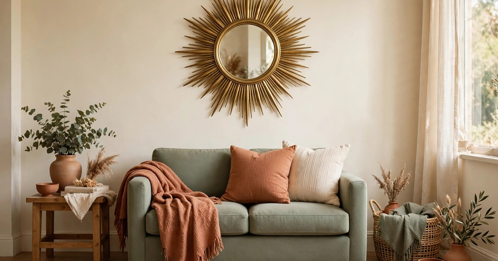
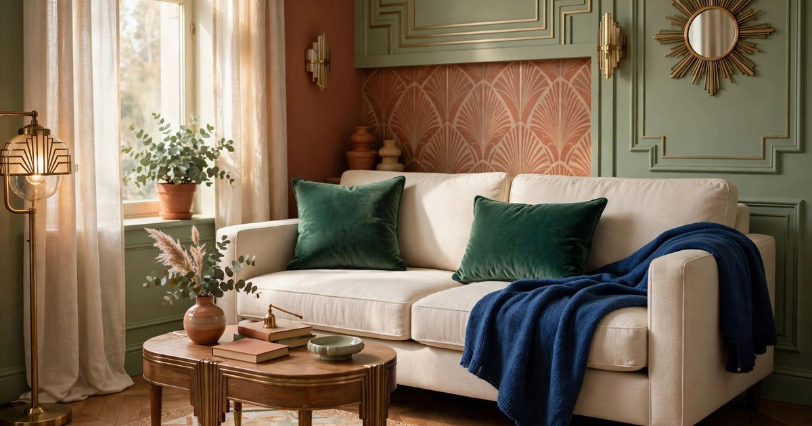
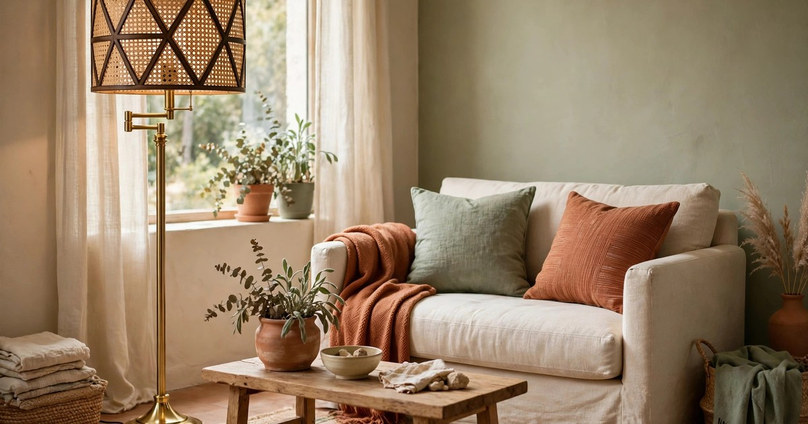
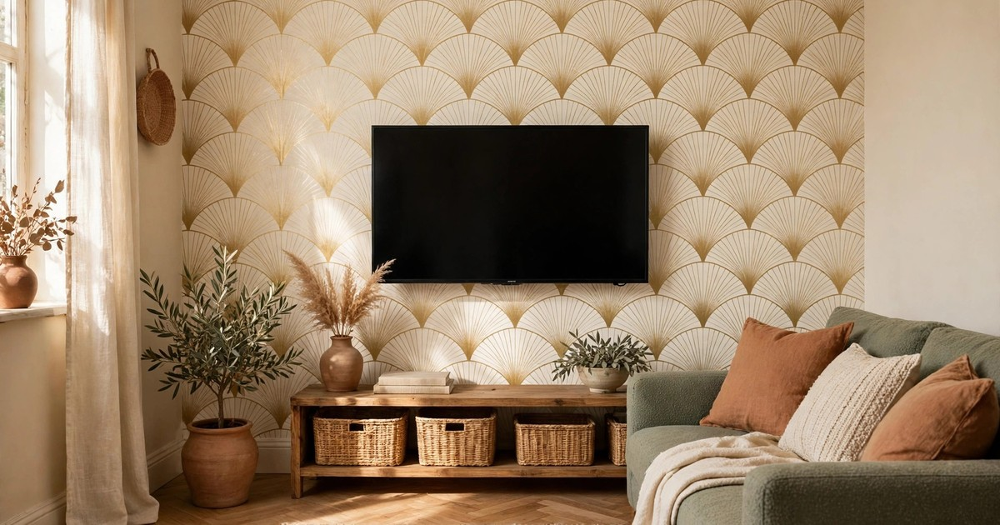
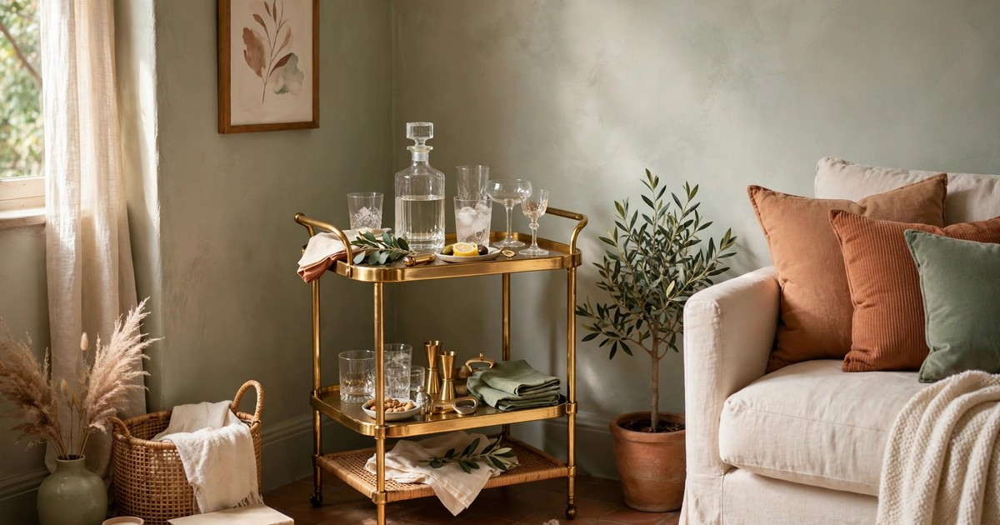
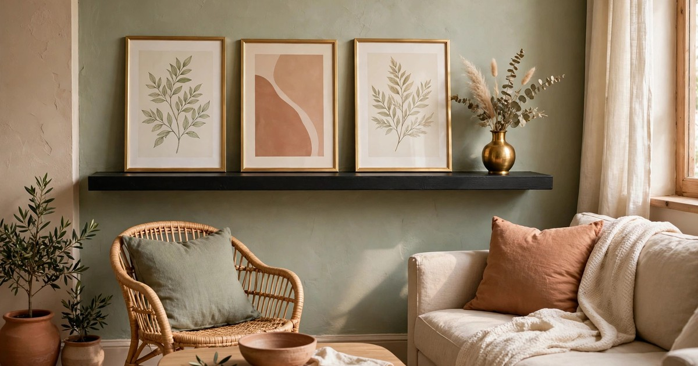
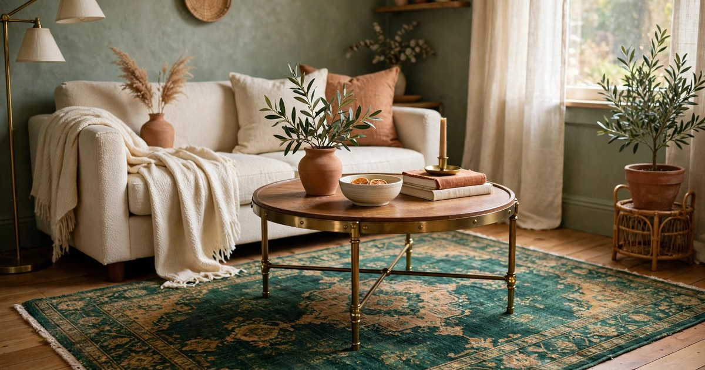
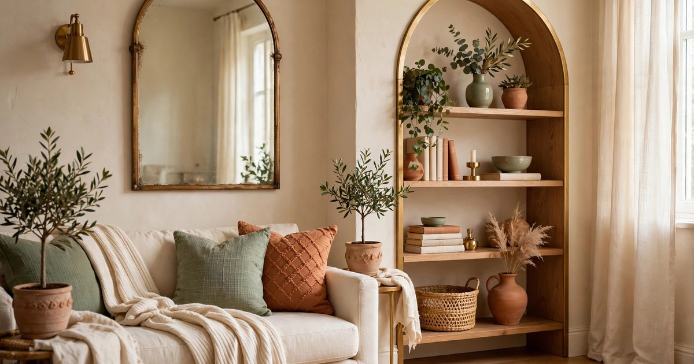
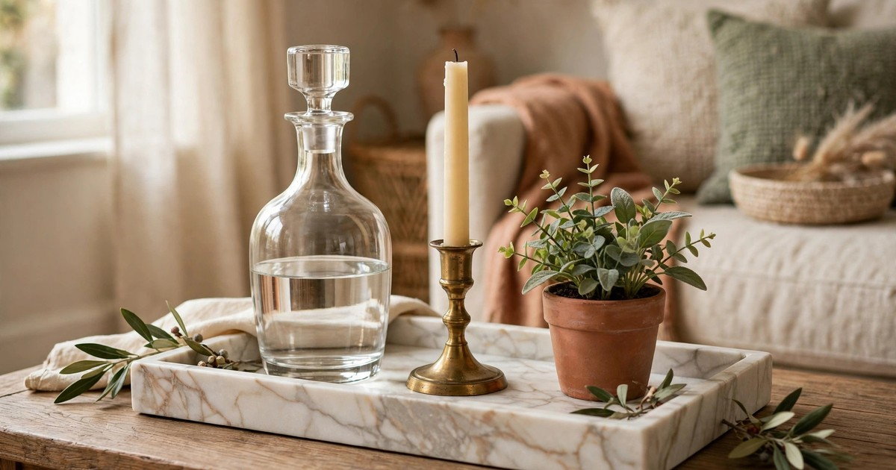
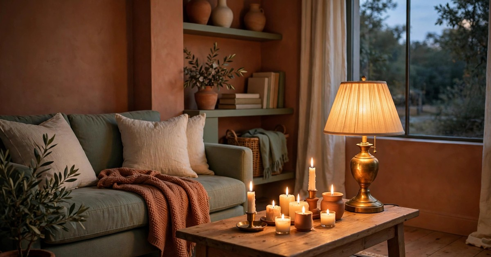

There is a particular pleasure in walking into a 1920s hotel lobby: the brass gleaming, the geometry sharp, the colours rich enough to feel expensive without feeling loud. Neo Deco brings that same feeling into a small living room, and it does it without renovation, without drilling and without a boutique budget. The trend — modern art deco, all arches, sunbursts, brass and jewel tones — is one of Pinterest Predicts 2026's headline movements, and small apartments are where it works hardest. A small room cannot afford wasted decoration, and Neo Deco never wastes a move: every piece earns its place by adding light, shape or colour.

The trick is restraint. A small living room dressed head to toe in gold leaf and emerald velvet will feel like a stage set, not a home. The rooms that work best pick three or four deco moves and repeat them: one strong brass moment, one jewel-tone anchor, one geometric pattern and one piece of shine. Everything else stays quiet — cream walls, a simple sofa, warm wood — so the glamorous pieces have room to breathe. This list gives you ten ideas that follow that rule, each one renter-friendly and budget-first, and each one sized for a room where the sofa is two metres from the television.

If the bedroom version of this look caught your eye, our [renter-friendly Neo Deco bedroom ideas](/neo-deco-bedroom-ideas-renters/) use the same palette in a smaller room, and the [brass light fixtures for small spaces](/brass-light-fixtures-small-spaces/) in this series pair beautifully with everything below.

### 1. Start with a sunburst mirror over the sofa

A sunburst mirror is the single fastest way to make a small living room feel deco. The radiating rays read as geometry and glamour at once, the brass finish catches whatever light the room has, and the mirror itself doubles the sense of space by reflecting the window opposite. Hang it centred over the sofa, with the bottom of the mirror about fifteen to twenty centimetres above the sofa back — high enough to clear cushions, low enough to feel connected to the furniture rather than floating near the ceiling.

Size matters more than price here. A mirror that is too small looks lost above a sofa; aim for one roughly two-thirds the width of the sofa, and if your budget only stretches to a smaller piece, hang it over a sideboard or an armchair instead, where the proportions work in your favour. Lightweight resin and metal versions cost very little and hang from a single adhesive hook or picture strip, so there is no drilling and no deposit risk. Keep the wall around it plain — a sunburst mirror does not want competition from a gallery wall — and let it be the one loud thing on that wall.

### 2. Go jewel-tone on the sofa, not the walls

Painting a rental living room emerald green is a negotiation most landlords will decline, but a jewel-tone sofa dressing costs nothing in deposit terms and delivers almost the same drama. Two velvet cushion covers in emerald or sapphire, a throw in the same family draped over one arm, and suddenly the cream rental sofa you already own looks like it was chosen for the scheme. Velvet is the key fabric: its pile catches light differently from every angle, so even a flat colour looks layered and expensive.

Keep the rest of the soft furnishings quiet so the jewel tones stay the star. Cream or warm white cushions beside the velvet ones stop the look from feeling heavy, and a single brass or black accent — a cushion with a thin gold piping, a small tray on the coffee table — ties the sofa back to the rest of the room. If you want to go further, a washable jewel-tone rug under the coffee table anchors the whole seating area, but buy the cushions first: they are the cheapest test of whether the palette suits your light, and you can return them if it does not.

### 3. Add a brass floor lamp with a geometric shade

Small living rooms suffer from one overhead light, and one overhead light flattens everything. A brass floor lamp with a geometric drum or empire shade fixes the lighting and the style in a single purchase. Place it behind the sofa's reading corner or beside an armchair, and it gives you a pool of warm light exactly where you sit in the evening — which is also where guests' eyes go first.

Look for a slim stem and a small footprint, because a chunky base eats floor space you do not have. Arc lamps look dramatic in photographs and terrible in small rooms, where the arc hangs over the middle of the floor; a straight stem tucked against the wall is the practical choice. A warm white bulb (2700K) keeps the brass glowing rather than glaring, and a dimmer plug in the socket turns the same lamp into evening mood lighting. Our roundup of [brass light fixtures for small spaces](/brass-light-fixtures-small-spaces/) has plug-in and battery options that need no electrician at all.

### 4. Frame the television wall with fan-pattern peel-and-stick wallpaper

The television wall is the hardest wall in a small living room: it has to hold a black rectangle and still look like decor. A single strip of fan-pattern or scallop peel-and-stick wallpaper behind the television solves it. The deco fan motif is unmistakably 1920s, the peel-and-stick format comes down cleanly when you move, and confining it to one wall — or even one vertical panel behind the television — keeps the pattern from overwhelming the room.

Choose a paper in cream and gold rather than a high-contrast black and gold, which can feel heavy in a small space, and hang the television or a low media unit in front of it so the pattern reads as a frame rather than a feature wall competing for attention. If you would rather not paper at all, the same effect comes from a large framed fan-pattern print, or from three small framed prints in a row above the media unit. The pattern is the point, not the medium, so pick whichever version your landlord and your budget are happiest with.

### 5. Let a bar cart be the room's glamorous anchor

Nothing says 1920s glamour quite like a bar cart, and the antique bar cart is the single most-searched Neo Deco piece of 2026 for good reason. A small two-tier brass and glass cart tucks into a corner that would otherwise hold nothing, and it earns its footprint twice over: it is a drinks station, a display shelf and a piece of sculpture all at once. Style the top tier with a decanter, two or three glasses and a small vase of greenery, and keep the lower tier for bottles and books so it never looks cluttered.

If a real vintage cart is out of budget, a new brass-finish trolley costs a fraction of the antique price and reads almost identically once it is styled. The styling is what sells it, so keep the palette tight — brass, glass, one jewel tone — and resist the urge to load every shelf. A cart with breathing room looks like a hotel lobby; a cart packed to the edges looks like a storage unit. If you do not drink, the same cart works as a plant stand, a tea station or a record-player perch, and the glamour survives the change of job completely.

### 6. Build a black-and-gold picture ledge

A picture ledge is the renter's answer to a gallery wall: one narrow shelf, held up by adhesive strips or a couple of small hooks, that lets you layer framed prints without committing to a dozen holes. In a Neo Deco room, paint the ledge black or choose a black finish, then fill it with gold-framed prints — a sunburst, a fan pattern, a black-and-white photograph of a 1920s building — and one small brass object, a vase or a candle holder, to break the flatness.

The ledge works because it is changeable. Swap one print for a Christmas card in December, a postcard from a trip in summer, and the room refreshes itself without a single new purchase. Keep the frames in the same finish and vary the sizes instead: two large prints with one small one between them looks collected, while six identical frames in a row looks like a shop display. Hang the ledge at eye level when seated, not standing — in a small living room you spend most of your time on the sofa, and the art should be composed for that view.

### 7. Anchor the seating area with a vintage-look jewel-tone rug

A rug is the largest piece of colour most small living rooms will ever hold, and in a Neo Deco scheme it does the heavy lifting. A vintage-look rug in emerald, sapphire or deep ruby — ideally washable, because small rooms and real life share the same floor — defines the seating area, warms up pale rental flooring and ties the jewel-tone cushions to the floor so the colour feels deliberate rather than scattered.

Size it generously: a rug that only just fits under the coffee table makes the room feel smaller, while one that reaches under the front legs of the sofa makes the seating area feel like a room within a room. If a full-size vintage rug is out of budget, a smaller jewel-tone rug layered over a plain jute or cream base rug gives you the same colour story for less, and the layering itself is very deco — pattern on pattern, but disciplined. Keep the pattern faded rather than sharp; a distressed vintage print reads as texture, while a crisp new geometric can fight with the wallpaper and the mirror.

### 8. Use arches wherever the room will allow them

The arch is Neo Deco's signature shape, and it is wonderfully forgiving in small rooms because it draws the eye upward without adding visual weight. An arched mirror leaning against the wall behind a chair, an arched shelving unit in an empty corner, or even an arched piece of peel-and-stick wall decal behind a side table — each one gives the room the same soft geometry, and none of them needs a single hole in the wall.

If you can only add one arch, make it a mirror. A leaning arched mirror reflects light across the room, makes a low ceiling feel taller, and gives you a full-length check before you leave the flat, which is three jobs for one piece. Keep the frame brass or black, never white, so it reads as deco rather than farmhouse, and style the shelf or the floor in front of it simply — a small plant, a stack of books — so the arch itself stays the focus.

### 9. Style a marble-look tray vignette on the coffee table

A coffee table vignette is where a Neo Deco living room proves it is a home and not a showroom, and a tray is what keeps it from becoming clutter. Start with a marble-look tray — real marble is heavy and expensive, but a marble-effect resin or ceramic tray costs very little and reads identically at arm's length — then add three things: something tall, something that shines, and something alive. A small decanter or a tall candle holder, a brass object, and a sprig of eucalyptus or a tiny potted plant.

The rule of three keeps the vignette intentional, and the tray keeps it contained: everything that belongs to the display stays inside the tray, and everything else — remote controls, coasters, the book you are reading — lives outside it. Red marble is having a particular moment in the Neo Deco trend, so if you find a tray with red veining, it will feel very current; cream and grey veining is the safer, longer-lasting choice. Either way, the tray is one of the cheapest deco moves on this list, and it is the one guests notice first.

### 10. Layer the light: warm bulbs, a dimmer plug and candles

Deco rooms were never lit by a single ceiling bulb, and yours should not be either. Three layers of warm light — the floor lamp from idea three, a small table lamp or a pair of battery candles on the media unit, and real candles in brass holders on the coffee table — turn a small living room from flat to golden in the evening, which is when you actually live in it. Warm white bulbs throughout (2700K, never daylight) keep every surface in the same honeyed tone, and a dimmer plug on the floor lamp lets you drop the light level without losing the glow.

Battery candles are the renter's friend here: they go inside lanterns, on high shelves and in the bar cart without any fire risk, and a set with a timer switches itself on every evening. Save the real candles for the coffee table, where you can see them, and keep them in brass holders so even unlit they contribute to the scheme. Lighting is the least photogenic item on this list and the most transformative in real life — get the light right and the brass, the velvet and the geometry all look twice as expensive.

## Frequently Asked Questions

### Is Neo Deco renter-friendly?
Yes — almost every move in this list is damage-free. Peel-and-stick wallpaper, adhesive hooks, leaning mirrors, bar carts and soft furnishings all come down or move out without a trace. The only pieces that need a conversation with your landlord are anything that involves drilling, and none of these ideas requires it.

### How do I keep a small room from feeling busy with so much pattern?
Pick one pattern and repeat it, then keep everything else plain. If your wallpaper is a fan pattern, your mirror should be a sunburst, not another fan, and your rug should be a faded vintage print rather than a second geometric. Three deco moves repeated beats ten deco moves competing.

### What colours define Neo Deco?
Brass and black as the structure, cream as the background, and one jewel tone — emerald, sapphire or ruby — as the accent. Red marble is the trend's current statement material, but it works best as a single tray or vase rather than a whole room.

### Where can I find brass decor on a small budget?
Thrift shops, charity shops and the homeware aisle of discount stores are full of brass candle holders, trays and frames for a few pounds or dollars each. New brass-finish pieces from budget retailers read identically once styled, and a single good piece beats five cheap-looking ones, so buy slowly and choose well.
