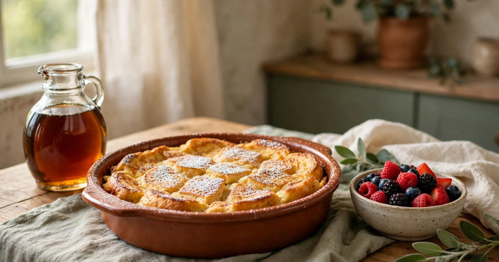
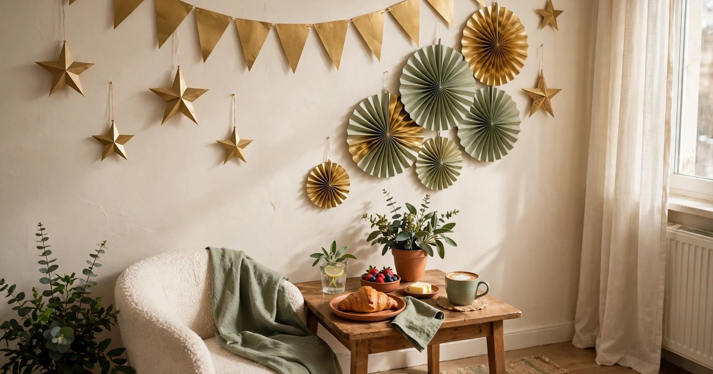
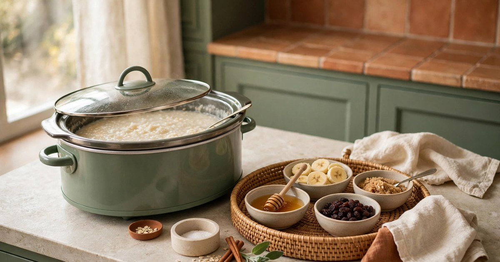
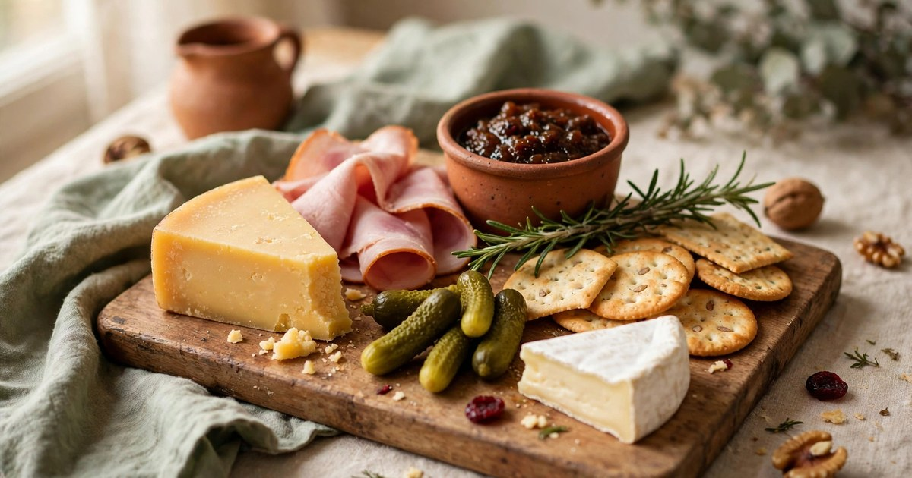
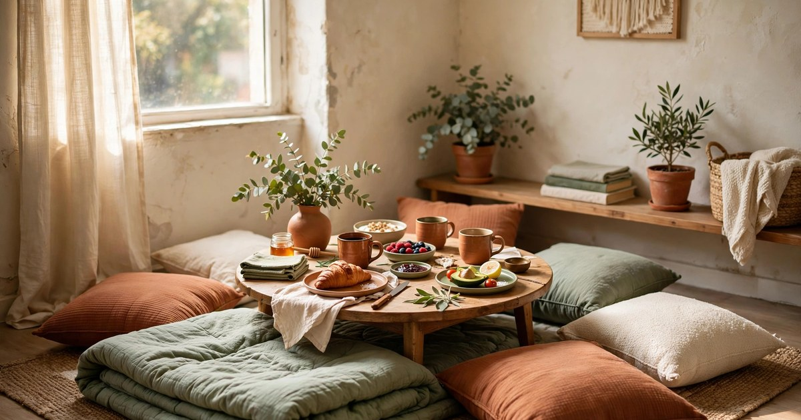
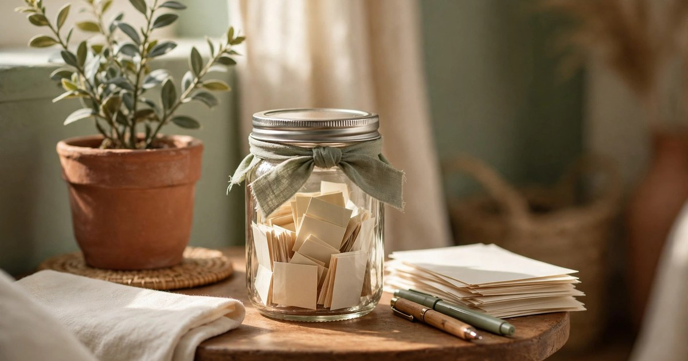
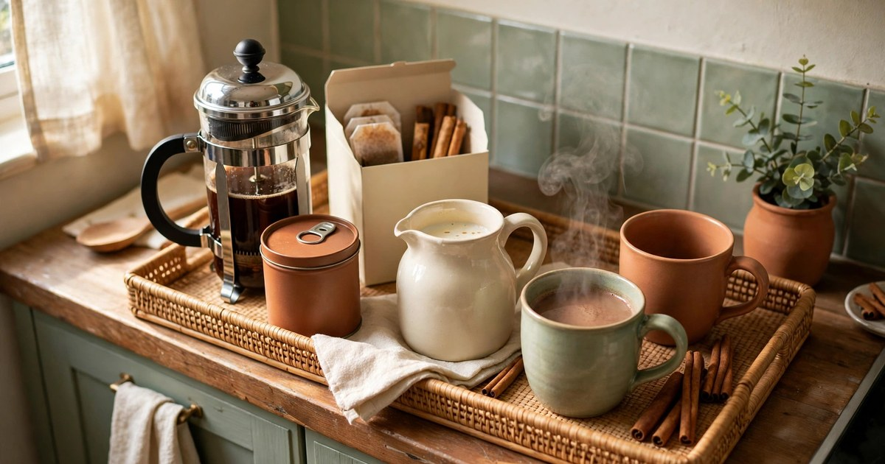
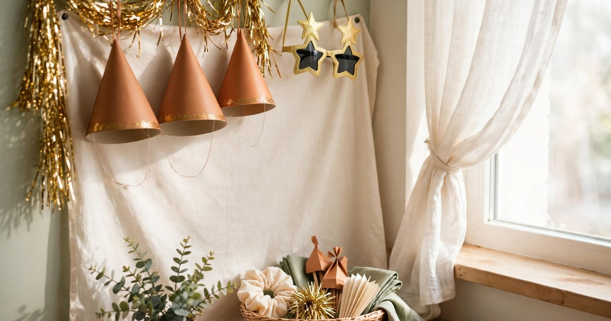
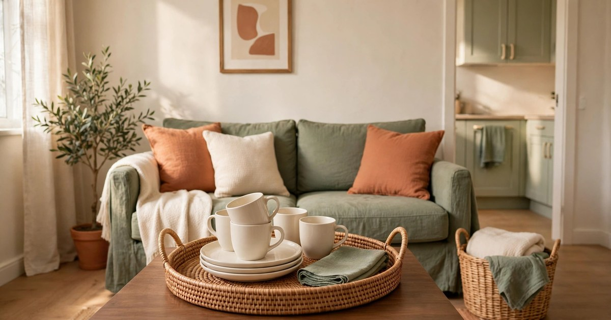

New Year's Day is the gentlest day of the year. Nobody is in a hurry, nobody expects a grand performance, and everyone arrives a little sleepy and very ready to be fed. That makes it the perfect morning to host in a small rental — a brunch is a low, slow, seated gathering, and a small flat does it better than a big house because everyone sits close enough to talk properly.

Hosting on 1 January in a rental adds two worries that homeowners never think about: the deposit and the energy levels. Every decoration has to come down without a mark, and nothing can demand that you stand at a hob for an hour when you only went to bed at 3 am. The good news is that a New Year's Day brunch is the easiest party to make both deposit-safe and host-friendly, because almost everything can be made the night before, set out on one table, and cleared away in a single tray. These ten ideas keep the morning calm, the spending under £35, and the flat spotless by noon.

### 1. A make-ahead overnight French toast bake

The single best decision you can make for a New Year's Day brunch is to do the cooking on New Year's Eve. An overnight French toast bake is assembled the night before in one dish — cubes of day-old bread, eggs, milk, a spoonful of cinnamon and a little vanilla — then covered and left in the fridge while you are out celebrating. In the morning you slide it into the oven, and forty-five minutes later it comes out golden and puffed while you are still in your dressing gown.

Use the cheapest bread that works, which is a supermarket white loaf a day past its best; stale bread soaks up the custard better than fresh and costs a fraction of a brioche. Serve it straight from the dish with a jug of maple syrup or honey, a bowl of frozen berries thawed overnight, and a dusting of icing sugar. Nobody will know it cost under £5 to make, and nobody will ask, because they will be too busy going back for seconds.

### 2. A mimosa and mocktail bar on a tray table

A drinks bar turns a plain brunch into a party, and it does not need a trolley or a bar cart — a tray table, a folding TV table, or even a cleared ironing board with a cloth over it will do. Set out one bottle of prosecco or cava, a jug of orange juice, a jug of cranberry juice, and a bottle of sparkling water, and let guests mix their own. People love choosing their ratio, and it frees you from playing bartender all morning.

Keep the cost down by buying the supermarket's own-label fizz rather than a named brand — chilled and mixed with juice, nobody can tell the difference. For guests who are not drinking, the same juices with sparkling water and a slice of orange make a mocktail that looks just as celebratory in the glass. Put the bar on a tray with a rim so any spill is contained, and lay a folded tea towel underneath the jugs to catch drips. For more ideas on dressing a small table for a celebration, see our [renter-friendly New Year's Eve table decor ideas](/renter-friendly-new-years-eve-table-decor-ideas/).

### 3. Paper decorations that go up in ten minutes

New Year's Day decorations should be fast, cheap and gone by lunchtime, and paper is the only material that ticks all three boxes. A string of paper bunting, a handful of gold paper stars, and a few paper fans taped to the wall take ten minutes to put up and cost under £5 from a pound shop or a supermarket party aisle. They also come down without a mark, which matters more than anything in a rental: use washi tape or command strips, never pins or Blu Tack on painted walls.

Make the decorations do double duty by reusing last night's party props — the "Happy New Year" banner from the evening can stay up for brunch, and any leftover balloons can be gathered into a corner bunch rather than thrown away. Choose one colour — gold on cream, or blush pink — and keep everything in that palette so a handful of cheap paper pieces looks deliberate rather than scattered.

### 4. A slow-cooker porridge bar with toppings

If your oven is busy with the French toast bake, the slow cooker earns its keep with porridge. Put oats, milk and a pinch of salt in the slow cooker on low before bed — or on high for two hours in the morning — and wake up to a pot of porridge that has cooked itself. Set out toppings in small bowls and let everyone build their own: brown sugar, honey, sliced banana, raisins, peanut butter, and whatever jam is already in the fridge.

Porridge is the cheapest hot dish you can serve — a bag of oats costs under £1 and feeds eight people easily — and it is exactly what tired guests want on a cold January morning: warm, filling and gentle. The toppings bar is where it becomes a brunch rather than a breakfast: arrange the bowls on a tray with a little handwritten card for each one, and add one treat topping such as chocolate chips to make it feel indulgent. Keep the slow cooker on warm through the morning so latecomers get a hot bowl too.

### 5. A "leftovers into brunch" board from Christmas cheese and ham

Every fridge in the country holds the same thing on 1 January: half a Christmas cheese board, some sliced ham, a few pickles and a heel of bread. Turn it into the centrepiece of your brunch instead of letting it sit there until it goes off. Arrange the cheese, ham, crackers and pickles on your biggest board or a baking tray lined with greaseproof paper, add a sliced apple or a few grapes if you have them, and call it a brunch board. It looks generous, it costs nothing extra, and it clears the fridge before the food wastes.

The trick is presentation: cut cheese into neat wedges, fold the ham into loose rolls, and fill gaps with crackers and a small pot of chutney. A sprig of rosemary from a windowsill plant or a few bay leaves makes the board look styled rather than thrown together. Serve it with the French toast bake and the porridge bar and you have a full spread without buying a single extra ingredient.

### 6. Cosy seating: floor cushions and a low table

A small rental rarely has enough chairs for a brunch party, and buying chairs for one morning is a waste of money. The renter's answer is floor seating: a pile of cushions, a folded duvet as a floor mat, and a low coffee table — or a large tray on a couple of sturdy boxes — as the eating surface. It feels like a picnic indoors, guests relax into it within minutes, and it turns a seating shortage into the most memorable part of the morning.

Borrow cushions from the sofa and the bed, and ask one guest to bring a couple if you are short. Layer a blanket under the cushions so nobody sits on a cold floor, and keep the table low enough that plates rest comfortably in laps or on the table edge. This setup works best for six or fewer guests; with more, split the group between the table and the floor so nobody is perched awkwardly. When brunch ends, the cushions go straight back on the sofa and the room is a living room again in five minutes.

### 7. A New Year intentions and resolutions jar

Every New Year's gathering needs one moment about the year ahead, and a resolutions jar is the cheapest and most charming way to create it. Put a clean jam jar on the table with a stack of small paper slips and a couple of pens, and invite each guest to write down one intention for the year — something they want to do, learn or let go of — fold it, and drop it in.

Make the jar part of the table dressing rather than an afterthought: tie a ribbon around it, write "Intentions for 2027" on a card, and set it next to the drinks so everyone passes it. You can read a few slips aloud over the last cup of coffee, or seal the jar and keep it until next New Year's Day, when opening it becomes a tradition of its own. The whole thing costs nothing — a jar from the recycling, paper from a notebook, pens you already own — and it gives the morning a purpose beyond eating, which is what guests remember long after the plates are cleared.

### 8. A hot drinks station: coffee, cocoa and spiced tea

On a cold January morning, the hot drinks station is where guests gather, so give it a proper corner of the kitchen rather than squeezing it between the dishes. Set out the kettle, a cafetière or a jar of instant coffee, a tin of cocoa, and a box of spiced tea bags, with mugs, sugar and milk alongside.

Keep the station cheap by using what you already own: the mugs from the cupboard, the cocoa from Christmas, the tea bags from the back of the drawer. Add one small luxury to make it feel special — a tin of marshmallows or a jar of cinnamon sticks — and let guests dress their own drinks. Put a tray under everything to catch drips, and place the station away from the food table so the queue for coffee does not block the queue for food. If you hosted a winter evening gathering before, the same setup works there too — see our [winter dinner party guide for small rentals](/host-winter-dinner-party-small-rental-guide/) for the full layout.

### 9. A photo corner with last night's party props

Nobody arrives at a New Year's Day brunch looking their best, and that is exactly why a photo corner works — it gives everyone permission to be silly about it. Gather last night's props — the party hats, the novelty glasses, the "2027" headbands, the gold tinsel — and hang them on a hook or drape them over a chair in the best-lit corner of the room. Add a plain sheet or a length of wrapping paper taped to the wall as a backdrop, and you have a photo corner that cost nothing and produces the pictures everyone shares.

The best spot is by the window, where the soft January daylight does the work of a ring light for free. Put a small sign on the wall — "New Year, same us" — and leave a phone tripod or a stack of books so guests can set a timer and take group shots without a photographer. The photos double as thank-yous: send the best one to each guest later in the day and you have thanked them for coming without writing a single message.

### 10. A one-tray tidy-up plan so the flat is clean by noon

The best part of a New Year's Day brunch is that it can be over — and the flat clean — by noon, leaving the whole afternoon free. The secret is a one-tray tidy-up plan: before guests arrive, put a large tray or a washing-up bowl by the table, and as plates empty, everything goes straight onto the tray instead of piling up on the table. When the tray is full, it goes to the kitchen in one trip.

Give the plan a ten-minute slot on the morning's schedule — say 11.30 am — and ask two guests to help: one clears, one wipes, you wash. Three people can clear a brunch for eight in under ten minutes, and guests genuinely like helping; it is part of the sociable feeling of the morning. Paper decorations come down into a bag for the recycling, cushions go back on the sofa, the tray table folds away, and the room is a living room again. Starting the year with a clean flat and a clear afternoon is a better resolution than any list. For the morning-after side of the festive season, our [Christmas morning guide for small apartments](/christmas-morning-small-apartment-guide/) uses the same one-tray trick.

## Shop this look: New Year's Day brunch essentials

- **Slow cooker** — porridge cooks itself overnight while you sleep in. [Shop slow cooker](https://www.amazon.com/s?k=slow+cooker+small+family&tag={{AMAZON_TAG}})
- **Cafetière** — proper coffee for the hot drinks station, no machine needed. [Shop cafetière](https://www.amazon.com/s?k=cafetiere+french+press+coffee+maker&tag={{AMAZON_TAG}})
- **Paper bunting** — ten minutes up, gone by lunchtime, no marks on the wall. [Shop paper bunting](https://www.amazon.com/s?k=paper+bunting+gold+party&tag={{AMAZON_TAG}})
- **Gold paper stars** — a handful in one colour makes cheap paper look deliberate. [Shop gold paper stars](https://www.amazon.com/s?k=gold+paper+stars+party+decorations&tag={{AMAZON_TAG}})
- **Washi tape** — hangs paper decorations without damaging painted walls. [Shop washi tape](https://www.amazon.com/s?k=washi+tape+decorative+gold&tag={{AMAZON_TAG}})
- **Floor cushions** — turn a seating shortage into the cosiest part of the morning. [Shop floor cushions](https://www.amazon.com/s?k=floor+cushions+large+soft&tag={{AMAZON_TAG}})

## Frequently Asked Questions

### How many people can I host for a New Year's Day brunch in a small rental?

Six to eight guests is the sweet spot for a one-room flat. That is enough for a lively table and few enough that everyone gets a real seat or a proper floor cushion. A brunch that fits the room feels cosy; one guest too many makes it feel crowded.

### What is the cheapest New Year's Day brunch menu?

An overnight French toast bake, a slow-cooker porridge bar and a leftovers board will feed eight people for under £15 in total. The porridge costs under £1 in oats, the French toast bake under £5, and the board uses food already in the fridge.

### How do I decorate for New Year's Day brunch without damaging my rental?

Use paper decorations hung with washi tape or command strips, and never pins, nails or Blu Tack on painted walls. Paper bunting, stars and fans go up in ten minutes, cost under £5, and come down without a mark.

### Can I host a New Year's Day brunch if I was out late the night before?

Yes — that is exactly what this plan is built for. The oven and slow cooker do the cooking while you wake up, and the one-tray tidy-up plan means the flat is clean by noon.

### What time should a New Year's Day brunch start and end?

Invite guests for 10.30 or 11 am, when everyone has slept in, and plan to wind down around 12.30 pm. Two hours is long enough to eat properly, share intentions and take photos, and short enough that nobody feels trapped.
