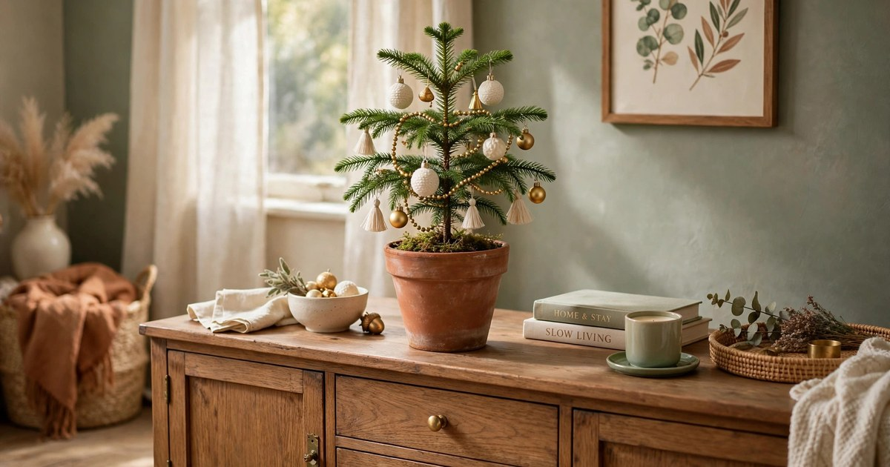
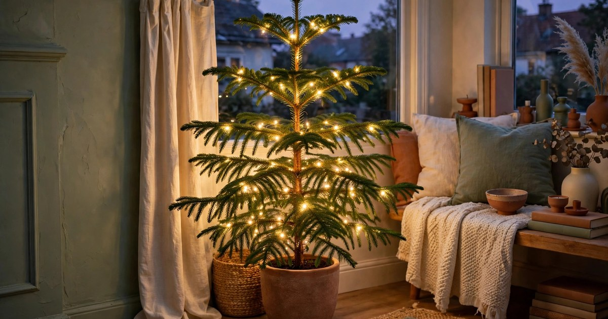
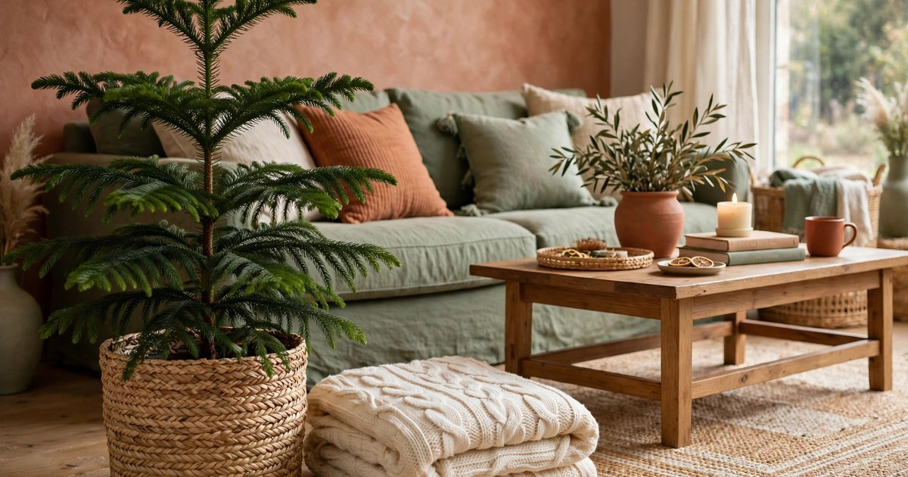
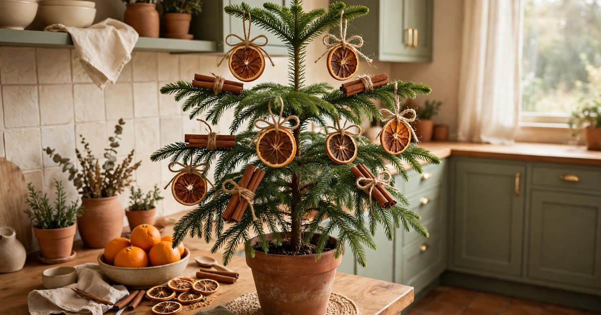
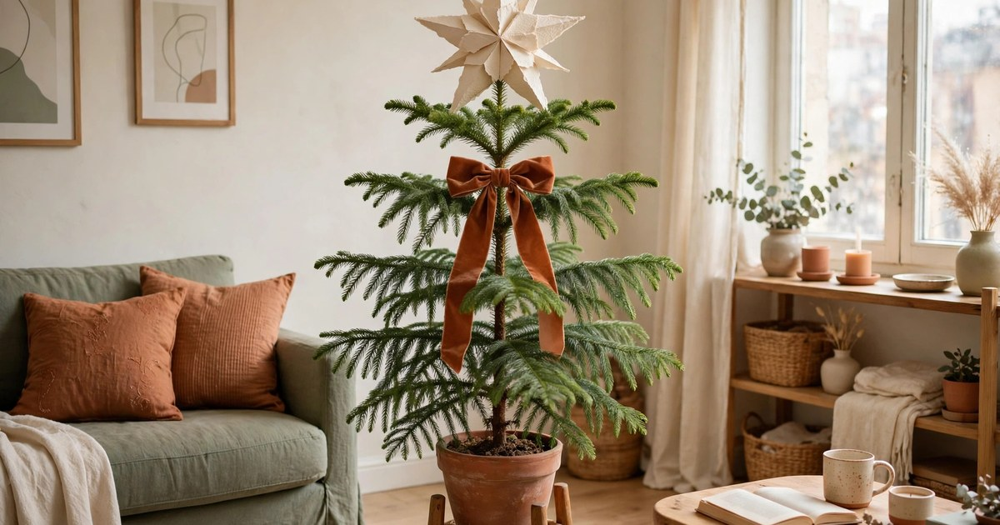
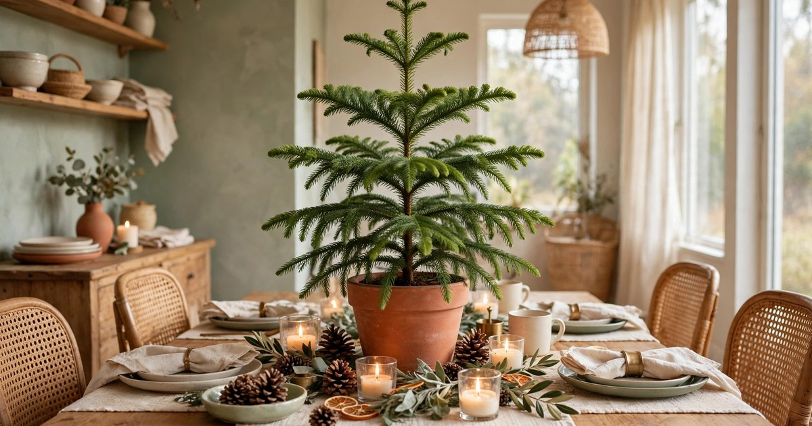
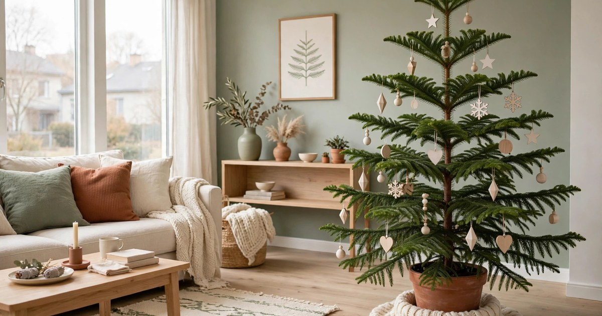
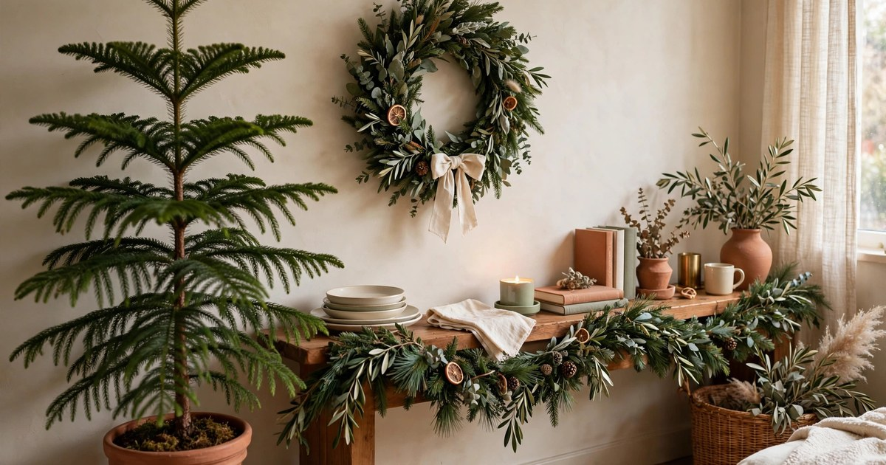
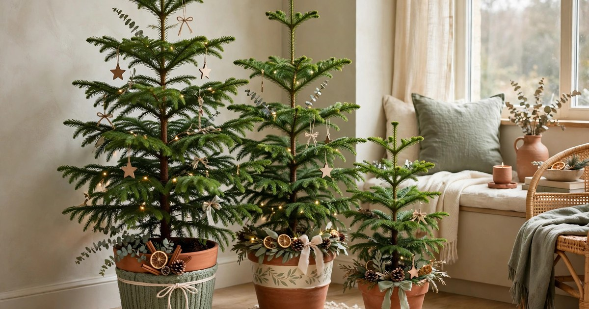
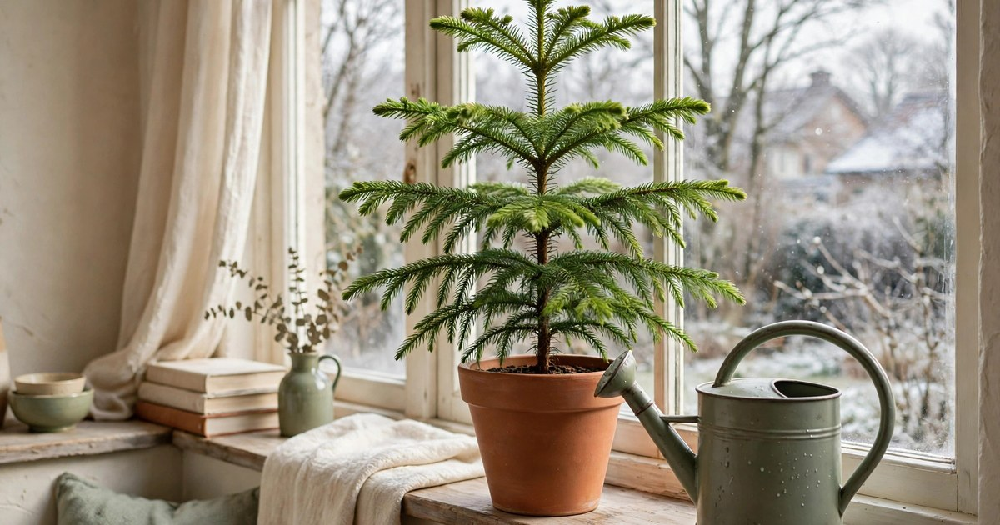

A Norfolk pine is the renter's secret weapon at Christmas. It looks like a miniature Christmas tree, it costs a fraction of a cut tree, and — unlike the tree you drag to the kerb in January — it is still alive in February. With its soft, feathery branches and naturally symmetrical shape, a Norfolk pine (Araucaria heterophylla) gives you the full festive look in a pot you can keep, and it fits happily on a sideboard, a windowsill or the floor of a small flat where a seven-foot spruce never could.

The trick is decorating with a light touch. Norfolk pine branches are softer and more delicate than a cut tree's, so heavy baubles, thick tinsel and dense garlands will drag the branches down and stress the plant. Think small, light and warm instead: miniature ornaments, battery fairy lights, dried citrus, cinnamon sticks and a beautiful pot. Every idea below is renter-friendly and budget-first, and each one comes with a care tip woven in, because the whole point of a living Christmas tree is that it keeps growing long after the decorations come down. Buy it early in November if you can, give it bright indirect light, and it will reward you with fresh green growth all winter.

### 1. Keep it simple with miniature ornaments

The single best rule for decorating a Norfolk pine is to go small. Miniature baubles — the kind sold in packs of twelve or twenty for a few pounds — weigh almost nothing, so the soft branches hold their shape instead of drooping under the weight. Choose a tight palette of two or three colours and repeat them all over the tree: cream and gold with a touch of sage, or terracotta and blush with warm wood, will look far more expensive than a rainbow of random ornaments. Hang the largest of your miniatures low, where the branches are strongest, and the tiniest ones near the top, where the growth is most delicate.

Space the ornaments out rather than crowding every branch. A Norfolk pine's charm is in its feathery, layered foliage, and a tree smothered in baubles hides the very thing that makes it special. Aim for one ornament per branch tip, with gaps of green showing between them, and step back every few minutes to check the shape from across the room. If you are working to a tight budget, a single mixed pack of mini ornaments and a spool of thin gold thread are all you need — tie the thread into small loops rather than using the bulky metal hooks that come in the box, and the ornaments will sit neatly without bending the branches. Keep the tree away from radiators and hot air vents while it is dressed, since dry heat is the fastest way to brown the lower branches.

### 2. Wrap it in warm battery fairy lights

Fairy lights are what turn a Norfolk pine from a houseplant into a Christmas tree, and battery-operated strings are the renter's best friend — no trailing cables, no socket hunting, no drilling. Choose a short string of warm-white micro LEDs, around two to three metres for a tabletop tree, and wind it loosely around the tree in a gentle spiral, starting at the top and working down. Keep the lights on the outside of the branches rather than threading them deep into the foliage, so the wires never pinch or bend the soft growth.

A small battery pack tucks neatly behind the pot or inside a decorative basket, and a string with a built-in timer is worth the extra pound or two: six hours on and eighteen off keeps the glow going through the evening without you remembering to switch it off. Battery lights also run cool, which matters for a living tree — mains lights and old-fashioned incandescent strings give off heat that dries the needles. While the lights are on, the tree is still a plant: it needs its usual bright, indirect light during the day, so do not push it into a dark corner just because the fairy lights look good there. Water when the top few centimetres of soil feel dry, and rotate the pot a quarter turn every week so the tree grows evenly instead of leaning towards the window.

### 3. Dress it in a beautiful basket or terracotta pot

The pot is half the decoration. A Norfolk pine usually arrives in a plain black nursery pot, and simply dropping that pot inside something beautiful transforms the whole tree. A woven seagrass basket, a terracotta pot one size larger, or a ceramic planter in cream or sage all work wonderfully with the warm, earthy palette of a Norfolk pine, and none of them cost much at a thrift shop or discount store. If the pot is too tall, set the nursery pot on an upturned saucer inside it so the tree sits at the right height.

Leave the tree in its nursery pot rather than repotting it at Christmas. Repotting in winter, when the plant is growing slowly and the days are short, is a needless shock — and the nursery pot makes watering easier, since you can lift the plant out, water it in the sink and let it drain before setting it back. Add a layer of sphagnum moss or a folded linen cloth over the soil surface to hide the plastic rim and give the display a finished look. A basket or pot cover also solves the renter's other problem: it catches drips, so watering never stains a wooden floor or a landlord's sideboard. Choose a cover with no drainage hole, and always empty any water that collects in the bottom after watering.

### 4. Add dried orange slices and cinnamon sticks

Dried orange slices and cinnamon sticks are the cheapest ornaments you will ever own, and they suit a Norfolk pine perfectly because they weigh almost nothing. Slice oranges thinly, dry them slowly in a low oven or on a sunny windowsill for a few days, then thread jute twine through a small hole and hang them from the branch tips. A cinnamon stick tied with the same twine makes a rustic companion, and the two together give off a gentle festive scent every time you brush past the tree.

Make your own rather than buying ready-made packs, and the whole decoration costs less than a single bag of shop-bought baubles. Dry the slices until they are fully crisp and papery — any moisture left in the fruit will attract mould in a warm living room. Hang them on the outer branches where air circulates, and take them down after a few weeks if they start to soften. The same low-effort, high-charm approach works for the rest of the room too: a string of dried orange slices across a window or along a shelf echoes the tree and ties the whole space together for pennies. Keep the tree's soil evenly moist while the ornaments are up, since a dry Norfolk pine drops its lower branches first — and those are the branches your ornaments are hanging from.

### 5. Top it with a paper star or a simple bow

A Norfolk pine rarely needs a shop-bought tree topper. Its top is a soft, upward-pointing tip that suits something light and handmade: a folded paper star, a small wooden star, or a simple velvet bow in terracotta or cream. A heavy glass or metal topper will bend the leader stem and can damage the growing tip, which is the part of the tree that decides its shape for years to come — so keep whatever you choose under a few dozen grams.

A paper star is the easiest option and costs nothing. Fold one from a sheet of kraft paper or a page of an old book, or cut a simple five-pointed star from card and hang it from the top branch with a loop of thread. A velvet or linen bow is just as simple: tie a wide ribbon around the top few centimetres of the stem, letting the tails drape down a couple of branches, and it reads as a topper without putting any weight on the tip at all. Whichever you choose, fix it gently and check it every few days — a topper that slips and hangs from one side will pull the leader sideways. If the tip does get bent, do not panic: the tree will usually send up a new leader, but it takes a season to recover, so prevention is worth the care.

### 6. Style it as a tabletop centrepiece

A small Norfolk pine, forty to sixty centimetres tall, makes a better tabletop centrepiece than any shop-bought arrangement — and you already own the plant. Set it in the middle of the dining table on a wooden board or a woven placemat to protect the surface, and build the scene around it with things you already have: a few pinecones, a cluster of battery tea lights in glass holders, a sprig of eucalyptus laid flat, or a folded linen napkin under the pot. The tree does the visual work; everything else is just framing.

Keep the styling low and sparse so the tree stays the star and nobody has to peer around it to talk across the table. Two or three small elements are enough, and keeping the palette to cream, wood and green means the centrepiece works from the first week of December right through to New Year's Day without looking tired. A tabletop tree is also the easiest to care for, because it sits where you see it every day — you will notice dry soil or a drooping branch immediately. Just keep it clear of the candles: even battery tea lights should sit a hand's width from the foliage, and real candles never belong next to a living tree. When dinner is over, the tree goes back to its bright spot by the window, where it belongs.

### 7. Go full Scandi with white and wood

If your flat leans minimal, a Norfolk pine is made for the Scandinavian look. The tree's soft, feathery green is the only colour you need: dress it in white wooden ornaments, small cream pom-poms and a few unpainted wooden beads, and let the natural tones do the talking. A cream knitted tree skirt or a simple linen cloth under the pot finishes the look without adding clutter, and the whole scheme costs very little because it uses so few pieces.

The Scandi approach suits the plant as well as the room. With only a handful of lightweight ornaments, the branches keep their natural shape, and the tree looks like itself rather than a costume. Wooden ornaments are also the most forgiving choice for a living tree: they are light, they do not shatter if they fall, and they do not snag the soft needles the way metal hooks and wire can. Look for them in thrift shops and discount stores, or cut simple shapes from thin plywood or thick card if you enjoy making things. Finish with a string of warm-white lights and nothing else — no tinsel, no garland, no spray snow — and the tree will look calm, warm and expensive. Remember that Norfolk pines dislike cold draughts, so keep your Scandi tree away from the front door and any window that does not close properly, even if that spot photographs beautifully.

### 8. Pair it with a matching wreath or garland

A Norfolk pine looks twice as intentional when it is not the only green thing in the room. Hang a simple evergreen wreath on the wall behind it, drape a short garland along the shelf above it, or set a second, smaller Norfolk pine beside it, and the tree stops looking like a lone plant and starts looking like a decorated corner. The trick is to repeat one element — the same ribbon, the same dried oranges, the same warm lights — across the tree and its companions, so the whole grouping reads as one scheme.

You do not need to buy a wreath to make this work. A simple ring of Norfolk pine trimmings — the lower branches you prune to keep the tree shapely — tied onto a wire frame or a bent coat hanger makes a free, matching wreath, and it smells wonderful. If you prune, do it sparingly: take only one or two lower branches, cut close to the trunk with clean secateurs, and never strip a whole tier of branches at once. The tree needs its foliage to photosynthesise through the dark winter months. A matching garland can be made the same way, or you can drape a string of the same fairy lights along a shelf and let the repetition do the work. For renters, a wreath hung from an adhesive hook and a garland laid along a shelf are both completely damage-free.

### 9. Make a Norfolk pine forest with two or three sizes

One Norfolk pine is a Christmas tree; three of different heights is a forest, and it is one of the most charming looks a small flat can manage. Group a tall floor tree with a medium tabletop one and a tiny windowsill one, all in matching terracotta or cream pots, and you get the layered, woodland feel of a much bigger display without needing a single extra square metre. Decorate them as a set — the same ornaments, the same lights, the same ribbon — and the group reads as one deliberate arrangement.

This is also the smartest way to buy. Small Norfolk pines are inexpensive, and a trio of small trees often costs less than one large one, while giving you far more decorating surface. Keep the tallest tree at the back of the group and the smallest at the front, and leave a few centimetres between the pots so air circulates and each tree gets its share of light. If the group sits in a corner, rotate the whole arrangement every week or two so no one side goes pale from lack of light. After Christmas, the forest becomes a permanent houseplant display — move the trees to their usual bright spots, take the decorations down, and you have three healthy plants for the price of one festive season. Water them individually rather than on a shared schedule, since the smallest pot will dry out fastest.

### 10. Keep it alive after Christmas with a January refresh

The best Norfolk pine decor idea is the one that happens in January. Once the decorations come down, give your tree a proper refresh and it will be bigger, fuller and even more beautiful next Christmas. Start by removing every ornament, light and ribbon, and check the branches for any that were bent or damaged — prune those back to a healthy node with clean secateurs. Wipe the needles gently with a damp cloth to remove dust and any glitter or spray residue, and check the soil: if the tree has been in the same pot for a year or more, spring is the right time to repot it into a pot one size larger with fresh, free-draining houseplant compost.

January care is simple but important. Move the tree to its brightest spot, keep it away from radiators and cold draughts, and water when the top few centimetres of soil feel dry — usually every ten to fourteen days in winter. Feed it lightly from spring onwards with a half-strength liquid houseplant feed once a month, and mist the foliage occasionally if your flat is centrally heated, since Norfolk pines love humidity and dry air is their biggest enemy indoors. With that routine, a Norfolk pine can grow thirty centimetres a year and live for decades, becoming a family Christmas tree that gets a little grander every December. That is the real magic of a living tree: the decorations change every year, but the tree itself is the tradition.

## Frequently Asked Questions

### How do you decorate a Norfolk pine for Christmas without damaging it?

Use small, lightweight ornaments and battery-operated fairy lights, and keep decorations on the outer branches rather than threading them deep into the foliage. Avoid heavy glass baubles, thick tinsel and spray snow, which weigh the soft branches down and can damage the needles. Always protect the top growing tip — never hang a heavy topper from it — and keep the tree away from radiators while it is dressed.

### How much light and water does a Norfolk pine need in winter?

Give it the brightest indirect light you have, such as a few feet from a south- or west-facing window, and rotate the pot weekly so it grows evenly. Water when the top few centimetres of soil feel dry, usually every ten to fourteen days in winter, and always let excess water drain away — Norfolk pines hate sitting in water. Mist the foliage occasionally in centrally heated flats, since dry air browns the branch tips.

### Can a Norfolk pine survive indoors all year?

Yes — a Norfolk pine is a houseplant first and a Christmas tree second. It thrives indoors year-round in bright, indirect light with regular watering and occasional feeding in spring and summer. It dislikes cold draughts and temperatures below about 10°C, so keep it away from draughty windows and doors in winter. With good care it can grow thirty centimetres a year and live for decades.

### Is a Norfolk pine safe for cats and dogs?

A Norfolk pine is generally considered non-toxic to cats and dogs, which is one reason it suits homes with pets. That said, the soft needles can cause mild stomach upset if a pet chews a lot of them, and falling needles are easy to swallow, so it is still worth keeping the tree somewhere your pet cannot treat it as a toy — a sturdy stand or a tabletop spot out of reach works well.

### When should I buy a Norfolk pine for Christmas?

Buy it in early to mid-November so it has time to settle in before you decorate it. Choose a tree with even, symmetrical branches, bright green needles and no brown patches on the lower branches. Avoid trees that have been sitting in a dark shop corner or next to a heater, and check the soil is damp but not soggy. A healthy tree bought in November will look its best all December and be ready to keep growing in January.
