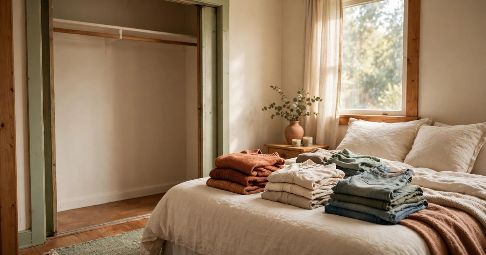
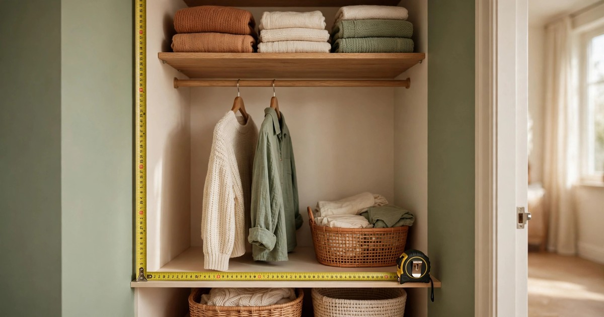
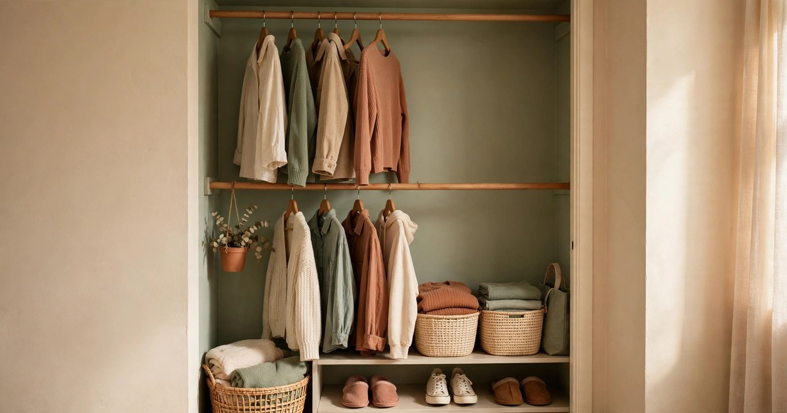
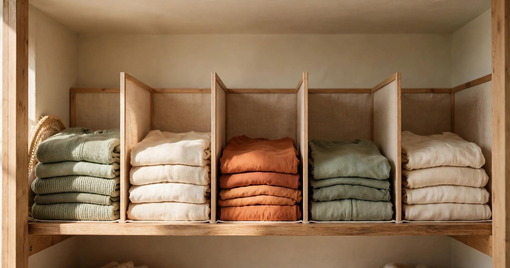
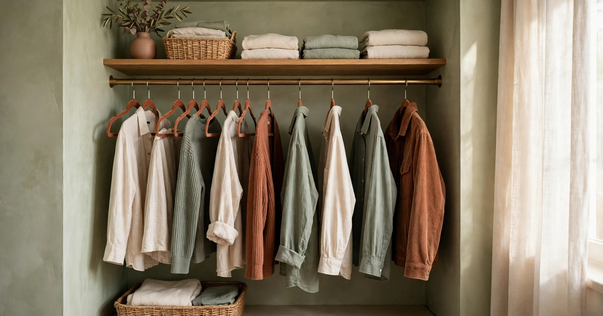
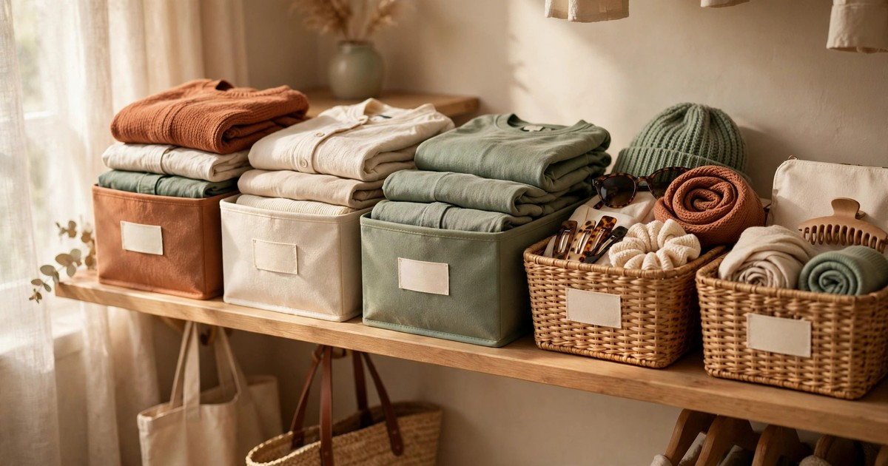
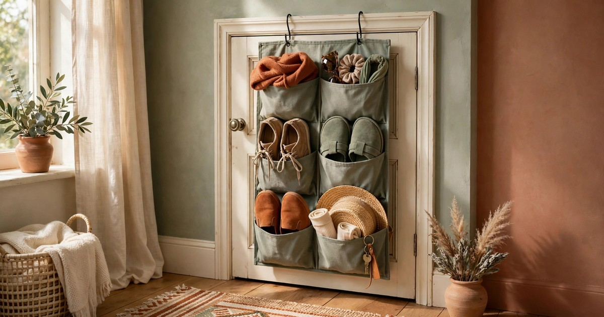

Every small apartment has the same dirty secret: a closet that looks like a suitcase exploded inside it. Clothes you forgot you owned are crushed at the back, shoes pile up on the floor, and the one jumper you actually want is always at the bottom of the heap. It is not a space problem, not really. Most small closets have enough cubic metres to hold everything you own — they just waste most of it on a single hanging rod, a high shelf you cannot reach, and a floor that becomes a landfill.

The good news is that closet organization is one of the cheapest upgrades in a small home. You do not need a built-in system, a carpenter, or your landlord's permission. Everything in this guide is removable, costs less than a takeaway per step, and works in the standard rental closet: one rod, one shelf, and a door. Follow the seven steps in order — the order matters, because buying organizers before you have sorted and measured is how people end up with a drawer full of organizers and a closet that is still chaos — and you will finish the weekend with a closet that holds twice as much and takes half the time to use.

### 1. Empty It Completely and Sort Ruthlessly

No organizer can fix a closet that holds too much stuff, so the first step costs nothing and takes the longest: take everything out. Every hanger, every shoe, every bag on the top shelf, and put it on the bed. A closet you can see empty is a closet you can plan; a closet you keep "tidying around" stays a mystery forever.

Then sort into four piles and be honest. Keep: things you wore in the last three months or will wear in the next three. Maybe: things you love but have not worn in a year — put them in a bag, date it, and if you have not opened it in three months, it goes. Donate: anything that does not fit, is damaged beyond a quick repair, or you keep out of guilt. Bin: stained, broken, or single socks. Most people find a quarter to a third of their closet leaves in this step, which is the single biggest space gain in the whole guide and it is free.

While the closet is empty, wipe down the shelf and floor, check the rod is secure, and note anything broken — a sagging shelf or a loose rod bracket is worth a photo to your landlord, because it is their fixture to fix. Then, and only then, move on to measuring. If you skip this step and organize around clothes you do not wear, you have built a beautiful system for storing clutter.

Find it on Amazon: [vacuum storage bags for seasonal clothes](https://www.amazon.com/s?k=vacuum+storage+bags+clothes&tag={{AMAZON_TAG}})

### 2. Measure the Space Before You Buy Anything

Closet organizers fail for one boring reason: they do not fit. A shelf divider that is two centimetres too wide, a hanging shelf that hangs too low, a shoe rack that blocks the door — all of them end up in a cupboard, and the money is gone. Ten minutes with a tape measure prevents all of it.

Measure four things and write them down: the width of the closet at the rod and at the floor, the height from the floor to the rod, the height from the rod to the shelf above it, and the depth from the back wall to the door frame. Note whether the door is a sliding door, a bifold, or a hinged door, because a hinged door gives you the whole door back for storage while a sliding door steals half the opening. Also measure the height of the tallest thing you hang — a long coat or a dress — because that decides where your second rod can go.

Take those numbers with you, on your phone, every time you shop for closet gear, and check the product dimensions against them before you buy. The best organizers are the ones sized for your actual closet, not the ones that looked good in a photo of a walk-in three times the size. This step costs nothing and saves the most money in the whole guide.

Find it on Amazon: [retractable tape measure for home measuring](https://www.amazon.com/s?k=tape+measure+home+measuring&tag={{AMAZON_TAG}})

### 3. Add a Second Hanging Rod — No Drilling Required

The single biggest space win in a small closet is a second rod, and it is the easiest step in this guide. A standard rental closet wastes the entire lower half: shirts hang at the top and everything below the hem is dead air. A second rod, hung from the existing rod, instantly doubles your hanging space for shirts, trousers, skirts and folded jumpers.

The renter-safe version is a hanging closet rod — a metal rod that hooks over the existing rod with adjustable straps or hooks, no screws, no drilling, no damage. They cost less than a pizza, install in about thirty seconds, and come out just as fast when you move. Hang it so that the lower rod sits about 90 centimetres below the upper one: enough for shirts and folded trousers on top, and shirts and skirts below. Keep long items — coats, dresses — on the one section where the second rod does not reach, usually one end of the closet.

One warning: do not overload it. A hanging rod is rated for a certain weight, and a rod full of heavy denim will sag or slip. Keep heavy coats and jeans on the original rod and use the second rod for lighter pieces. Done right, this one step is the difference between a closet that holds forty garments and one that holds eighty.

Find it on Amazon: [hanging closet rod extender no drilling](https://www.amazon.com/s?k=hanging+closet+rod+extender+no+drill&tag={{AMAZON_TAG}})

### 4. Shelf Dividers and Shelf Risers for the Top Shelf

The shelf above the rod is where jumpers go to die. Without dividers, stacks lean, slide, and eventually avalanche every time you pull one item out. The fix is almost embarrassingly cheap: clip-on shelf dividers that slide onto the shelf edge and hold each stack upright, plus a small shelf riser that creates a second level for folded tees or accessories.

Shelf dividers come in metal wire and clear acrylic; the wire ones cost less and grip better on standard closet shelves. Place one every 25 to 30 centimetres and sort by type — tees in one bay, jumpers in the next, jeans in another — so you can see what you have at a glance. A riser, which is just a small freestanding shelf that sits on the shelf, is perfect for the things you reach for least: out-of-season jumpers on top, everyday ones underneath.

Fold using the file-fold method — clothes folded into rectangles and stood on edge like files — and the whole shelf becomes visible at once instead of a stack you have to dig through. It takes five minutes to learn and saves that time every single morning.

Find it on Amazon: [clip-on shelf dividers for closet shelves](https://www.amazon.com/s?k=closet+shelf+dividers+wire&tag={{AMAZON_TAG}})

### 5. Switch to Matching Slim Hangers

This step sounds cosmetic until you try it. A mismatched collection of thick plastic hangers, wire hangers, and dry-cleaner hangers wastes an astonishing amount of rod space — a thick hanger can be three times the width of a slim one, and across forty garments that is the difference between a closet that closes and one that does not. Matching slim hangers also stop clothes from sliding off and make the whole closet look calm, which matters more than it should: you are more likely to keep a closet tidy when it looks tidy.

Slim velvet hangers are the standard pick: they are thin, they grip clothes so nothing slides to the floor, and they cost very little in a pack of thirty or fifty. Replace your hangers in one go rather than gradually, because a half-converted rod still wastes the space. Keep a few sturdy wooden hangers for heavy coats, which need the support, and recycle the old plastic ones — many clothing retailers take them back.

One practical note for renters: slim hangers are the easiest closet upgrade to take with you when you move, and they fit every closet you will ever rent. It is a one-time purchase that pays off in every flat after this one.

Find it on Amazon: [slim velvet hangers non-slip pack of 50](https://www.amazon.com/s?k=slim+velvet+hangers+non+slip+pack&tag={{AMAZON_TAG}})

### 6. Bins and Baskets With Labels for Everything Else

Everything that does not hang needs a home with a label on it, or it will end up in a pile on the closet floor. Fabric bins and small baskets are the answer: scarves and belts in one, hats and gloves in another, gym kit in a third, out-of-season clothes in the big one on the top shelf. The label is not optional — an unlabelled bin is just a box you have to open to check, and you will stop opening it.

Use fabric bins rather than hard plastic where you can: they are lighter, they squash a little to fit awkward gaps, they look softer in a small space, and they fold flat when you move. Clear bins have their place too, for the things you want to see at a glance. Whatever you choose, keep the sizes consistent — two or three sizes, repeated — because a shelf of matching bins looks intentional and a shelf of random boxes looks like storage overflow.

Put the things you use weekly at eye level and the things you use monthly up high. And leave one bin deliberately empty. It sounds wasteful, but that empty bin is where new things go, and it is what stops the whole system from overflowing the moment you buy one new jumper.

Find it on Amazon: [fabric storage bins with labels for closet](https://www.amazon.com/s?k=fabric+storage+bins+labels+closet&tag={{AMAZON_TAG}})

### 7. Use the Door, Then Keep the System Alive

The back of the closet door is free storage that most renters never use. An over-door organizer — hooks that hang over the top of the door, no screws — turns it into a home for shoes, scarves, belts, bags, or jewellery, depending on the style you choose. A clear-pocket shoe organizer works brilliantly even if you never put shoes in it: the pockets are the right size for scarves, belts, socks, and all the small things that otherwise vanish into drawers.

Pick the organizer to match what you actually lose track of. If shoes are the problem, get the shoe pockets. If accessories are the problem, get the one with hooks and small baskets. And check the door closes with the organizer on it — most do, but a thick organizer on a tight door frame will stop it latching, so measure the gap first.

Then the maintenance rule that keeps the whole system working: one in, one out. Every time something new comes into the closet, something old leaves it — donated, sold, or binned. And once a season, spend fifteen minutes doing a quick version of step one: pull out what you have not worn, re-fold what has slumped, and check the labels still match the bins. A closet system is not a one-time project; it is a habit that takes fifteen minutes a season and saves you that time every single morning.

Find it on Amazon: [over the door shoe organizer clear pockets](https://www.amazon.com/s?k=over+the+door+shoe+organizer+clear+pockets&tag={{AMAZON_TAG}})

## Frequently Asked Questions

### How much does it cost to organize a small apartment closet on a budget?

Most renters can do the whole system for under $75: a hanging rod ($10–15), shelf dividers ($8–12), a pack of slim hangers ($12–18), two or three fabric bins ($15–20), and an over-door organizer ($10–15). Start with the sort and the second rod — the two highest-impact steps — and add the rest over a few weeks if the budget is tight.

### Can I organize a rental closet without drilling or damaging anything?

Yes — every step in this guide is damage-free. Hanging rods hook over the existing rod, shelf dividers clip on, over-door organizers hang over the door, and bins sit on shelves. Nothing requires screws, nails, or adhesive, so your deposit is safe and everything comes with you when you move.

### What is the best way to store clothes in a tiny closet with no shelf?

If your closet has no shelf at all, a hanging closet organizer — a fabric shelf that hangs from the rod — creates instant shelving for folded clothes, and an over-door organizer takes care of shoes and accessories. A second hanging rod still works, and a small freestanding shoe rack on the floor uses the space under your hanging clothes.

### How do I stop my closet from getting messy again?

Two habits: one in, one out, so the volume never grows; and a fifteen-minute seasonal reset where you re-fold, re-sort, and pull out anything unworn. The biggest cause of re-clutter is clothes with no designated home, so if something keeps ending up in a pile, it needs a bin, a hook, or a hanger of its own.

### Should I fold or hang my clothes in a small closet?

Hang anything that wrinkles or that you reach for daily — shirts, blouses, trousers, dresses — and fold the rest: jumpers, tees, jeans, and anything heavy that would stretch on a hanger. Knitwear should always be folded, because hanging stretches it out of shape. The mix matters more than the rule: hanging uses vertical space, folding uses shelf space, and a small closet needs both.

### What do I do with out-of-season clothes in a small apartment?

Vacuum storage bags are the renter's best friend for out-of-season clothes: they compress bulky winter jumpers or summer clothes to a third of their size, and the sealed bags slide under the bed or onto the top shelf. Label each bag by season so you can find it in six months without opening all of them.
