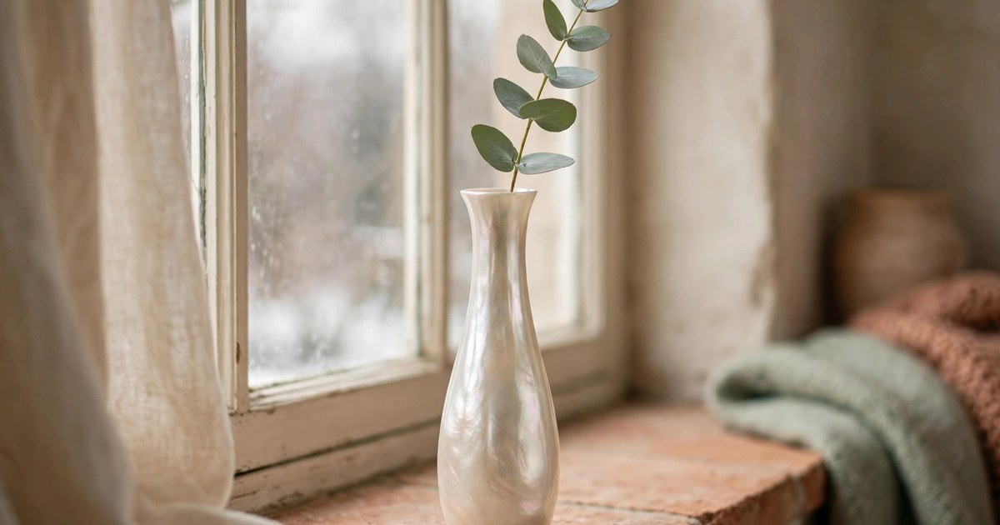
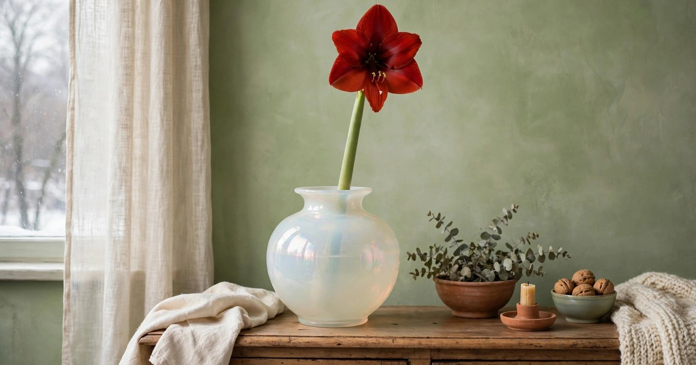
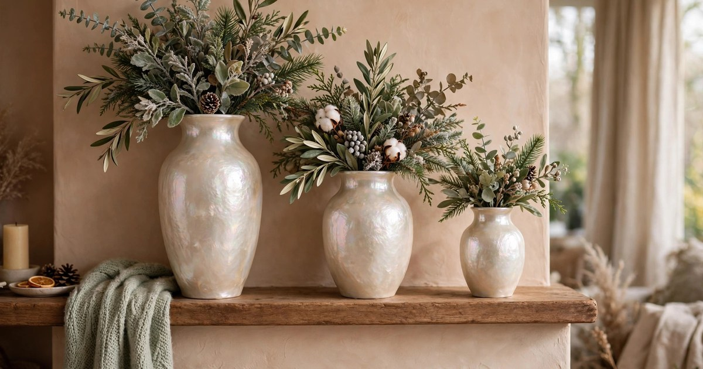
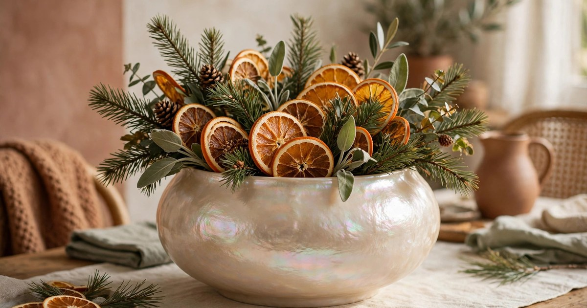
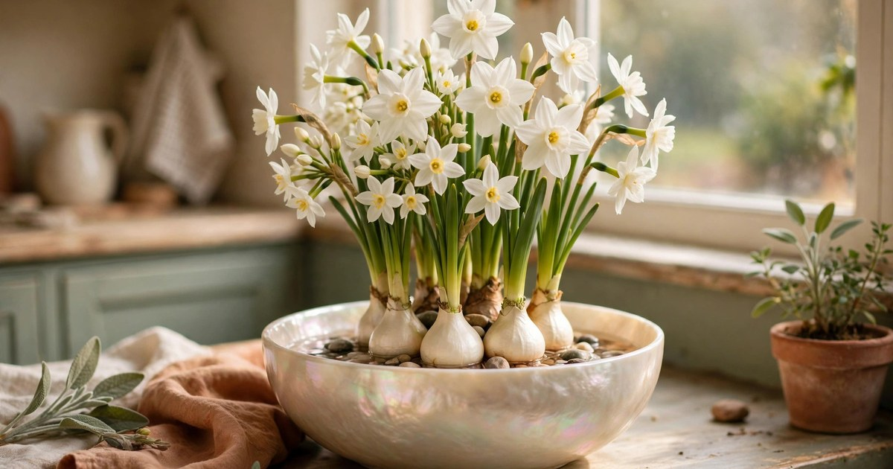
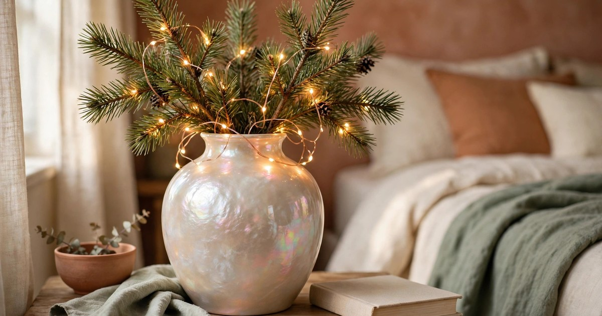
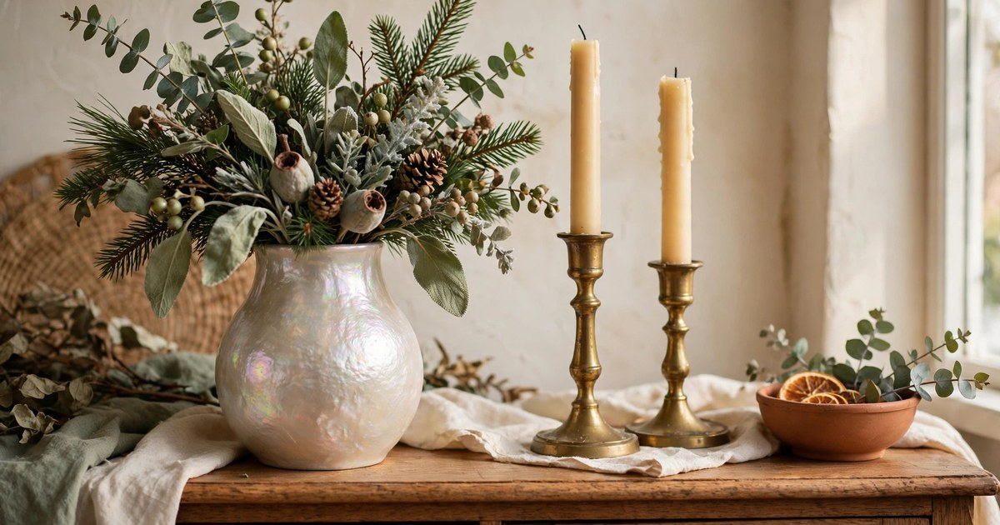
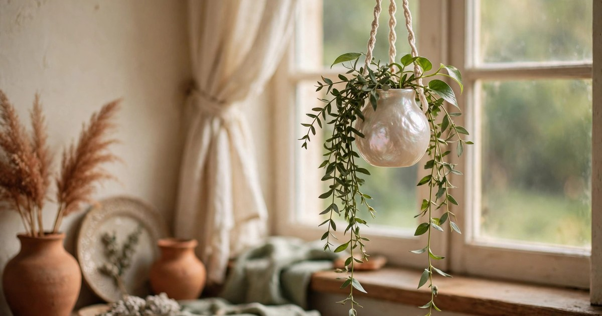
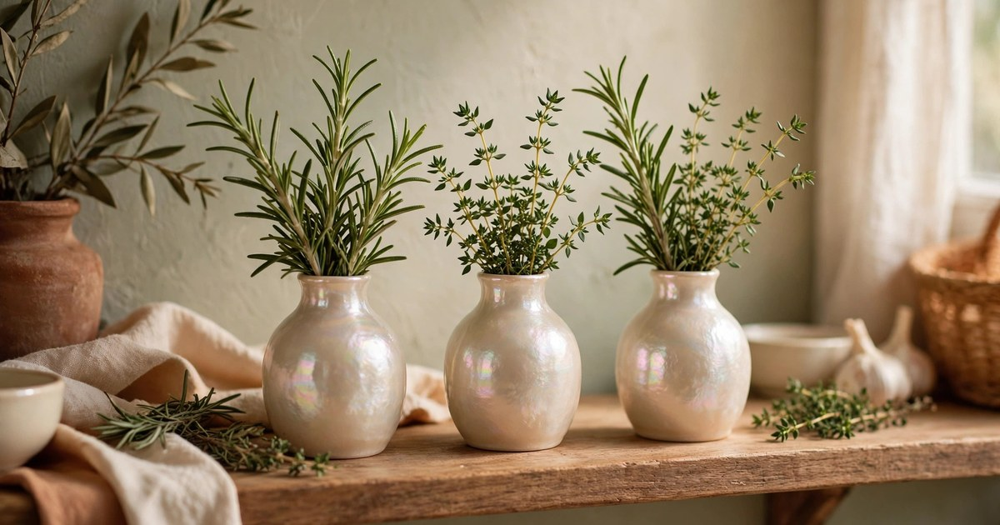
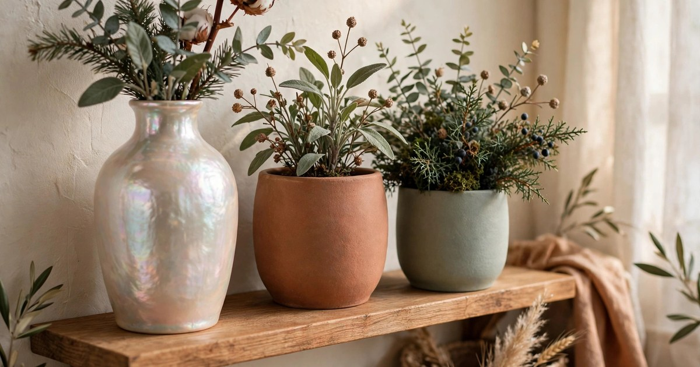

Winter light is low, pale and brief, and most vases simply disappear in it. A pearlescent vase does the opposite: its opalescent finish catches whatever light there is and throws it back as a soft shimmer, so a single stem of eucalyptus looks lit from within. Pearlescent and opalescent finishes are the quiet corner of the celestial trend Pinterest flagged for 2026 — the same soft shimmer behind the starburst lights and iridescent accents — and they suit winter greenery better than any other finish, because winter greenery is itself quiet: eucalyptus, pine, rosemary, amaryllis stems, forced paperwhites. The vase supplies the glow; the greenery supplies the life.

The rules are simple. Let the vase be the shine and the greenery be the shape — one shimmer per arrangement, never two. Keep stems sparse, because a pearlescent vase crowded with foliage looks like a gift bouquet, not a styled piece. And use the low winter light deliberately: put the vase where the window light hits it, even if that is not where you would normally put a vase. These ten ideas follow those rules, each one budget-first and renter-friendly, and each one sized for a small flat where a vase has to earn its shelf.

If you want the broader shimmer story, our roundup of [iridescent decor accents under $25](/iridescent-decor-accents-under-25/) covers the trend across the whole home, and our [Christmas plants that bloom all winter](/christmas-plants-bloom-all-winter-ideas/) will keep your vases filled until spring.

### 1. A single eucalyptus stem in a tall pearlescent bud vase

Start with the simplest arrangement there is, because it is also the most effective. One tall, narrow pearlescent bud vase, one long stem of eucalyptus, and a windowsill. The eucalyptus gives you shape and scent, the vase gives you shimmer, and the low winter sun does the rest — the opalescent glass picks up the pale light and glows gently all afternoon. A bud vase this size costs very little, and eucalyptus stems last for weeks in water, then dry beautifully and keep their scent for months.

Keep the stem long and the vase tall so the proportions stay elegant: a short stem in a tall vase looks apologetic, while a long stem arcing slightly over the rim looks intentional. Change the water weekly and trim the stem end each time, and the arrangement will outlast most cut flowers by a factor of three. If eucalyptus is hard to find, a single stem of olive, ruscus or even a bare twig with a few berries works the same way — the vase is doing the decorative work, so the stem only needs to be interesting, not expensive.

### 2. Amaryllis in an opalescent vase

Amaryllis is the Christmas flower that behaves like a piece of sculpture: a thick, straight stem, a huge trumpet bloom, and a presence that fills a room. Put it in an opalescent vase and the two statement pieces amplify each other — the bloom gives the vase scale, the vase gives the bloom a glow. A single amaryllis stem in a medium pearlescent vase is the fastest centrepiece on this list, and it costs less than a small bouquet.

Buy the amaryllis as a cut stem rather than a bulb if you want it this week; bulbs take four to six weeks to bloom. Support the stem with a few pebbles in the bottom of the vase if it leans, and keep the vase away from radiators, which shorten the bloom's life dramatically. Our roundup of [amaryllis bulb kits under $25](/amaryllis-bulb-kits-under-25/) is the place to start if you would rather grow your own for next month. When the flower fades, the same vase takes a stem of winter greenery and the display continues without a second purchase.

### 3. A graduated trio on a mantel or shelf

Three pearlescent vases in graduated heights — tall, medium, short — grouped tightly on a mantel, a shelf or a sideboard, each holding a different winter stem. The grouping reads as one composition, and the shimmer multiplies: three opalescent surfaces catch the light from three angles, so the whole shelf glows. Keep the stems different in each vase — eucalyptus in the tall one, pine in the medium, rosemary in the short — so the group has variety as well as rhythm.

The trick is to keep the group tight. Vases spaced a hand's width apart read as three separate objects; vases almost touching read as one arrangement. If you only have two pearlescent vases, add a third in plain matte ceramic in a matching tone — the contrast makes the shimmer stand out more, not less. This is the arrangement to build if you have a mantel or a long shelf that currently holds nothing but dust, and it is the one guests photograph first.

### 4. Dried citrus and winter greenery in a wide pearlescent vase

Dried orange slices are the winter styling secret that costs almost nothing: slice an orange thinly, dry it in a low oven, and you have translucent amber discs that glow against an opalescent vase like stained glass. Thread two or three slices onto a stem of pine or fir, stand them in a wide pearlescent vase, and add a few sprigs of eucalyptus for height. The whole arrangement costs less than a coffee and lasts the entire winter.

Make the citrus yourself rather than buying it — a bag of oranges and an afternoon in the oven gives you enough slices for a season of arrangements, and our guide to [drying citrus and flowers for winter decor](/dry-citrus-flowers-winter-decor-guide/) walks through the method. Keep the vase wide rather than tall for this one: a wide mouth lets the citrus slices fan out and catch the light, while a narrow vase hides them. This is the arrangement for the dining table, where it will be seen at every meal.

### 5. Forced paperwhites in a pearlescent bowl vase

Paperwhites are the easiest indoor flower to force, and a low, wide pearlescent bowl vase is the perfect vessel for them. Set the bulbs on a bed of pebbles, add water to just below the bulb bases, and place the bowl on a bright windowsill. In three to four weeks you have white, sweetly scented blooms rising from a shimmering bowl — a piece of spring in the middle of winter, grown rather than bought.

The bowl shape matters: a tall vase hides the bulbs, while a low bowl shows the whole composition — pebbles, roots, stems, blooms — and the pearlescent finish makes the water itself look luminous. Keep the water level below the bulbs to prevent rot, and move the bowl to a cooler spot once the flowers open to make them last longer. If you have never forced bulbs before, our guide to [forcing paperwhite bulbs indoors](/force-paperwhite-bulbs-christmas-guide/) covers the timing so they bloom for Christmas.

### 6. Fairy lights inside a pearlescent vase

A pearlescent vase with a string of battery fairy lights coiled inside it is the evening version of everything on this list. The opalescent glass diffuses the light, so instead of seeing individual bulbs you see a soft, even glow — a lantern that happens to be a vase. Add a few short sprigs of pine or eucalyptus around the lights, and the greenery becomes a silhouette against the glow.

Use warm white micro fairy lights with a timer, and keep the battery pack hidden behind the vase or tucked under the greenery. This arrangement belongs where you sit in the evening: a bedside table, a side table beside the sofa, a shelf in a dark hallway. It is also the best use of a pearlescent vase you already own but have not known what to do with — the lights turn an ordinary vase into the warmest object in the room, and the whole thing costs less than a takeaway coffee.

### 7. Pair the vase with brass candlesticks

Pearlescent glass on its own can feel cool and floaty, and brass is what grounds it. A pearlescent vase of winter greenery flanked by two brass candlesticks — or one tall brass candlestick and one short — gives the arrangement weight, warmth and a second metallic shimmer that plays against the opalescent finish. The pairing is a classic of the celestial trend: soft shimmer plus warm metal, neither one overwhelming the other.

Keep the candlesticks slim and the candles white or cream, so the brass is the colour and the candle is the light. Battery taper candles are the safe choice in a small flat, especially near dried greenery, and they look identical to real ones from across the room. This is the arrangement for the sideboard or the dining table, where it will be seen at eye level, and it is the one to build when you want the room to feel dressed for an evening rather than merely decorated.

### 8. A hanging pearlescent vase by the window

A small pearlescent vase hung in the window — from a suction hook, a tension rod, or a length of ribbon over a curtain rail — puts the shimmer exactly where the light is strongest. The vase catches the low winter sun all day, the greenery inside it is backlit, and the whole thing moves gently in the draught, which makes it feel alive in a way a vase on a shelf never does. A single trailing stem, a pothos cutting or a sprig of ivy, is all it needs.

Keep the vase small and the water level low, so the weight stays well within what a suction hook can hold, and check the hook weekly — cold glass and condensation can loosen suction over time. This is the idea for a kitchen window or a bathroom window, where a vase on the sill would be knocked over within a week, and it is the best way to enjoy a pearlescent finish in a room with almost no shelf space at all.

### 9. Winter herb cuttings in small pearlescent vases

Rosemary, thyme and bay are winter greenery you can eat, and a row of small pearlescent vases holding herb cuttings on a kitchen shelf is both decoration and a working herb garden. The cuttings root in water within a couple of weeks, the rosemary scents the kitchen every time you brush past it, and the pearlescent finish makes a functional row of cuttings look like a deliberate display rather than a propagation experiment.

Use vases of the same shape in graduated sizes, or three identical small vases in a row — either way, consistency is what makes it look styled. Label nothing; the herbs are recognisable by scent and shape, and the row reads better without tags. When a cutting roots, pot it on and replace it with a fresh cutting, so the display is self-renewing all winter. This is the idea that pays for itself, in the most literal sense on this list.

### 10. Mix pearlescent with matte ceramic for balance

The final idea is a rule rather than an arrangement: never let pearlescent be the only finish in the room. A shelf of nothing but shimmer looks like a gift shop; a pearlescent vase beside a matte ceramic pot, a terracotta planter and a woven basket looks like a home. The matte surfaces absorb light, the pearlescent surface reflects it, and the contrast is what makes both finishes look intentional.

Apply the rule to a plant shelf: one pearlescent vase among three or four matte pots, holding the tallest or most visible stem, with the rest of the shelf in ceramic, terracotta and woven textures. The eye goes to the shimmer first and then travels across the shelf, which is exactly what a good display should do. If you already own a shelf full of matte pots, a single pearlescent vase is the cheapest way to refresh it — one purchase, and the whole shelf looks new.

## Frequently Asked Questions

### Where can I buy a pearlescent vase on a budget?
Thrift shops, charity shops and discount homeware aisles are the best sources — opalescent glass was widely made in the twentieth century, so vintage pieces are common and cheap. New budget versions are widely available online, and a single good vase beats three poor ones.

### Will a pearlescent vase suit my room if nothing else is celestial?
Yes. Pearlescent glass reads as a neutral with a shimmer, not as a theme piece, so it sits comfortably beside terracotta, sage, cream and wood. The one finish it fights with is high-gloss chrome — keep it with warm metals like brass instead.

### What greenery lasts longest in a vase in winter?
Eucalyptus, pine, fir, rosemary and olive all last for weeks in water in a cool room, and eucalyptus dries beautifully if you forget to change the water. Amaryllis and paperwhites are the best flowering options, and both are covered in our winter plant guides.

### How do I clean a pearlescent vase?
Warm water and a drop of washing-up liquid, swirled gently — never a bottle brush, which can scratch the opalescent coating on cheaper vases. For narrow necks, a handful of uncooked rice with warm water, shaken gently, cleans the inside without scratching.
