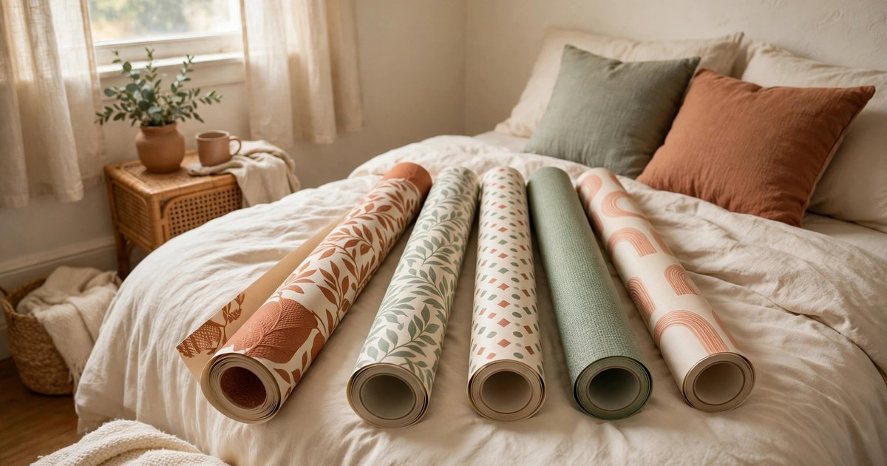
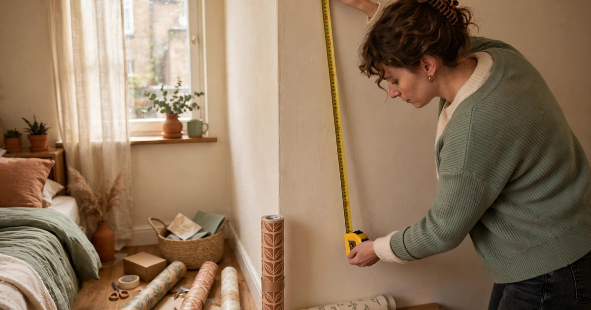
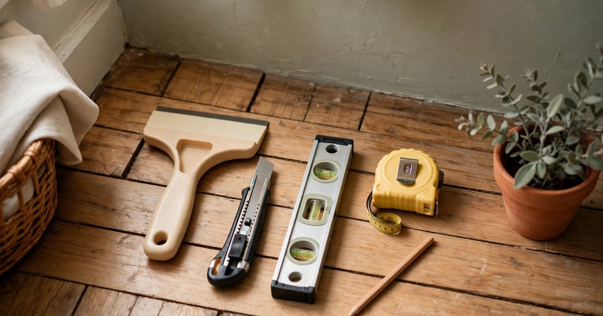
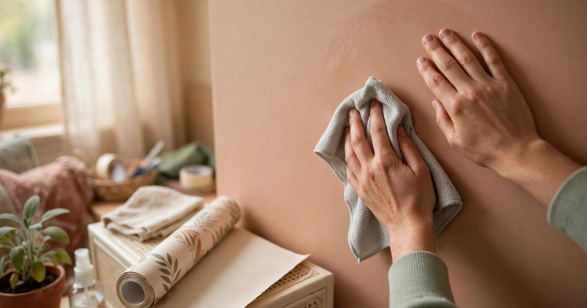
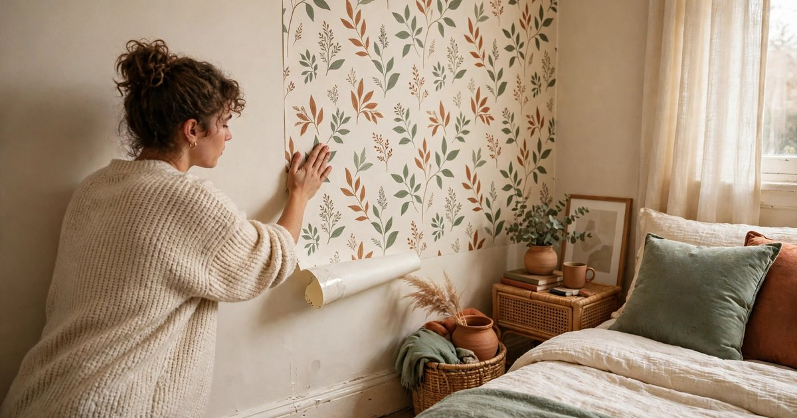
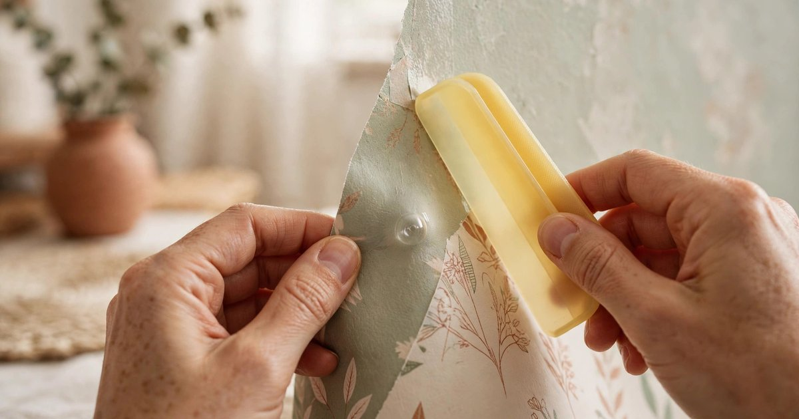
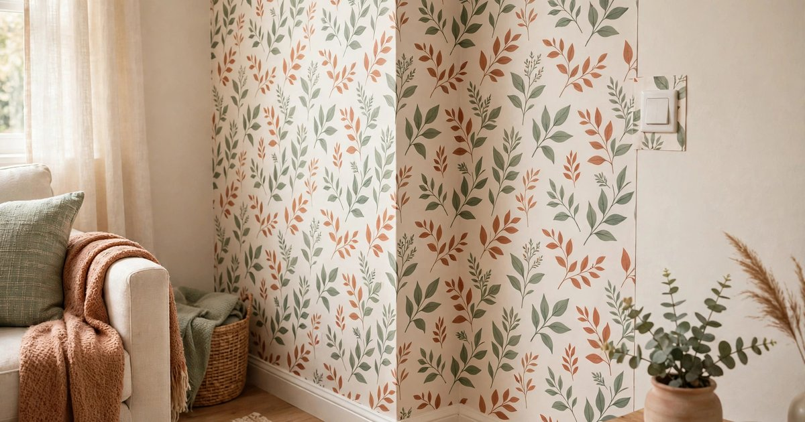
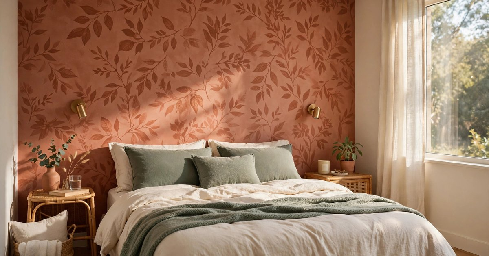
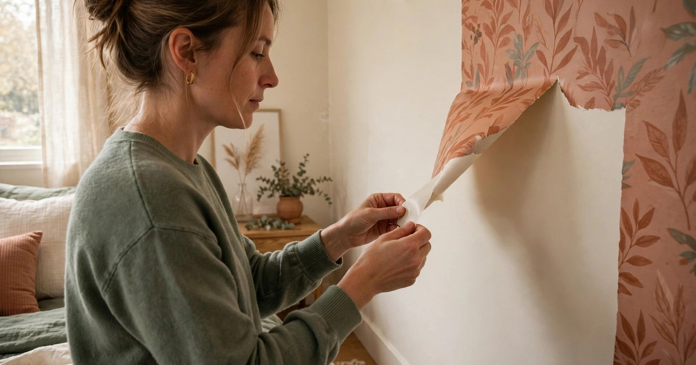

There is no faster way to transform a rental than a wall of peel-and-stick wallpaper. In a single afternoon, a plain magnolia box room becomes a cosy bedroom with a terracotta accent wall, a tired kitchen gains a sage tiled-look backsplash, or a narrow hallway finally has some personality — all without a paintbrush, a landlord's permission slip for paint, or a single permanent change. For renters, it is the closest thing to a magic wand: big visual impact, small budget, and — when you choose and apply it properly — fully reversible.

The catch is the word "properly." Peel-and-stick wallpaper has a reputation problem, and most of it comes from people who skipped the prep work: wallpaper applied over dusty, textured, or freshly painted walls that peels off in a week, or paper left up for three years that takes the paint with it on removal day. Both problems are avoidable, and both come down to the same thing — understanding that this is a temporary product, and treating your walls like something you have to hand back in the same condition you found them. Choose the right paper for your wall type, prep the surface, apply it with patience, and removal is a ten-minute job that leaves nothing behind.

This guide walks through the whole process, step by step, from picking a renter-safe wallpaper to the clean removal that gets your full deposit back. Every step is built around the same three rules: no damage to the walls, no marks your landlord can charge for, and nothing that costs more than it needs to. Follow them and you can wallpaper a rental with complete confidence — and take the whole look down again in an afternoon when moving day comes.

### 1. Choose a genuinely removable wallpaper

Not all "removable" wallpaper is equally removable, and the label on the roll is not always the whole story. True peel-and-stick wallpaper uses a low-tack adhesive that is designed to release cleanly from painted plasterboard and smooth painted walls. Traditional paste-the-wall wallpaper, self-adhesive vinyl meant for furniture or shelves, and cheap unbranded rolls sold as "wall stickers" can all be much stickier, and the wrong choice is how renters end up with torn paint at the end of a tenancy. Before you buy, check that the listing says removable, repositionable, and safe for painted walls — and read the reviews specifically for removal stories, not just photos of the finished wall.

Material matters as much as the adhesive. A woven fabric-backed peel-and-stick paper is the safest bet for a rental: it is thick enough to hide small wall imperfections, it repositions easily without stretching, and it peels off in one clean sheet. Smooth vinyl papers look crisp and wipe clean, which makes them ideal for kitchens and bathrooms, but cheaper vinyl can be thinner and more likely to leave residue. Peel-and-stick paper with a paper backing tends to be the hardest to remove cleanly, so it is the one type worth avoiding in a rental, however pretty the pattern is.

Pattern and colour are where renters can save real money. A bold pattern looks dramatic, but it usually needs more rolls because of pattern matching, and a large-scale print in a small room can overwhelm the space. A small-scale pattern — a subtle botanical, a fine stripe, a soft geometric — is more forgiving, easier to match at the seams, and far more likely to suit the next room you move it to. And if you are nervous about committing, start with one accent wall rather than a whole room: one wall behind the bed or the sofa gives you most of the impact for a fraction of the cost, and it is the easiest possible removal job when you move out.

Buy a single test roll first if you can, and stick a small offcut to a hidden patch of wall — behind a door, inside a cupboard — for a week. If it peels off cleanly after seven days with no paint lift and no residue, the roll is safe for your walls. That one small test is the cheapest deposit insurance you will ever buy.

Find removable wallpaper rolls on Amazon: [peel and stick removable wallpaper rolls for renters](https://www.amazon.com/s?k=peel+and+stick+removable+wallpaper+renters&tag={{AMAZON_TAG}})

### 2. Measure your wall — and buy one roll more than you think

The most common budgeting mistake with peel-and-stick wallpaper is buying too little. Running out mid-wall means ordering a second batch, and wallpaper is printed in dye lots — a second batch can be a slightly different shade, which shows up as a visible band across your wall. Measure carefully once, do the simple maths, and buy one spare roll on top. The spare roll is your insurance against a miscut panel, a pattern-matching mistake, and the panel you will want later when one strip gets damaged. If you never use it, it is a future accent wall in your next flat.

Measuring is straightforward. Measure the height of the wall from skirting board to ceiling, then the width, and multiply the two to get the area. Check the coverage printed on the roll — most peel-and-stick rolls cover a fixed area, and the listing will tell you how many square metres or square feet that is. Divide your wall area by the roll coverage and round up. Then add the pattern repeat: if the pattern repeats every 50 centimetres, you lose some length on every panel to line the pattern up, so add roughly ten percent for a small repeat and up to twenty percent for a large one. A plain or small-scale pattern needs almost no extra; a bold large-scale print needs the most.

Measure the height in at least three places along the wall — left, middle, and right. In older rental flats, ceilings are rarely perfectly level, and a wall that is 2.4 metres at one end and 2.45 at the other will catch you out if you cut every panel to the same length. Cut each panel to the longest measurement for its position on the wall, plus five centimetres extra at the top and bottom, and trim the excess after it is stuck in place. That overhang is your margin for error, and trimming it away at the end is far easier than discovering a panel is two centimetres short at the ceiling.

Sketch a quick plan on paper before you order: which wall, how many panels, and where the seams will fall. Avoid placing a seam right in the middle of a feature like a headboard or a mirror if you can help it, and plan so that the first panel starts at the most visible corner of the room. A ten-minute sketch saves a wasted roll and a wall that looks slightly off every time you walk in.

Find a good tape measure on Amazon: [retractable tape measure for measuring walls](https://www.amazon.com/s?k=retractable+tape+measure+for+measuring+walls&tag={{AMAZON_TAG}})

### 3. Gather your tools before you start

Peel-and-stick wallpaper is a low-tool job, but the right tools are the difference between a smooth, professional-looking wall and a bubbly one that peels at the corners. You do not need anything expensive or specialist — most of what you need is already in a basic household toolkit, and the rest costs very little. Gather everything before you peel the first backing sheet, because stopping halfway through a panel with the adhesive exposed is how dust and creases get in.

The essentials are a smoothing tool, a sharp utility knife with fresh blades, a spirit level, a tape measure, a pencil, and a pair of sharp scissors. The smoothing tool — a flat plastic squeegee — is the single most important item: it presses the paper flat, pushes air bubbles to the edges, and is what keeps the paper stuck for months rather than days. A credit card works in a pinch, but a proper smoother is wider, has a soft edge that will not scratch the paper, and costs less than a takeaway coffee. A long spirit level keeps your first panel perfectly vertical, and everything else hangs off that first panel, so it is worth borrowing one if you do not own one.

A step ladder or a sturdy stool is essential for reaching the top of the wall safely. Do not balance on a chair or a stack of books — a wobble at the top of a panel is how a whole strip ends up crooked. A clean, dry cloth for wiping the wall, a small bucket of warm water with a drop of washing-up liquid for the pre-clean, and a roll of low-tack painter's tape for holding panels in place while you position them round out the kit. Painter's tape is also useful for marking your plumb line on the wall without leaving a mark.

Keep a spare blade handy and change it the moment it starts to drag. A dull blade tears the paper instead of cutting it, and a torn edge at the skirting board is visible forever. Everything here is cheap, reusable, and useful for a dozen other renter-friendly jobs, so think of it as a small investment in your deposit rather than a one-off expense.

Pick up a wallpaper smoothing tool on Amazon: [wallpaper smoothing tool kit for peel and stick wallpaper](https://www.amazon.com/s?k=wallpaper+smoothing+tool+kit+peel+and+stick&tag={{AMAZON_TAG}})

### 4. Prep the wall — the step that protects your deposit

Wall preparation is the step most people skip and the step that matters most. Peel-and-stick adhesive bonds to whatever is on the surface of the wall — dust, grease, flaking paint, old Blu Tack residue — and if that layer is not sound, the paper will peel off taking the loose layer with it. Ten minutes of cleaning and checking now is what keeps the paper up for a year and the paint intact when it comes down. Think of it as deposit protection, not housework.

Start by washing the wall with warm water and a drop of washing-up liquid, using a clean cloth or sponge. Work from the top down, rinse the cloth often, and pay extra attention to the areas around light switches, radiators, and the kitchen, where grease and grime build up. Let the wall dry completely — at least a few hours, ideally overnight — before you apply anything. Wallpaper stuck to a damp wall will bubble as the moisture dries, and the adhesive will never bond properly. If the room is humid, open a window and let the air circulate while it dries.

Next, check the condition of the paint. Run your hand over the wall and look for flaking, bubbling, or loose paint, especially near windows and in bathrooms. If paint is already lifting, the wallpaper will lift it further — either choose a different wall, or flag the flaking paint to your landlord before you start so it is on record as pre-existing. Test the wall texture too: peel-and-stick wallpaper sticks beautifully to smooth, eggshell, or satin painted walls, but it struggles on heavily textured walls, bare plaster, and fresh paint. Paint needs at least four weeks to cure fully before wallpaper goes over it, so if the flat was freshly painted before you moved in, wait — or stick to a different wall.

Finally, fill any small holes from picture hooks with filler and let it dry and sand it smooth, and remove any old adhesive, Blu Tack, or command strip residue with a gentle adhesive remover. A smooth, clean, dry, fully cured wall is the foundation of the whole project — and it is the reason the paper will come off cleanly when you leave.

Find wall filler and adhesive remover on Amazon: [wall filler repair kit for small holes renters](https://www.amazon.com/s?k=wall+filler+repair+kit+small+holes&tag={{AMAZON_TAG}})

### 5. Apply the first panel — slowly, and perfectly level

The first panel sets the line for the entire wall, so it deserves all your patience. Every panel after it will butt up against this one, and if the first panel is even slightly off vertical, the error compounds across the wall until the last panel is visibly slanted. Do not rush this step — the whole wall is only as straight as the panel you start with, and peel-and-stick paper is forgiving precisely because you can peel it back and try again.

Start by marking a plumb line. Measure one panel width in from your starting corner, minus about a centimetre, and use a spirit level to draw a faint vertical pencil line from ceiling to skirting board. This line is your guide — the first panel's edge runs along it, and the small overlap into the corner hides any unevenness in the corner itself. Corners in rental flats are almost never perfectly square, so never trust the corner as your straight edge. The plumb line is your only true vertical.

Peel back about 30 centimetres of the backing paper from the top of the panel and fold it back, leaving the rest in place. Line the top of the panel up with the ceiling, leaving your five-centimetre overhang, and press the exposed top section gently onto the wall along your plumb line. Step back and check it is level before you go any further. Then, working slowly downward, peel the backing away in short sections while smoothing the paper onto the wall with your smoothing tool, working from the centre outward to push air toward the edges. Keep the panel taut but do not stretch it — stretched paper shrinks back later and pulls away from the seams.

If the panel goes on crooked, peel it back gently and reposition it. That is the whole point of peel-and-stick paper: you can lift and restick it several times without damaging the adhesive or the wall, provided you peel slowly and do not yank. Once the panel is straight, smooth it firmly from top to bottom, pressing out any remaining air, and move on to the next panel with confidence.

Find a spirit level on Amazon: [spirit level for hanging wallpaper straight](https://www.amazon.com/s?k=spirit+level+for+hanging+wallpaper&tag={{AMAZON_TAG}})

### 6. Smooth out bubbles and fix seams as you go

Air bubbles are the most common complaint with peel-and-stick wallpaper, and they are almost always fixable. Small bubbles appear when air gets trapped between the paper and the wall, usually because the panel was smoothed too quickly or from the wrong direction. The fix is simple, and it works best while the paper is freshly applied — so deal with bubbles as you go, panel by panel, rather than finishing the whole wall and then trying to rescue it.

For small bubbles, push them gently toward the nearest edge with your smoothing tool, working slowly from the centre of the bubble outward. Use the flat edge of the smoother with light, even pressure — pressing too hard can crease the paper or push the adhesive out at the seams. Most small bubbles will move to the edge and disappear completely. For a bubble near a seam, push it toward the seam itself and out through the join. If a bubble will not move, lift the paper back to the bubble, smooth it down again from the centre outward, and restick it — the adhesive is repositionable, and a second attempt almost always works.

For a stubborn bubble that refuses to move, there is a last resort: prick it with the very tip of a fine pin, press the air out through the tiny hole with your smoother, and smooth the paper flat. The pinhole is invisible in a patterned paper and barely noticeable in a plain one. Do not cut a slit — a slit leaves a visible line, while a pinhole closes up on its own. Use this trick sparingly and only on bubbles that will not respond to smoothing or lifting.

Seams need the same attention. Each new panel should butt snugly against the previous one, edge to edge, with no gap and no overlap. A small gap shows the wall colour through it; an overlap creates a visible ridge and a weak spot where the paper can lift. If a seam opens up after a day or two, press it down firmly with the smoother, and if it keeps lifting, a tiny piece of double-sided tape behind the edge will hold it — just make sure it is a low-tack tape that will not damage the paint on removal. A well-smoothed wall with tight seams looks professionally done, and it stays that way for the whole tenancy.

Get a sharp utility knife on Amazon: [utility knife with snap-off blades for trimming wallpaper](https://www.amazon.com/s?k=utility+knife+snap+off+blades+wallpaper+trimming&tag={{AMAZON_TAG}})

### 7. Handle corners, sockets, and tricky edges cleanly

Corners, plug sockets, and light switches are where a wallpaper job either looks professional or looks homemade, and they are also where renters cause the most wall damage — by cutting too deep, or by peeling paper around a fitting and tearing the paint. Slow down for these details. They take a few extra minutes each, and they are the difference between a wall your landlord admires and a wall that costs you money.

For an inside corner, do not try to bend one panel around it. Corners are never perfectly square, and a panel folded around a corner will crease and pull away. Instead, measure the distance from the last full panel to the corner, cut a strip to that width plus two centimetres, and apply it so the extra two centimetres wrap just around the corner onto the next wall. Then start the next wall with a fresh panel, overlapping that two-centimetre wrap and trimming along the corner with a sharp knife. The overlap is hidden in the corner itself, and each wall ends up with its own straight, clean edge. For an outside corner, wrap the paper around it by about five centimetres and smooth it firmly — outside corners take more wear, so a little extra wrap keeps the edge from catching and lifting.

For plug sockets and light switches, turn the power off at the fuse box before you start — it is a five-second job that removes any risk. Apply the panel over the fitting, then feel for the edges of the socket through the paper and make a small diagonal cut from the centre of the fitting out toward each corner, like cutting an envelope open. Fold the resulting flaps back, smooth the paper around the fitting, and trim the excess with a sharp knife, leaving a small margin tucked under the socket cover. If the socket cover can be unscrewed, remove it first and refit it over the paper for the neatest finish of all — just keep the screws safe and remember to refit the cover before you move out.

Trim the top and bottom edges last, once all the panels are up. Hold a wide metal ruler or a straight edge against the skirting board or ceiling, and cut along it with a fresh utility blade in one smooth stroke. Change the blade often — a sharp blade is what gives you a clean, invisible cut, and a dull one is what tears the paper and scores the paint underneath.

Find a metal straight edge on Amazon: [metal ruler straight edge for trimming wallpaper](https://www.amazon.com/s?k=metal+ruler+straight+edge+trimming+wallpaper&tag={{AMAZON_TAG}})

### 8. Style the wall so it looks intentional, not temporary

A wallpapered accent wall only works if the rest of the room agrees with it. The fastest way to make peel-and-stick wallpaper look cheap is to leave the room exactly as it was before, with the new wall shouting against furniture and bedding that clash with it. The fix costs nothing: pull one or two colours out of the wallpaper pattern and repeat them in the room — a cushion, a throw, a plant pot, a framed print — and suddenly the wall looks like the starting point of a deliberate scheme rather than a sticker someone slapped up.

Behind the bed is the classic spot for a reason. A headboard wall in a warm terracotta or a soft sage makes the bed the focal point of the room, and it needs almost no other styling — cream or white bedding, one or two cushions in a tone from the paper, and a small bedside lamp is enough. In a living room, the wall behind the sofa does the same job: hang one framed print or a small shelf against it and the paper becomes a backdrop instead of a feature on its own. In a hallway or a small dining nook, even a single narrow strip of wallpaper between two door frames can add more character than a whole wall of paint.

Keep the rest of the room calm. A bold pattern wants plain furniture and plain bedding around it; a subtle pattern can take a little more colour. The rule of thumb is that the wallpaper is the loudest thing in the room, so everything else should be quieter — solid colours, natural textures like wood, linen, and rattan, and nothing else competing for attention. That restraint is what makes a rented room look designed rather than decorated in a hurry.

And remember that the wallpaper is temporary, which is a freedom, not a limitation. Because you can take it down in an afternoon, you can afford to be bolder than you would be with paint: try the botanical print, the terracotta stripe, the sage geometric. If you hate it in a month, peel it off and try another pattern on the same wall. Renters who treat wallpaper as a seasonal change — a fresh look for the darker months, a lighter one for spring — get far more joy out of it than renters who pick one safe neutral and live with it for three years.

Find renter-friendly cushions to match on Amazon: [terracotta cushion covers for rental bedroom styling](https://www.amazon.com/s?k=terracotta+cushion+covers+bedroom&tag={{AMAZON_TAG}})

### 9. Remove it cleanly and get your full deposit back

Removal day is the moment all the careful prep pays off — and it is the step that decides whether your deposit comes back in full. Done properly, removing peel-and-stick wallpaper takes less than an hour for an accent wall and leaves the paint underneath exactly as you found it. Done in a rush, with a yanked corner and a scraper, it can tear paint, leave adhesive residue, and turn a cheap decorating project into a deduction from your deposit.

Start at a top corner and peel slowly, pulling the paper back on itself at a low angle — almost parallel to the wall rather than straight out toward you. A low angle puts the least stress on the paint and lets the adhesive release gradually. Work downward in a steady, unhurried motion, and if you feel resistance, stop and warm the area gently with a hairdryer on a low setting for thirty seconds. The warmth softens the adhesive and lets the paper release without taking paint with it. Never use a scraper or a knife to get a stubborn edge started — a fingernail or a plastic card is enough, and it cannot gouge the wall.

If a little adhesive residue remains — and on some walls, especially in warm rooms, a faint tacky film can be left behind — remove it with warm water and a drop of washing-up liquid on a soft cloth, rubbing gently in small circles. For anything more stubborn, a small amount of cooking oil on a cloth will dissolve the residue, followed by a wash with warm soapy water to remove the oil. Avoid harsh solvents, white spirit, or abrasive pads: they can damage the paint far more than the wallpaper ever did, and a damaged patch of paint is exactly what a landlord will charge to repair.

Once the paper is off, walk the wall in good light and check every inch for marks, scuffs, or leftover adhesive. Touch up any small scuffs with the same paint if you have it, fill any tiny holes, and photograph the wall as part of your move-out record. Keep the photos with your check-in inventory photos — if the landlord ever queries the wall, a dated photo of a clean, undamaged surface is the best evidence you can have. A clean removal, documented with photos, is the quiet ending to a project that made your rental feel like home for a whole tenancy.

Find a hairdryer for gentle removal on Amazon: [hair dryer with cool setting for removing removable wallpaper](https://www.amazon.com/s?k=hair+dryer+cool+setting+removable+wallpaper&tag={{AMAZON_TAG}})

Peel-and-stick wallpaper is the rare decorating project that asks almost nothing of a renter and gives back so much: a wall that feels like yours, a room that finally has a focal point, and a tenancy that ends with the wall exactly as you found it. Choose a genuinely removable paper, prep the wall properly, take your time with the first panel, and removal is a calm afternoon job rather than a deposit dispute. Start with one accent wall, see how it transforms the room, and you may find that the boldest pattern you were nervous about becomes the thing you miss most when you move out.

## Frequently Asked Questions

### Will peel-and-stick wallpaper damage rental walls?

No — if you choose a genuinely removable paper and apply it to a clean, smooth, fully cured painted wall, it should peel off without damage. Problems happen when paper goes over flaking paint, fresh paint that has not cured, or heavily textured walls, or when it is left up for many years. Test a small offcut in a hidden spot for a week before committing to a whole wall.

### How long can I leave peel-and-stick wallpaper up in a rental?

Most good-quality removable wallpaper is designed to stay up for one to three years and still remove cleanly. Beyond that, the adhesive can bond more firmly, especially in warm rooms or in direct sunlight, so it is wise to plan on removing and replacing it within a couple of years rather than leaving it up for a whole long tenancy.

### Can I use peel-and-stick wallpaper in a bathroom or kitchen?

Yes, vinyl peel-and-stick wallpaper works well in kitchens and bathrooms because it wipes clean and resists moisture. Avoid papering directly inside a shower or right above a hob, where constant steam and heat can loosen the adhesive. Make sure the wall is completely dry before applying, and use a smoother to press the edges down firmly so moisture cannot creep underneath.

### Can I reposition peel-and-stick wallpaper if I make a mistake?

Yes — that is its main advantage over traditional wallpaper. You can peel a panel back and restick it several times while you are applying it, provided you peel slowly and do not stretch the paper. Once the paper has been up for a few days the adhesive sets more firmly, so do your repositioning during the installation itself, not a week later.

### Do I need my landlord's permission to use peel-and-stick wallpaper?

It is always worth checking your tenancy agreement, as some contracts mention wall coverings specifically. Most landlords are happy with genuinely removable wallpaper because it causes no permanent change, and many prefer it to painting. If in doubt, tell your landlord what you plan to use, show them a sample, and get their agreement in writing — it protects you both.

### How do I remove adhesive residue left by peel-and-stick wallpaper?

Start with warm water and a drop of washing-up liquid on a soft cloth, rubbing gently. For stubborn residue, a little cooking oil on a cloth will dissolve it, followed by a wash with warm soapy water. Avoid harsh solvents or abrasive pads, which can damage the paint underneath and create the very problem you are trying to avoid.
