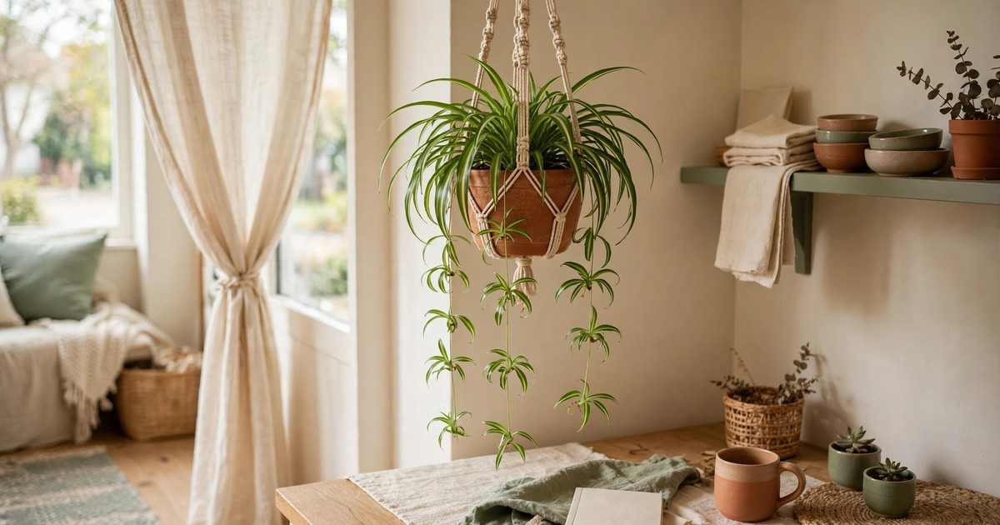
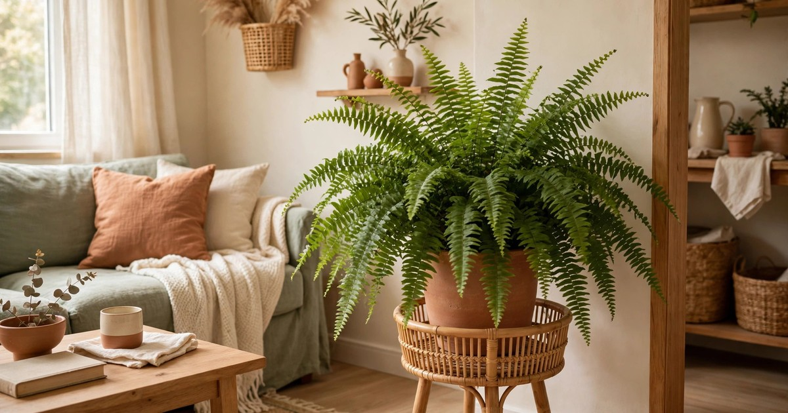
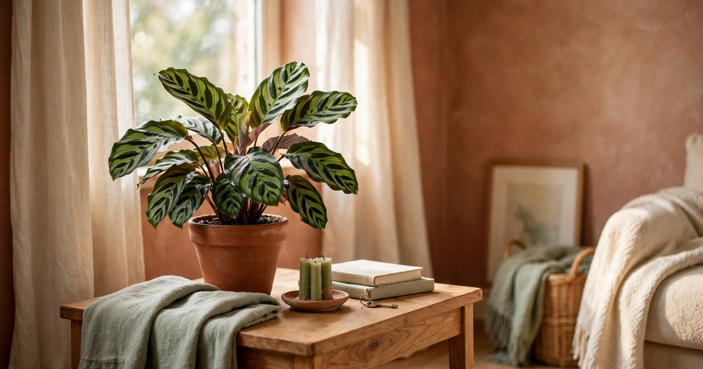
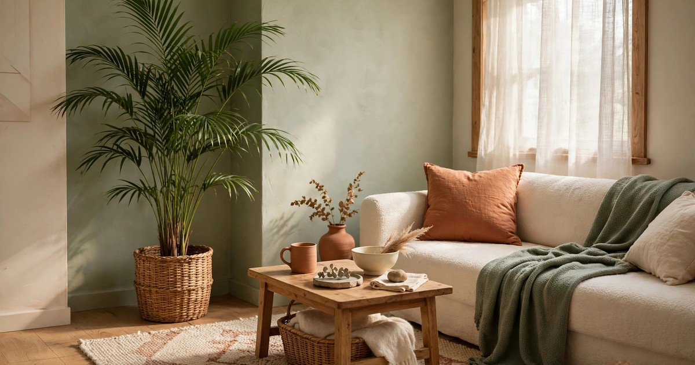
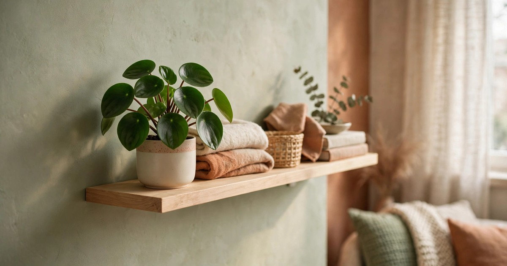
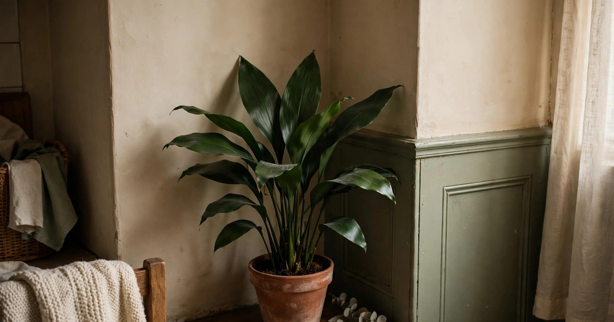
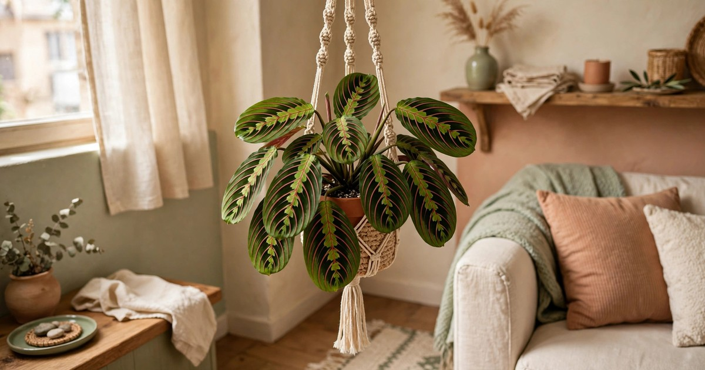
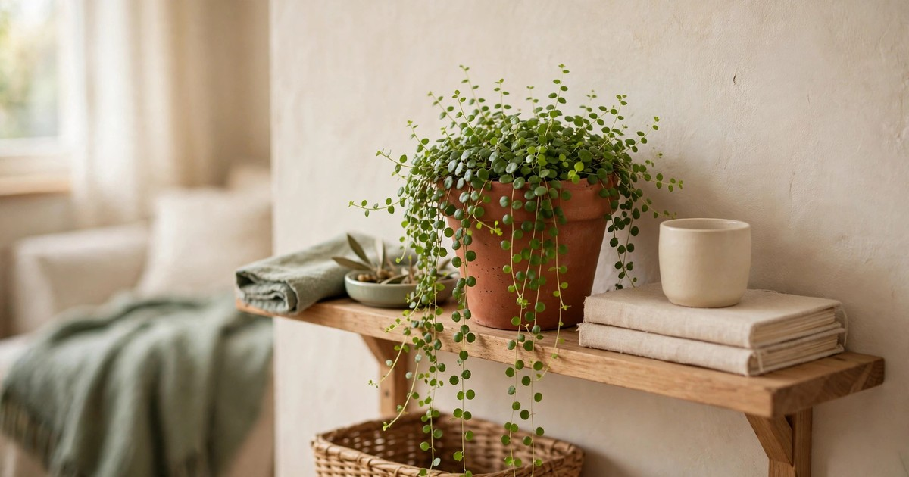
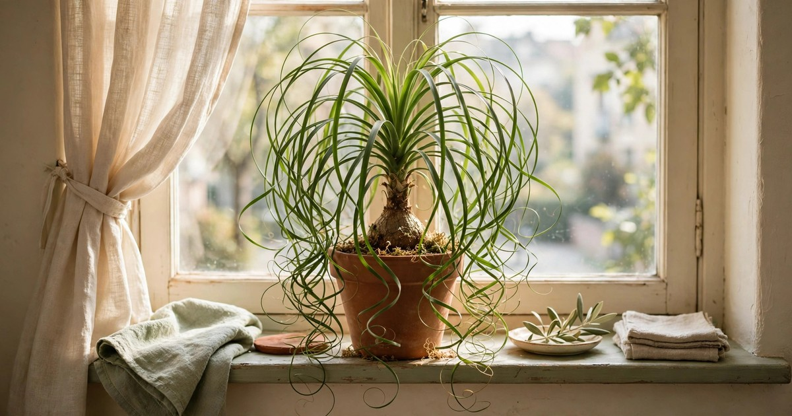
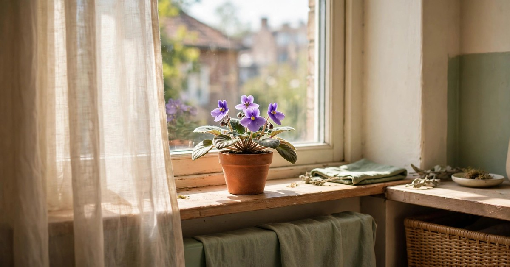

The hardest part of keeping plants in a flat shared with a cat or a dog is not the light or the watering — it is the worry. So many of the most popular houseplants are toxic if chewed: lilies, pothos, snake plants, peace lilies, and monstera all carry some risk, and in a small apartment your pet is never more than a few steps from every plant you own. A curious cat that nibbles a leaf while you are at work can turn into a vet visit by the evening.

The good news is that plenty of beautiful, easy plants are genuinely non-toxic to cats and dogs, and this list has ten of the best of them — all verified against the ASPCA's list of non-toxic plants, all suited to small spaces, and all forgiving enough for a busy renter. A note of honesty: "non-toxic" does not mean "good to eat" — a cat that eats a whole plant will still get an upset stomach, and any plant chewed to pieces will look terrible. But with these ten, a curious nibble is a mess, not a medical emergency, and that is the difference that matters.

### 1. Spider Plant

The spider plant is the classic pet-safe houseplant for a reason: it is completely non-toxic to cats and dogs, it is almost impossible to kill, and it produces baby plantlets that dangle like a green waterfall. Cats are famously attracted to it — some vets think the leaves contain a mild hallucinogenic compound cats enjoy — so expect yours to get nibbled, and the good news is that nibbling is harmless to the cat and the plant bounces back fast.

Give it bright indirect light and water when the top soil dries out, usually weekly. Brown leaf tips are its one common complaint, caused by fluoride in tap water — let your tap water sit uncovered overnight before watering and the new leaves come in clean. Hang it where the plantlets can dangle, and within a year one plant becomes a whole collection, because every baby is a free new plant.

Find it on Amazon: [spider plant in hanging basket pet safe](https://www.amazon.com/s?k=spider+plant+hanging+basket+indoor&tag={{AMAZON_TAG}})

### 2. Boston Fern

The Boston fern is one of the few houseplants that is both dramatic and completely pet-safe, with soft, feathery fronds that can grow half a metre long and fill an empty corner with green. It is also one of the best plants for raising humidity in a dry, centrally heated flat, which your skin and your sinuses will notice in winter.

It is thirstier than most plants on this list and it will tell you when it is unhappy: dry, crispy frond tips mean it needs more water or more humidity. Keep the soil consistently moist, mist it a few times a week, and give it a spot with bright indirect light — a bathroom is its favourite room in any flat, because the shower steam gives it the humidity it craves. Keep it out of direct sun, which scorches the fronds, and it will reward you with growth that looks far more expensive than the plant cost.

Find it on Amazon: [Boston fern plant in pot indoor](https://www.amazon.com/s?k=boston+fern+plant+indoor+pot&tag={{AMAZON_TAG}})

### 3. Calathea

Calathea is the plant for renters who want something that looks like a design object: bold patterned leaves in greens, purples and pinks, each one different, with the charming habit of folding its leaves up at night and opening them again in the morning. It is completely non-toxic to cats and dogs, and it is one of the best low-light plants there is — it genuinely prefers a shady spot to a sunny one.

The trade-off is that calathea is fussier than the other plants here: it wants consistent moisture, high humidity, and filtered or rain water rather than hard tap water, which can brown the leaf edges. A pebble tray under the pot and a weekly wipe of the leaves keep it happy, and the reward is a plant that looks like it cost three times what it did. If your flat is dry and you forget to water, start with a spider plant instead — calathea is a second plant, not a first.

Find it on Amazon: [calathea plant patterned leaves indoor](https://www.amazon.com/s?k=calathea+plant+indoor+pot&tag={{AMAZON_TAG}})

### 4. Areca Palm

The areca palm is the pet-safe way to get the tall, tropical, "holiday" look in a flat: feathery fronds on slender stems that can reach a metre or more indoors, turning an empty corner into a green focal point. It is non-toxic to cats and dogs, it is one of the few palms that tolerates indoor life well, and it is also one of the best-studied air-cleaning houseplants.

Give it bright indirect light — within a metre or two of a window — and water when the top few centimetres of soil dry out. It likes a little more water than the average houseplant, and it appreciates a misting now and then. The one thing it dislikes is being moved: find its spot and leave it there, because areca palms sulk for weeks after a relocation. In a small flat, one areca palm in a corner does the work of five small plants.

Find it on Amazon: [areca palm plant large indoor pot](https://www.amazon.com/s?k=areca+palm+plant+indoor&tag={{AMAZON_TAG}})

### 5. Peperomia

Peperomia is the small-space specialist on this list: compact, slow-growing, happy in a tiny pot on a shelf or a desk, and available in dozens of varieties from the round-leaved peperomia hope to the watermelon-patterned peperomia argyreia. All of them are non-toxic to pets, and all of them are forgiving of the low light and irregular watering that define most rental flats.

Its thick, fleshy leaves store water, so it prefers to be underwatered rather than overwatered — water when the soil has dried out and always let the pot drain fully. It is a plant that rewards neglect more than attention, which makes it ideal for a busy renter. A peperomia on a desk or a bedside table is the easiest way to add green to a room that has no floor space to spare.

Find it on Amazon: [peperomia plant small pot indoor](https://www.amazon.com/s?k=peperomia+plant+small+pot&tag={{AMAZON_TAG}})

### 6. Cast Iron Plant

The cast iron plant earned its name: it survives low light, irregular watering, draughts, and neglect that would kill almost anything else, and it is completely non-toxic to cats and dogs. Its broad, dark-green leaves are architectural and elegant, and it grows slowly enough that it will not take over a small flat. If you have a dark corner where every other plant has died, this is the plant for that corner.

It wants almost nothing: low to moderate light, water every couple of weeks, and an occasional wipe of the leaves to keep them glossy. It is the best plant on this list for a north-facing flat, a windowless hallway, or a bathroom with no window. The only thing it dislikes is direct sun, which scorches the leaves, and overwatering, which rots the roots — two problems that are easy to avoid by leaving it alone.

Find it on Amazon: [cast iron plant aspidistra indoor pot](https://www.amazon.com/s?k=cast+iron+plant+aspidistra&tag={{AMAZON_TAG}})

### 7. Prayer Plant

The prayer plant is a close relative of the calathea with the same delightful habit: its leaves fold up at night like hands in prayer and open again in the morning. The red-veined variety, maranta leuconeura, is one of the most striking small houseplants there is — deep green leaves with bright red veins and a purple underside — and it is entirely non-toxic to pets.

Like calathea it prefers humidity and consistent moisture, so it is happiest in a bathroom or near a humidifier, and it likes low to medium light rather than direct sun. It trails as it grows, which makes it beautiful in a hanging planter or on a high shelf where the leaves can spill over the edge. If your cat is a nibbler, the prayer plant is a good choice: its leaves are soft and tempting, and a nibble does no harm to either party.

Find it on Amazon: [prayer plant maranta red veins indoor](https://www.amazon.com/s?k=prayer+plant+maranta+indoor&tag={{AMAZON_TAG}})

### 8. Baby's Tears

Baby's tears is a tiny-leaved trailing plant that forms a soft green carpet, and it is one of the gentlest plants on this list — completely non-toxic, with delicate leaves that look like moss and spill beautifully over the edge of a pot. It is the plant to choose if you want a lush, full look on a shelf or in a hanging planter without taking up any floor space.

It likes consistent moisture and does not forgive drying out, so it is best for renters who water regularly or who keep it in a terrarium or a self-watering pot. It is also the plant most likely to be nibbled by cats, because the tiny leaves look like grass — and cats eat grass. The good news is that it is harmless, and the plant regrows quickly from any nibbled patch. Keep it in bright indirect light and it will fill its pot within a few months.

Find it on Amazon: [baby's tears plant soleirolia indoor](https://www.amazon.com/s?k=babys+tears+plant+soleirolia&tag={{AMAZON_TAG}})

### 9. Ponytail Palm

Despite the name, the ponytail palm is not a palm at all — it is a succulent with a swollen trunk that stores water and a fountain of long, curly leaves that cascade like a ponytail. It is completely non-toxic to cats and dogs, it is one of the easiest plants on this list to keep alive, and it looks like a sculpture on a windowsill or a side table.

It stores water in its trunk, so it needs watering only every two to three weeks — less in winter — and it likes bright light, making it the best pet-safe plant for a sunny windowsill. The long leaves are irresistible to cats, who love to bat at them, so expect some chewed tips; trim the brown ends with clean scissors and the plant will not mind. A ponytail palm in a terracotta pot is a statement piece that costs very little and asks for almost nothing.

Find it on Amazon: [ponytail palm plant in terracotta pot](https://www.amazon.com/s?k=ponytail+palm+plant+pot&tag={{AMAZON_TAG}})

### 10. African Violet

The African violet is the only plant on this list that flowers for months at a time indoors, and it does it in a pot small enough to sit on a windowsill — purple, pink, or white blooms above soft, fuzzy leaves, all completely non-toxic to cats and dogs. It is the pet-safe answer to the question "which houseplant actually flowers," and it costs less than a takeaway.

It wants bright indirect light — an east-facing windowsill is ideal — and water from the bottom, because water on the fuzzy leaves leaves marks. Sit the pot in a saucer of water for twenty minutes, let it drain, and repeat when the soil dries out. It likes a small, snug pot and will sulk if repotted into one too large. For a renter who wants colour without risk, a row of African violets on a windowsill is hard to beat.

Find it on Amazon: [African violet plant flowering indoor pot](https://www.amazon.com/s?k=african+violet+plant+flowering&tag={{AMAZON_TAG}})

## Frequently Asked Questions

### Are these plants really safe if my cat eats them?

All ten plants on this list are classified as non-toxic to cats and dogs by the ASPCA, which means a nibble will not poison your pet. A cat that eats a large amount of any plant may still get an upset stomach or vomit, so discourage heavy chewing — but you do not need an emergency vet visit for a nibbled spider plant leaf.

### Which pet-safe plants are best for low light?

The cast iron plant and calathea are the best low-light picks on this list — both tolerate dim corners that would kill most plants. The spider plant and peperomia also cope well with low light, though their growth slows. The African violet and ponytail palm need brighter spots, so keep them near a window.

### What popular houseplants are toxic to cats and dogs?

The most common toxic houseplants are lilies (extremely toxic to cats — even pollen can be fatal), pothos, snake plants, peace lilies, monstera, philodendron, and sago palm. If you already own any of these, keep them in a room your pet cannot access, or in a hanging planter well out of reach.

### How do I stop my cat from eating my plants?

Give your cat something better to chew: a pot of cat grass (wheatgrass or oat grass) placed near the plants redirects most nibbling. Citrus peels or a light spray of diluted lemon juice on the leaves deters many cats, and hanging planters keep the most tempting plants out of reach. A bored cat chews more, so daily play helps too.

### Can I keep pet-safe plants in a small apartment with no windows?

Yes, but choose carefully: the cast iron plant, calathea, and peperomia all tolerate very low light, and a small grow light — a cheap clip-on LED — keeps them thriving in a windowless room. Avoid the ponytail palm and African violet without a window, as both need real light to stay healthy.

### Where should I put pet-safe plants so my dog cannot knock them over?

Use heavy ceramic or terracotta pots that are hard to tip, keep plants on high shelves or in hanging planters out of tail-wagging height, and avoid the floor near doorways where an excited dog runs through. A plant stand with a wide, stable base is safer than a narrow one, and grouping plants together on a sturdy surface stops a single pot from being knocked off on its own.
