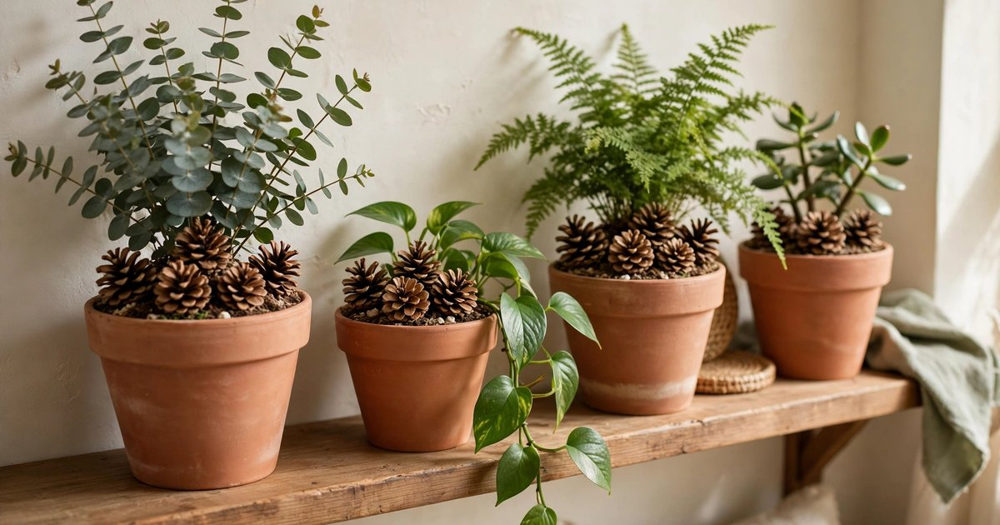
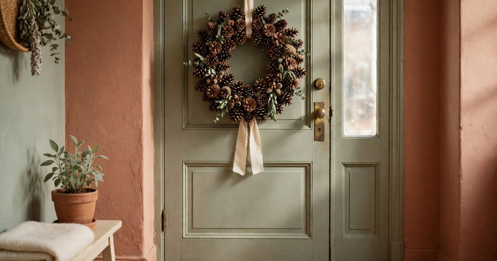
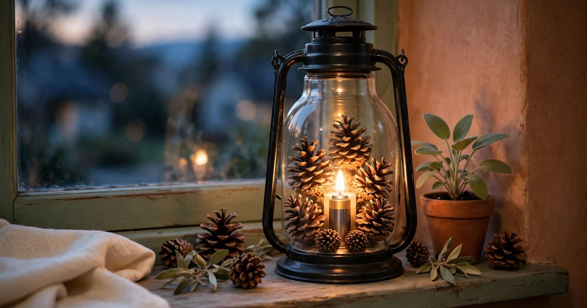
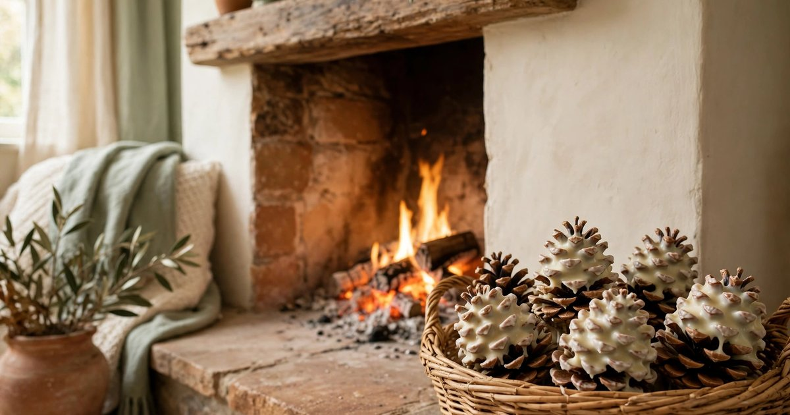

Pinecones are the best free decoration in winter. They fall from the trees in parks and woods all autumn, they cost nothing to collect, and they bring exactly the texture a winter room needs: rough, brown, natural, and unmistakably seasonal. A bowl of pinecones on a sideboard does the same work as a bought ornament — it says winter, it says woodland, it says someone here pays attention — and it does it for the price of a walk.

Before you use foraged pinecones, bake them. Ten minutes in a low oven (around 100°C) on a baking tray kills any insects hiding in the scales and opens the cones up beautifully as they dry. Let them cool, shake off any loose debris, and they are ready for every idea below. All ten use pinecones plus things you almost certainly already own, and all of them pack away — or compost — in January.

### 1. A pinecone garland along the mantel or shelf

The simplest pinecone decoration is also the most effective: a garland. Thread twine through the scales of a dozen pinecones — a screw eye twisted into the base of each cone makes this easy — and hang the string along a mantel, a shelf, or a window frame. Space the cones unevenly, mix large and small, and add a few dried orange slices or cinnamon sticks between them for colour and scent.

A pinecone garland works because the cones are naturally varied, so the garland never looks manufactured. It is also the most durable decoration on this list: a garland made this year will look just as good next year, and the year after. Hang it with a Command hook or drape it over the mantel, and it comes down without a mark.

### 2. A pinecone centrepiece in a low bowl

Fill a low bowl — wood, ceramic, or a basket — with pinecones, add a pillar candle in the centre, and you have a winter centrepiece that takes two minutes to make and lasts all season. The bowl does the work of containing the cones, so the arrangement looks deliberate rather than like a pile of foraged things, and the candle in the middle gives it height and a warm glow at dinner.

Vary the cone sizes and add a handful of dried orange slices or a few sprigs of evergreen for contrast. Use a battery candle if the table is within reach of children or pets, and keep real flames away from the cones themselves — pinecones are dry and will catch. This is the centrepiece for people who want a festive table without buying a single thing.

### 3. Pinecone ornaments on the tree

Tie a short length of ribbon or twine around the base of a small pinecone and hang it on the tree, and you have an ornament that costs nothing and looks like it came from a craft market. The cones' natural texture contrasts beautifully with shiny baubles, and a tree dressed with a mix of pinecones and baubles looks layered and collected rather than bought in one trip.

Make them fancier by brushing the tips of the scales with white paint for a frosted look, or dipping them in gold paint for a metallic edge — but plain cones are honestly the most elegant option on a natural tree. Our guide to [drying citrus and flowers for winter decor](/dry-citrus-flowers-winter-decor-guide/) pairs perfectly with this: a tree with pinecones and dried oranges is a whole decorating scheme for the price of a walk and an afternoon.

### 4. Pinecones as plant-pot toppers

Set a few small pinecones on the soil of your potted plants and two things happen at once: the plants look dressed for winter, and the soil stays covered. The cones hide bare compost, stop the soil drying out so fast in heated rooms, and deter cats from digging — a practical benefit that most plant owners discover by accident.

Choose small, neat cones for small pots and larger ones for floor plants, and keep the cones dry — a wet pinecone will close up and eventually mould. This is the easiest idea on the list, because it needs no tools, no string, and no arranging skill: drop the cones on the soil and you are done.

### 5. A pinecone wreath for the door

A pinecone wreath is the most impressive thing you can make from free materials. Glue or wire pinecones onto a wire or foam wreath form, packing them tightly so no form shows through, and finish with a ribbon at the top. The result is a wreath that looks bought, costs almost nothing, and lasts for years — pinecones do not fade, shed, or go out of fashion.

A hot glue gun is the fastest way to attach the cones, but florist's wire through the scales is stronger and lets you rearrange them. Start with the largest cones at the bottom and work upward, and fill any gaps with small cones or sprigs of evergreen. If you need a no-drill way to hang it, our guide to [hanging a Christmas wreath without drilling](/no-drill-christmas-wreath-hanging-renters/) covers hooks that hold a heavy wreath safely.

### 6. Pinecone place settings

A single pinecone at each place setting, with a name card tucked into its scales, is the most charming low-effort table decoration on this list. It costs nothing, it takes seconds per guest, and it gives every place a small natural object to look at while dinner is being served. After the meal, guests can take their pinecone home — which is a better party favour than most.

Use small, neat cones and write the names on kraft card or plain white card. A sprig of rosemary tucked beside the cone adds scent and colour, and the whole setting looks intentional rather than improvised. This is the idea to use when you are hosting and the budget is already spent.

### 7. A pinecone-filled lantern

Fill a glass lantern or a large glass jar with small pinecones, set a battery candle in the middle, and you have a winter light that glows through the glass and the gaps between the cones. The lantern contains the cones, so the arrangement looks neat, and the candlelight through the pinecone scales is genuinely beautiful at dusk.

Use battery candles only — a real flame inside a jar full of dry cones is a fire risk. A lantern like this works on a windowsill, a hallway table, or a bathroom shelf, and it is the one pinecone idea that looks just as good in February as it does in December, because it reads as winter rather than Christmas.

### 8. Pinecone fire starters for the fireplace

If you have a fireplace, pinecones are the best fire starters you will ever use — and the prettiest. Dip a dried pinecone in melted wax (an old candle end works perfectly), let it set, and it will catch light easily and burn steadily for several minutes. Stack a basket of wax-dipped cones beside the fireplace and you have fuel and decoration in one object.

Only use wax-dipped cones in a proper fireplace or fire pit, never in a candle or an open flame indoors, and keep the basket a safe distance from the hearth. This is the most practical idea on the list, and the one that turns a foraged decoration into something genuinely useful all winter.

### 9. Pinecones on a winter plant shelf

A plant shelf in winter can look a little bare — the plants are growing slowly, the light is low, and the shelf needs something seasonal to fill the gaps. Pinecones are the answer: tuck them between the pots, lean a large one against a planter, or line a row of small cones along the front edge of the shelf. The brown, rough texture contrasts with the green leaves and the ceramic pots, and the shelf instantly reads as winter.

This works because the cones are the same palette as the terracotta pots most plant shelves already have, so they tie the shelf together rather than introducing a new colour. Our guide to [styling trailing plants in a small apartment this winter](/trailing-plants-small-apartment-winter-ideas/) has more ideas for keeping a plant shelf looking full through the dark months.

### 10. A pinecone-and-candle windowsill display

Line a windowsill with pinecones and pillar candles — alternating cone, candle, cone, candle — and the sill becomes a winter display that glows in the evening and catches the frost on the glass in the morning. The sill is the perfect place for this because it is a surface that is otherwise empty, and the display is visible from outside as well as inside, which makes the whole flat look festive from the street.

Keep the candles in glass holders so the wax never reaches the sill, and use battery candles if the sill is narrow or within reach of curtains. A row of cones and candles along a sill is the simplest version of winter decorating there is: two objects, one surface, no skill required.

## Frequently asked questions

### Where can I find pinecones for free?

Parks, woods, and streets lined with pine trees are the best sources — look on the ground under mature pines from late summer through autumn. Always check local rules before collecting, and take only what has fallen; never pull cones from a tree.

### How do I clean pinecones before using them indoors?

Bake them on a tray at around 100°C for ten minutes, which kills insects and opens the scales. Let them cool completely, shake off loose debris, and pick out any remaining dirt with a soft brush. Avoid washing them in water, which makes them close up and can cause mould.

### Will pinecones attract bugs into my home?

Not if you bake them first. The low oven kills anything hiding in the scales, and a baked pinecone is just dry wood — no more likely to attract insects than a wooden bowl. Store spare cones in a dry place, and check them for damp before bringing them out next year.

### Can I use pinecones in a home with pets?

Yes, with care. Pinecones are non-toxic, but they are a choking hazard for small pets and the scales can be sharp. Keep them out of reach of chewers — on high shelves, inside lanterns, or on the mantel — and avoid using them at floor level where a dog can reach them.

### How long do pinecone decorations last?

Years, if they are kept dry. Pinecones do not fade, rot, or lose their shape indoors, so a garland or wreath made this year will look the same next year. Store them in a dry box over summer, and they will be ready to use again next winter.
