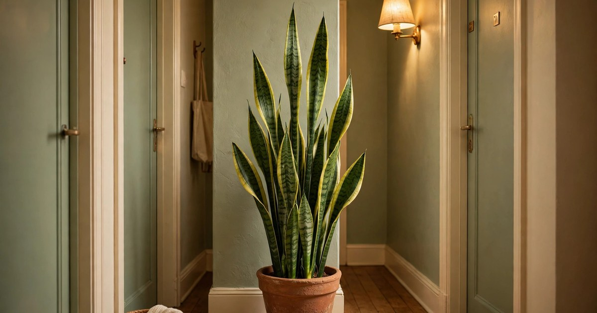
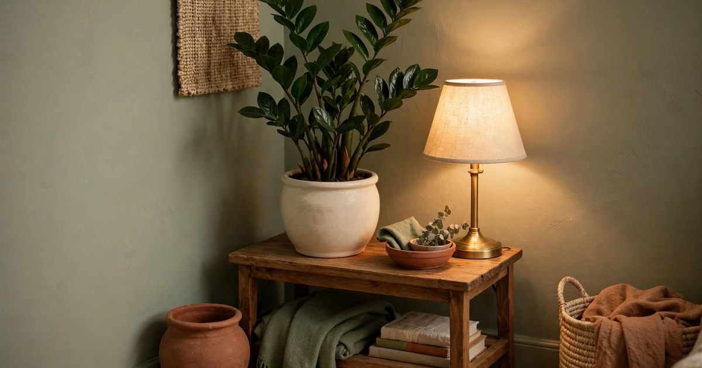
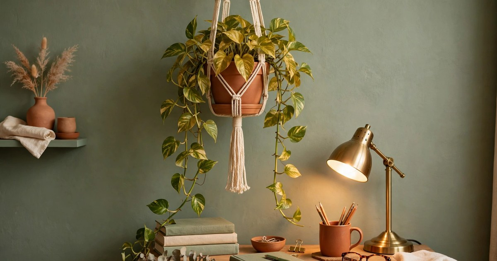
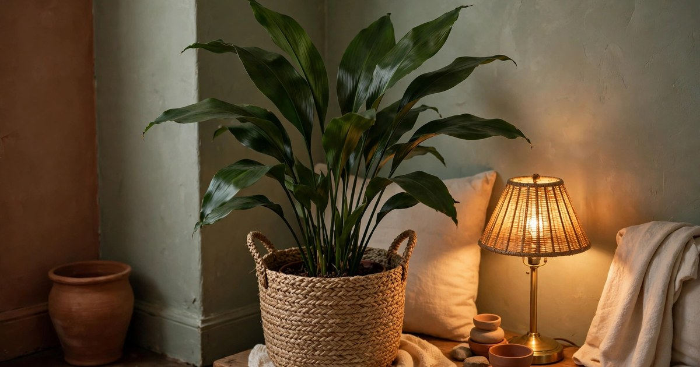
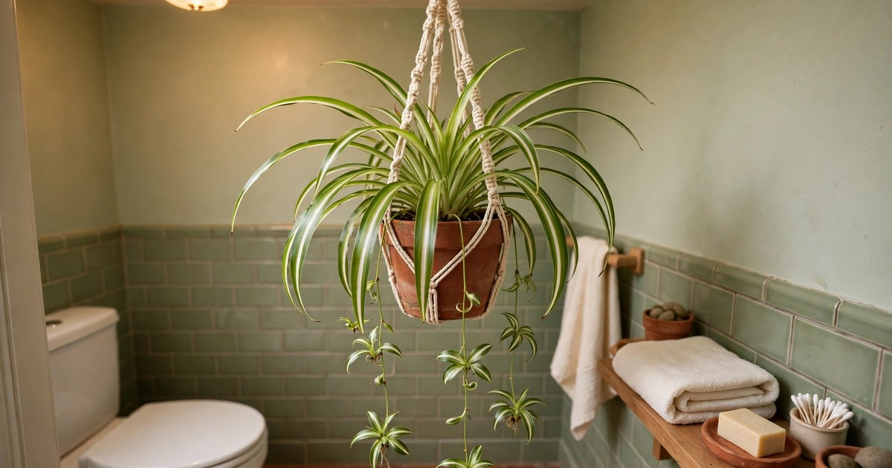
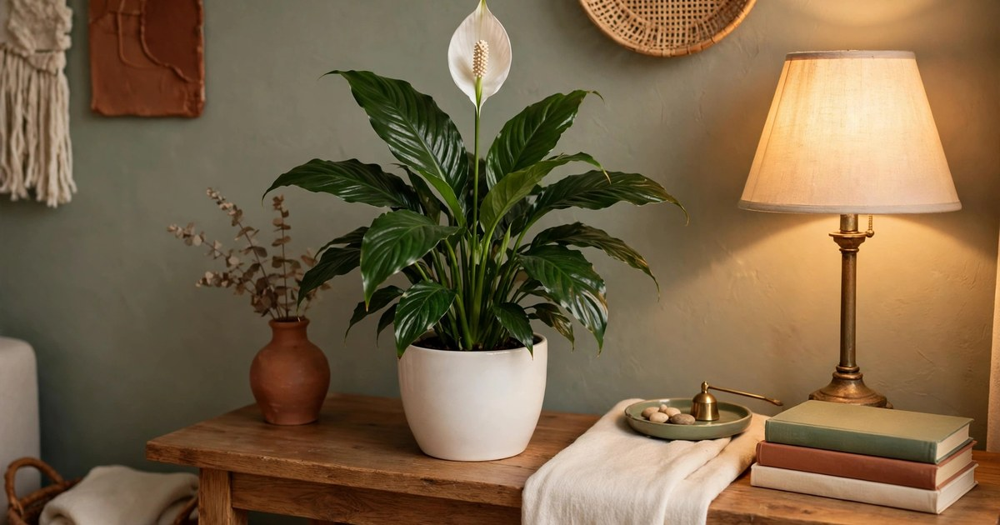
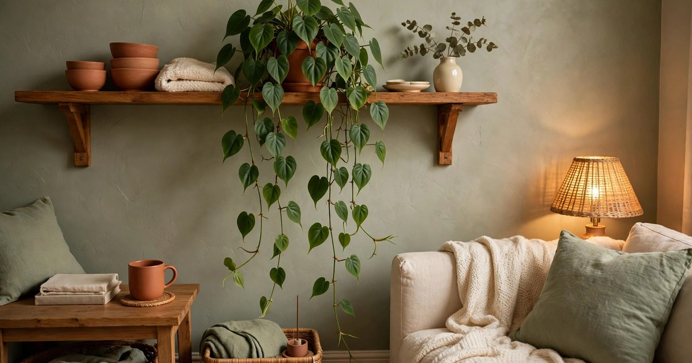
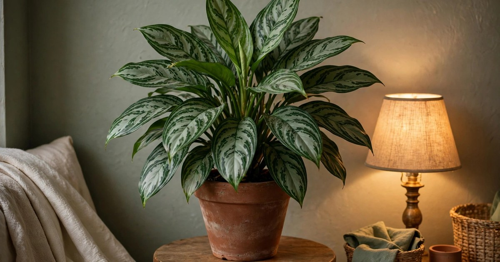
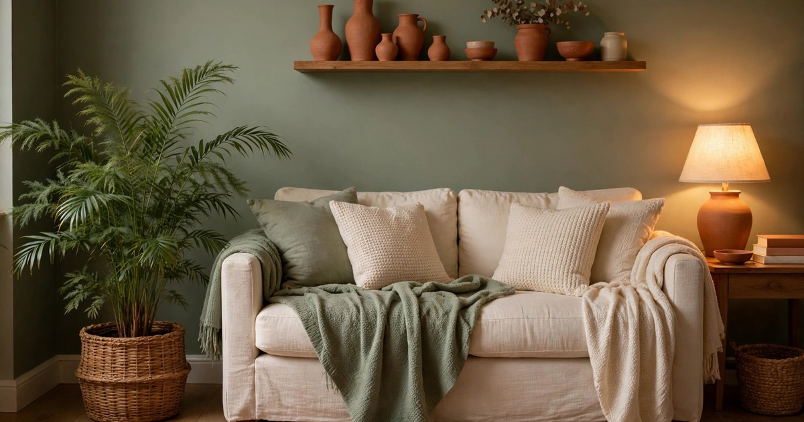
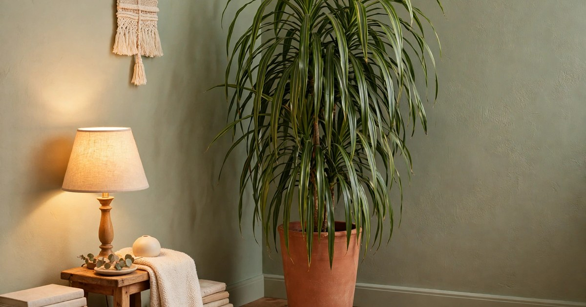

Let's be honest before anything else: no plant truly thrives in zero light. Every plant on this list would rather have a window, and any shop or blog that tells you otherwise is selling you a dying plant. But "no windows" doesn't have to mean "no plants" — it means you need the toughest survivors, a simple rotation system, and one cheap piece of kit. This post covers all three: the ten plants most likely to stay alive in a windowless flat, how to rotate them so each one gets its turn near the brightest spot or under a lamp, and the roughly $15 full-spectrum grow bulb that screws into a normal lamp and makes a windowless room genuinely workable for plants.

The rules for a windowless flat are different from the rules for a dark one. Our guide to [low-light indoor plants for dark apartments](/low-light-indoor-plants-dark-apartments/) covers plants for rooms that still get some daylight through a small or north-facing window — that post is about LOW light. This one is about ZERO light: basement flats, interior bedrooms, bathrooms with no window, and hallway corners that never see the sun. The plants below can survive those conditions for weeks at a time, especially with the rotation system near the end of this post — but they will grow slowly, they will not flower much, and they need less water than you think. Buy small, buy cheap, and start with two or three before you fill the flat.

## The 10 toughest plants for a windowless apartment

### 1. Snake Plant

The snake plant is the undisputed champion of the windowless flat, and it's not close. It stores water in its thick, upright leaves, tolerates weeks of neglect, and keeps photosynthesizing on the faintest ambient light from a hallway lamp or a door left open. In a room with no windows at all it won't grow fast — expect a new leaf every month or two rather than every few weeks — but it will stay green and upright for months, which is more than almost anything else can promise.

Water it like you mean it sparingly: once every three to four weeks in a dim room, and only when the soil is bone dry all the way down. Overwatering is the one thing that kills snake plants, and in a windowless flat the soil dries far slower than you expect. It fits anywhere — a tall pot by the front door, a small one on a bathroom shelf, a cluster flanking the TV. The only place it genuinely hates is a cold, damp corner, so keep it away from a draughty exterior door in winter.

[Shop snake plants](https://www.amazon.com/s?k=snake+plant+live&tag={{AMAZON_TAG}})

### 2. ZZ Plant

The ZZ plant looks like it was designed in a lab for renters with no windows: glossy, architectural leaves, thick rhizomes underground that store water for weeks, and a near-total indifference to low light. It is one of the very few plants that genuinely holds its colour in a room lit only by ceiling lights, and it forgives the two classic renter sins — forgetting to water and watering on a schedule instead of checking the soil.

In a windowless room, water a ZZ plant roughly once a month, and less in winter. If a stem turns yellow and soft, that is almost always too much water, so let it dry out completely before the next drink. It grows slowly in the dark — a new stem every month or so — which is actually a virtue in a small flat, since it won't outgrow its spot. One medium ZZ in a cream or terracotta pot is enough to make a hallway or a windowless bedroom feel alive.

[Shop ZZ plants](https://www.amazon.com/s?k=ZZ+plant+live&tag={{AMAZON_TAG}})

### 3. Pothos

Pothos is the plant every renter should start with, window or no window. It trails beautifully from a shelf or a hanging basket, it tells you exactly what it needs (drooping leaves mean thirsty, yellow leaves usually mean too much water), and a single cutting in a jar of water will root on a kitchen counter with no light at all. In a windowless flat it will grow slowly and its variegated leaves may revert to plain green — less light means less variegation — but the plant itself keeps going.

Give it a weekly check rather than a weekly water: feel the top few centimetres of soil, and water only when dry. Hang it high where its vines can trail, or train it along a shelf edge with removable hooks — no drilling, no damage, and it comes down cleanly when you move out. If a vine gets leggy in the dark, snip it back and pop the cuttings in water; in a few weeks you'll have a second plant for free.

[Shop pothos plants](https://www.amazon.com/s?k=pothos+plant+live&tag={{AMAZON_TAG}})

### 4. Cast Iron Plant

The cast iron plant earned its name in Victorian parlours lit by gas lamps, and it has been surviving dark rooms ever since. Its broad, dark green leaves are built for shade — in the wild it grows on forest floors — so a windowless flat is closer to its natural home than a sunny sill is. It is slow, steady, and almost impossible to kill with low light alone.

Water every two to three weeks, letting the soil dry between waterings, and wipe the big leaves with a damp cloth once a month — dust blocks what little light reaches them, and in a dim room every photon counts. It doesn't mind cool rooms, dry air, or being ignored for a fortnight while you're away. The trade-off is speed: a cast iron plant in a windowless flat may only push out a handful of new leaves a year. Buy a full, mature plant rather than a small one, and enjoy it as a piece of living furniture rather than a fast-growing project.

[Shop cast iron plants](https://www.amazon.com/s?k=cast+iron+plant+live&tag={{AMAZON_TAG}})

### 5. Spider Plant

Spider plants are the cheerful workhorse of the low-light world, and they bring something the tougher plants on this list don't: babies. The little plantlets that dangle from arching stems can be snipped off and potted, so one $10 plant becomes a whole collection within a year. In a windowless flat a spider plant will grow more slowly and its white stripes may fade toward green, but it keeps producing those arching leaves — and in a bathroom, the humidity from showers actually helps it.

Water when the top of the soil feels dry, roughly every one to two weeks, and keep it out of the coldest draughts. Brown leaf tips are the classic spider plant complaint in flats, and they're usually caused by tap water chemicals or dry air rather than light — try filtered or day-old tap water, and a pebble tray underneath helps. Hang it in a bathroom or above a kitchen counter, where its trailing plantlets can dangle without taking up floor space.

[Shop spider plants](https://www.amazon.com/s?k=spider+plant+live&tag={{AMAZON_TAG}})

### 6. Peace Lily

The peace lily is the only plant on this list that might actually flower in a windowless flat — not often, and not lavishly, but a white spathe now and then is possible, which no other plant here can promise. It is also the most communicative: its leaves droop dramatically when thirsty and perk back up within hours of watering, so you always know where you stand. That makes it a good first plant if you're nervous about killing things.

It likes more water than the others on this list — check the soil weekly and water when the top few centimetres are dry — and it appreciates humidity, so a bathroom or a kitchen is its best spot in a windowless flat. Keep it away from radiators, which crisp its leaf edges. One honest warning: peace lilies are toxic to cats and dogs if eaten, so if you have pets, hang it high or pick another plant from this list.

[Shop peace lilies](https://www.amazon.com/s?k=peace+lily+plant+live&tag={{AMAZON_TAG}})

### 7. Heartleaf Philodendron

Heartleaf philodendron is pothos's softer, shadier cousin: heart-shaped leaves on thin trailing vines, happy to climb a moss pole or cascade from a high shelf, and perfectly content in the kind of light you'd read a book by rather than the kind you'd sunbathe in. It is one of the best plants for filling a blank wall in a windowless room, because a single plant can trail two metres or more over a year or two, even in dim conditions.

Water when the top of the soil is dry, about every one to two weeks, and pinch back the longest vines if they get bare in the middle — the cuttings root easily in water, just like pothos. It suits the same removable-hook trick as pothos: train vines along a picture rail or shelf edge without a single hole in the wall. In very low light the leaves stay smaller and spaced further apart, which actually suits a minimalist, trailing look.

[Shop heartleaf philodendron](https://www.amazon.com/s?k=heartleaf+philodendron+live&tag={{AMAZON_TAG}})

### 8. Chinese Evergreen

Chinese evergreen, or aglaonema, is the plant that interior designers reach for when a room has no natural light at all — hotel lobbies, offices, windowless bathrooms — because its patterned leaves in green, silver and cream hold their colour in conditions that bleach most other plants pale. There are dozens of varieties, from deep green to pink-tinged, so you can pick one that suits your palette without worrying about light.

Water every two weeks or so, when the top of the soil is dry, and keep it warm — it dislikes cold draughts below about 15°C, so a hallway by an exterior door in winter is the one spot to avoid. Dust the leaves monthly so they can catch the light they do get. It grows slowly and stays compact, which makes it ideal for a desk, a bedside table, or a small shelf where a bigger plant would overwhelm the space.

[Shop Chinese evergreen plants](https://www.amazon.com/s?k=chinese+evergreen+plant+live&tag={{AMAZON_TAG}})

### 9. Parlor Palm

The parlor palm has been the go-to plant for dark Victorian parlours and dim hotel corners for over a century, and it still does the job better than almost anything else: feathery, soft fronds that bring a room to life, in a plant that asks for almost nothing. It grows slowly in low light, which means the small palm you buy today will still fit its spot in two years' time — a real virtue in a rented flat where every square metre counts.

Water when the top few centimetres of soil are dry, roughly every one to two weeks, and give it a light mist or a nearby pebble tray if your flat's air is very dry — brown frond tips are its way of complaining about dryness, not darkness. It is one of the few palms that is safe around cats and dogs, so it's a good pick if the peace lily is off your list. One parlor palm in a woven basket beside the sofa does more for a windowless living room than a shelf full of small pots.

[Shop parlor palm plants](https://www.amazon.com/s?k=parlor+palm+plant+live&tag={{AMAZON_TAG}})

### 10. Dracaena

Dracaena is the tall, architectural closer for this list — the plant you put in the empty corner of a windowless room when everything else feels too small. Varieties like 'Janet Craig' and 'Lemon Lime' have bold striped leaves on upright stems, and they tolerate low light far better than their tropical looks suggest. In a dark flat they grow slowly and keep their colour, and a single tall dracaena can anchor a whole corner the way a floor lamp would.

Water every two to three weeks, and use filtered or day-old tap water if you can — dracaenas are sensitive to fluoride, which shows up as brown leaf tips. Keep it away from radiators and cold draughts, and rotate the pot a quarter-turn every couple of weeks so it grows straight instead of leaning toward the nearest lamp. It is toxic to pets if chewed, so keep it out of reach of curious cats and dogs.

[Shop dracaena plants](https://www.amazon.com/s?k=dracaena+plant+live&tag={{AMAZON_TAG}})

## The rotation system (and the $15 grow bulb that makes it all work)

Here is the trick that turns this list from "plants that survive" into "plants that actually live": rotation. You don't need a window for every plant — you need one bright spot, and you need to share it. Pick the brightest place in your flat: the spot nearest the front door's glass panel, the hallway under the brightest ceiling light, the kitchen counter under the cabinet lights, or a shelf with a lamp. That is your recovery spot. Every week, swap two or three plants into it for a few days while the others rest in their display spots. Each plant gets a regular dose of the best light you have, and no plant sits in the darkest corner forever.

The second half of the trick costs about $15 and changes everything: a full-spectrum grow bulb screwed into an ordinary lamp. Our guide to [grow lights for dark winter apartments](/grow-lights-dark-winter-apartments-under-25/) covers the options under $25, but the simplest version is a single LED grow bulb in a desk lamp or floor lamp you already own, on a timer for 10–12 hours a day, shining on a shelf of plants from about 30 cm away. It uses less electricity than a normal light bulb, it looks like ordinary warm light to your eyes, and it is the difference between a snake plant that merely survives and one that actually grows new leaves. If you buy one thing from this post, buy the bulb — then buy the plants.

A final honest note on expectations: even with rotation and a grow bulb, windowless plants grow slowly, flower rarely, and need far less water than the care tag suggests. That is fine. The goal in a windowless flat isn't a jungle — it's a few green, living things in rooms that would otherwise have none, bought cheap, kept alive with a weekly check, and enjoyed for years.

## Frequently Asked Questions

### Can any plant really grow with no sunlight at all?

No plant grows well in literal darkness, and any plant kept in a pitch-black room will eventually die. The plants in this post survive in windowless rooms because those rooms still have ambient light — ceiling lights, lamps, light spilling in from a hallway or an open door. If your room is dark even with the lights on, add a grow bulb (see the section above) before you buy plants; a $15 bulb is cheaper than replacing dead plants every month.

### How is this different from low-light plants?

Low light still means some daylight — a north-facing window, a small window, a room that gets indirect sun for part of the day. Our [low-light indoor plants for dark apartments](/low-light-indoor-plants-dark-apartments/) guide covers that situation. This post is for zero-light rooms: no window at all, or a window that faces a wall and never sees direct sun. The plants here are the toughest survivors, and they need the rotation system and grow bulb in this post to do more than just hang on.

### How often should I water plants in a windowless apartment?

Less than you think — usually half as often as the same plant in a bright room. Without sunlight, plants drink slowly and soil stays wet for much longer, so overwatering is the number one killer in windowless flats. Check the soil with your finger before every watering, and only water when the top few centimetres are dry. For snake plants and ZZ plants that can mean once a month; for peace lilies, about once a week.

### Will a grow light bulb really help, or do I need a special setup?

A single full-spectrum LED grow bulb in a normal lamp genuinely helps — it is the cheapest meaningful upgrade for a windowless flat. Put it on a timer for 10–12 hours a day, keep it 20–30 cm from the plants, and aim it at a shelf or a cluster rather than one plant at a time. You don't need a tent, a rack, or a purple grow panel; one bulb over your rotation spot is enough to keep the plants on this list growing slowly instead of just surviving. See our [grow lights for dark winter apartments](/grow-lights-dark-winter-apartments-under-25/) guide for the best options under $25.

### Which plant should I buy first for a windowless apartment?

A snake plant or a ZZ plant — they're the hardest to kill, the most forgiving of forgotten watering, and the cheapest to replace if something does go wrong. Buy one, keep it alive for two months with the rotation system, then add a pothos or spider plant for trailing greenery. Starting with one plant and learning its rhythm beats buying ten at once and watching them all struggle.

A windowless flat doesn't have to be a plant-free flat. Start with one tough plant, give it a turn under the lamp each week, and let the green in slowly.
