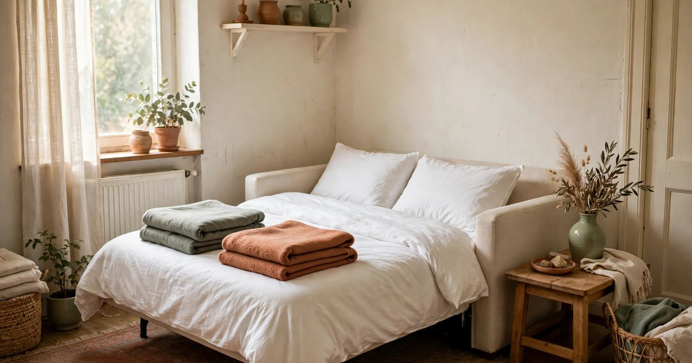
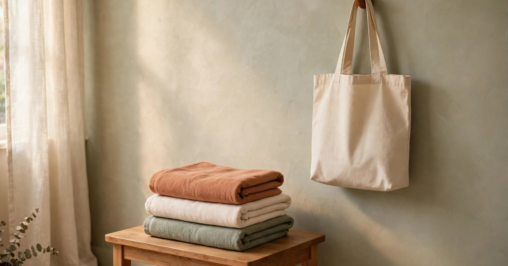
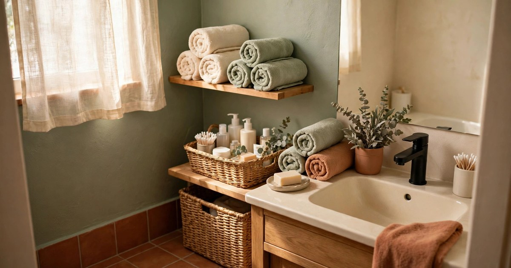
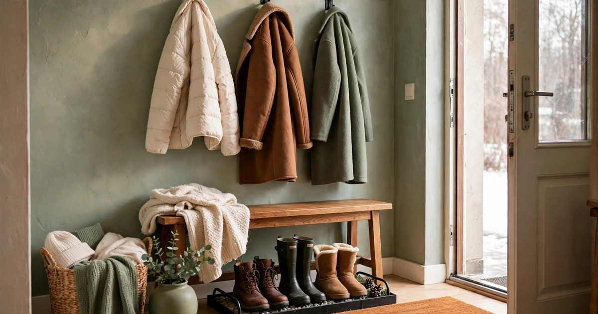
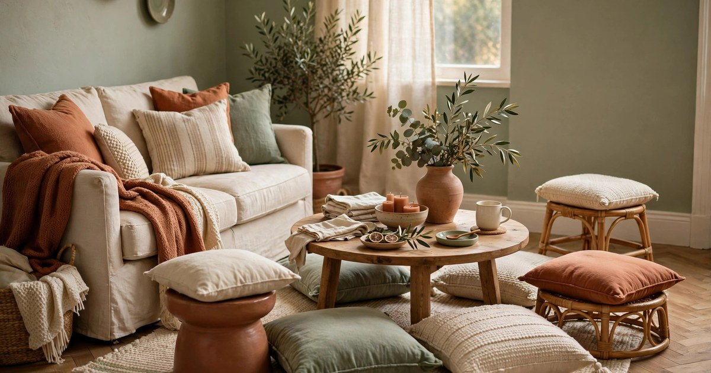
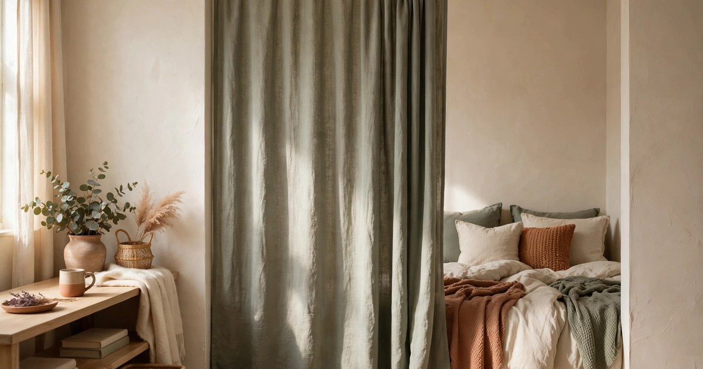
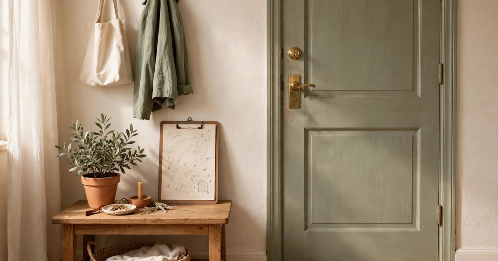

Winter guests arrive with suitcases, wet coats, and the expectation of a warm bed, and your rental has no guest room. That is not a problem — it is a puzzle with a very solvable answer. A rental can host overnight visitors beautifully if you plan the four things guests actually care about: somewhere comfortable to sleep, somewhere to put their things, a bathroom that works, and a host who is not stressed. The nine steps below cover all of it, with nothing that damages a wall, buys furniture you cannot store, or requires a spare room you do not have.

### 1. Build a sleep setup that does not eat the living room

The sleep setup is the whole game, so solve it first. A sofa bed is ideal if you have one; if not, a good air mattress with a real mattress topper is nearly as comfortable and folds into a cupboard when guests leave. What matters is not the bed type but the bedding: fresh sheets, two pillows per person, and a blanket that is actually warm enough for a cold house at night. Guests forgive a sofa bed; they do not forgive a thin blanket in December.

Set the bed up before guests arrive, not after dinner when everyone is tired. Make it properly — fitted sheet, duvet, pillows arranged — so it reads as a bed, not a camp. Keep the bedding somewhere accessible for the stay, because guests who get cold at 2 am should be able to grab another blanket without waking you. And if two guests are sharing, a sofa bed beats two separate air mattresses in a small room, because it leaves floor space for suitcases and morning movement.

### 2. Clear one surface and one hook per guest

Guests do not need much space, but they need some space that is visibly theirs. Clear one surface per guest — a side table, a cleared shelf, one end of a dresser — and hang one hook per guest, using removable adhesive hooks that come down cleanly. The moment a guest can put their phone, book, and water glass somewhere that is not the floor, they stop feeling like an imposition and start feeling like a guest.

This step costs an hour of tidying, not a purchase. Clear the clutter from the surfaces you have rather than buying new furniture. A small basket or tray on the surface gives guests a contained spot for keys, chargers, and toiletries, and it keeps their things from spreading across your home. If you have hosted before, you know the alternative: a guest's belongings slowly colonising every surface, which stresses everyone by day two.

### 3. Stock the bathroom like a mini hotel

A guest bathroom does not need renovating; it needs stocking. Fresh towels (one bath towel and one hand towel per guest), a spare toothbrush, basic toiletries, and a bin that is not full — that is the whole list, and it is the difference between a guest feeling welcome and a guest feeling awkward about asking for a towel. Roll the towels instead of folding them; rolled towels look intentional and take up less shelf space.

Winter adds two items: lip balm and moisturiser, because cold air and indoor heating dry skin fast, and guests rarely pack enough. Put everything in one visible basket or on one shelf so guests can help themselves without asking. And check the small things the day before: a working light, a shower curtain that stays inside the bath, a toilet roll that is not nearly empty. Guests remember bathroom comfort more than any other part of a stay, because it is where they are most aware of being in someone else's home.

### 4. Set up a self-serve drinks station

A drinks station is the kindest hosting trick in a small rental, because it lets guests help themselves without asking and without waking you. Set a tray on the kitchen counter with a kettle (or the coffee maker), mugs, tea, coffee, sugar, and a small jug of milk, plus a few biscuits if you want to be remembered fondly. Guests who wake early can make tea quietly; guests who arrive late can make cocoa without you getting up.

Keep it compact — a single tray, not a whole counter — and put it somewhere that does not block cooking. In winter, add one festive touch: a jar of cinnamon sticks, a tin of hot chocolate, or a bottle of something warming for the evening. The station also saves you: instead of playing waiter all weekend, you point once at the tray and everyone is sorted. If you are hosting a larger group, our guide to [hosting a Christmas party in a rental](/host-christmas-party-rental-no-damage-guide/) covers the same self-serve logic at party scale.

### 5. Warm the entryway for wet coats and boots

Winter guests arrive wet, and the [entryway](/small-apartment-winter-entryway-ideas/) is where that wetness either stays contained or spreads through the flat. Set a [boot tray](/protect-rental-floors-winter-salt-guide/) or an old towel by the door, hang removable hooks for coats (one per guest, plus one for you), and put a sturdy [doormat](/renter-friendly-christmas-doormats-under-25/) down. Guests who can take off wet boots and hang a dripping coat the moment they arrive feel looked after, and your floors stay dry.

If your entryway is tiny — a hallway nook, a corner by the door — a single tray and a row of hooks is still enough. Add a small bench or sturdy stool if you have one, because sitting to take boots off is much easier than balancing in a doorway. Keep a spare umbrella and a couple of old towels by the door for guests who arrive in rain. And clear the entryway before guests arrive: it is the first thing they see, and a cluttered entrance makes the whole flat feel smaller than it is.

### 6. Plan seating so everyone actually fits

A rental living room seats its usual occupants comfortably and then one extra person breaks it. Before guests arrive, count seats against guests plus you, and add what is missing: floor cushions, a sturdy stool, a dining chair pulled into the living room, or a pouffe. The goal is not matching furniture — it is that nobody ends up perched on an armrest or standing with a plate all evening.

Arrange seating in a loose circle or around the coffee table rather than in rows facing the television, because guests want to talk, not watch. Pull the coffee table out slightly if it lets an extra cushion fit, and keep walkways clear — guests carrying mugs in a crowded room need a path that does not require sidestepping furniture. In a very small flat, the floor cushion is your best friend: it stores flat, costs little, and turns a two-seat room into a four-seat room in seconds.

### 7. Add privacy without a door

The hardest part of hosting in a rental is privacy, especially in a studio or one-bedroom flat where the guest sleeps in the living room. You cannot add a door, but you can add a division: a tension-rod curtain across a nook, a freestanding screen, a tall bookcase pulled out slightly, or even a curtain hung from removable hooks around the sofa bed. The division does not need to block sound; it needs to block sightlines, which is what makes both sides feel private.

Give the guest side its own light — a small lamp or a battery light — so they can read without lighting your bedroom, and agree on a simple morning routine: who uses the bathroom first, when the sleeping area gets folded away. Guests who have a curtain and a lamp feel like they have a room; guests who sleep in the middle of your living room under the ceiling light feel like they are camping in your house. The curtain comes down in January with no trace, and your deposit is untouched.

### 8. Prep the kitchen for group cooking

Winter hosting usually means cooking together, and a rental kitchen built for one or two people needs a little preparation before it feeds four. Clear one full counter of clutter, put the big pot and the roasting tray where you can reach them, and set out serving bowls the night before. Plan one big, forgiving meal — a stew, a tray bake, a slow-cooker dish — rather than a fussy menu that needs every burner and your full attention.

Stock the basics guests forget: cooking oil, salt, coffee, milk, and something for breakfast, because the morning after is when a bare fridge is most embarrassing. If guests offer to cook, say yes and give them a drawer: guests who can find the knives and the chopping board without asking three questions feel useful instead of in the way. And agree on the washing-up plan early — a small flat's sink fills fast, and a quick rinse-as-you-go rule keeps the kitchen usable all weekend.

### 9. Leave a simple house guide

A one-page house guide is the finishing touch that makes guests relax: the Wi-Fi password, how the heating works, where the spare towels and blankets are, the bin routine, and one local tip (the good coffee shop, the late shop, the bus stop). Write it on a card or a clipboard by the door, or leave it on the guest's surface. Guests who can answer their own questions stop apologising for asking, and you stop repeating the same five answers.

Keep it to one page and keep it friendly — this is a welcome note, not a tenancy agreement. Include the one thing every rental has that confuses visitors (the shower dial, the temperamental lock, the buzzer code) and the one thing guests most want to know (the Wi-Fi). If you are hosting over a holiday, add the plan: what time dinner is, whether there is a walk planned, when people are leaving. A guest who knows the plan enjoys the stay; a guest who does not spends it wondering.

## Guests Leave, the Flat Stays Yours

Preparing a rental for winter guests is mostly tidying, stocking, and thinking one step ahead — not buying, building, or renovating. A comfortable sleep setup, one surface and hook per guest, a stocked bathroom, a drinks station, a dry entryway, enough seats, a curtain for privacy, a kitchen ready for group cooking, and a one-page guide: that is the whole system, and every piece of it comes down or folds away when guests leave. The flat goes back to normal in an afternoon, the deposit is safe, and the guests leave saying the stay felt easy — which is the highest compliment a small rental can earn.

## Shop this look: guest-ready rental kit

- **Inflatable mattress with pump** — a sleep setup that packs away after. [Shop air mattresses](https://www.amazon.com/s?k=inflatable+mattress+with+built+in+pump&tag={{AMAZON_TAG}})
- **Spare towel set** — one clean set per guest, hotel-style. [Shop towel sets](https://www.amazon.com/s?k=guest+towel+set&tag={{AMAZON_TAG}})
- **Folding luggage rack** — a suitcase spot that is not the bed. [Shop luggage racks](https://www.amazon.com/s?k=folding+luggage+rack&tag={{AMAZON_TAG}})
- **Boot tray** — wet coats and boots stay by the door. [Shop boot trays](https://www.amazon.com/s?k=boot+tray+for+entryway&tag={{AMAZON_TAG}})
- **Guest toiletries set** — mini bottles so nobody has to ask. [Shop guest toiletries](https://www.amazon.com/s?k=guest+toiletries+set&tag={{AMAZON_TAG}})

## Frequently Asked Questions

### How do I host overnight guests with no guest room?
Use a sofa bed or an air mattress with a proper topper, fresh sheets, and two pillows per person, and make the bed up before guests arrive. Add a curtain or screen for privacy and a small lamp on the guest side. Guests forgive a sofa bed; they do not forgive thin blankets or no privacy at all.

### What should I stock in the bathroom for guests?
One bath towel and one hand towel per guest, a spare toothbrush, basic toiletries, and an empty bin. In winter, add lip balm and moisturiser. Put everything in one visible basket so guests can help themselves without asking.

### How do I keep a small rental comfortable for several guests?
Count seats against guests and add floor cushions or stools where you are short, arrange seating for conversation, and keep walkways clear. A self-serve drinks station and a one-page house guide let guests help themselves, which keeps the host relaxed and the flat calm.

### How do I protect my deposit when hosting guests?
Use removable hooks for coats and curtains, tray-based displays, and rugs in high-traffic areas. Nothing in this guide needs a nail, a screw, or adhesive that damages paint, so the flat returns to normal when guests leave.
