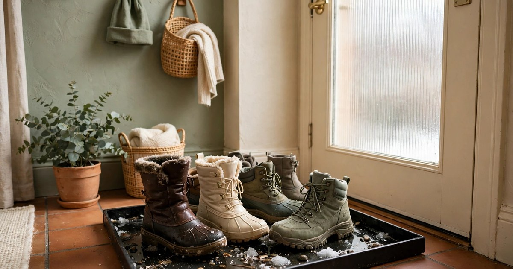
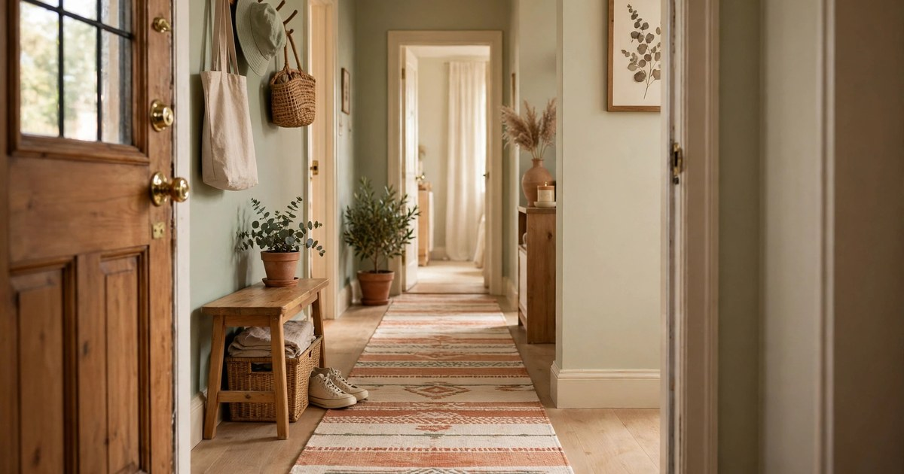
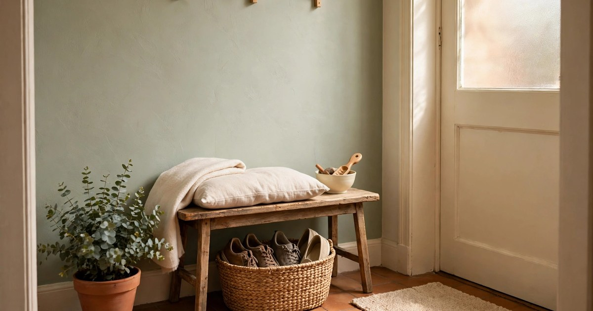
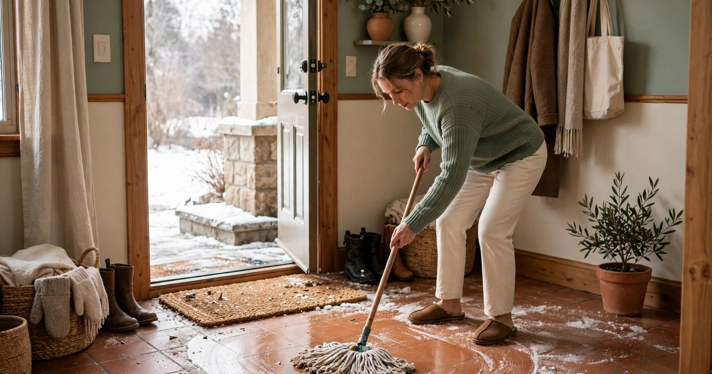
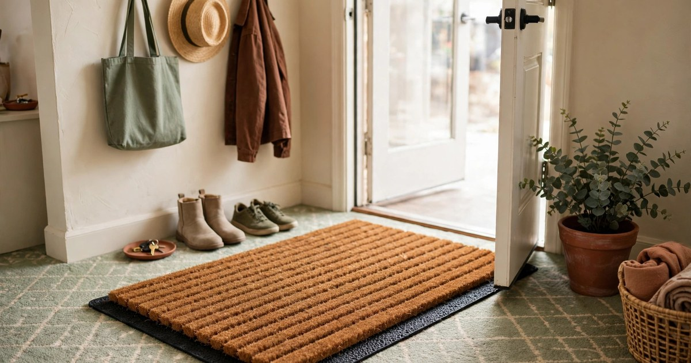
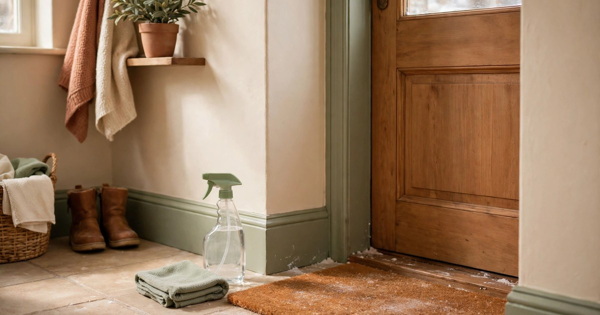
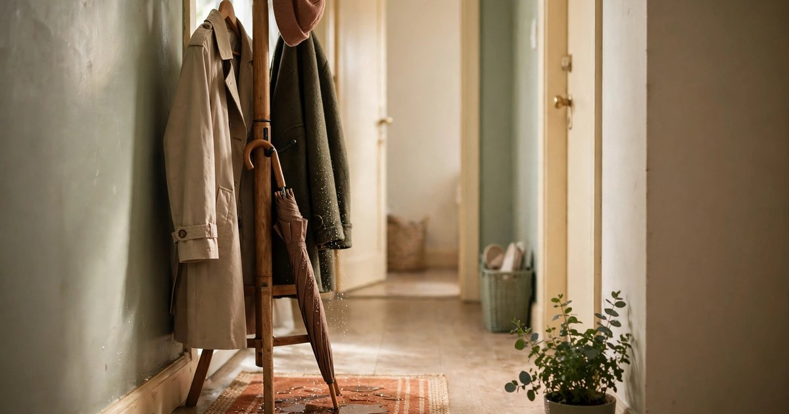
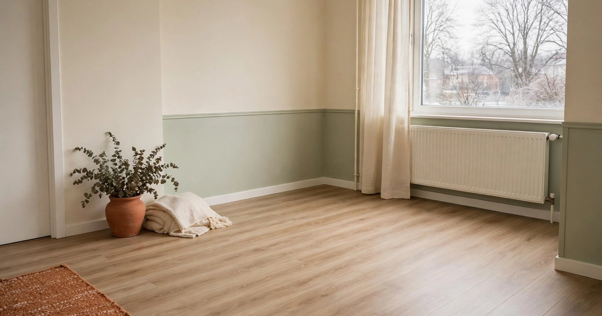

Winter is the season that eats rental deposits. Every time someone walks in with snowy boots, they track in a slurry of water, grit, and road salt — and salt is the quiet villain, because it does not just dirty a floor, it damages it. Salt crystals scratch wood, stain grout, eat into laminate seams, and leave white rings on stone that no amount of mopping fully removes. Landlords notice floors first at checkout, and "winter damage" is one of the few deductions that is genuinely hard to argue. The good news: protecting a rental floor costs almost nothing, needs no landlord permission, and starts at the front door, not with a renovation.

### 1. Start with a boot tray at the door

A boot tray is the single most effective floor protector a renter can buy, because it catches the mess at the exact point it enters the flat. Choose a tray with a raised lip and a ridged or slatted base — the lip holds meltwater, the ridges keep boots out of the puddle — and size it to the number of boots your household actually wears, not the number you wish you owned. One tray per entrance is enough; a second tray for guests can live stacked nearby and come out when visitors arrive.

Place the tray on a washable mat, not directly on the floor, so any overflow lands on something you can shake out rather than on wood or carpet. Empty and rinse the tray weekly in winter — a tray full of salty slush stops protecting anything and starts corroding the tray itself. This one habit, done consistently, prevents more floor damage than every other idea on this list combined, because it stops the salt before it ever touches your floor.

### 2. Lay a washable runner from door to living space

A boot tray catches what comes off at the door, but people do not always stop at the door — they walk in, they carry things, they forget. A washable runner laid from the entrance toward the living space catches the second wave: the drips, the grit shaken loose mid-stride, the salt that rode in on a coat hem. Choose a low-pile, machine-washable runner in a dark colour that hides winter grime between washes, and a length that covers the full path from door to the first room.

The runner must be washable, not just wipeable — winter salt needs a washing machine, not a damp cloth. A rug pad or non-slip backing underneath keeps the runner from sliding on hard floors and protects the floor beneath from the rug itself, which matters on polished wood where a shifting rug acts like sandpaper. Wash the runner every two weeks in deep winter, and more often after snow or ice, when salt use peaks.

### 3. Make shoe removal easy, not a lecture

The best floor protection is shoes coming off at the door — but only if taking them off is easier than walking in with them on. A small bench or sturdy stool by the entrance, a basket or open shelf for shoes, and a pair of indoor slippers waiting in plain sight turn shoe removal from a rule into the path of least resistance. People, including guests, follow the setup in front of them; a bare hallway with nowhere to sit invites boots straight through to the living room.

Keep the system visible and welcoming rather than fussy: a bench, a basket, slippers, done. Guests who see a bench and a basket understand the house rule without being told, which spares everyone an awkward conversation. For households with children, add a low hook for their coats at their height — if the coat comes off at the door, the boots usually follow.

### 4. Wipe salt off hard floors the same day

Salt damage is a function of time: salt sitting on a floor for a day is dirt, but salt sitting for a week bonds, stains, and scratches as it is ground in by footsteps. The rule is simple — wipe hard floors near the entrance the same day salt arrives, before it dries into white residue. A damp mop with plain warm water does the job for daily salt; save the floor cleaner for the weekly clean, because over-cleaning with chemicals strips finishes faster than the salt does.

For wood floors, wring the mop nearly dry — standing water is wood's other winter enemy, and a soaking mop does as much damage as the salt. For laminate, wipe along the seams rather than across them, so water is not pushed into the joints where it swells the boards. For tile and stone, a damp mop followed by a dry cloth prevents the white salt rings that form when salty water evaporates on the surface. Five minutes, same day, every snowy day: that is the whole system.

### 5. Protect carpeted entryways with a removable mat layer

Carpeted entryways are the hardest rental floors to protect, because carpet absorbs salt water instead of showing it — the damage hides until it smells or stains permanently. The answer is a removable layer: a heavy-duty, low-pile doormat or a washable carpet tile laid over the rental carpet for the whole winter season. It takes the salt, it takes the water, and in spring it lifts away to reveal the carpet underneath in the condition it was in November.

Choose a mat with a waterproof or rubber backing so meltwater does not soak straight through to the carpet below — a pretty coir mat without a backing is decoration, not protection. Shake the mat outside weekly and hose it down monthly, because a saturated mat stops absorbing and starts holding salty water against the carpet it was meant to protect. If your entryway carpet is already stained from a previous winter, a dark mat also hides the old damage while preventing new damage, which is a deposit-saving double win.

### 6. Keep a salt-neutralising spray by the door

Plain water removes fresh salt, but dried salt residue — the white crust that appears days later — needs a little help. A simple vinegar-and-water solution (one part white vinegar to three parts water) dissolves salt residue on hard floors without harsh chemicals, and it costs pennies. Keep a labelled spray bottle and a cloth by the entrance, not buried in a cleaning cupboard, so dealing with a salt mark takes thirty seconds rather than a cleaning session you keep postponing.

Spray, wait a minute for the salt to dissolve, wipe, then wipe again with plain water to remove the vinegar — that second wipe matters on stone and sealed wood, where vinegar left sitting can dull the finish. Never use vinegar on unsealed stone or marble, which vinegar etches; for those floors, plain warm water and prompt wiping are the safer route. The point of keeping the spray by the door is not the chemistry, it is the habit: salt dealt with today never becomes a stain tomorrow.

### 7. Guard the spots everyone forgets

The front door gets all the attention, but winter salt reaches floors through forgotten routes too: the coat rack where wet coats drip, the balcony door where snow blows in, the spot by the radiator where boots dry and leave salt rings. Walk your flat once with winter eyes and put a small mat, tray, or towel under each of these spots — a saucer under a plant that gets watered with snowy hands, a towel under the coat hooks, a mat at the balcony door.

These forgotten spots cause disproportionate damage precisely because nobody wipes them — a salt ring under a coat rack sits undisturbed for months, bonding to the floor while the entrance gets mopped weekly. A monthly check of these spots, added to your regular clean, catches them before they become permanent. In a rental, the floor you save is often not the hallway but the corner nobody thought to protect.

### 8. Photograph your floors before winter and after

This step protects your deposit, not your floor — and in a rental, that distinction matters. Photograph every floor in the flat at the start of winter, in daylight, with the date visible in the file metadata, and store the photos somewhere you will find them at checkout. Repeat the photos in spring. If a landlord claims winter damage at checkout, dated photos showing the floor's condition before and after winter are the strongest evidence a tenant can have, and they cost nothing.

Photograph the entryway, the hallway, and any spot that already has wear, because pre-existing wear is the damage most often blamed on the current tenant. Email the winter photos to yourself or your landlord with a brief note — a timestamped email is harder to dispute than a photo on a phone. Floor protection is partly physical and partly paper: the mats and trays prevent the damage, and the photos prove you prevented it.

## Winter Floors Are a System, Not a Product

No single mat saves a rental floor; the system does. A boot tray at the door, a washable runner beyond it, shoes off as the easy default, same-day wiping, and a photo record at the start and end of winter — together, these cost less than a single professional floor clean and protect the deposit that floor cleaning would be deducted from. Start at the front door this weekend, before the first real snow, and your floors will come out of winter looking like winter never happened.

## Frequently Asked Questions

### Does road salt really damage indoor floors?

Yes — salt crystals are abrasive and hygroscopic, meaning they scratch surfaces and draw in moisture. On wood they dull finishes and scratch, on laminate they damage seams, on grout they stain, and on stone they leave white rings. The damage grows with time, which is why same-day cleaning matters.

### What is the best doormat for winter salt protection?

A heavy-duty, low-pile mat with a rubber or waterproof backing, sized to let two full boot steps land on it. Coir mats scrape boots well but need a waterproof layer beneath them on hard floors, or meltwater soaks through to the floor below.

### Can I use vinegar on all rental floors to remove salt?

No — vinegar dissolves salt well on sealed wood, laminate, tile, and vinyl, but it etches unsealed stone and marble. For stone floors, use plain warm water and prompt wiping instead, and always follow a vinegar wipe with a plain-water wipe.

### How do I prove winter floor damage was pre-existing?

Photograph all floors at the start of winter in daylight, and email the photos to yourself or your landlord so they carry a timestamp. Repeat in spring. Dated before-and-after photos are the strongest tenant evidence at deposit disputes.
