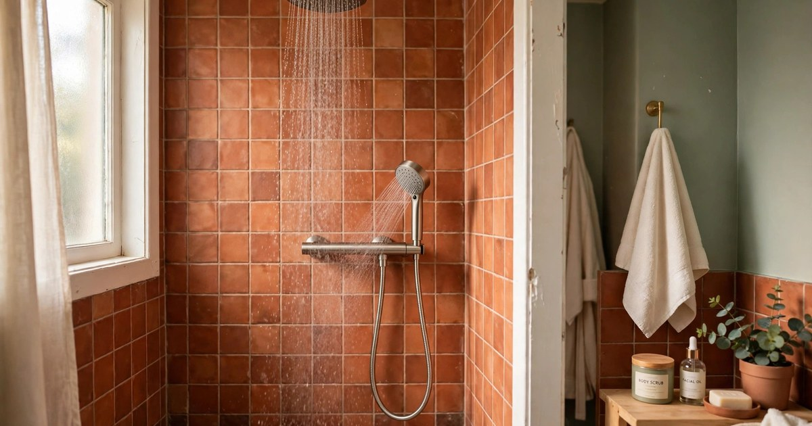
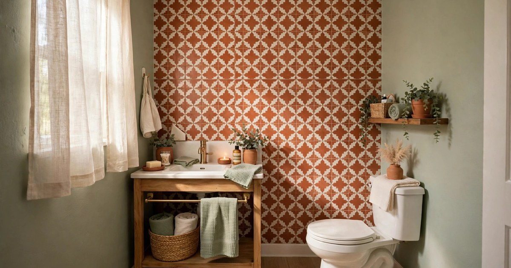
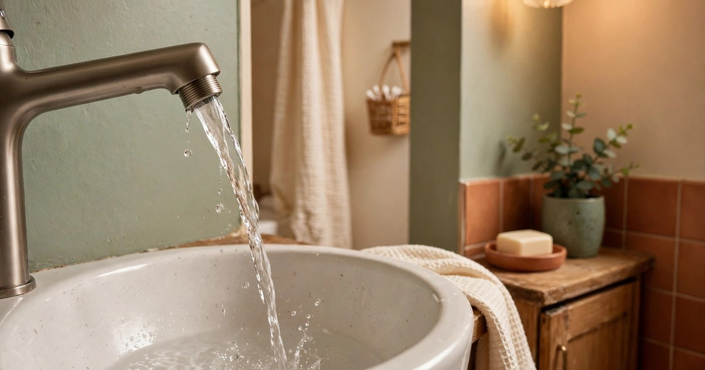
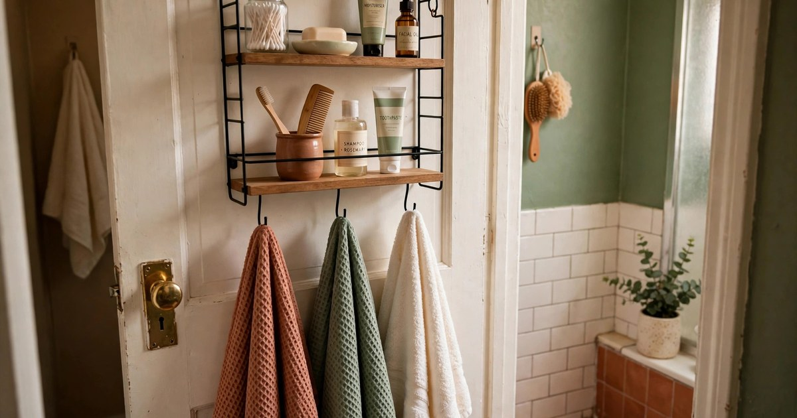
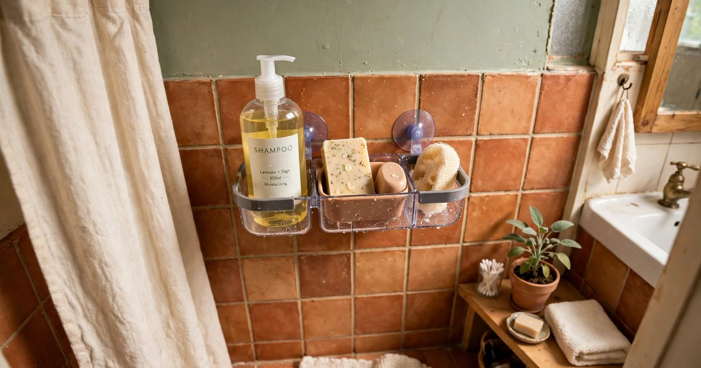
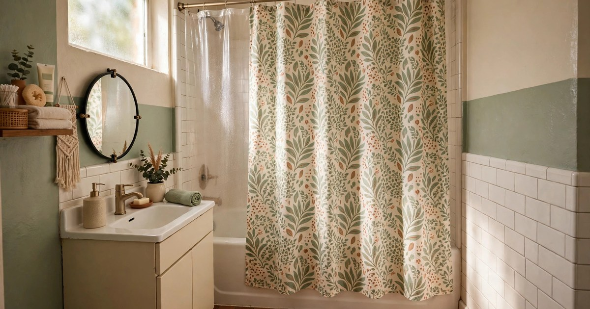
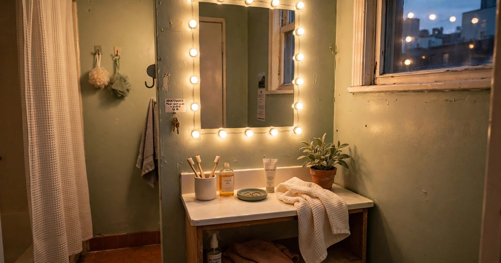
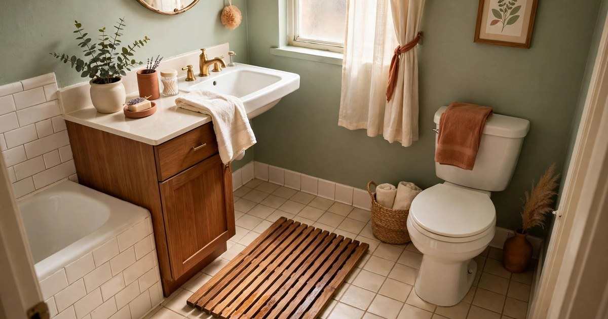
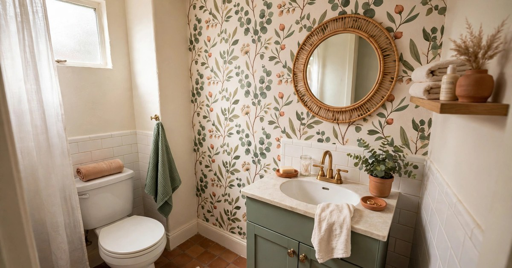
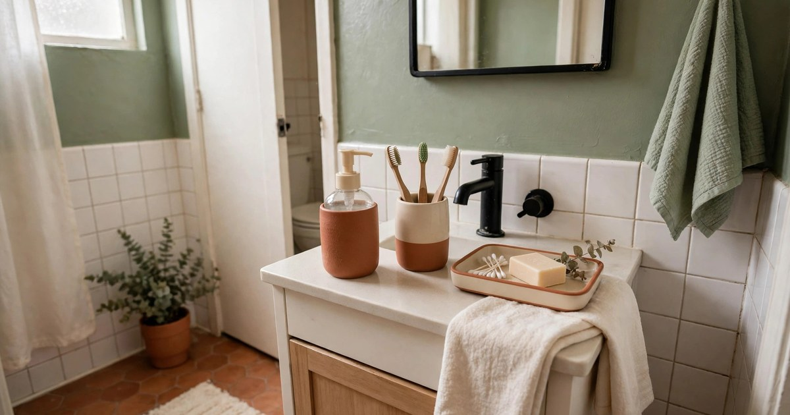

A rental bathroom can feel like the least loved room in the flat. The tiles are someone else's taste, the shower head dribbles, the mirror is foggy, and every fixture looks like it was chosen in a hurry sometime in the nineties. Because it is not your bathroom, the temptation is to put up with it — to tell yourself it is not worth spending money on a room you will eventually leave behind. But you use that room every single day, twice a day at least, and a few small, reversible changes can make it feel like a completely different space.

The good news is that the best bathroom upgrades for renters are also the cheapest ones. None of the ideas in this list require a drill, a plumber, or a landlord's permission. Every single one can be undone in minutes and packed into a box when you move out, and most of them cost less than a takeaway dinner. The trick is to focus on the things you touch and see every day — the shower, the light, the storage, the textiles — rather than the things you cannot change, like the tiles and the bath itself. Fix the daily experience and the room transforms around it.

Before you start, take a few photos of the bathroom exactly as it is, and keep the original fixtures in a labelled box. That is the whole deposit-protection strategy in one sentence. When you move out, you swap everything back, the bathroom looks exactly as it did on your inventory photos, and there is nothing for a landlord to argue about. Most landlords are perfectly happy with reversible upgrades — many are even pleased, since a better shower head and a tidier bathroom leave the flat in better shape than they found it. If you are ever in doubt about a particular swap, a quick message to your landlord costs nothing and covers you completely.

Here are ten renter-friendly bathroom upgrades that genuinely make a big difference, each one reversible, each one budget-friendly, and each one you can finish in an afternoon.

### 1. Swap the shower head

A new shower head is the single highest-impact upgrade in this entire list, and it takes about five minutes. Most rental bathrooms come with the cheapest shower head the landlord could find — a small, tired fitting that produces a thin, uneven trickle. Unscrew it, screw on a modern handheld or rainfall head, and your morning shower goes from a chore to something you actually look forward to. The difference in water pressure and coverage is dramatic, and the whole swap is completely reversible: keep the original head in a box and screw it back on when you leave.

Look for a head with adjustable spray settings — rainfall, massage and mist at minimum — and a universal fitting, which suits almost every standard shower arm. A handheld head on a hose is especially useful in a small bathroom, since it makes cleaning the shower and the bath far easier, and it is a genuine help if you ever need to wash a pet or rinse out a muddy pair of boots. Choose a finish that suits the rest of the room: brushed nickel and matte black both look far more expensive than chrome, and both hide limescale better. Wrap the thread with a few turns of plumber's tape before fitting to stop drips, and hand-tighten only — a wrench can crack the fitting or damage the shower arm, and you do not want that conversation with your landlord.

Shop this upgrade on Amazon: [handheld shower head with adjustable spray settings](https://www.amazon.com/s?k=handheld+shower+head+adjustable+spray&tag={{AMAZON_TAG}})

### 2. Peel-and-stick tiles on one wall

Peel-and-stick tiles are the renter's answer to a bathroom you cannot stand looking at. One accent wall — behind the basin, around the mirror, or the wall opposite the door — is enough to change the whole character of the room, and you do not need to cover every surface to get the effect. Modern peel-and-stick tiles are thick, waterproof and convincingly textured, and they come off cleanly when it is time to move, provided you chose a genuinely removable product rather than a permanent adhesive tile.

Preparation matters more than the tiles themselves. Clean the wall thoroughly with sugar soap or a degreasing cleaner and let it dry completely, because any grease or soap residue will stop the tiles bonding properly. Measure twice and start from the centre of the wall, working outwards, so the cut tiles end up evenly at the edges rather than all bunched on one side. A craft knife and a straight edge give you clean cuts, and a small roller or the flat of your hand pressed firmly over each tile makes sure the adhesive grips. In a steamy bathroom, avoid placing tiles where the shower hits them directly — the accent wall behind the basin is the safest spot — and check the product is rated for bathrooms and humidity before you buy.

Shop this upgrade on Amazon: [peel and stick bathroom wall tiles waterproof](https://www.amazon.com/s?k=peel+and+stick+bathroom+wall+tiles+waterproof&tag={{AMAZON_TAG}})

### 3. A new faucet aerator

A faucet aerator is the smallest upgrade on this list and one of the most satisfying. It is the little mesh fitting that screws onto the end of your tap, and the one your landlord installed is almost certainly clogged with limescale, which is why the water comes out in a weak, spluttering stream. Unscrew the old aerator — it usually comes off by hand, or with a gentle turn of pliers wrapped in a cloth — and screw on a new one. The water flow instantly becomes smooth, even and properly pressurised, and the tap looks and feels brand new.

There is a money angle here too. A good aerator mixes air into the water stream, so you get the same satisfying flow while using noticeably less water, which matters if you pay for your own water or simply want a lower bill. Aerators come in standard sizes, but it is worth checking the diameter of your tap before ordering — most basin taps take a standard male or female thread, and a cheap thread adapter covers the rest. Buy a pack of two or three while you are at it: one for the bathroom basin, one for the kitchen tap, and a spare for the day the limescale wins again. The whole job costs a few pounds and takes less time than brushing your teeth.

Shop this upgrade on Amazon: [faucet aerator replacement pack water saving](https://www.amazon.com/s?k=faucet+aerator+replacement+water+saving&tag={{AMAZON_TAG}})

### 4. Over-door storage

Small rental bathrooms almost never have enough storage, and the back of the door is the largest unused surface in the room. An over-door rack hooks over the top of the door — no screws, no adhesive, nothing to damage — and instantly gives you two or three shelves of storage for towels, toilet rolls, cleaning products and all the bits that currently live in a pile on the windowsill. It is the closest thing to adding a cupboard without actually adding a cupboard.

Choose a rack with hooks that are slim enough to let the door close properly; a rack that is too thick will stop the door latching and drive you mad within a day. Wire racks are light and let air circulate, which helps towels dry, while a rack with a towel bar as well as shelves does double duty in a bathroom with no heated towel rail. Measure the thickness of your door before ordering, since older doors vary, and look for hooks with a felt or rubber lining so they do not mark the paint. Load the heaviest items on the lowest shelf so the rack stays stable, and keep everyday items at eye level so you are not reaching over the door every morning.

Shop this upgrade on Amazon: [over door bathroom storage rack hooks](https://www.amazon.com/s?k=over+door+bathroom+storage+rack+hooks&tag={{AMAZON_TAG}})

### 5. Suction-cup organisers

Suction-cup organisers are the renter's best friend in the shower. Bottles balanced on the edge of the bath, soap sliding off the windowsill, razors perched on the taps — a small caddy stuck to the tiles at exactly the height you want ends all of that. Modern suction cups are far better than the ones you remember: a good lever-lock cup holds several kilos, survives daily steam, and peels off the wall without leaving a mark when you move out.

The secret to suction cups that actually stay up is a clean, smooth surface. Wipe the tile with hot water and a little washing-up liquid, dry it completely, then press the cup firmly and flip the lever. They will not stick to textured tiles, grout lines or matt finishes, so pick a smooth, glazed tile and a spot away from the direct spray of the shower. A two-tier caddy with a soap dish and hooks for a razor or a sponge holds everything a daily shower needs, and a second small basket by the basin keeps toothbrushes and skincare off the worktop. If a cup ever loses its grip, a quick rinse under warm water and a re-press usually restores it — and if it keeps failing, the tile underneath is probably too textured, so try a different spot.

Shop this upgrade on Amazon: [suction cup shower caddy organiser no drill](https://www.amazon.com/s?k=suction+cup+shower+caddy+organiser+no+drill&tag={{AMAZON_TAG}})

### 6. A new shower curtain and liner

A shower curtain is the largest single piece of fabric in most rental bathrooms, which makes it the easiest way to change the room's whole look. The tired, yellowing curtain your landlord left behind is probably doing more damage to the room's appearance than anything else in it. A fresh curtain in a warm pattern — terracotta stripes, a soft sage print, a simple waffle texture — instantly makes the bathroom feel intentional rather than inherited, and a new liner underneath keeps the water where it belongs.

Buy the curtain and the liner as a pair, and make sure the liner is the right length: too short and water escapes onto the floor, too long and it bunches and goes mouldy at the bottom. A weighted hem on the liner keeps it hanging straight inside the bath, and a few extra curtain rings mean the curtain glides instead of bunching. Fabric curtains look far better than plastic ones and wash easily, while a clear or frosted liner disappears behind them. This is also the upgrade where your own taste finally gets a say in the room — choose a pattern you genuinely love, because you will see it first thing every morning, and when you move out the curtain folds into a bag and comes with you.

Shop this upgrade on Amazon: [fabric shower curtain with liner set](https://www.amazon.com/s?k=fabric+shower+curtain+with+liner+set&tag={{AMAZON_TAG}})

### 7. Stick-on vanity lighting

Rental bathrooms are notoriously badly lit. One harsh ceiling bulb, a mirror you can barely see yourself in, and shadows exactly where you need light — it is no wonder getting ready in the morning feels harder than it should. Stick-on vanity lighting fixes this without a single wire. Battery-powered LED strips or puck lights around the mirror, or a slim LED bar stuck above it with removable adhesive, give you soft, even light on your face for makeup, shaving or just waking up properly.

Look for lights with a warm colour temperature — around 2700 to 3000 Kelvin — which flatters skin and matches the warm palette of the rest of the room, rather than the cold blue-white light that makes a bathroom feel like a hospital corridor. Dimmable lights are worth the small premium, since full brightness for getting ready and a low glow for a late-night visit are very different jobs. Battery-powered lights mean no cables and no electrician, and a rechargeable USB light is the most practical of all: charge it once a month and forget about it. Mount the strip or bar with the removable adhesive pads supplied, never with permanent glue, and test the position at night before you commit — the light should fall on your face, not into your eyes.

Shop this upgrade on Amazon: [stick on LED vanity lights battery powered mirror](https://www.amazon.com/s?k=stick+on+LED+vanity+lights+battery+powered+mirror&tag={{AMAZON_TAG}})

### 8. A teak bath mat

A teak bath mat is a small luxury that changes how the bathroom feels underfoot. Stepping out of the shower onto warm, smooth wood instead of a cold, damp fabric mat is a genuinely lovely daily moment, and teak looks like it belongs in a spa rather than a rental. It is also far more practical than it looks: teak is naturally water-resistant, it dries quickly, it does not go mouldy the way a fabric mat does, and it lifts off the floor so air circulates underneath.

Choose a mat with slats rather than a solid board, so water drains through and the mat dries between uses, and check the size against the space in front of your bath or shower — a mat that is too wide will catch on the door, while one that is too narrow looks lost. Give it a quick wipe or a rinse once a week and let it dry fully, and it will last for years, moving from flat to flat with you. In a small bathroom, a teak mat also does quiet visual work: the warm wood tone breaks up a room full of white tiles and chrome, and it ties the bathroom into the same warm, earthy palette as the rest of your home. It is the rare upgrade that is both a practical purchase and a piece of decor.

Shop this upgrade on Amazon: [teak wood bath mat non slip](https://www.amazon.com/s?k=teak+wood+bath+mat+non+slip&tag={{AMAZON_TAG}})

### 9. Removable wallpaper accent

If peel-and-stick tiles are the practical fix, removable wallpaper is the fun one. One accent wall in a bold botanical print, a soft terracotta stripe, or a subtle sage pattern turns a plain white bathroom into a room with real personality, and the paper peels off cleanly when you move out. It is the fastest way to make a rental bathroom feel like yours, and it costs a fraction of what a landlord would spend on retiling.

Bathrooms are steamy, so choose a vinyl-based removable wallpaper rated for humidity, and put it on a wall that does not get direct water — the wall behind the door, or the wall beside the mirror, rather than inside the shower area. As with tiles, the wall must be clean and completely dry before you start, and a smooth painted wall gives the best bond. Hang the paper from the top, smoothing down as you go with a plastic smoother or a clean cloth, and trim the edges with a sharp craft knife. Buy one extra roll beyond what you measure: matching the pattern at the seams uses more paper than you expect, and a spare roll is far cheaper than a second delivery. When moving day comes, peel slowly from a corner at a low angle — that is the technique that leaves the paint underneath intact.

Shop this upgrade on Amazon: [removable peel and stick wallpaper bathroom vinyl](https://www.amazon.com/s?k=removable+peel+and+stick+wallpaper+bathroom+vinyl&tag={{AMAZON_TAG}})

### 10. A matching accessories set

The final upgrade is the one that pulls everything else together: a matching set of bathroom accessories. A soap dispenser, a toothbrush holder, a small tray and a tumbler, all in the same finish and colour, turn a cluttered basin into a composed little vignette. It sounds like a small thing, but mismatched bottles and random cups are what make a bathroom look chaotic, and a coordinated set is the fastest way to make it look considered.

Choose a finish that suits the upgrades you have already made — terracotta ceramic, warm wood, brushed brass or matte black — and keep the set small. Three or four pieces are enough; a bathroom counter covered in accessories is just a different kind of clutter. Decant your hand soap and shampoo into matching dispensers and the visual noise drops dramatically, and a small tray under the set catches drips and keeps everything in one place. This is also the most portable upgrade on the list: the whole set fits in a shoebox when you move, and it makes the next bathroom feel like home on the very first day. It is the finishing touch that makes the other nine upgrades look like a plan rather than a collection of purchases.

Shop this upgrade on Amazon: [matching bathroom accessories set ceramic](https://www.amazon.com/s?k=matching+bathroom+accessories+set+ceramic&tag={{AMAZON_TAG}})

Ten upgrades, not one of them needing a drill, a plumber or a landlord's signature. That is the whole point of renter-friendly decorating: you improve the room you actually live in, you protect your deposit by keeping every change reversible, and you take the good stuff with you when you go. Start with the one that annoys you most — the feeble shower, the dark mirror, the bottles with nowhere to live — and work through the rest as the budget allows. A rental bathroom will never be a showroom, but it can absolutely be a room you enjoy using, and for the price of a few reversible swaps, that is a very good deal indeed.

One last renter's tip: photograph everything before you change it, keep every original fitting in a labelled box, and undo each upgrade in reverse order on moving day. The bathroom goes back to exactly how you found it, your deposit stays safe, and your shower head, your teak mat and your matching accessories all come with you to make the next bathroom feel like home from day one.

## Frequently Asked Questions

### Are these bathroom upgrades really deposit-safe for renters?

Yes, provided every change is genuinely reversible. Swapping a shower head, changing an aerator, hanging an over-door rack, sticking on removable tiles or wallpaper, and adding freestanding accessories all leave the original fixtures and surfaces untouched. Keep the original fittings in a labelled box and photograph the bathroom before you start, so you can restore everything exactly as it was. If a product needs drilling, permanent adhesive or plumbing work, it is not renter-friendly — skip it.

### Do I need my landlord's permission for renter-friendly bathroom upgrades?

For fully reversible changes like the ones in this list, you generally do not need formal permission, but telling your landlord is still good practice. A short message describing the swaps — and the fact that everything will be restored before you leave — covers you and often leaves the landlord pleased, since the flat ends up in better condition. Always ask first for anything involving plumbing changes beyond a simple shower head or aerator swap.

### Will peel-and-stick tiles and removable wallpaper survive a steamy bathroom?

They will, if you choose products rated for bathrooms and humidity and put them on the right walls. Use vinyl-based removable wallpaper and waterproof peel-and-stick tiles, and keep both away from direct shower spray — the wall behind the basin or beside the mirror is ideal. Clean and dry the wall thoroughly before applying, and press each tile or strip firmly into place. In a bathroom with no ventilation at all, improve airflow first with the door ajar or a small fan, since constant damp will defeat any adhesive over time.

### How much should I budget for these ten bathroom upgrades?

Most renters can complete the whole list for well under $200, and many of the upgrades cost under $15 each. A shower head and a teak bath mat are usually the biggest single purchases, while an aerator, a suction-cup caddy and a shower curtain are among the cheapest. Start with the upgrade that fixes your biggest daily frustration, then add the rest one at a time — you do not need to buy everything in one go to feel the difference.

### What should I do with the upgrades when I move out?

Take them with you. That is the beauty of reversible upgrades: the shower head unscrews, the tiles and wallpaper peel off, the racks lift off the door, and the accessories pack into a box. Restore the original fittings, wipe down the surfaces, and compare the room with your original photos. The bathroom should look exactly as it did on move-in day, and your upgrades go on making your next bathroom better from day one.
