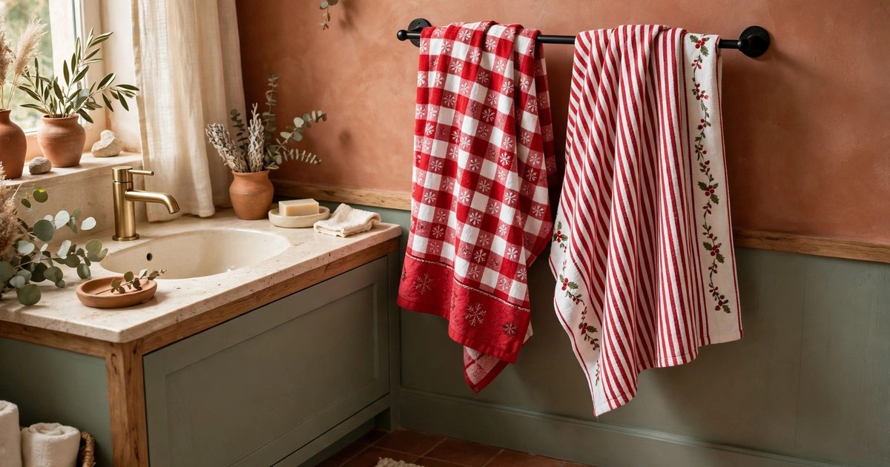
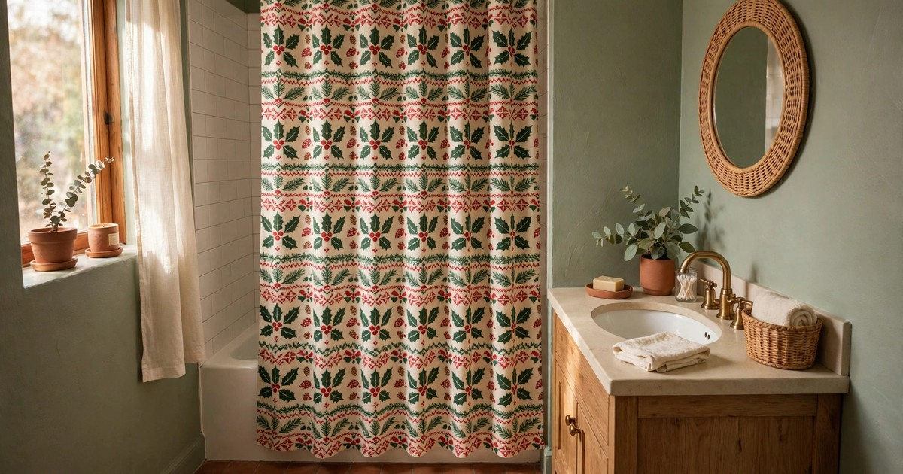
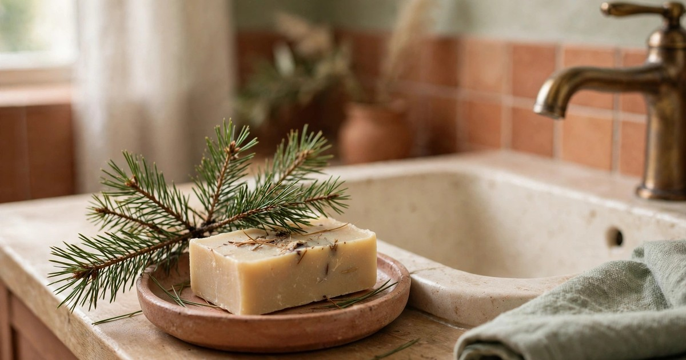
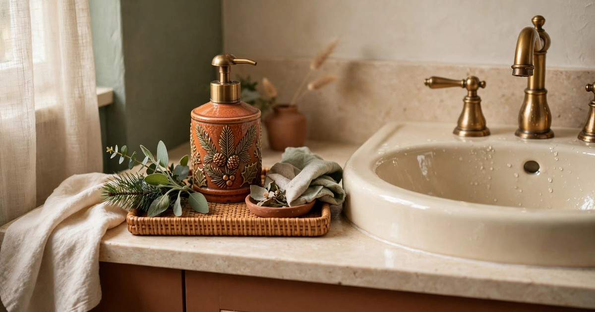
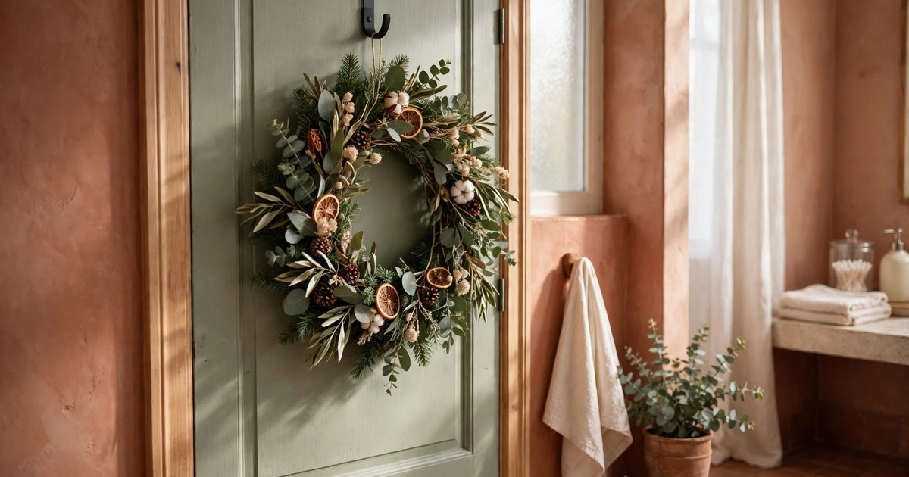
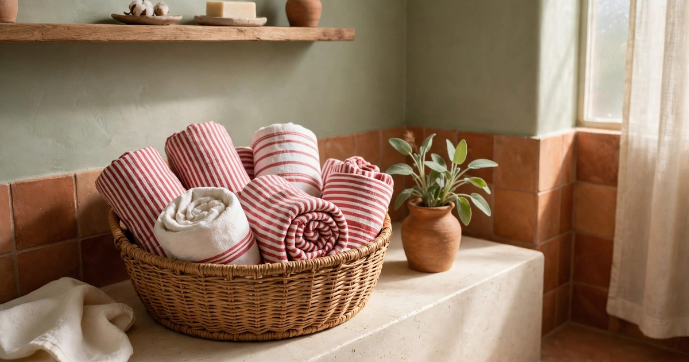
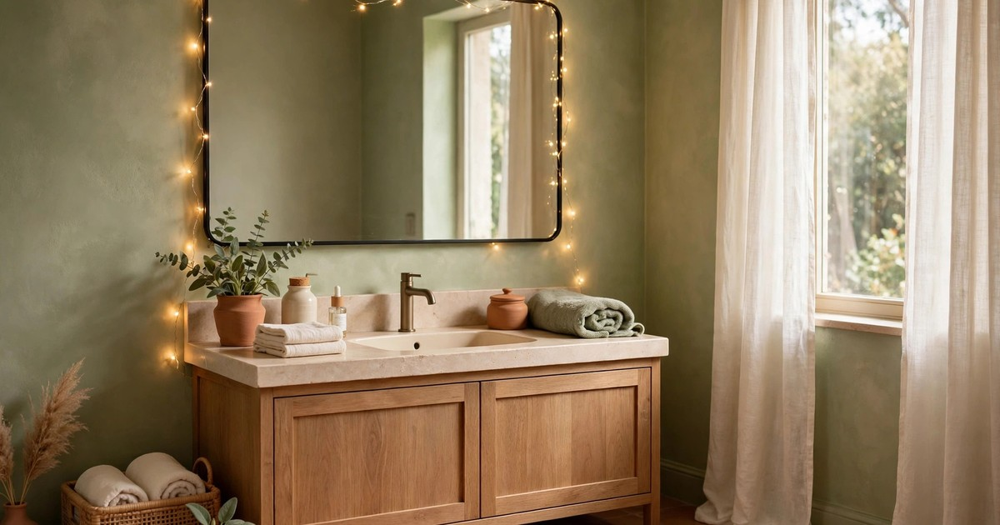
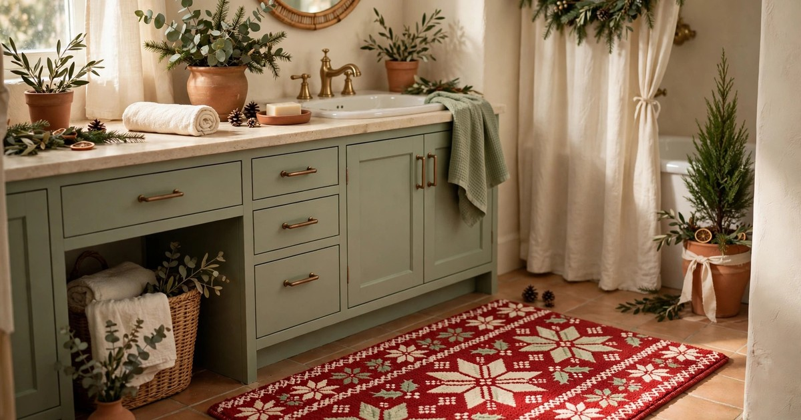

The bathroom is the room most people forget at Christmas, which is exactly why decorating it feels like such a treat. Guests notice it, it makes the whole house feel finished, and it costs almost nothing — because a bathroom is small, a little festive detail goes a very long way. For renters, though, the bathroom is also the room where damage is easiest to cause and hardest to hide: tiles chip, grout stains, suction marks linger, and a landlord will spot a drilled hole in a tiled wall long after the tinsel is gone.

The good news is that every idea below is fully reversible. Nothing here needs a drill, a nail, or a permanent adhesive, and everything can be packed away in January in under half an hour, leaving the bathroom exactly as you found it. The rules are simple: use hooks that hang over doors or grip with suction, choose battery lights and candles instead of anything with a flame or a mains plug near water, and keep anything wet, scented, or coloured away from grout and sealant that could stain. Work within those rules and you can have a bathroom that feels properly festive all December, on a budget of just a few pounds per idea.

### 1. Swap in a festive hand towel set

Why it works: a hand towel is the single fastest Christmas swap in any bathroom, because it is right at eye level, right where guests wash their hands, and it instantly signals the season without a single decoration going on a wall. A set in deep red, forest green, or a classic red-and-white pattern does the whole job on its own, and because towels are useful all year round, a plain red set simply becomes an everyday towel again in January.

How to do it damage-free: this one needs no fixings at all — just hang the festive towels on the rail or ring you already have. If your bathroom only has one rail, swap the everyday hand towel for the festive one and keep the everyday set in a drawer for January. To keep the look intentional rather than cluttered, fold the towel in thirds so the pattern shows, and pair it with a plain cream or white bath towel so the festive colour has room to breathe.

Budget tip: a pair of festive hand towels costs less than most single decorations, and discount stores stock them from November. If you already own red or green towels, you do not need to buy anything at all — a red towel plus a sprig of greenery on the shelf reads as Christmas straight away.

### 2. A mini tree on the windowsill or shelf

Why it works: a mini tree brings the full Christmas feeling into a room that rarely gets a tree of its own, and in a small bathroom a tree just 20 to 30 centimetres tall is plenty. It sits neatly on a windowsill, a shelf, or the corner of a vanity unit, it needs no floor space, and it is the decoration guests comment on most — because nobody expects a tree in the bathroom.

How to do it damage-free: stand the tree in a small pot, a mug, or a decorative tin, and put a coaster or a folded flannel underneath so the base cannot scratch the sill or leave a damp ring. Use a faux mini tree if your bathroom is humid, since a real one will drop needles in the steam, and decorate it with a few tiny baubles or a short string of battery fairy lights rather than anything heavy that could topple it into the bath.

Budget tip: mini trees are one of the cheapest Christmas buys of all, and a plain green one dressed with baubles you already own looks far more expensive than it is. After Christmas, the tree packs flat into a box and comes out again next year.

### 3. Battery candles around the bath

Why it works: nothing makes a bathroom feel like a spa faster than candlelight, and at Christmas that glow feels doubly festive. Battery candles give you all of the atmosphere with none of the risk: no naked flame near towels, curtains, or bath products, no wax dripping onto tiles or into the grout, and no heat damage to a plastic bath surround or a wooden bath tray.

How to do it damage-free: group three or five battery pillar candles of different heights along the bath edge, on a windowsill, or on a tray on the vanity unit. A tray is worth it here, because it gathers the candles into one deliberate display and stops them sliding around on a wet surface. Choose candles with a built-in timer so they switch themselves on in the evening and off before bed, and keep real candles out of the bathroom entirely during the festive season.

Budget tip: a set of three battery pillar candles costs about the same as one scented candle, and they last for years. Buy them once, and they become your December bathroom ritual every year.

### 4. A Christmas shower curtain (swapped back in January)

Why it works: the shower curtain is the largest single surface in most bathrooms, so changing it changes the whole room in one move. A festive curtain — deep red, a subtle pine pattern, or a classic red-and-white check — turns an ordinary bathroom into a Christmas bathroom instantly, and because it hangs from the rail you already have, it needs no new fixings whatsoever.

How to do it damage-free: simply unhook your everyday curtain and hang the festive one on the same rings or hooks. Keep the everyday curtain folded in a drawer so the swap back in January takes two minutes. Choose a machine-washable curtain so it can be laundered before it goes into storage, and avoid curtains with glitter or loose appliqué that could shed into the bath or the drain.

Budget tip: a festive shower curtain is often cheaper than a set of bathroom accessories, and it does more visual work than all of them combined. If you are watching the pennies, a plain red curtain plus your existing white towels gives you the same festive hit for even less.

### 5. Pine-scented soap and a sprig of greenery

Why it works: Christmas is as much a smell as a look, and the bathroom is one of the few rooms where scent actually lingers, because it is small and enclosed. A pine- or cedar-scented soap, with a single sprig of fresh greenery laid beside it on the sink, gives you that just-cut Christmas tree smell every time you wash your hands, with no diffuser, plug, or flame involved.

How to do it damage-free: keep the soap on a small dish or tray so it never sits directly on a stone, wood, or painted surface, where a wet bar can leave a stain or a ring. Lay the greenery on the dish or in a small glass rather than directly on the sink, and replace the sprig every few days before it drops needles into the basin. Avoid coloured soaps or oils that could stain grout or sealant, and skip anything that needs to be stuck to a tile.

Budget tip: a pine-scented bar of soap costs very little, and a sprig of greenery is free if you trim it from a tree, a wreath, or a bunch bought for another room. This is the cheapest idea on the list, and one of the most effective.

### 6. Festive soap dispenser and tray

Why it works: the sink area is the visual centre of most bathrooms, and a matching soap dispenser and tray make it look styled rather than merely functional. A dispenser in deep red, forest green, or gold, sitting on a small tray with a candle or a sprig of greenery, turns an everyday corner into a little Christmas vignette, and it is something you use every single day.

How to do it damage-free: everything here just sits on the sink or the vanity — no fixings, no adhesives, nothing attached to a wall or a tile. The tray matters more than it looks: it catches soap drips and water splashes before they reach the surface underneath, which protects stone, wood, and painted finishes from the rings and stains that landlords notice. Choose a tray with a smooth base, or put a folded flannel underneath it.

Budget tip: you do not need a matching set. A plain dispenser you already own, refilled and dressed with a ribbon tied around the neck, plus a tray or a small plate from the kitchen, gives you the same styled look for nothing. Save the money for the towels or the tree.

### 7. Wreath on the bathroom door with an over-door hook

Why it works: a wreath is the classic Christmas welcome, and hanging one on the bathroom door — inside or outside — makes the whole hallway feel festive as well as the bathroom itself. It also solves the small-bathroom problem beautifully: the door is space you were not using anyway, so the wreath adds decoration without taking up a single centimetre of shelf, sill, or floor.

How to do it damage-free: hang the wreath from an over-door hook, which hooks over the top of the door and needs no screws, nails, or adhesive at all. Check that the hook fits your door thickness and that the door still closes fully, and choose a lightweight faux wreath rather than a heavy fresh one, so the hook cannot slip or mark the door edge. A felt pad on the hook where it touches the door adds extra protection for painted doors.

Budget tip: a small faux wreath costs a few pounds and lasts for years, and one wreath can move around the house — bathroom door this year, bedroom door next year. If you already own a wreath for the front door, a smaller matching one for the bathroom door ties the whole house together.

### 8. Red-and-white guest towels rolled in a basket

Why it works: rolled towels in a basket look like a boutique hotel display, and at Christmas a basket of red-and-white towels is both decoration and hospitality — guests can see at a glance that fresh towels are there for them. It also adds softness and colour to a room that is mostly hard surfaces, which is exactly what makes a bathroom feel warm rather than clinical in winter.

How to do it damage-free: the basket simply sits on the floor, on a stool, or on top of a laundry hamper — no fixings of any kind. Choose a basket with a smooth base, or set it on a folded towel, so it cannot scratch tiles or a wooden floor when it is moved. Keep the basket away from the bath and the shower, where splashes would soak the towels, and wash the festive towels before they go back into storage in January.

Budget tip: a woven basket from a discount store plus towels you already own in red, white, or cream is all this idea needs. Roll rather than fold the towels — rolled towels take up less room, look more deliberate, and make a small basket look full.

### 9. Fairy lights along the mirror (suction or Command hooks)

Why it works: fairy lights around a mirror are the bathroom equivalent of a lit Christmas tree — they make the whole room glow, they flatter everyone who looks in the mirror, and they turn an ordinary evening routine into something that feels special. The mirror is also the one place where lights are guaranteed to be seen, because every visitor looks in it.

How to do it damage-free: this is the idea where the fixing matters most, so choose it carefully. Suction-cup hooks made for mirrors and glass hold well and peel straight off, and small Command hooks designed for smooth surfaces remove cleanly if you follow the removal instructions exactly — pull the tab slowly, straight down, and never yank. Use battery fairy lights with a timer, never mains lights near water, and keep the wire away from taps and the bath edge. Test one hook for a day before hanging the whole string, so you know it holds.

Budget tip: one short string of warm-white battery fairy lights is all you need, and it costs less than a takeaway coffee. Warm white suits a bathroom far better than multicoloured lights, and it matches every other idea on this list.

### 10. A small festive mat that hides tired tiles

Why it works: if your rental bathroom has tired tiles, a stained floor, or a colour scheme you would never have chosen, a festive mat is the fastest cover-up available. A small mat in deep red, a seasonal pattern, or a classic check draws the eye, adds warmth underfoot on cold December mornings, and hides exactly the part of the floor you least want guests to notice.

How to do it damage-free: a mat simply lies on the floor — no adhesive, no fixings, nothing that touches the tiles except fabric. Choose a machine-washable mat with a non-slip backing, and wash it before it goes into storage so it comes out fresh next December. Keep the mat clear of the shower so it does not stay damp, and lift it regularly to let the floor underneath dry, which protects both the tiles and the grout.

Budget tip: a festive bath mat is often the cheapest item in the Christmas homeware aisle, and it works harder than most of the expensive ones. Pair it with your festive hand towel and the room already reads as Christmas, even before you add anything else.

## A bathroom that comes down in January

The thread running through all ten ideas is not really about Christmas at all — it is about choosing decorations that sit on, hang over, or lie on surfaces instead of being fixed to them. Towels, a curtain, a basket, a tray, a mat, and a wreath on an over-door hook all come down in January in minutes, with no holes to fill, no adhesive to scrape off, and no marks for a checkout inspection to find. Pick the three or four ideas that suit your bathroom size and your budget, keep everything battery-powered near water, and enjoy a bathroom that feels properly festive all December and perfectly ordinary again by mid-January.

## Frequently Asked Questions

**Can I hang fairy lights in a bathroom safely?**
Yes, if you use battery-powered lights and keep them away from water. Hang them around the mirror with suction-cup hooks or small Command hooks made for smooth surfaces, never run mains lights near a bath, shower, or taps, and choose lights with a timer so they switch themselves off. Remove the hooks in January by pulling the tab slowly, exactly as the instructions say.

**Will suction hooks damage bathroom tiles or mirrors?**
Good suction hooks made for glass and smooth tile peel straight off and leave no mark, but cheap ones can leave a ring if they sit for weeks in steam. Use hooks rated for bathrooms, test one for a day before hanging a full string of lights, and wipe the surface before you stick them on so they grip properly and come off cleanly.

**How do I remove Command hooks from tiles without damage?**
Follow the removal instructions exactly: hold the hook, pull the adhesive tab slowly straight down along the wall, and keep pulling until it releases. Never yank the hook off the wall or peel it sideways, which is what damages paint and leaves residue. If a tab snaps, warm it gently with a hairdryer and roll the residue off with your thumb.

**What is the cheapest way to decorate a rental bathroom for Christmas?**
Start with the swaps that cost nothing or nearly nothing: a festive hand towel, a pine-scented soap, a sprig of greenery, and a basket of rolled towels you already own. Those four ideas together cost less than a single large decoration, they need no fixings at all, and they make the bathroom feel festive the moment a guest walks in.
