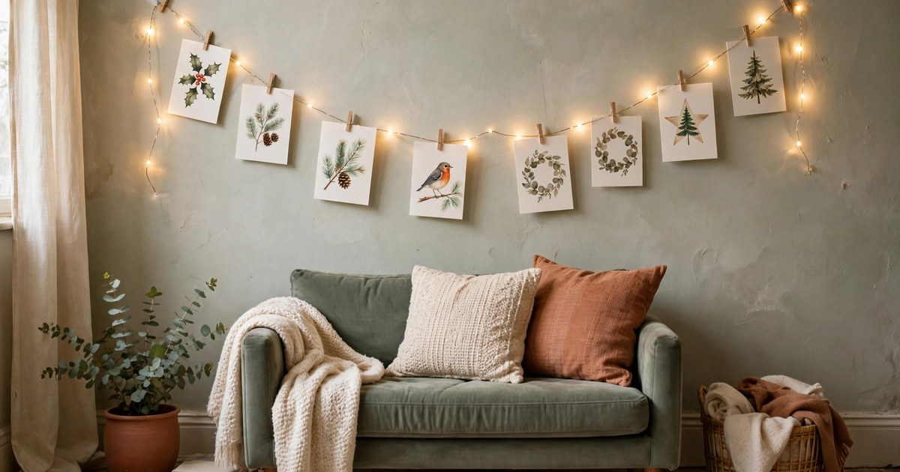
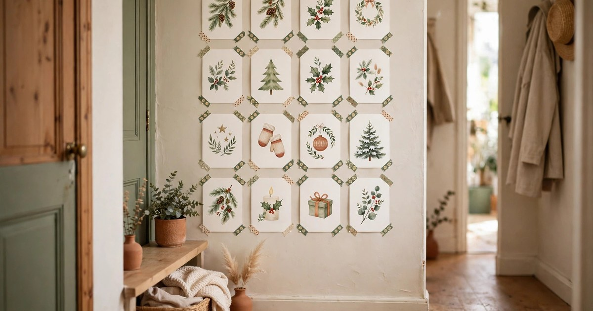
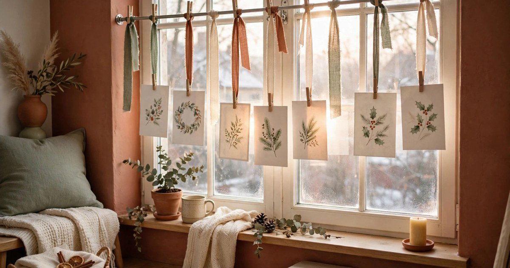
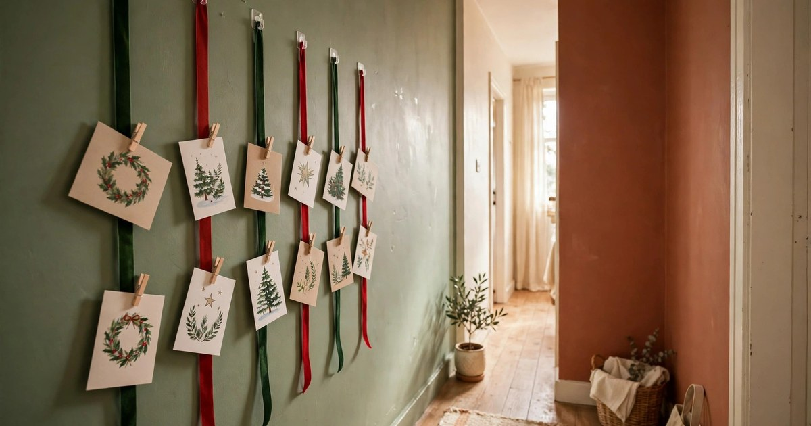
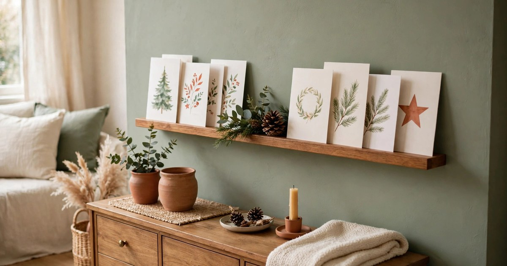
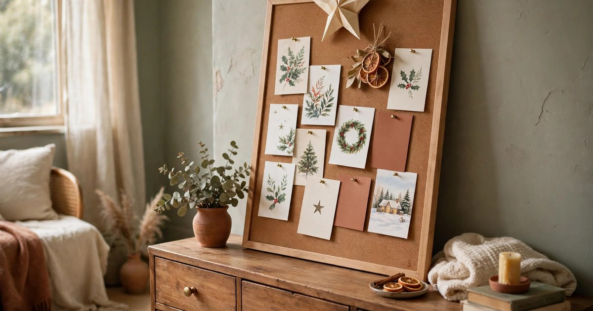
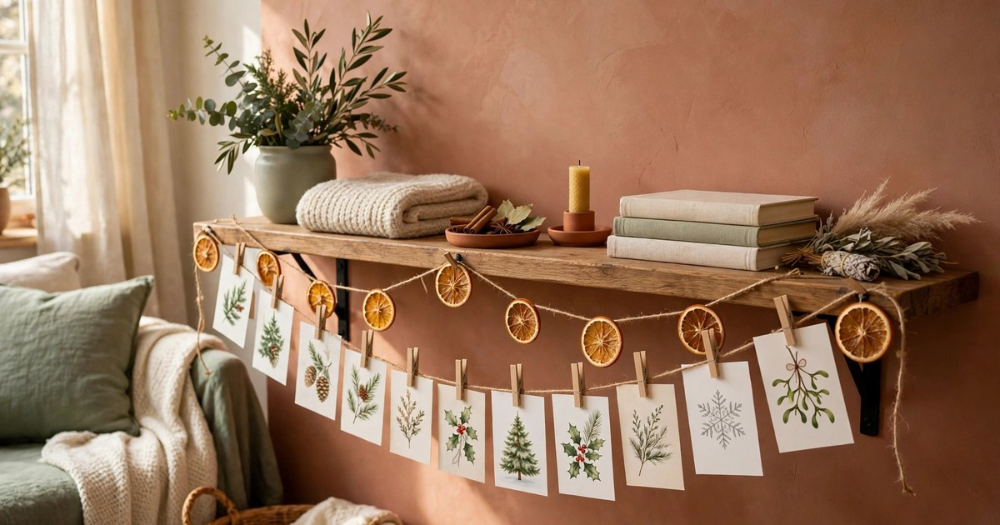
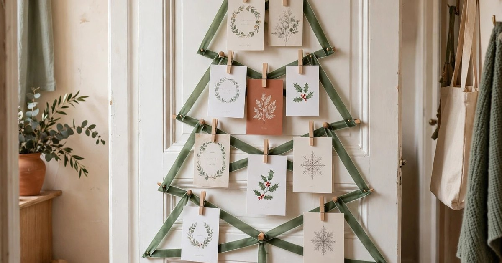
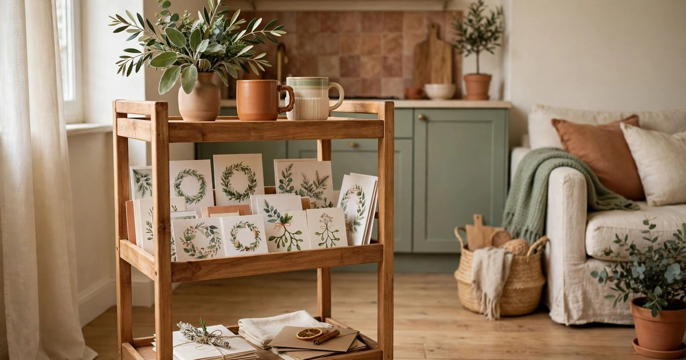
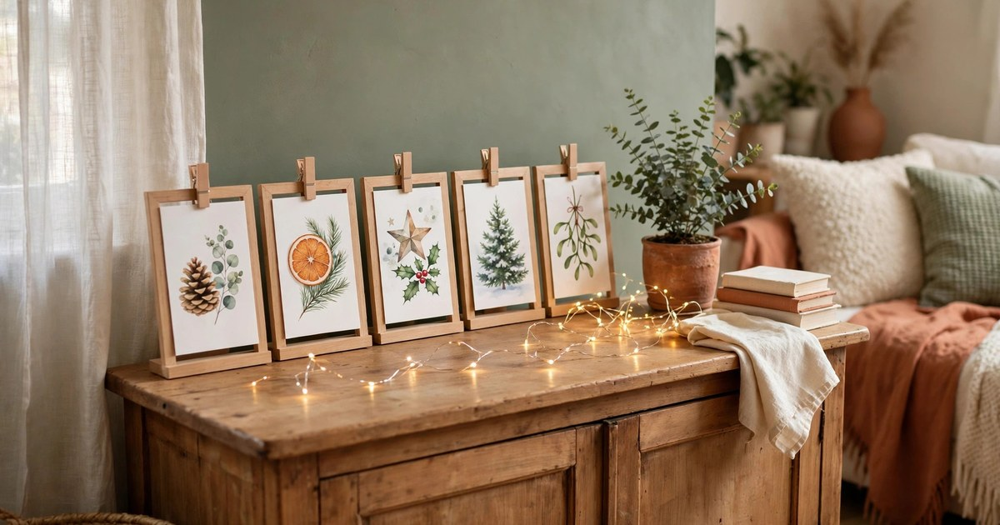

Christmas cards arrive in a cheerful trickle all through December, and then comes the question every renter in a small flat knows well: where do they all go? Piled on the sideboard, they slide into a heap. Blu-tacked to the wall, they leave marks and take paint with them in January. And with no mantelpiece, no spare wall and no room for a dedicated display, the cards that friends and family chose so carefully end up hidden in a drawer instead of on show.

The good news is that a beautiful card display does not need nails, screws or a single hole. Every idea below is completely damage-free, costs very little, and is designed for the realities of rented rooms: short walls, borrowed furniture and a deposit you want back in full. Most use things you already own — string, pegs, washi tape, a spare shelf — and every one of them can be taken down in ten minutes on Boxing Day with nothing left behind but a tidy wall.

### 1. A fairy light string with mini wooden pegs

This is the classic for a reason: a length of battery fairy lights strung across a wall or along the top of a bookshelf, with cards pegged to it using tiny wooden pegs, turns a pile of post into a glowing feature in one evening. The lights do the decorating for you, so the display looks finished even before many cards have arrived, and the warm glow makes the whole corner feel festive after dark. A set of battery lights costs a few pounds, a bag of mini pegs costs less, and you can reuse both year after year.

Hang the string from removable adhesive hooks, the kind that peel off cleanly, and drape it in a gentle swag rather than pulling it taut — a little slack looks softer and gives you room to add cards as they arrive. Start with the cards you already have, pegging each one by a top corner so it hangs straight, and leave gaps between them for the ones still to come. When the string fills up, add a second row underneath, or start a new string on the next wall. The display grows with your post, which is half the charm.

### 2. A washi tape gallery wall

Washi tape is the renter's best friend at Christmas: it sticks firmly enough to hold a card all month, peels off without taking paint, and comes in every festive pattern you can imagine. A gallery wall of cards held up with small washi tape corners looks deliberate and polished, like a curated display rather than a last-minute fix, and it costs almost nothing if you already have a roll or two in a drawer. Choose a tape colour that echoes your room — deep green, gold or a warm terracotta — and keep it consistent across the whole wall so the display reads as one piece.

Lay the cards out in a loose grid, leaving a finger-width gap between each one, and fix each card with two small pieces of tape across its top corners, or a single piece folded over the top edge like a hinge. If your walls are freshly painted or delicate, test one piece of tape in a hidden spot first and warm it gently with a hairdryer on a low setting when you remove it in January — the heat softens the adhesive and it lifts away cleanly. The grid suits hallways and the narrow wall beside a door, the two spots most small flats have going spare.

### 3. A tension rod across a window or alcove

A tension rod is one of the cleverest no-damage tools a renter can own: it wedges between two surfaces with pressure alone, no screws and no marks, and it can span a window frame, a shallow alcove or the gap between two bookshelves. Hang a few lengths of ribbon or twine from the rod, clip cards to them with pegs or paperclips, and you have a floating display that catches the daylight beautifully. It is especially good in front of a window, where the cards are backlit and every colour glows.

Choose a rod that fits snugly — too short and it slips, too long and it bows — and twist it until it feels firm before you hang anything from it. Alternate ribbon lengths so the cards hang at different heights, like a mobile, and keep the heaviest cards nearest the ends of the rod where the support is strongest. When Christmas is over, the rod twists out in seconds and the ribbons fold away in a drawer, ready for next year or for hanging lightweight curtains in the meantime.

### 4. A command hook ribbon ladder

If you have one bare stretch of wall, four or five removable hooks and a few metres of ribbon will give you a full card display with room for dozens of cards. Fix the hooks in a vertical column, loop a length of ribbon over each one so it hangs down in parallel strands, and clip your cards along the ribbons. The result looks like a proper display board, but the whole thing is just hooks and ribbon, and it comes down without a trace. Ribbon is cheap by the metre, and a single roll will cover a generous wall.

Space the hooks about twenty centimetres apart and let the ribbons hang to just above skirting-board height, so the lowest cards are still easy to read. Clip cards at a slight angle rather than dead straight — it looks more relaxed and it stops the ribbons twisting under the weight. This is also one of the best displays for a narrow hallway, where a wide board would never fit but a tall, slim ladder of ribbons uses the height you already have. Pair it with the hook tricks in our guide to [command hook Christmas decor for renters](/command-hook-christmas-decor-renters-under-20/) if you want to build out the rest of the hallway at the same time.

### 5. A picture ledge or spare shelf

Cards were designed to stand up, and a shallow picture ledge or a spare shelf lets them do exactly that with no fixings at all. Lean the cards along the ledge in a row, overlapping them slightly like books on a shelf, and the display builds itself as the post arrives. It looks lovely on top of a sideboard, a bookcase or a windowsill, and because nothing is stuck to the wall, there is nothing to damage and nothing to clean up afterwards. A narrow ledge shelf costs very little, leans against the wall on brackets that rest on the furniture, or can simply be a shelf you already own.

Stand the largest cards at the back and the smallest at the front so every design is visible, and tuck a sprig of greenery, a pinecone or a small battery candle between groups of cards to break the row into little scenes. If your shelf is deep enough, stand a second row behind the first for depth. The ledge doubles as a display surface all year round too — swap the cards for framed photos or postcards in January and it earns its keep long after Christmas.

### 6. A freestanding pinboard or cork board

A small cork board or pinboard propped on a sideboard, a desk or a chest of drawers gives you a proper display surface that never touches the wall at all. Pin the cards up with festive pins or washi tape, add a paper star or a sprig of dried orange at the top, and you have a display you can move from room to room whenever you fancy a change. It is ideal for renters whose walls are off-limits entirely, or for anyone who wants their cards somewhere guests will actually see them, like the hallway table or the dining room sideboard.

Pick a board that stands on its own feet or leans safely against the wall at a slight angle, and keep the pins shallow so they only go into the cork. If you do not have a board, a large piece of thick cardboard wrapped in festive fabric works just as well for a single season, and costs nothing at all. Arrange the cards edge to edge for a full, abundant look, or leave breathing room around your favourites so they stand out. When the season ends, unpin the cards in minutes and the board goes back in a cupboard.

### 7. A twine garland along a shelf or radiator cover

A length of twine strung along the front of a shelf, a bookcase or a radiator cover is a display that uses furniture you already have instead of wall space you do not. Tie the twine between two small adhesive hooks or simply drape it over the ends of the shelf and weight it with books, then peg cards along it with wooden pegs. Thread in dried orange slices, cinnamon sticks or small pinecones between the cards and the whole thing reads as a proper garland rather than a storage solution. It is one of the prettiest ideas here, and it costs the price of a ball of twine.

Keep the twine slightly slack so it drapes in a gentle curve, and hang the cards by one corner so they flutter slightly rather than sitting flat. If you are draping it along a radiator cover, keep cards and twine clear of the hottest part of the surface and use battery lights rather than real candles anywhere nearby. The same garland trick works along the top of a door frame or across a wide mirror, so if one spot fills up, the display can migrate to another without any new fixings at all.

### 8. A door-hung card tree

The back of a door is wasted space in most small flats, and it makes a perfect canvas for a card tree. Use a removable over-door hook to hang a large triangle of green ribbon or a simple wire frame, then peg your cards inside the triangle so they form the shape of a Christmas tree. It is a talking point the moment guests arrive, it uses zero wall space, and the door still opens and closes normally because everything sits flat against it. Children love helping to build it, adding each new card to the tree as it arrives.

Start with the widest row at the bottom and narrow as you go up, saving the smallest cards for the top, and finish with a paper star or a bow at the peak. If you would rather not build a tree shape, the same over-door hook holds a simple ribbon ladder like the one in idea four, which is just as effective and even quicker to set up. And if your front door needs dressing too, our guide to [no-drill Christmas wreath hanging for renters](/no-drill-christmas-wreath-hanging-renters/) covers the damage-free hooks that make it possible.

### 9. A kitchen trolley or bar cart card station

If your cards keep ending up on the kitchen worktop, give them a proper home instead: turn a small trolley, a bar cart or even a spare chair into a dedicated card station. Stand the cards along the shelves, leaning against the trolley sides, and add a small vase of greenery and a candle on top. The display stays contained in one tidy footprint, the cards are visible from the kitchen table where everyone sits, and the trolley can be wheeled into a corner when you need the space back. It is the best option for open-plan flats, where wall space is shared between the kitchen and the living room.

Use the top shelf for your favourite cards, standing upright and fully visible, and the lower shelves for the rest, angled so their fronts show. A few festive mugs or a small bowl of clementines on the top shelf ties the whole station together and makes it look intentional rather than improvised. When a new card arrives, it takes five seconds to slot it into the front row, which means this is the display most likely to stay tidy all the way through December.

### 10. A clip frame collage on the sideboard

For your very favourite cards — the handmade ones, the ones from far away, the ones with the loveliest artwork — give them the framed treatment. Simple clip frames or frameless acrylic holders cost very little, stand on any flat surface, and turn a card into a piece of art. Line three or four of them along a sideboard or windowsill, mix in a small plant or a string of battery lights, and you have a display that looks like it came from a home magazine rather than a post pile. The cards stay pristine too, protected behind glass or acrylic, which matters if you want to keep them.

Choose frames all in one finish — plain wood, black or brass — so the row looks coordinated even though every card inside is different. Stand the frames at a slight angle rather than ramrod straight, and vary the heights a little for a relaxed, collected feel. After Christmas, the frames go back to holding photographs or prints, so nothing you buy for this idea is single-use. It is a small investment that pays off every year, in December and beyond.

Christmas cards are small, thoughtful things, and they deserve better than a heap on the sideboard. Any one of these ten ideas will show them off properly without a nail, a screw or a mark on your walls, and most of them cost less than a fiver to set up. Pick the one that fits the space you actually have — a string of lights, a ribbon ladder, a shelf you already own — and let the display grow as the cards arrive. Your walls will thank you in January, and your deposit will too.

## Frequently Asked Questions

### Will washi tape damage my walls or leave marks?

Good quality washi tape is designed to remove cleanly from painted walls, and it is one of the safest fixings a renter can use. Test a small piece in a hidden spot first, avoid sticking it to freshly painted or flaking surfaces, and warm it gently with a hairdryer on a low setting before peeling it off in January. The heat softens the adhesive and the tape lifts away without taking paint with it.

### How do I display cards if I have almost no free wall space?

Use furniture instead of walls. A picture ledge, a freestanding pinboard, a kitchen trolley or a clip frame collage all display cards beautifully without touching a wall at all, and the back of a door or a tension rod across a window gives you display space you probably were not using. In a very small flat, one well-chosen shelf display usually holds more cards than people expect.

### What is the best way to hang a card display without command hooks?

A tension rod across a window or alcove, twine draped over a shelf and weighted with books, or an over-door hook all work without any adhesive at all. Washi tape is another adhesive-free option in the sense that it sticks to the card and the wall but removes cleanly. Choose the method that suits your space, and always test any fixing somewhere hidden before you commit to a whole wall of it.

### How do I stop my card display looking cluttered as more cards arrive?

Start with gaps. Leave space between cards on day one, and add a second row, a second string or a second shelf when the first one fills up, rather than cramming cards in edge to edge. Keep one colour or material consistent — the same ribbon, the same pegs, the same tape — so the display reads as one piece, and move your favourites to the most visible spots as the collection grows.
