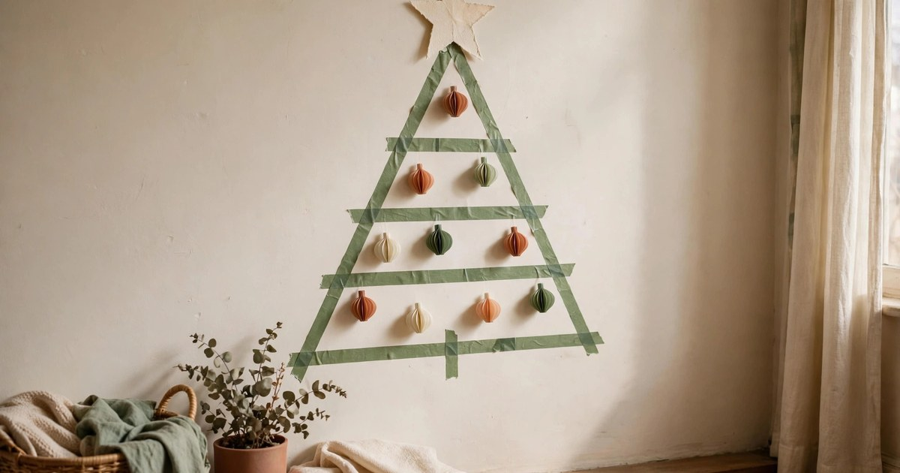
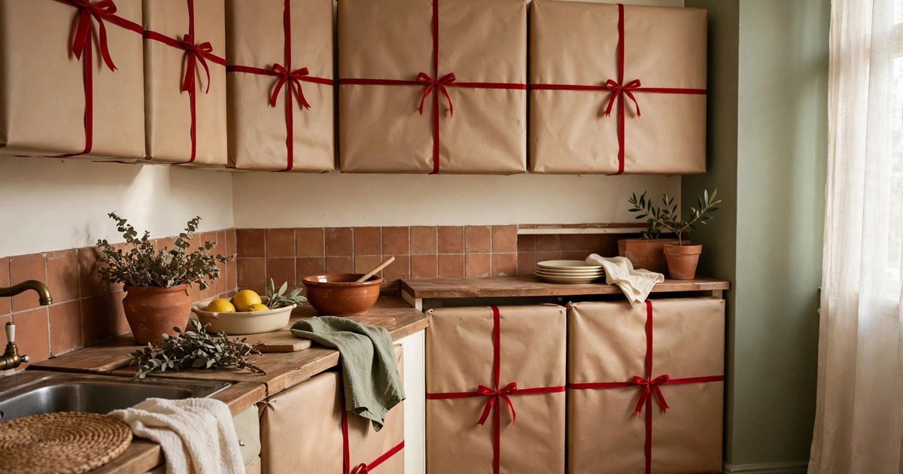

Christmas has a habit of arriving all at once. One minute it is early November and the shops are just putting out their first baubles, and the next it is the second week of December, guests are coming round, and your flat still looks like it does in July. For renters, the pressure is worse: you want the place to feel properly festive, but you cannot bang in nails, you cannot drill a hook into the wall, and every decorating decision has to pass the same test — will this come down in January without costing me my deposit?

The good news is that a festive flat does not need a weekend of work or a single hole in the wall. Every idea below takes about ten minutes from start to finish, costs very little, and leaves no trace behind. They are all built around things you probably already own — cushion covers, a vase, a jar, a houseplant — plus one or two cheap seasonal buys. Pick one tonight and your living room will feel like Christmas before the kettle has boiled. Pick all ten across a week and the whole flat will be dressed without a single afternoon lost to decorating.

### 1. Swap your cushion covers for festive ones

Nothing changes a room faster than a cushion swap, and it is the single best ten-minute Christmas job in a rented flat. Keep your everyday cushion pads and simply slip on festive covers — deep green, burgundy, a warm terracotta, or a simple cream cover with a stitched snowflake or a sprig of holly. Envelope-style covers need no zips or sewing, they cost a few pounds each, and the whole swap takes less time than making a cup of tea. The moment the new covers are on, the sofa looks dressed for the season, even if nothing else in the room has changed.

Mix one or two patterned covers with plain ones in a matching colour so the sofa looks styled rather than themed to within an inch of its life, and add a folded throw over one arm to tie the colours together. When January comes, the covers come off, fold flat into a drawer, and your everyday cushions are back — no marks, no damage, and nothing to store that is bigger than a magazine. If you are buying new, choose covers in colours you will genuinely reuse next year, and check the size against your existing pads before you order so there is no wrestling on the day.

### 2. Put a branch in a vase and hang baubles from it

A bare branch in a vase is one of the prettiest pieces of Christmas decor you can make, and it costs almost nothing. Find a shapely branch in a park or garden — or use a sturdy stem cut from a shrub — stand it in a tall vase weighted with a few pebbles, and hang six or eight small baubles from its twigs with short lengths of ribbon or thread. In ten minutes you have a sculptural, Scandinavian-looking decoration that works on a sideboard, a windowsill or a dining table, and it takes up barely any space at all.

Keep the baubles light so the branch does not droop, and hang them at different heights for a natural, collected look. A mix of matte and shiny finishes in two colours — say, gold and deep green, or cream and terracotta — looks far more expensive than a rainbow of random ornaments. Add a tiny string of battery fairy lights wound loosely around the branch if you want it to glow in the evening, and the whole thing reads as a deliberate design choice rather than a last-minute improvisation. When the season ends, the baubles go back in their box and the branch goes in the green bin.

### 3. Fill a glass jar with fairy lights

Battery fairy lights stuffed loosely into a large glass jar, a vase or even a Kilner jar from the kitchen cupboard make an instant glowing centrepiece, and the whole job takes about three minutes. Coil the lights in gently rather than stuffing them, tuck the little battery pack behind the jar, and switch them on: the glass diffuses the light into a soft, warm glow that makes the whole corner of the room feel festive. It is the easiest idea on this list and one of the most effective, especially once the afternoons start getting dark.

A jar of lights works almost anywhere — on a mantelpiece substitute like the top of a bookcase, on a bedside table, on a hallway console, or as the centre of a dining table. For a fuller look, add a handful of pinecones, a few dried orange slices or a small sprig of greenery around the base of the lights inside the jar. Use a timer setting if your lights have one, so they switch themselves on at dusk and off at bedtime, and always use battery lights rather than mains ones for anything in glass — no trailing cables, no plugs, and nothing hot to worry about.

### 4. Stick paper snowflakes to the window with water

Paper snowflakes are the cheapest Christmas decoration in existence — a few sheets of white paper and a pair of scissors — and the renter-friendly trick is to fix them to the window with plain water instead of tape or glue. Dampen the back of each flake very lightly, press it to the glass, and surface tension holds it in place for weeks. From outside, the window looks beautifully dressed; from inside, the flakes glow against the daylight. When January comes, they peel off with a fingertip and a wipe of a cloth leaves the glass spotless.

Fold each sheet into sixths and cut small triangles and curves from the folded edges, then unfold to reveal the pattern — no two flakes need to match, and the wonky ones are usually the most charming. Make a mix of sizes and scatter them across one window rather than covering every pane, leaving some clear glass so the room still gets its light. This is a lovely job to do with children, and it costs literally nothing if you have paper and scissors already. If your windows are double-glazed and cold to the touch, the flakes may need re-damping after a very cold night, which takes seconds.

### 5. Dress a houseplant as a mini Christmas tree

If you already have a houseplant, you already have a Christmas tree — it just does not know it yet. A bushy monstera, a fiddle leaf fig or even a sturdy spider plant can carry a handful of miniature baubles, a tiny star on top and a short string of battery fairy lights wound through its leaves. It takes ten minutes, it costs the price of a small bag of mini ornaments, and it gives you a tree that needs no floor space, no stand and no watering schedule beyond the one the plant already has.

Keep the decorations small and light so you do not weigh down the stems, and hang them from the sturdier branches rather than the newest growth. A ribbon tied around the pot in a festive colour finishes the look, and a few small wrapped presents or a folded throw at the base makes it feel like a proper little tree corner. The plant itself stays perfectly happy as long as you use battery lights, which stay cool, and remove everything in January before the new growth starts. It is also the ideal tree for a flat with a cat, since there is no trunk to climb and nothing heavy to knock over.

### 6. Make a washi tape Christmas tree on the wall

A Christmas tree made entirely of washi tape is the renter's answer to the no-tree problem: no floor space needed, no needles on the carpet, and nothing to drill or stick permanently. Lay strips of green washi tape across a bare wall in the shape of a triangle, starting wide at the bottom and narrowing to a point, add a paper star at the top, and then tape a few lightweight paper baubles or small cards inside the triangle. The whole thing takes ten minutes, costs a couple of pounds in tape, and looks genuinely delightful — part decoration, part piece of wall art.

Use a tape colour that suits your room, deep green or a warm terracotta, and keep the lines slightly imperfect rather than ruler-straight; a hand-drawn feel suits the idea better than precision. Test a small piece of tape in a hidden spot first, especially on freshly painted walls, and warm it gently with a hairdryer on a low setting when you peel it off in January so it lifts cleanly. The washi tree works brilliantly in a hallway, a child's bedroom or the narrow wall beside a door — the awkward spots where a real tree would never fit.

### 7. Gift-wrap your cabinet doors like presents

Here is the ten-minute idea that makes guests laugh with delight: wrap your kitchen cabinet doors, or the doors of a wardrobe or a chest of drawers, in wrapping paper with a ribbon cross and a bow, so each door looks like a giant present. Cut the paper to size, hold it in place with a few small pieces of washi tape at the edges, cross two strips of ribbon over the front and tie a bow in the middle. It transforms the most ordinary piece of furniture in the flat into the centrepiece of the room, and it takes about ten minutes per door.

Choose a sturdy wrapping paper rather than the thinnest kind, and pick one colour or pattern for all the doors so it reads as a set rather than a jumble. Kraft paper with red ribbon looks wonderfully traditional, while a deep green paper with gold ribbon feels more grown-up. Because the paper is held on with washi tape, it comes off in January without a mark, and the ribbon can be reused next year. This is a particularly good trick for a rented kitchen, where the cabinets are often the least attractive thing in the room and you are not allowed to change them.

### 8. Set out a festive mug display on an open shelf

If you have an open shelf in the kitchen, or even just a spare stretch of worktop, a row of festive mugs is a decoration that earns its keep every single morning. Pull out the mugs with Christmas designs, a reindeer, a snowflake, a cheerful red glaze, and line them up along the shelf with a small sprig of greenery or a pinecone tucked between them. It takes five minutes, it costs nothing if you already own the mugs, and it turns an everyday object into a seasonal display that you actually use rather than just look at.

Mix the festive mugs with one or two plain ones in a matching colour so the shelf does not look like a gift shop, and stack a couple of small plates or a little bowl of clementines at one end to finish the scene. If you do not own Christmas mugs, a plain red or green mug reads just as festive, and a charity shop is full of them for a pound or two in November. The display doubles as a hot chocolate station on cold evenings — keep the cocoa, the marshmallows and a small jug on the shelf below, and the whole corner becomes the warmest spot in the flat.

### 9. Build a ten-minute tray vignette for the coffee table

A tray is the renter's secret weapon for Christmas decorating, because it contains the whole display in one moveable footprint and protects the table underneath at the same time. Take any tray you own — wooden, rattan, even a baking tray lined with a tea towel — and arrange three things on it: something tall, something glowing and something natural. A candle in a jar, a small vase of greenery and a handful of pinecones is the classic combination, and it takes ten minutes to arrange and looks like it took an hour.

The trick is to vary the heights so the eye moves across the tray, and to keep everything inside the tray's edges so the vignette reads as one object rather than clutter. A battery candle is the safe choice in a rented flat, and it means the tray can sit anywhere, even near curtains or the sofa arm. When you need the coffee table back for dinner or a board game, the whole display lifts away in one move and comes back just as easily. It is the lowest-effort, highest-impact idea on this list, and it works on a sideboard, a dining table or a hallway console just as well.

### 10. Do a Christmas bedding swap

The bedroom is the room most people forget at Christmas, and it is the one where a ten-minute change makes the biggest difference to how the flat feels at the end of the day. Swap your everyday duvet cover for a festive one — deep green, a soft red check, or a plain cream with a stitched border — add a folded throw across the foot of the bed and one cushion in a matching colour, and the room feels like a winter cabin. You were going to change the bedding anyway, so the Christmas version costs no extra time at all.

Choose a duvet cover in a colour you genuinely like, not a novelty print you will tire of by the second week, and keep the rest of the room calm so the bed is the statement. A small string of battery fairy lights along the headboard or a sprig of greenery in a jar on the bedside table completes the look without a single fixing. In January, the festive bedding goes into the wash and back into the cupboard, and your bedroom is back to normal with nothing to take down, nothing to store in the loft, and not a mark on a wall.

Christmas in a rented flat does not have to mean a weekend of decorating, a pile of holes to fill in January, or a nervous wait for the deposit to come back. Ten minutes is genuinely enough: a cushion swap, a jar of lights, a branch in a vase, a tray on the coffee table. Start with the idea that fits the room you spend the most time in, and add one more each evening until the flat feels festive. Your walls will stay pristine, your landlord will never know anything happened, and the only trace of Christmas left behind in January will be the photographs.

## Frequently Asked Questions

### Will washi tape damage my walls when I take my Christmas decor down?

Good quality washi tape is designed to remove cleanly from painted walls, and it is one of the safest fixings a renter can use for quick Christmas decor. Test a small piece in a hidden spot first, avoid freshly painted or flaking surfaces, and warm the tape gently with a hairdryer on a low setting before peeling it off — the heat softens the adhesive and it lifts away without taking paint with it.

### How can I decorate for Christmas in a rental with no nails and no drilling?

Use the flat itself instead of the walls. Freestanding displays like a tray vignette, a branch in a vase, a jar of fairy lights and a dressed houseplant need no fixings at all, and removable options like washi tape, over-door hooks and tension rods give you hanging space without a single hole. Every idea in this post is designed around that rule, so nothing here risks your deposit.

### What is the cheapest way to make a rented flat feel festive in ten minutes?

Swap your cushion covers for festive ones and fill a glass jar with battery fairy lights — between them they cost less than a tenner and take about five minutes combined. Paper snowflakes on the window cost nothing at all if you already have paper and scissors, and a branch in a vase with a few baubles is nearly free too. Start with the room you use most and add one idea per evening.

### Can I put up Christmas decor in a rental if my landlord is strict?

In most tenancies, freestanding and removable decorations are completely fine — they do not alter the property in any way. The ideas here involve no nails, no screws, no drilling and no adhesive that marks paint, so they fall well within what any landlord would consider normal seasonal decorating. If your tenancy agreement mentions decorations specifically, stick to the fully freestanding ideas like the tray vignette, the fairy light jar and the dressed houseplant.

### How do I store ten-minute Christmas decor ideas so I can reuse them next year?

Fold the cushion covers and the festive bedding flat, keep the washi tape and ribbons in a single labelled box, and store the baubles, battery lights and mini ornaments together in a shoebox. Everything in this post packs down to one small box plus a folded stack of fabric, which fits on top of a wardrobe or under a bed — no loft, no garage and no storage unit required.
