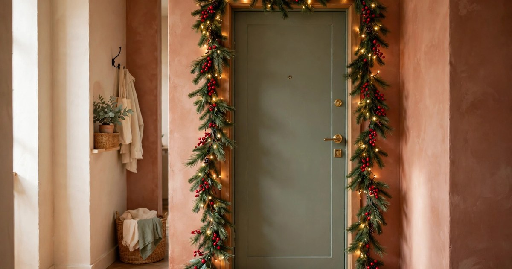
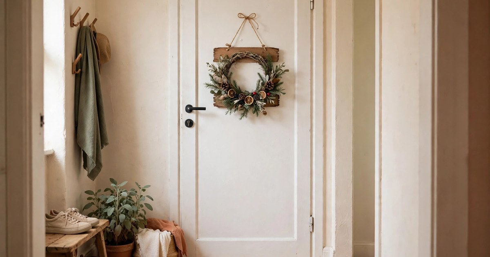
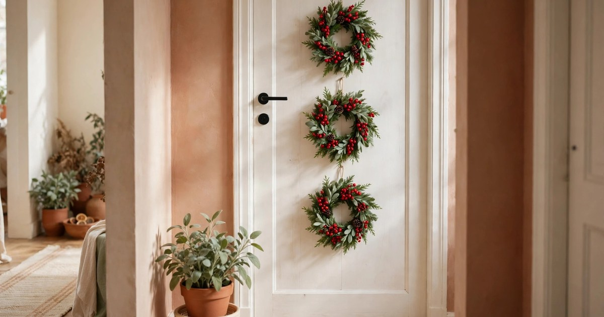
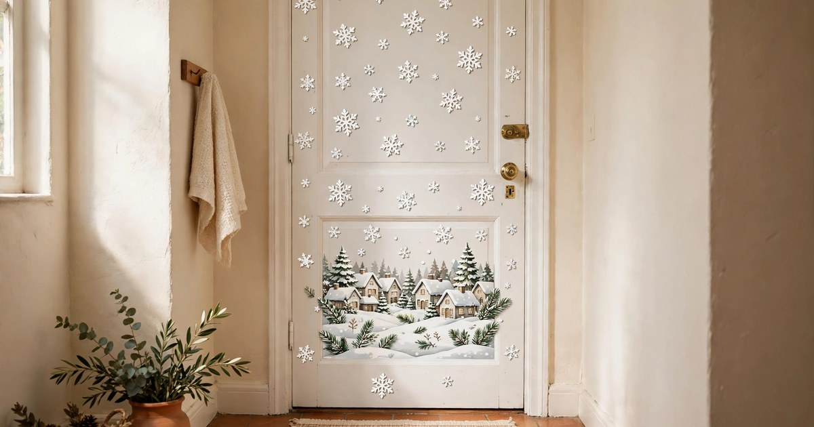

The front door is the first thing anyone sees at Christmas, and in a rented flat it is also the easiest place to decorate without touching a single wall. No landlord permission, no holes, no arguments about what counts as damage — just a door, a hook or two, and a bit of festive colour. Yet most renters either skip the door entirely or hammer in a nail they will regret in January. Neither is necessary.

Every idea in this roundup costs under $25, and every one is genuinely renter-friendly: nothing is drilled, nailed or glued to anything you do not own. The whole kit is over-door hangers, suction hooks, Command strips and magnets — the same fixings that come off cleanly in January, leaving the door exactly as you found it. Whether your front door opens onto a shared hallway, a communal landing or a tiny porch, there is something here that fits, and most of these picks take under ten minutes to put up.

The nine picks below cover the full spectrum, from a classic pre-lit wreath to a set of removable decals that turn a plain door into a Christmas scene. Mix and match two or three for a layered look, or pick a single hero piece and let it do all the work. Either way, the total spend stays under $25 per pick, and the deposit stays safe. If you are decorating the inside of your flat too, our guide to [stocking holders that need no mantel](/christmas-stocking-holders-no-mantel/) pairs beautifully with a dressed-up door — and if you have a small tree just inside, our [budget ornaments for small trees](/budget-christmas-ornaments-small-trees-under-25/) keep the whole entrance feeling coordinated.

### 1. Pre-lit faux Christmas wreath

A pre-lit wreath is the single most effective Christmas door decoration you can buy, because it does two jobs at once: it gives you the lush green shape of a traditional wreath and it glows after dark, so your door looks festive from the hallway or the street even when the landing light is off. Faux wreaths have come a long way — the good ones mix pine, fir and eucalyptus tips with a few pine cones and red berries, and at arm's length they look remarkably close to the real thing, without shedding needles all over a shared hallway carpet.

Why it works for renters: a wreath hangs from a single over-door hook, so there is nothing to screw in and nothing stuck to the paint. Battery-powered fairy lights mean no trailing cables and no need for a socket by the door, which matters in older flats where the nearest plug is two rooms away. Look for a wreath around 45–60 cm across — big enough to make an impression, small enough to store flat in a cupboard for eleven months.

Where it fits: front doors, obviously, but also the inside of the door if your building rules frown on hallway decorations, or a bedroom door for a bit of private festive cheer. To take it down, lift it off the hook, pop the batteries out, and slip it into a bin bag so it stays dust-free until next year. [Shop pre-lit Christmas wreaths](https://www.amazon.com/s?k=pre+lit+christmas+wreath+small&tag={{AMAZON_TAG}})

### 2. Over-door wreath hanger

The humble over-door hanger is the unsung hero of renter Christmas decor, because almost every door idea in this list depends on one. It is a flat metal hook that slides over the top of the door and hangs down the other side, with a hook at the bottom for your wreath, garland or sign. No screws, no adhesive, no marks — it simply rests on the door and comes off the moment you lift it away.

Why it works for renters: it is the only fixing most doors need, and it protects the door in two ways. First, it takes the weight, so you are not tempted to hammer in a nail or stick a hook directly onto the paint. Second, the better hangers have a felt or rubber backing where they touch the door, so they cannot scratch the finish even after weeks of use. Adjustable-length hangers are worth the extra pound or two, because they let you position a wreath exactly at eye level instead of wherever a fixed hook happens to land.

Where it fits: any standard interior or front door up to about 4 cm thick, which covers nearly every rental. Check the gap above your door first — very tight fire doors in some flats leave almost no clearance, in which case a suction hook on the glass panel or a Command hook on the flat of the door is the better bet. One hanger can serve a wreath in December and a dried-flower hoop the rest of the year, so it earns its keep well beyond Christmas. [Shop over-door wreath hangers](https://www.amazon.com/s?k=over+door+wreath+hanger+adjustable&tag={{AMAZON_TAG}})

### 3. Faux pine garland for the door frame

A garland turns a plain door frame into a festive archway, and it is the easiest way to make a small entrance feel grand without spending much. A faux pine garland — ideally one with a few berries, pine cones and a string of warm-white lights woven in — drapes around the top and sides of the frame, softening the hard edges of the door and drawing the eye up. It is the same trick florists use in shop windows, scaled down for a flat.

Why it works for renters: garlands are held up with small clear Command hooks or removable adhesive clips pressed onto the frame, not nails, and they peel off cleanly in January if you follow the removal instructions — pull the tab straight down, slowly, and the adhesive releases without taking paint with it. Battery-operated lights keep everything cable-free, and a 2.7-metre garland is usually enough to frame a standard door with a gentle swag in the middle.

Where it fits: front door frames, of course, but also the door between your hallway and living room if your front door is off-limits, or along the top of a wide doorway for the same framing effect. When the season ends, coil the garland loosely, tie it with string, and store it flat in a bag — crush it into a box and it will take an hour to fluff back into shape next year. [Shop faux pine garland with lights](https://www.amazon.com/s?k=faux+pine+garland+christmas+lights+battery&tag={{AMAZON_TAG}})

### 4. Oversized Christmas door bow

If a wreath feels too traditional and a garland feels like too much work, an oversized bow is the shortcut. One big velvet or satin bow — deep red, forest green or gold — pinned to the centre of the door instantly reads as Christmas, the same way a bow on a gift does. It is bold, it is simple, and it takes about thirty seconds to put up, which makes it the best pick in this list for anyone decorating on Christmas Eve.

Why it works for renters: a bow weighs almost nothing, so it hangs happily from a single Command hook or a suction cup on a smooth door, and it leaves no trace at all. Because it is fabric, it folds flat for storage and survives being squashed in a drawer, unlike a wreath that needs careful handling. Choose a weather-resistant outdoor bow if your door faces the elements, and look for wired edges — they let you shape the loops so the bow holds its form instead of flopping flat against the door.

Where it fits: dead centre on a plain door for maximum impact, or paired with a simple wreath for a classic layered look. It also works beautifully on the inside of the door, where it greets you every time you come home. In January, unhook it, fold it, and tuck it into the Christmas box — it will be ready to go again next year with a quick shake. [Shop oversized Christmas door bows](https://www.amazon.com/s?k=oversized+christmas+door+bow+velvet+red&tag={{AMAZON_TAG}})

### 5. Hanging wooden Christmas sign

A hanging wooden sign adds words to your door — a cheerful "Merry Christmas", a "Let It Snow" or a simple "Welcome" in festive lettering — and it brings a warm, handmade feel that softens the more polished look of faux greenery. The best ones are lightweight plywood or MDF with a jute string hanger, painted in cream, sage or terracotta tones that sit happily alongside the rest of your hallway decor.

Why it works for renters: a sign weighs next to nothing, so it hangs from the same over-door hook or Command strip as everything else in this list, and the string hanger means there is no hardware to attach at all. Because signs are flat, they store easily — slide one behind a wardrobe or under a bed and it takes up no space for the rest of the year. They are also the easiest decoration to personalise, whether you choose a family name, a favourite Christmas phrase or a design that matches your interior colours.

Where it fits: centred on the door, hung below a wreath, or layered over a garland swag for a fuller look. On a glass-panelled door, hang it on the inside so the lettering reads clearly through the glass from the hallway. Wipe it with a dry cloth before storing, and keep it out of damp hallways if it is unsealed wood. [Shop hanging wooden Christmas signs](https://www.amazon.com/s?k=hanging+wooden+christmas+sign+door&tag={{AMAZON_TAG}})

### 6. Bauble door swag

A bauble swag is the door decoration for people who love colour. Instead of greenery, a swag is a short, dense cluster of shiny baubles — red, gold, green, or a mix — strung together on a ribbon or wire and hung in a gentle curve across the door or down one side of the frame. It catches the light, it sparkles in the hallway, and it uses the ornaments you probably already own, which makes it one of the cheapest statement pieces in this list.

Why it works for renters: a swag hangs from a single hook, weighs very little, and needs no fixing beyond that one point of contact. Shatterproof plastic baubles are the sensible choice for a door that gets opened and closed a dozen times a day — glass baubles look gorgeous but one slam of the door in a draught can end in glitter and tears. Many ready-made swags come pre-strung, or you can make your own by threading spare baubles onto a length of ribbon, which costs almost nothing if you already have a box of ornaments.

Where it fits: draped in a swag shape across the top half of the door, hung vertically down one side of the frame, or paired with a plain wreath for a pop of colour against the green. Our guide to [budget ornaments for small trees](/budget-christmas-ornaments-small-trees-under-25/) is a good source of cheap bauble sets if you want to build your own. At the end of the season, unhook the swag, wrap it in tissue, and it will be ready to hang again next year. [Shop bauble door swag](https://www.amazon.com/s?k=christmas+bauble+door+swag+decoration&tag={{AMAZON_TAG}})

### 7. LED curtain lights for the door

LED curtain lights turn a flat door into a glowing backdrop, and they are the most dramatic pick in this roundup for the money. A curtain of fine fairy lights — usually a 2-by-2-metre sheet of warm-white LEDs on nearly invisible wire — hangs from the top of the door and falls in soft vertical strands, framing whatever else you have on the door and casting a warm glow across the whole hallway. In a dark winter landing, the effect is genuinely magical.

Why it works for renters: the lights hang from a few clear Command hooks along the top of the door frame, and the battery pack tucks behind the curtain or sits on the floor, so there are no cables trailing across the hallway and nothing screwed into the wall. LED lights stay cool to the touch, which matters when the strands hang near curtains, coats or a wreath, and a timer function — usually six hours on, eighteen off — means you never have to remember to switch them off. Most sets cost well under $20, including the batteries.

Where it fits: on the door itself for a full glowing panel, or on the wall of the hallway beside the door if you would rather keep the door clear for a wreath. They also work beautifully on the inside of a glass-panelled door, where the light spills through the glass into the hallway. When January comes, unhook the strands carefully, wind them around a piece of cardboard to stop tangling, and store the battery pack with the batteries removed. [Shop LED curtain lights for doors](https://www.amazon.com/s?k=led+curtain+lights+christmas+door+battery&tag={{AMAZON_TAG}})

### 8. Mini wreath set of 3

A set of three mini wreaths solves the classic renter's dilemma: one big wreath can overwhelm a narrow door, but a single small wreath can look lost. Three matching mini wreaths — usually around 25–30 cm each — hung in a vertical row down the door, or spread across the door and the hallway wall, give you the fullness of a large display with the flexibility of small pieces. They look intentional, they look expensive, and they cost less than one large pre-lit wreath.

Why it works for renters: each mini wreath weighs a fraction of a full-size one, so they hang from the lightest of fixings — small Command hooks, suction cups, or even a ribbon looped over the top of the door. Because they are small, they are easy to store, easy to move, and easy to rearrange if the first layout does not feel right. Sets often come with a mix of greenery, berries and a bow, so the three pieces look coordinated without you having to style them yourself.

Where it fits: in a vertical trio down the centre of the door, one on the door and two flanking it on the hallway wall, or one on the front door and the others on bedroom and bathroom doors to carry the Christmas theme through the flat. If you have a mirror in the hallway, a mini wreath hung on its frame is a lovely touch. Pack them flat in a single box with tissue between them and they will last for years. [Shop mini Christmas wreath set of 3](https://www.amazon.com/s?k=mini+christmas+wreath+set+of+3+small&tag={{AMAZON_TAG}})

### 9. Removable Christmas door decal set

Removable decals are the most renter-proof decoration in this entire roundup, because they are designed from the start to come off. A set of static-cling or low-tack vinyl decals — snowflakes, a snowy village scene, Santa and reindeer, or a simple "Merry Christmas" in elegant lettering — presses onto the smooth surface of the door, stays put all December, and peels away in January without leaving a mark, a residue or a single speck of damage.

Why it works for renters: there is no hook, no nail and no adhesive strong enough to damage paint. Static-cling decals use no adhesive at all — they hold on by static and a smooth surface — while low-tack vinyl is made for exactly this job and is the same material used for temporary shop-window displays. They are also the cheapest pick here, with most sets under $10, and they are the best option for doors that cannot take a hook at all, like metal fire doors or doors with no clearance above them.

Where it fits: on the flat panels of a front door, on a glass panel, or on the inside of the door where the kids can help arrange them. They are also brilliant on a hallway mirror or a window next to the door. To remove them, peel slowly from a corner; if any low-tack vinyl leaves a faint mark, a damp cloth takes it off in seconds. Store the backing sheets and you can reuse the set next year. [Shop removable Christmas door decals](https://www.amazon.com/s?k=removable+christmas+door+decals+static+cling&tag={{AMAZON_TAG}})

## Frequently Asked Questions

### Can I hang a Christmas wreath on a rented front door without damaging it?

Yes — use an over-door wreath hanger, which slides over the top of the door and needs no screws, nails or adhesive. Felt-backed hangers protect the paint, and the whole thing lifts off in January leaving no trace. For glass-panelled doors, a heavy-duty suction hook is the alternative.

### Will Command strips damage my door or frame?

Used correctly, no. Choose strips rated for the weight of your decoration, press them onto a clean, dry surface, and remove them by pulling the tab straight down slowly — never yank the strip sideways. That slow downward pull releases the adhesive cleanly without taking paint with it.

### What is the cheapest way to decorate a rental door for Christmas?

A removable decal set or a single oversized bow, both usually under $10, make the biggest impact for the least money. If you already own spare baubles, a homemade bauble swag on a ribbon costs almost nothing and looks wonderfully festive.

### Can I decorate the outside of my front door in a rented flat?

Usually yes, but check your tenancy agreement and any building rules first — some blocks restrict hallway decorations for fire-safety reasons. If the outside is off-limits, decorate the inside of the door instead; you will see it every time you come home, and it is just as cheerful.

### How do I store Christmas door decorations in a small flat?

Wreaths and garlands store best flat in a bin bag or under a bed; bows and signs fold or slide behind furniture; decals keep on their backing sheets in a drawer. Keep everything dry, keep batteries out of lights, and label the bag so you can find it next December without digging through every cupboard.
