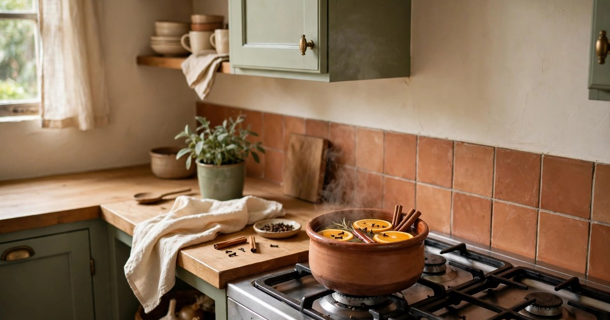
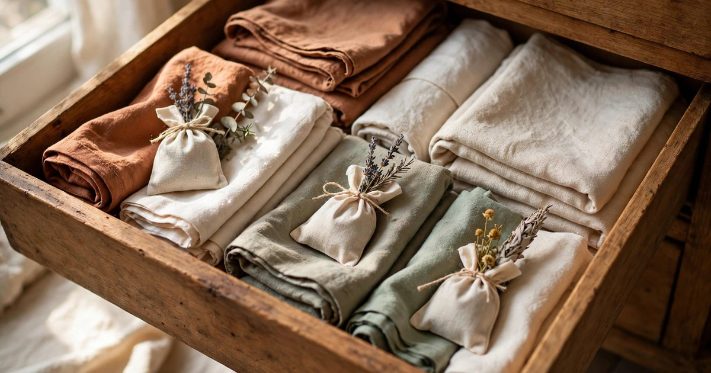
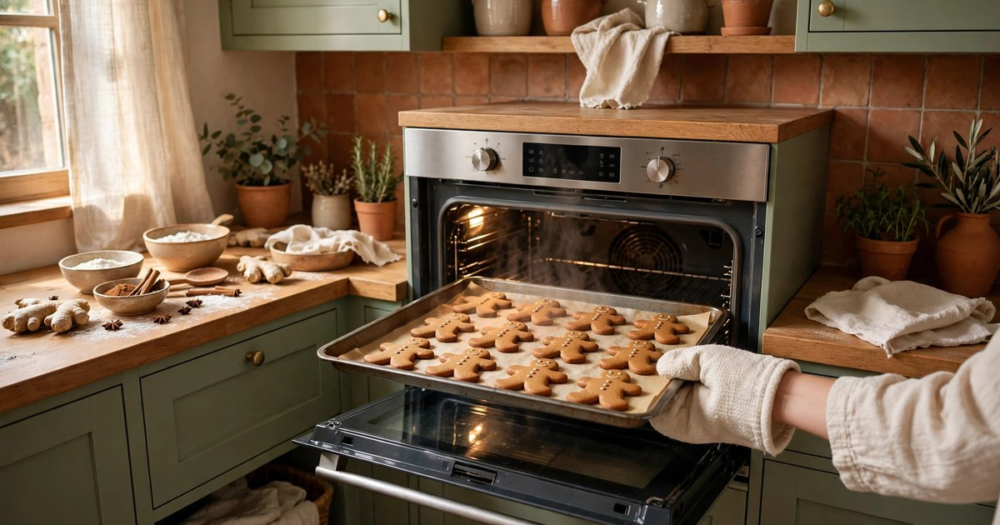

Christmas has a smell before it has a look. Long before the tree is up, the scent of cinnamon, pine, and orange tells your brain the season has started — and in a small rental, that scent fills the whole flat in minutes. The good news is that the best Christmas scents are also the most renter-friendly: they need no installation, no damage, and almost no money. Every idea below works in a flat with a strict tenancy agreement, and most of them use things already in your kitchen.

### 1. Simmer a stovetop pot

The simmer pot is the fastest, cheapest Christmas scent there is. Fill a small saucepan with water, add a sliced orange, two cinnamon sticks, a handful of cloves, and a star anise if you have one, and keep it at the lowest possible simmer. Within twenty minutes the whole flat smells like Christmas baking, and it keeps going for hours as long as you top up the water.

It works so well in a rental because it needs nothing but a hob and a pan, and it doubles as a humidifier for dry winter air. Start it an hour before guests arrive, or on a quiet evening when you want the flat to feel festive without decorating anything. Keep the heat genuinely low — a rolling boil evaporates the pot dry and burns the spices — and never leave it simmering unattended. One pot, reused for two or three evenings with fresh water, scents a whole weekend.

### 2. String a dried orange garland

Dried orange slices smell faintly sweet and citrusy for weeks, and strung on twine they are both a decoration and a scent source. Slice oranges thinly, dry them in a low oven (around 100°C for two to three hours, turning once), and thread them on string with cinnamon sticks or wooden beads. Hang the garland along a window, a shelf, or a doorway with removable hooks, and it perfumes the room gently every time warm air passes it.

The scent is subtle rather than strong, which is exactly right for a small flat — it sits in the background instead of competing with cooking or candles. Dried oranges also last: a garland made in early December still smells in January, and it composts when you take it down. If you want a stronger hit, tuck a few extra slices into a bowl on the coffee table, where the warmth of the room releases their scent faster.

### 3. Bundle cinnamon sticks in a vase

Cinnamon sticks are the laziest Christmas scent in the best way: bundle five or six together with twine, stand them in a small vase or jar, and they scent a shelf or a side table for weeks with zero effort. They look like a deliberate decoration — rustic, warm, and seasonal — and they cost less than a takeaway coffee.

This is the idea for the spots a simmer pot cannot reach: the bathroom shelf, the bedside table, the hallway console. Pair the bundle with a few dried orange slices or a sprig of pine for a fuller display, and replace the sticks when the scent fades, usually after three or four weeks. In a rental, a cinnamon bundle is also gloriously safe: no flame, no heat, no plug, nothing that could possibly trouble a landlord.

### 4. Put fresh pine branches in water

Nothing smells like Christmas faster than real pine, and you do not need a tree to get it. A few branches in a vase of water — from a tree lot's offcuts, a florist, or a neighbour's trimming — fill a small flat with forest scent within an hour. Offcuts are often free if you ask at a tree seller, and a bunch of pine from a supermarket costs less than a scented candle.

Real greenery also solves the small-flat problem of fake decorations looking cheap: pine is imperfect in exactly the right way. Keep the branches in water, mist them every few days, and they stay fragrant for two to three weeks. For the full guide to keeping cut greenery going all December, see our post on [keeping cut Christmas greenery fresh](/keep-cut-christmas-greenery-fresh-guide/). When the branches dry out, compost them — nothing to store, nothing to dust for eleven months.

### 5. Use candles on a tray, safely

A scented candle is the classic Christmas scent for a reason: one match and the room changes. In a rental, the trick is the tray. Group candles on a heatproof tray with a sprig of greenery, keep the tray away from curtains and shelves, and never leave a lit candle unattended or burning while you sleep. If your tenancy restricts open flames, battery-operated candles with a scented wax melt warmer give you the glow and the fragrance with no flame at all — our [battery candle picks](/battery-christmas-candles-small-apartments-under-20/) cover the best-looking options.

Choose one scent per room and keep it consistent through December, so the flat develops a signature Christmas smell rather than a different fragrance every evening. Pine, cinnamon, and spiced orange are the safe classics; vanilla and amber are warmer and less obviously seasonal if you want a scent that lasts past Christmas. Trim the wick before each lighting — a short wick burns cleaner and the scent throws further.

### 6. Run a diffuser with a winter blend

A diffuser is the renter's best friend for Christmas scent: no flame, no smoke, a plug or a USB port, and a scent you can change by the drop. A winter blend of orange, cinnamon bark, and clove essential oils smells convincingly like Christmas, and a few drops last for hours. Put the diffuser where air circulates — near a doorway or on a shelf at mid-height — rather than in a corner, where the scent pools and stays.

Diffusers are also the most controllable option: three drops for a subtle background scent, six for a room-filling one, and you can switch the blend for guests with allergies or pets (check pet-safe oils first — some, like cinnamon bark, are not suitable around cats and dogs). The upfront cost is a little higher than a simmer pot, but a bottle of essential oil lasts all season and well beyond, which makes it one of the cheapest scents per evening in this list.

### 7. Tuck sachets into drawers and linen

Scented sachets are the quiet luxury of Christmas scent: small cloth bags of dried lavender, cinnamon, and cloves tucked into drawers, linen cupboards, and coat pockets, so every drawer you open in December smells festive. They cost almost nothing to make — a scrap of fabric, a spoonful of spices, a ribbon — and they scent the things you actually wear and sleep in, which is a different pleasure from scenting a room.

Put a sachet in the bedding drawer and your sheets smell faintly of Christmas all month; put one in the coat cupboard and your winter coat carries the scent out of the house with you. Sachets last for months, and when the scent fades, a squeeze refreshes them. They are also a lovely zero-cost gift: make a batch while you are making your own, tie them with ribbon, and you have a present for every guest who visits in December.

### 8. Bake something that smells like December

Baking is the only Christmas scent that also produces food, which makes it the best value on this list. Gingerbread, cinnamon rolls, spiced biscuits, or a simple orange and clove cake fill a small flat with scent for hours, and the smell lingers in curtains and cushions long after the baking is done. Even a tray of shop-bought cinnamon rolls, warmed in the oven, scents the whole flat convincingly.

The scent is strongest while baking and for an hour after, so time it for when it matters: before guests arrive, on a Sunday afternoon, or on Christmas Eve itself. If you do not bake, a pan of sliced apples with cinnamon and sugar, roasted low in the oven, gives you most of the effect with almost no skill required. And unlike a candle, the result of this scent is something you can eat, which is a strong argument in its favour.

### 9. Make clove-studded pomanders

Pomanders — oranges studded all over with cloves — are the oldest Christmas scent on this list, and still one of the best. Push whole cloves into an orange in any pattern you like, roll it in cinnamon and orris root powder if you have it, and leave it in a bowl. The orange slowly dries, the cloves release their warm, spicy scent for weeks, and the bowl becomes a beautiful, edible-looking centrepiece.

This is a wonderful project for an evening in front of the television, and it costs an orange and a jar of cloves. A bowl of three or four pomanders scents a coffee table area for a month or more, and as the oranges dry they shrink and darken into something that looks deliberately rustic rather than past its best. When January comes, compost them — a decoration that never needs storing is a gift in a small flat.

### 10. Spray your linens and curtains

Linen spray is the finishing touch that makes the whole flat smell considered rather than just scented. A few spritzes of a pine, cinnamon, or spiced-orange spray on bedding, curtains, and cushion covers puts the scent exactly where people sit and sleep, and it refreshes rooms that candles and diffusers do not reach. Shop-bought linen sprays are cheap, or make your own with water, a splash of vodka, and a few drops of essential oil in a spray bottle.

Spray in the morning so the scent settles by evening, and test on a hidden corner of fabric first — essential oils can mark delicate materials. The trick is lightness: two or three spritzes per room, not a soaking, because a small flat amplifies scent fast. Combined with one stronger source (a candle, a simmer pot, a diffuser), linen spray is what makes guests walk in and say the flat smells amazing without being able to point at why.

## One Scent, Every Room, No Damage

The thread through all ten ideas is the same: Christmas scent in a rental should be warm, cheap, and removable. Pick one signature scent — cinnamon and orange, pine and clove, vanilla and amber — and carry it through the flat in two or three forms: a strong source like a simmer pot or candle, a background source like sachets or a garland, and a finishing touch like linen spray. Nothing here needs a nail, a drill, or a landlord's permission, and nothing here needs storing in January beyond a jar of cloves. Start with the simmer pot tonight, and your flat will smell like Christmas before the decorations are even out of the box.

## Shop this look: Christmas scent kit

- **Simmer pot spice kit** — cinnamon, clove, and orange ready to simmer. [Shop simmer spices](https://www.amazon.com/s?k=stovetop+simmer+pot+spice+kit&tag={{AMAZON_TAG}})
- **Dried orange slices** — garlands, simmer pots, and pomanders. [Shop dried oranges](https://www.amazon.com/s?k=dried+orange+slices+for+decoration&tag={{AMAZON_TAG}})
- **Cinnamon sticks bundle** — tie into vases or simmer whole. [Shop cinnamon sticks](https://www.amazon.com/s?k=cinnamon+sticks+for+decoration&tag={{AMAZON_TAG}})
- **Essential oil diffuser** — a winter blend that runs for hours. [Shop diffusers](https://www.amazon.com/s?k=essential+oil+diffuser+for+home&tag={{AMAZON_TAG}})
- **Linen spray** — Christmas scent on curtains and bedding. [Shop linen spray](https://www.amazon.com/s?k=christmas+linen+spray&tag={{AMAZON_TAG}})

## Frequently Asked Questions

### What is the cheapest way to make a flat smell like Christmas?
A stovetop simmer pot: water, a sliced orange, cinnamon sticks, and cloves, kept at the lowest simmer. It costs almost nothing, scents the whole flat within twenty minutes, and can be reused for several evenings with fresh water.

### How do I scent a rental without candles?
Use a diffuser with a winter essential oil blend, a simmer pot, cinnamon bundles, or dried orange garlands — none of them need a flame. If you want candlelight too, battery-operated candles plus a wax melt warmer give you glow and fragrance with no open flame.

### How long do dried orange garlands and pomanders last?
Dried orange garlands keep a gentle scent for several weeks and look good all December. Clove pomanders scent a room for a month or more as the orange slowly dries. Both compost in January, so nothing needs storing.

### Are Christmas scents safe around pets?
Some are not: cinnamon bark and clove essential oils can be harmful to cats and dogs in diffusers, so check pet-safe oils before diffusing. Simmer pots, dried oranges, and pine branches are generally safer, but keep any pot or candle out of pets' reach and never leave a lit candle unattended.
