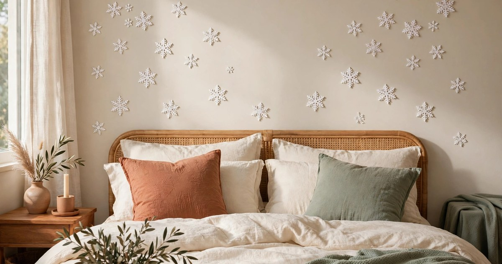
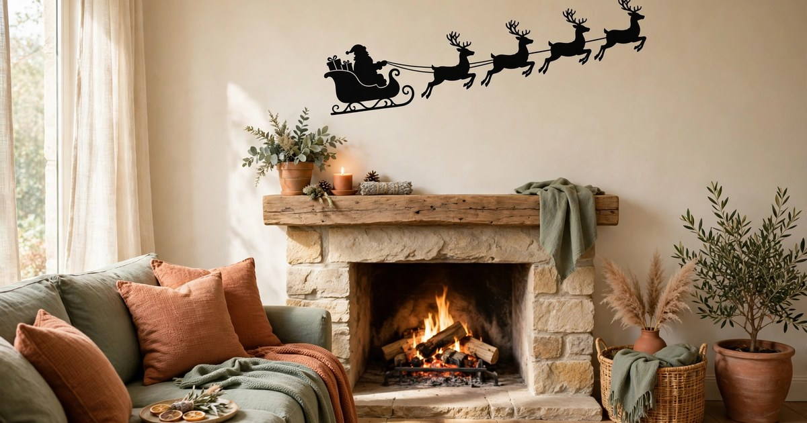
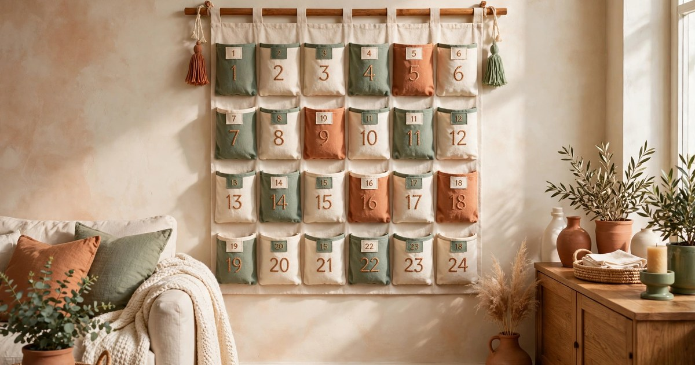

Christmas in a rented home is a balancing act. You want the flat to feel properly festive, but every decoration has to come down in January without taking paint, plaster or your deposit with it. Wall decals are one of the easiest wins for renters: they stick on in seconds, fill a blank wall with colour and cheer, and peel off cleanly when the season ends — as long as you choose genuinely removable, peel-and-stick designs rather than permanent vinyl.

Every decal in this roundup costs under $25 for the pack size listed, and every one is made for temporary use on smooth painted walls. A word of caution before you buy: always check whether the price covers a single decal or a whole set, because listings vary — a $9 "tree decal" might be one large tree, while a $12 "snowflake set" could contain fifty pieces. The prices below are for the listed pack size, and we have noted where a set gives you far more pieces than a single statement decal. Stick to removable vinyl or static-cling designs, avoid anything described as permanent adhesive, and test one small piece on a hidden patch of wall first if your paint is matt or freshly applied.

## 1. Peel-and-Stick Christmas Tree Wall Decal

The classic of the category, and for good reason. A large peel-and-stick Christmas tree decal, typically $8–15 for a single tree around 90–120 cm tall, turns a bare wall into a festive focal point without a single nail or hook. Most packs include a decorated tree plus a scattering of bauble and star decals you can arrange around it, so the finished look feels layered rather than flat. The best versions use a low-tack adhesive that grips painted plasterboard and smooth wallpaper but lifts away without residue, which is exactly what a renter needs.

If your flat is too small for a real tree — or your landlord bans them — this is the closest thing to the real deal. Pair it with a few fairy lights draped from [command hooks](https://decorly.homes/command-hook-christmas-decor-renters-under-20) and a stack of wrapped boxes underneath, and guests will barely notice there is no pine in the room. When January comes, peel from a corner slowly and warm the adhesive with a hairdryer on low for a few seconds if anything feels stubborn.

**Why it works:** One big decal fills an entire wall for the price of a takeaway coffee run, and the removable adhesive is designed for exactly this kind of short-term use.

**Where it fits:** Living room feature wall, hallway, or the wall beside the sofa in a studio flat.

[Shop removable Christmas tree wall decals](https://www.amazon.com/s?k=removable+christmas+tree+wall+decal&tag={{AMAZON_TAG}})

## 2. Snowflake Wall Sticker Set

Snowflake sets are the best value in this whole roundup. For $7–12 you usually get a pack of 40–60 individual snowflakes in assorted sizes, which is enough to dress a whole wall, a window surround and a door frame from a single purchase. The flakes are small and light, so they cling well even to slightly textured paint, and because you place each one yourself, you control the density — a gentle scatter over the bedhead or a full blizzard effect across the living room wall.

They also work brilliantly as a supporting act. Layer snowflakes around a larger tree or village decal to tie the whole scheme together, or use the smallest flakes to fill gaps on a gallery wall. White and silver flakes suit a cool, Scandi-inspired scheme, while iridescent ones catch the light beautifully in the evening. Keep a few spares in the packet for touch-ups if one loses its grip mid-season.

**Why it works:** A single cheap set covers a huge area, the pieces are endlessly rearrangeable, and removal is a matter of seconds per flake.

**Where it fits:** Bedroom wall above the bed, bathroom mirror surround, or scattered across a living room wall.

[Shop snowflake wall sticker sets](https://www.amazon.com/s?k=snowflake+wall+sticker+set+removable&tag={{AMAZON_TAG}})

## 3. Reindeer Wall Decal

A reindeer decal brings a playful, storybook feel that suits family flats and shared houses alike. Expect to pay $10–18 for a single large reindeer, often sold with a sleigh, a few stars or a snowy ground line included in the pack. Gold and copper reindeer look wonderfully warm against sage or cream walls, while white silhouette reindeer suit a minimalist, Nordic-style scheme and show up beautifully on a darker feature wall.

The trick with a reindeer is placement. Put it at eye level where it reads as a deliberate piece of art rather than a stray sticker — beside the tree, above a sideboard, or in the hallway where everyone sees it on the way in. If the pack includes antlers as a separate piece, take a moment to line them up carefully before pressing down, since repositioning is possible but gets less reliable after the third or fourth attempt.

**Why it works:** A single character decal has real personality, and the metallic finishes look far more expensive than the price suggests.

**Where it fits:** Hallway, living room side wall, or a child's bedroom.

[Shop reindeer wall decals](https://www.amazon.com/s?k=reindeer+wall+decal+christmas+removable&tag={{AMAZON_TAG}})

## 4. Santa and Sleigh Silhouette Decal

Few images say Christmas as instantly as Santa's sleigh crossing the moon. A Santa and sleigh silhouette decal, usually $9–16 for a single wide scene around 60–90 cm across, works best high on a wall where the silhouette can "fly" across empty space. Black silhouettes are the classic choice and look sharp against pale walls; gold versions feel more glamorous and catch the lamplight in the evening.

This is a great pick if you already have a tree and want something for a second room. It needs very little to look complete — a string of fairy lights underneath as a horizon line, or a few snowflake decals trailing behind the sleigh, is enough. Because the design is one wide piece, check your wall width before ordering; a sleigh that is too small for the wall looks lost, while one that is too large will crowd the corners.

**Why it works:** The silhouette is instantly recognisable from across the room, and a single wide decal makes a bare wall feel decorated in under five minutes.

**Where it fits:** Above a fireplace or sideboard, high on a living room wall, or across a bedroom wall.

[Shop Santa sleigh wall decals](https://www.amazon.com/s?k=santa+sleigh+wall+decal+christmas&tag={{AMAZON_TAG}})

## 5. Christmas Window Clings

Window clings are the renter's secret weapon because they use static cling rather than adhesive, which means literally zero residue and no risk to paint at all. A pack of festive window clings — snowmen, baubles, holly, candy canes — typically costs $6–12 for a set of 20–40 pieces, making them the cheapest pick on this list per piece. They stick to clean glass, smooth mirrors and even glossy tiles, and they can be peeled off and repositioned dozens of times.

They are also the most sociable decoration you can buy: visible from the street, they spread Christmas cheer to neighbours and passers-by as well as to everyone inside. Apply them to the inside of the glass so they are protected from rain, and smooth out air bubbles with a credit card for a neat finish. Store them flat between sheets of baking paper after Christmas and they will last for years.

**Why it works:** Static cling means no adhesive, no residue and no deposit risk whatsoever — the safest option on this list for cautious renters.

**Where it fits:** Living room windows, bedroom windows, glass doors, or bathroom mirrors.

[Shop Christmas window clings](https://www.amazon.com/s?k=christmas+window+clings+static+removable&tag={{AMAZON_TAG}})

## 6. Christmas Garland Wall Decal

A garland decal gives you the look of a draped evergreen swag without the pine needles, the weight or the hooks. Most packs cost $10–17 for a garland strip of 150–200 cm, often with separate bauble and bow decals to place along it. The long, horizontal shape is perfect for the spots other decals struggle with: above a door frame, along the top of a wall, or swagged across a wide window.

This is the pick to choose when your walls are already busy. Because a garland decal sits high and runs horizontally, it frames a room rather than competing with your furniture or artwork. Look for designs with a slight curve built in, so the garland reads as naturally draped rather than ruler-straight. If you are hanging a real wreath elsewhere, this pairs beautifully with it — see our guide to [no-drill Christmas wreath hanging for renters](https://decorly.homes/no-drill-christmas-wreath-hanging-renters) for the matching door solution.

**Why it works:** It fills the awkward high strip of wall that usually goes undecorated, and the long format makes a room feel finished with a single piece.

**Where it fits:** Above door frames, along the top of a living room wall, or swagged across a wide window.

[Shop Christmas garland wall decals](https://www.amazon.com/s?k=christmas+garland+wall+decal+removable&tag={{AMAZON_TAG}})

## 7. Advent Countdown Wall Decal

An advent countdown decal turns a wall into a daily ritual. These sets, usually $11–19 for a 24-pocket or 24-number design, come in two styles: numbered doors or pockets you open day by day, and a simple numbered tree or chart where you move a star marker each morning. The pocket versions are the most fun for families — tuck a sweet, a note or a tiny gift into each one — while the marker style suits adults and shared flats.

Because the decal stays up for the whole of December, durability matters more here than with any other pick. Choose a thicker vinyl with a strong-but-removable adhesive, and press the edges down firmly on the first day. Site it somewhere the whole household passes daily, like the hallway or the kitchen wall, so nobody forgets to open the day's pocket. It also doubles as a decoration in its own right, so the wall does not need much else.

**Why it works:** It combines decoration with a daily moment of anticipation, and one purchase covers the entire advent season.

**Where it fits:** Hallway, kitchen wall, or family living room.

[Shop advent countdown wall decals](https://www.amazon.com/s?k=advent+countdown+wall+decal+christmas&tag={{AMAZON_TAG}})

## 8. Gold Star Wall Decal Set

A set of gold star decals is the most versatile pick in this roundup. For $7–13 you typically get 50–100 stars in mixed sizes, which is enough to cover a whole wall, frame a window, or scatter across a ceiling edge. Gold stars read as festive in December and, unlike a Santa or a tree, they can stay up into January without looking out of season — or come down with everything else in a few minutes.

Use them to fill the gaps other decals leave behind. A trail of stars leading from the front door to the tree, a constellation above the bed, or a border around a mirror all work beautifully. They also pair well with warm white fairy lights, since the metallic gold catches the glow. If your walls are white or cream, choose a slightly deeper antique gold so the stars stand out; on sage or terracotta walls, bright gold pops perfectly.

**Why it works:** Stars suit almost any colour scheme, the sets are generous for the price, and they are the easiest decals to place, move and remove.

**Where it fits:** Bedroom wall, hallway, around a mirror, or framing the Christmas tree decal.

[Shop gold star wall decal sets](https://www.amazon.com/s?k=gold+star+wall+decal+set+removable&tag={{AMAZON_TAG}})

## 9. Winter Village Scene Wall Decal

The winter village scene is the showstopper of this list. A single wide decal — usually $14–22 for a scene around 120–180 cm across — depicts snowy rooftops, glowing windows, a church spire and a scattering of trees along the bottom of a wall, like a festive mural. It is the most expensive pick here, but it is also the most complete: one piece, one wall, and the room is dressed.

Place it low on the wall, just above the skirting board, so the village reads as a streetscape rather than a picture hung too high. It looks magical with a string of warm fairy lights tucked behind the top edge or a few battery tea lights on the windowsill in front of it. Because it is large, smooth it on slowly from one end to the other with a soft cloth to avoid trapping air bubbles, and keep the backing sheet until January in case you want to store it flat and reuse it next year.

**Why it works:** One decal delivers an entire scene — houses, trees, snow and light — for less than the cost of a small artificial tree.

**Where it fits:** Living room feature wall at skirting height, hallway, or behind the dining table.

[Shop winter village scene wall decals](https://www.amazon.com/s?k=winter+village+scene+wall+decal+christmas&tag={{AMAZON_TAG}})

## Frequently Asked Questions

### Will Christmas wall decals damage rented walls?

Genuinely removable, peel-and-stick decals should not damage sound painted walls, and static-cling designs carry no adhesive at all, so they are the safest choice. Avoid permanent vinyl, test a small piece on a hidden patch first, and peel slowly from a corner — warming the adhesive with a hairdryer on low helps on matt paint. If your walls are freshly painted, wait at least two weeks before applying any decal.

### How long do removable Christmas decals last?

A good-quality removable decal will stay put for the whole festive season, typically four to six weeks, without curling at the edges. Cheaper thin vinyl may lift in a warm room or a steamy bathroom, so press the edges down firmly when you first apply it and keep spares for touch-ups. Most decals are single-season use, though window clings can be stored flat and reused for years.

### Can I reposition a wall decal if I place it wrong?

Most peel-and-stick decals can be lifted and repositioned two or three times before the adhesive weakens, so small adjustments are fine. Lift gently from a corner rather than pulling the whole piece off at once, and avoid touching the sticky side with your fingers, which leaves oils that reduce grip. If a decal stops sticking, a few small pieces of removable mounting putty behind the edges will hold it for the rest of the season.

### Are the prices quoted for one decal or a set?

It varies by listing, which is why this guide notes the pack size for every pick. Snowflake, star and window cling packs usually contain dozens of pieces for $6–13, while statement decals like the tree, reindeer or village scene are usually a single large piece for $8–22. Always read the listing carefully before ordering, and check the dimensions as well as the piece count.

### What is the best decal for a very small flat?

A snowflake or gold star set is the best starting point, because you can spread a few pieces across a wall without overwhelming the room, and a single pack covers several spots. If you want one statement piece, choose the peel-and-stick tree decal — it gives you the festive focal point of a real tree with zero floor space used. In a studio, keep the decals to one wall so the room still feels calm rather than crowded.
