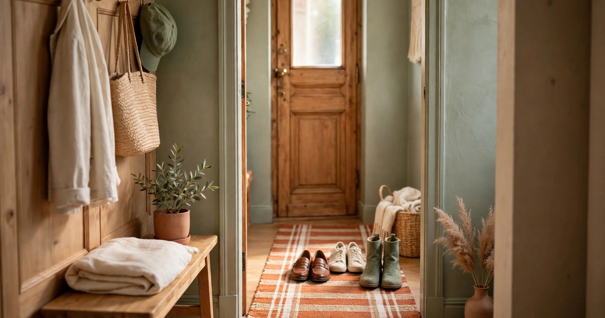
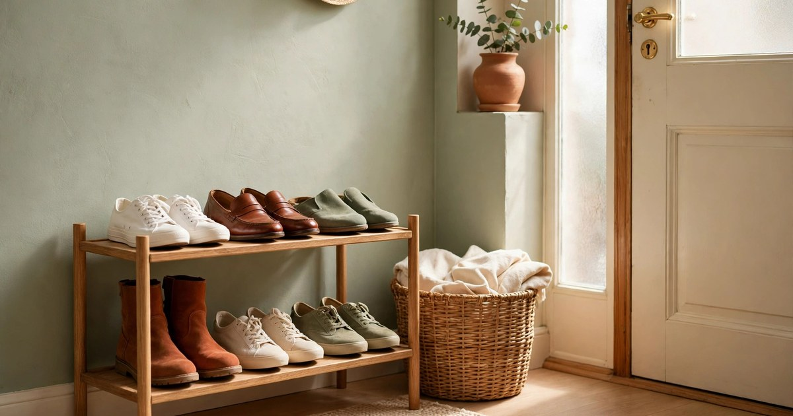
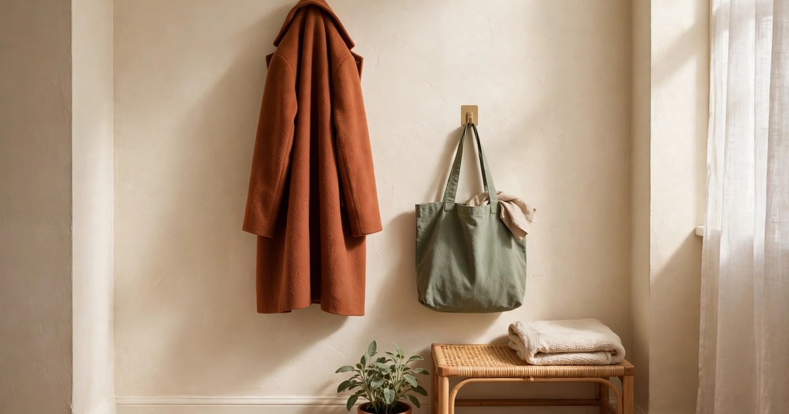
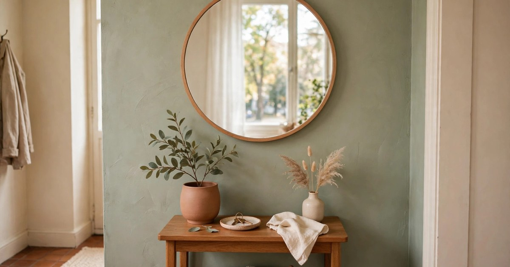
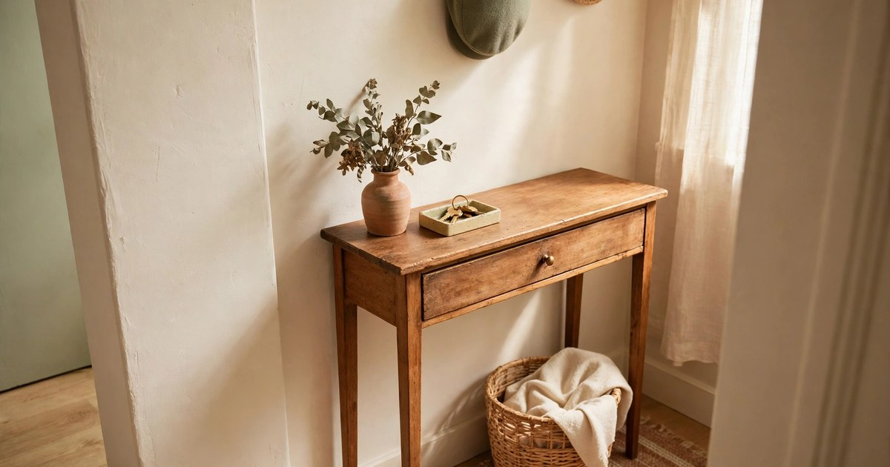
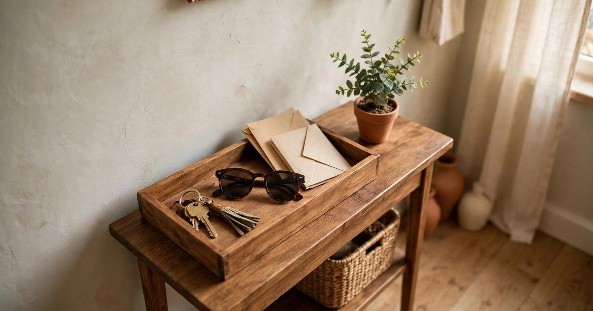
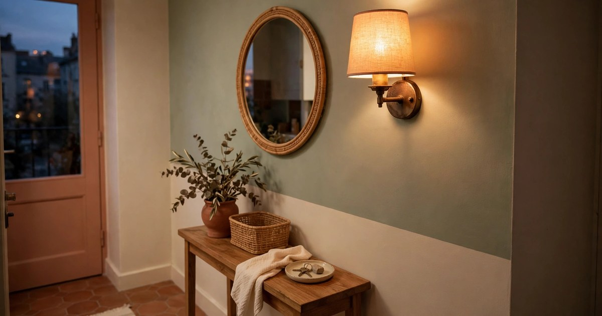
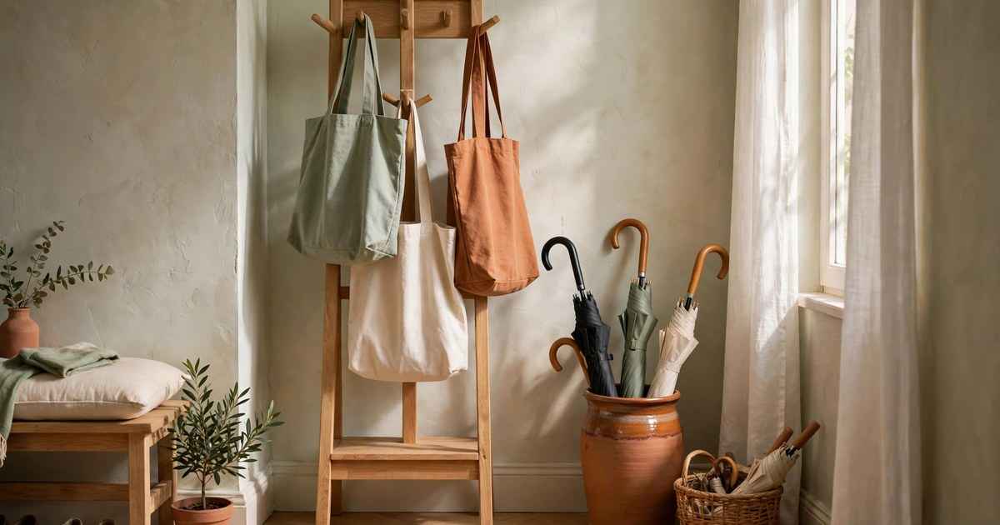
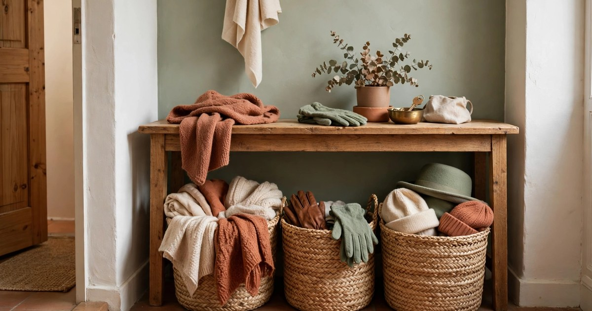
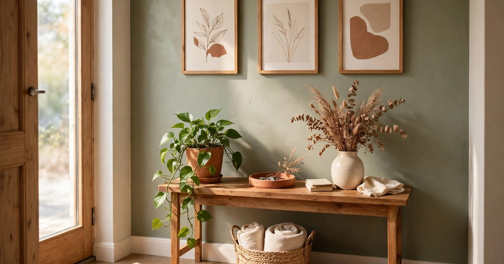

Most small apartments do not have an entryway at all. You open the front door and you are standing in the living room, the kitchen, or both at once. Shoes pile up by the door, keys migrate to the nearest flat surface, coats end up on the back of a chair, and the first thing you see when you walk in is a cluttered corner that sets the tone for the whole flat. It does not have to be that way. With a few renter-friendly moves — nothing drilled, nothing nailed, nothing that risks your deposit — you can carve a proper entryway out of a blank wall, a strip of floor, or even just a square metre of space beside the door.

An entryway has three jobs: it catches the things you carry in and out, it gives you a place to pause and get ready, and it makes the whole apartment feel intentional the moment you walk through the door. You do not need a foyer, a hallway, or a big budget to get all three. You need a defined zone, smart vertical storage, and a handful of pieces that work hard in a small footprint. Every step in this guide costs under $25, uses no tools beyond a pair of scissors, and comes off cleanly when you move out.

The ten steps below build on each other, in the order you should actually do them: define the zone first, then sort shoes, then get coats and bags off the floor, then add the mirror and light that make the space feel bigger, then finish with the small drop zones and personal touches that make it yours. You can do the whole thing in a single weekend afternoon, or one step a week as your budget allows. Either way, by the end you will have an entryway that looks like it was always there — and a landlord who will never know the difference.

### 1. Define the Zone with a Rug

An entryway starts with a boundary, and in a flat with no foyer the cheapest boundary is a rug. Lay a runner or a small rug just inside the front door and you have instantly told your brain — and everyone who visits — that this patch of floor is the entryway, not the living room. The rug catches dirt and grit before it travels into the flat, gives shoes a home, and adds the first layer of warmth and colour to a space that is usually bare walls and hard flooring. Pick a low-pile rug that a door can swing over without catching, and choose a washable one if you can: entryway rugs take the worst of muddy shoes, wet umbrellas and winter slush, and a rug you can throw in the machine will look new for years instead of months.

Size matters more than pattern. Measure the space beside your door before you buy — a rug that is too wide blocks the door swing, and one that is too small looks like a doormat that lost its way. In a typical small apartment, a runner around 60 cm wide and 120 to 150 cm long fits the strip beside most front doors, and a 90 cm square works well if the door opens onto a wider landing area. Terracotta, cream and sage tones suit the warm palette most small flats already have, and a subtle pattern hides the dirt between washes far better than a plain light rug. If your floor is dark wood or laminate, a light rug lifts the whole space; if your floor is pale, a deeper terracotta adds the contrast that makes the zone feel deliberate.

The rug also does quiet practical work that pays off every day. It protects your flooring — and your deposit — from the scuffs and grit that shoes drag in, and it gives you a soft landing for bare feet in the morning. Add a non-slip rug pad underneath and the rug will stay put on smooth floors without any tape or glue, which matters in a rental where adhesive residue can cost you money at move-out. A [washable entryway runner rug](https://www.amazon.com/s?k=washable+entryway+runner+rug&tag={{AMAZON_TAG}}) in a warm terracotta or cream pattern is the single best first purchase for a renter's entryway, usually under $25, and it is the foundation every other step in this guide builds on.

### 2. Sort Shoes with a Slim Rack or Tray

Shoes are the number-one entryway problem in a small apartment, and they are also the easiest to solve. Left loose, three pairs of shoes turn into a trip hazard that spills into the living room. Given a proper home, those same three pairs take up less than half a square metre. A slim two-tier shoe rack, a boot tray, or even a low bench with space underneath will transform the mess into something that looks tidy even when it is full. The trick is going vertical and narrow: a rack that is 60 to 80 cm wide and no more than 25 cm deep holds four to six pairs without eating into your walkway, and a second tier doubles the capacity without doubling the footprint.

Start by counting the pairs you actually wear every week, not the pairs you own. Most people rotate three or four pairs — trainers, work shoes, boots, and one smart pair — and the rest can live in a cupboard or under the bed. That honest count tells you how much rack you need, and buying the right size first time is cheaper than buying twice. A [slim stackable shoe rack](https://www.amazon.com/s?k=slim+stackable+shoe+rack+small+entryway&tag={{AMAZON_TAG}}) is ideal for renters because it assembles without tools, comes apart flat when you move, and costs less than a takeaway. If you prefer a tray, a boot tray with a raised lip catches rain, mud and snowmelt before it reaches your floor, and it is the kindest thing you can do for a landlord's laminate.

Whatever you choose, keep the top surface clear. The top of a shoe rack is prime entryway real estate — a tiny plant, a candle, or nothing at all — and the moment you pile bags and post on it, the whole zone slides back into clutter. If shoes still overflow, add a second rule alongside the rack: one pair in, one pair out. Keep a small basket beside the rack for slippers and dog leads, and put a shoehorn on a hook so nobody has to bend down and scuff the wall. In a shared flat, give each person a tier or a labelled basket, because the fastest way to keep an entryway tidy is to make it obvious whose mess is whose.

### 3. Hang Coats and Bags Without Drilling

Coats are the second entryway problem, and the renter's answer is the adhesive hook. Modern removable hooks hold far more than they used to — a good large hook takes 3 to 4 kg, which is a heavy winter coat and a tote bag — and they peel off cleanly with no holes, no filler and no repainting. The mistake most people make is using hooks that are too small for the job, then blaming the hook when a coat slides to the floor at 2 a.m. Buy hooks rated for the weight you will actually hang, follow the instructions to the letter — clean the wall with rubbing alcohol first, press firmly for thirty seconds, and wait a full hour before hanging anything — and they will hold for years.

Placement is everything. Mount hooks at two heights: a higher row at around 170 cm for coats and a lower row at around 120 cm for bags, dog leads and kids' jackets, so the lower row stays clear of the coats above. Stagger them rather than lining them up in a straight row, and the hooks look intentional rather than improvised. If your entryway wall is textured, painted with matte paint, or covered in old wallpaper, test one hook in a hidden spot first — adhesive hooks grip best on smooth, clean surfaces like gloss paint, glass, tile and metal, and struggle on rough plaster. On a stubborn wall, a freestanding coat rack is the no-risk alternative, and a [heavy duty adhesive wall hooks](https://www.amazon.com/s?k=heavy+duty+adhesive+wall+hooks+no+drilling&tag={{AMAZON_TAG}}) pack with a mix of sizes covers both coats and lighter items in one purchase.

Keep the hook count honest, too. Three hooks per person is plenty — one for a coat, one for a bag, one spare — and more than that invites a wall of clutter that defeats the purpose. Rotate coats seasonally so only the current season's outerwear lives by the door, and store the rest in a cupboard. If you share the flat, assign each person a hook colour or position. And when you move out, remove the hooks the right way: pull the tab straight down slowly, never yank the hook off the wall, and any hook that has lived on the wall for years will still leave the paint exactly as you found it.

### 4. Add a Mirror to Open the Space Up

A mirror is the single most powerful trick for a small entryway, and it costs less than almost anything else in this guide. A mirror opposite or beside a window bounces light into the darkest corner of a flat, and a mirror on the wall makes a narrow entryway feel twice as wide — which is exactly what you want in a space that is often a glorified corridor. It is also the last thing you check before you leave the house, so it earns its place on practical grounds as well as visual ones. A round mirror softens a boxy entryway, an arched mirror adds height, and a long rectangular mirror hung vertically makes a low ceiling feel taller.

Hanging a mirror without drilling is easier than it sounds. Lightweight mirrors under 2 kg hang perfectly well from a pair of large adhesive hooks or removable picture-hanging strips rated for the mirror's weight — just make sure the strips are rated for glass and mirrors, not just paper frames, and use two fixings spread apart rather than one in the middle, so the mirror cannot pivot. For heavier mirrors, lean a full-length mirror against the wall instead: a floor-length mirror propped at a slight angle behind a console table or beside the shoe rack looks deliberate, needs no fixings at all, and doubles as your outfit check. If even that feels risky, a [leaning full length mirror](https://www.amazon.com/s?k=leaning+full+length+floor+mirror+small+apartment&tag={{AMAZON_TAG}}) with a slim frame tucks into a gap as narrow as 30 cm and moves with you when you leave.

Hang the mirror at eye level — its centre around 150 to 160 cm from the floor — and think about what it reflects. A mirror that reflects a blank wall does nothing; a mirror that reflects a window, a plant, or a piece of art doubles the best thing in the room. Avoid hanging it directly opposite the front door if you can, since a mirror facing the door reflects everyone who walks in and can feel startling in a tiny space. And keep it clean: a smudged mirror in a small entryway is worse than no mirror at all, so a quick wipe with glass cleaner once a week keeps it working its magic.

### 5. Squeeze In a Slim Console Table

A console table is the piece that turns a pile of stuff by the door into an entryway, and the good news is that modern console tables are made for exactly this problem. A slim table 20 to 25 cm deep and 80 to 100 cm wide fits against the wall beside most front doors without blocking the walkway, and it gives you the one thing an entryway desperately needs: a flat surface at hand height. Keys, post, sunglasses, a phone charger, a small plant — all the things that currently migrate to the kitchen counter or the sofa — finally have a home, and a drawer or a lower shelf hides the clutter you do not want on display.

Choose a table with storage built in. A drawer is worth its weight in gold for the small things — spare keys, a torch, a lint roller, the dog's treats — and a lower shelf or an open space underneath holds a basket for scarves and gloves, or the shoe rack from Step 2 tucked neatly out of sight. A [narrow console table with drawer](https://www.amazon.com/s?k=narrow+console+table+with+drawer+small+entryway&tag={{AMAZON_TAG}}) in a warm wood or a cream finish usually costs under $50 and assembles in twenty minutes with the Allen key in the box, and it is light enough to carry to your next flat without hiring help. If even 25 cm is too deep for your space, a floating shelf mounted with adhesive brackets or a narrow wall-mounted ledge gives you the same drop surface in half the depth.

Style the top sparingly, because a console table in a small entryway has about 80 cm of surface and every object on it is competing for attention. The formula that works every time is three things: something tall at one end (a vase with dried stems, a small lamp), something flat in the middle (a tray for keys and post), and something low at the other end (a small plant, a stack of two books). Leave a third of the surface empty on purpose — that empty space is what makes the table look calm instead of crowded, and it leaves room for the parcel or the shopping bag you bring in on your way through the door.

### 6. Create a Key and Mail Drop Zone

Every lost key, every missed bill, every frantic morning search starts at the front door, and the fix is a drop zone: one small, defined place where keys, post and the things you grab on the way out always live. A shallow tray, a small bowl, or a wall-mounted pocket on the console table is all it takes, and the rule is simple — if it fits in the tray, it lives in the tray; if it does not, it does not live in the entryway at all. The tray stops keys from migrating to the kitchen counter, the sofa arm, and the pocket of the coat you wore yesterday, and it stops unopened post from forming a pile that slowly colonises the whole table.

A tray with a lip is better than a flat dish, because it keeps small things contained and makes the whole arrangement look intentional rather than accidental. Ceramic, wood and woven trays all work, and a [small entryway key tray](https://www.amazon.com/s?k=small+entryway+key+tray+catchall&tag={{AMAZON_TAG}}) in terracotta or natural wood ties the drop zone into the warm palette of the rest of the entryway for a few pounds. Put the tray where your hand naturally lands when you walk in — usually the end of the console table nearest the door — and add a tiny hook or a magnetic strip on the wall beside it for the one set of keys you reach for every single day, so you can grab them without even looking.

Post needs its own rule, because post is the clutter that arrives daily and never leaves on its own. Give it a small vertical sorter, a magazine holder, or a single wall pocket, and process it the same day: open it, deal with it, recycle the junk, and file the rest. Anything that sits in the entryway for more than a week is not being stored, it is being ignored, so a weekly clear-out of the drop zone — thirty seconds every Sunday — keeps the whole entryway honest. If you share the flat, give each person a slot in the sorter or a coloured tray, because shared drop zones only work when everyone can see at a glance what is theirs.

### 7. Light It Up Without an Electrician

Most small-apartment entryways are dark. They sit beside the front door, away from the windows, under a single ceiling bulb that either does not exist or casts a cold, flat light over everything. Good light changes the whole space: it makes the mirror work, it makes the colours warm, and it makes the entryway feel welcoming instead of gloomy at 6 p.m. in winter. And you do not need an electrician, a wired fitting, or landlord permission to get it. Battery-operated lights, plug-in lamps and rechargeable sconces have become genuinely good in the last few years, and they are made for renters.

The easiest win is a battery-operated wall sconce mounted with adhesive strips beside or above the mirror. Modern LED sconces run for weeks on a set of batteries, give off a warm 2700K glow that flatters skin and terracotta alike, and many come with a remote control or a motion sensor, so the light switches itself on when you walk in with your hands full of shopping. A pair of [battery operated wall sconces](https://www.amazon.com/s?k=battery+operated+wall+sconce+warm+light&tag={{AMAZON_TAG}}) flanking the mirror is the classic look, and at under $25 for the pair it is one of the cheapest transformations in this guide. If you would rather have a lamp, a small table lamp on the console table does the same job and needs only a socket — and in a rental, a lamp you can carry to the next flat beats a fitting you leave behind.

Light temperature matters more than brightness. Warm white light (2700K to 3000K) makes a small entryway feel cosy and makes wood, terracotta and cream look their best; cool white light (4000K and above) makes the same space feel like a hospital corridor. Check the bulb or the product listing before you buy, and keep the brightness gentle — an entryway needs a glow, not a floodlight. If your entryway has no socket at all, a rechargeable LED puck light stuck inside a basket or under the console shelf adds a soft pool of light exactly where you need it, and charges from a USB cable overnight.

### 8. Give Bags and Umbrellas a Home

Bags and umbrellas are the entryway items that never have a home, so they end up on the floor, on the shoe rack, or draped over the nearest chair — and once one bag lands on the floor, every bag follows. The fix is a dedicated spot that is easier to use than the floor. A freestanding coat rack with pegs at different heights takes coats, bags and hats in one piece of furniture, needs no fixings at all, and moves with you when you leave. If floor space is too tight for a rack, a row of adhesive hooks at bag height, a single sturdy hook on the back of the front door, or a small wall-mounted rail does the same job in almost no space.

Umbrellas deserve their own solution, because a wet umbrella leaning against the wall leaves a mark on the paint and a puddle on the floor — both things a landlord notices. A tall, narrow umbrella stand beside the door, or a boot tray with a raised lip that doubles as an umbrella tray, catches the drips and keeps the umbrella upright and easy to grab on the way out. A [freestanding coat rack with umbrella stand](https://www.amazon.com/s?k=freestanding+coat+rack+with+umbrella+stand+small+entryway&tag={{AMAZON_TAG}}) combines both jobs in one footprint, usually for under $40, and it is the single piece of furniture that most reduces entryway floor clutter in a small flat.

Keep the rule simple: one bag per person by the door, and the rest live in a cupboard. Tote bags multiply silently, and a hook with five totes on it looks like a laundry pile. Fold the spares and store them in the basket under the console table, and keep only today's bag on the hook. The same goes for umbrellas — one each, plus a compact folding umbrella in the drawer for emergencies. A small basket on the floor beside the rack catches the extras — reusable shopping bags, the dog lead, a scarf that is too bulky for a hook — and because the basket has a boundary, the extras stop spreading.

### 9. Add Hidden Storage with Baskets

Every small entryway has a category of stuff that has no proper home: scarves, gloves, hats, the dog lead, reusable bags, the spare phone charger, the thing you bought and have not found a place for yet. Baskets are the answer, because they hide clutter in plain sight. A woven basket under the console table, a lidded basket beside the shoe rack, or a set of small baskets on the console shelf turns a visible mess into a tidy arrangement that actually looks like decor. The basket is the renter's best friend: it needs no installation, it costs a few pounds, and it moves to the next flat with everything inside it.

Choose baskets that fit the space, not the other way round. Measure the gap under your console table or on your shelf before you buy, and leave a centimetre or two of breathing room so the basket slides in and out without scraping the wall. Seagrass, jute and cotton rope baskets suit the warm terracotta and cream palette of a renter's entryway, and a [seagrass storage baskets set](https://www.amazon.com/s?k=seagrass+storage+baskets+set+small&tag={{AMAZON_TAG}}) in two or three sizes gives you one for scarves, one for hats and gloves, and one for the miscellaneous bits, all matching. Lidded baskets are best for the things you do not want to see, and open baskets are best for the things you grab daily, because a lid is one extra step between you and the door when you are already late.

Label the baskets if you share the flat, or if you simply want to stop opening three baskets to find your gloves. A luggage tag, a wooden tag, or a simple paper label tied to the handle is enough — the point is that the system is obvious to anyone who walks in, including future-you at 7 a.m. And keep the basket rule ruthless: if a basket is overflowing, something in it needs to leave the entryway, not get a bigger basket. One basket per category, emptied and re-sorted with the seasons, is the difference between hidden storage and a hiding place for clutter.

### 10. Finish with Personal Touches

The last step is the one that turns a functional entryway into your entryway. A piece of art, a framed photo, a small plant, a vase of dried stems — these are the things that make the space feel like home rather than a storage zone, and they are also the cheapest step in the whole guide, because you probably already own most of them. A framed print hung with removable picture strips, a postcard taped to the wall with washi tape, or a photo in a small frame on the console table all work, and all come down cleanly when you move. The rule for a small entryway is one statement piece and one or two small accents — a gallery wall in a space this size reads as clutter, but a single framed print above the console table reads as intention.

Plants are the easiest living touch. A small pothos trailing from the console shelf, a snake plant in a terracotta pot on the floor beside the shoe rack, or a faux eucalyptus stem in a vase if your entryway gets no light at all — any of these adds the green that makes terracotta and cream feel alive. If your entryway is dark, choose a plant that tolerates low light, or go faux without apology: a good faux stem in a real vase fools everyone and never needs watering. A [small potted pothos plant](https://www.amazon.com/s?k=small+potted+pothos+plant+indoor&tag={{AMAZON_TAG}}) in a terracotta pot is the classic renter's entryway plant, cheap, forgiving, and happy on a shelf with almost no light.

Finally, add one thing that is purely for you — not for storage, not for function, just because you like looking at it. A candle you light when you get home, a small bowl of potpourri, a print from a trip you loved, a tiny dish from a market stall. That one object is what makes you smile when you walk through the door, and it is what your visitors remember. Keep it small, keep it to one, and keep the rest of the surface clear. An entryway that works hard and still has room for one beautiful, useless thing is an entryway that is finished — and it cost you less than a night out, with nothing drilled, nothing damaged, and everything ready to pack into a box when your lease ends.

## Frequently Asked Questions

### How do I create an entryway in an apartment with no foyer?

Start with a rug. Lay a runner or a small rug just inside the front door and you have defined the entryway zone without building anything. Then add a slim shoe rack, a row of adhesive hooks, and a narrow console table against the nearest wall. Those four pieces — rug, shoes, hooks, table — create a foyer in a flat that never had one, and every piece is renter-friendly and removable.

### Can I hang things in a rental entryway without drilling?

Yes. Large removable adhesive hooks hold 3 to 4 kg each, which covers coats, bags and mirrors under 2 kg, and removable picture-hanging strips hold frames and light mirrors. Clean the wall with rubbing alcohol first, press firmly for thirty seconds, and wait an hour before hanging anything. On textured or matte-painted walls, test one hook in a hidden spot first, and use a freestanding coat rack or a leaning mirror as a no-risk alternative.

### What is the best shoe storage for a small apartment entryway?

A slim two-tier shoe rack 60 to 80 cm wide and no more than 25 cm deep is the best all-rounder: it holds four to six pairs without blocking the walkway, assembles without tools, and comes apart flat when you move. A boot tray with a raised lip is the best choice if you deal with rain or snow, because it catches drips before they reach the floor. Keep only the three or four pairs you wear weekly by the door and store the rest elsewhere.

### How can I make a narrow entryway feel bigger?

Use a mirror and warm light. A mirror on the wall opposite or beside a window bounces light into the space and makes a narrow entryway feel twice as wide — hang it at eye level, with its centre around 150 to 160 cm from the floor. Add a battery-operated wall sconce or a small table lamp in warm white light (2700K to 3000K), keep the console table surface mostly clear, and choose a light-coloured rug. Together, light, reflection and empty space do more than any piece of furniture.

### What should I put on a small entryway console table?

Three things, and no more. Something tall at one end, such as a vase with dried stems or a small lamp; something flat in the middle, such as a tray for keys and post; and something low at the other end, such as a small plant or a stack of two books. Leave a third of the surface empty on purpose — that empty space is what makes the table look calm instead of crowded, and it leaves room for the parcel you bring in on your way through the door.

### How do I keep a small entryway tidy long-term?

Give everything a home and enforce a one-in, one-out rule. One pair of shoes in for every pair that goes to the cupboard, one coat per hook, one bag per person by the door. Process post the day it arrives, rotate coats and scarves with the seasons, and spend thirty seconds every Sunday clearing the drop zone and the console table. A tidy entryway is not about buying more storage — it is about keeping the amount of stuff in the entryway smaller than the storage you have.
