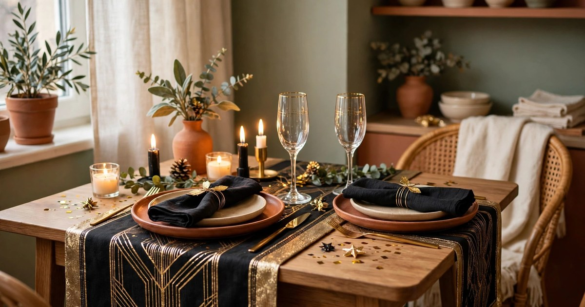
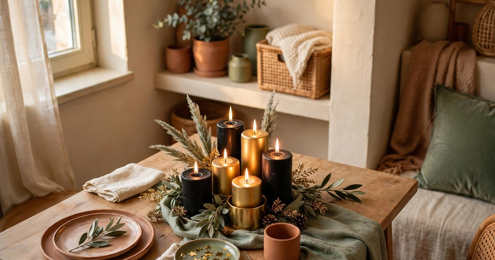
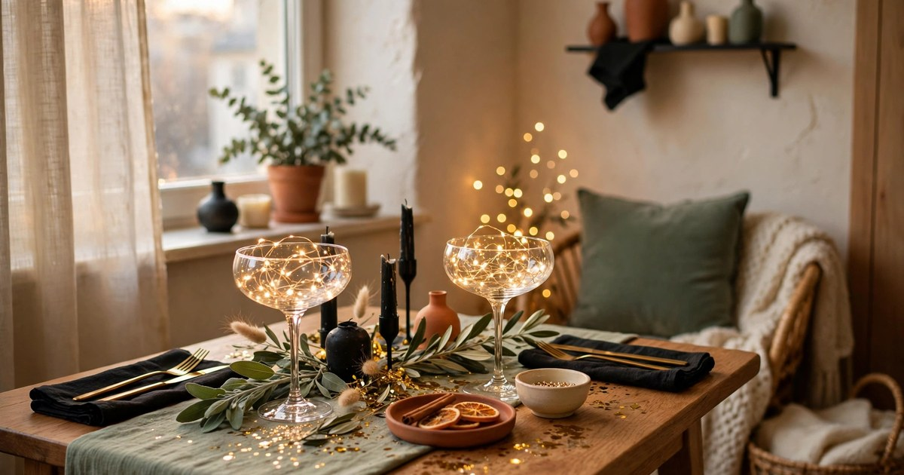
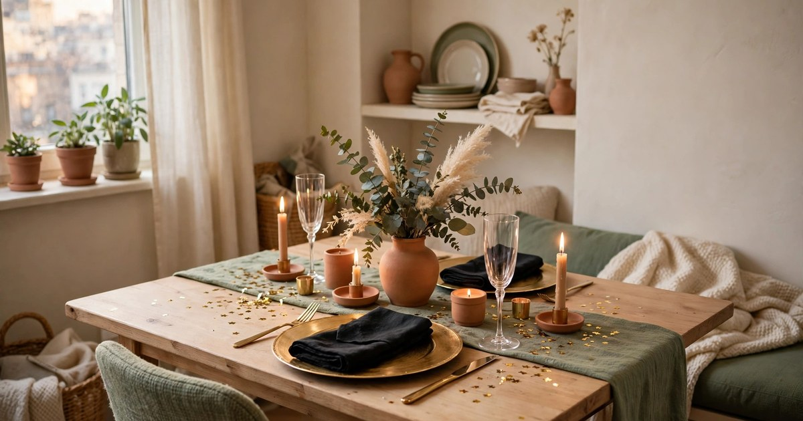
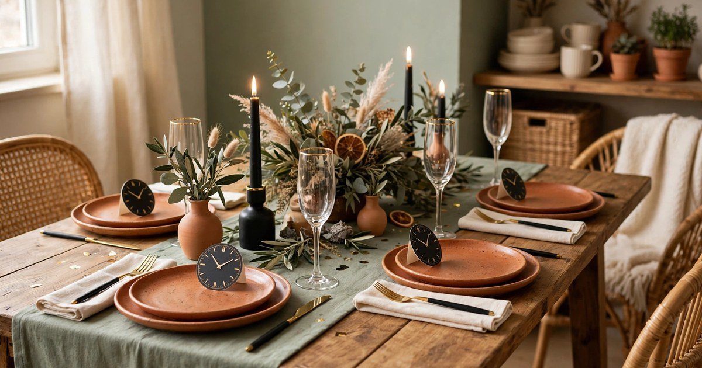
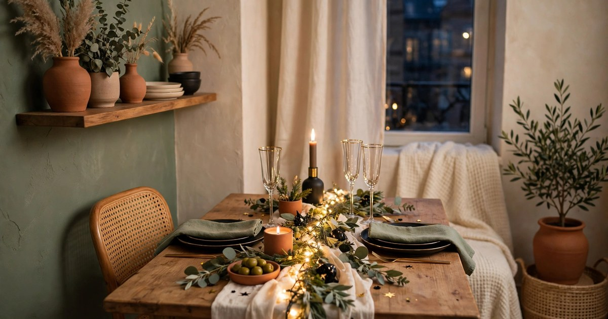
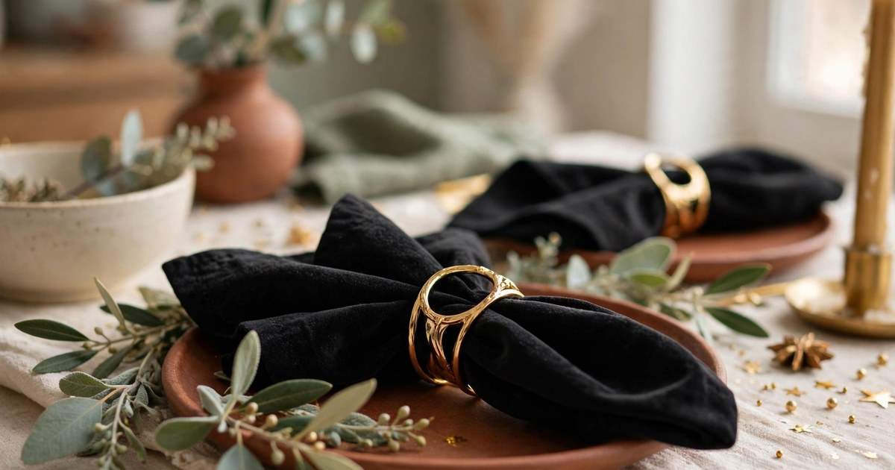
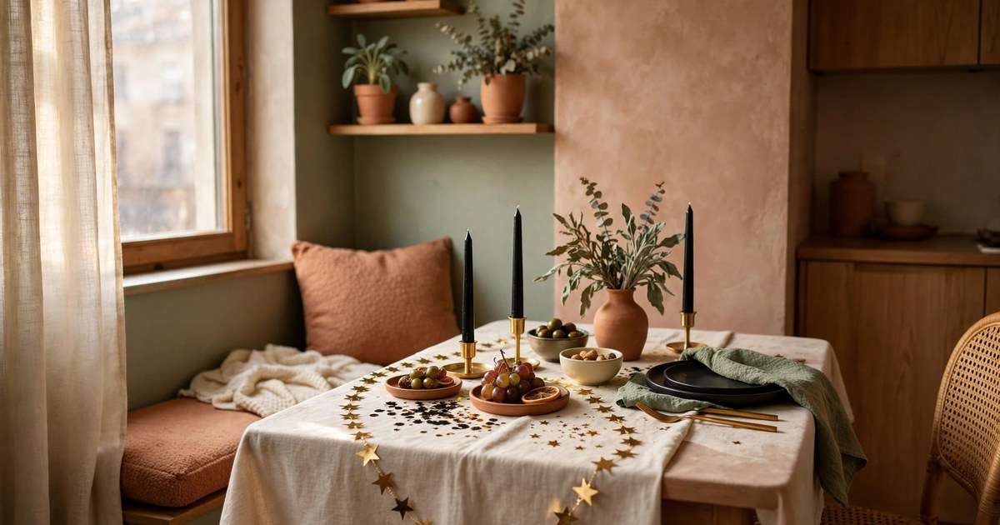
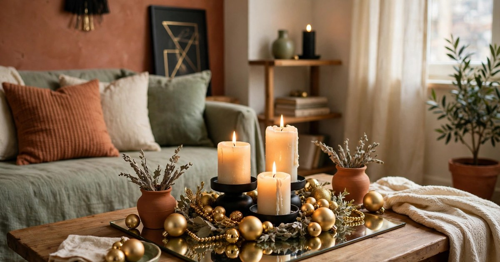
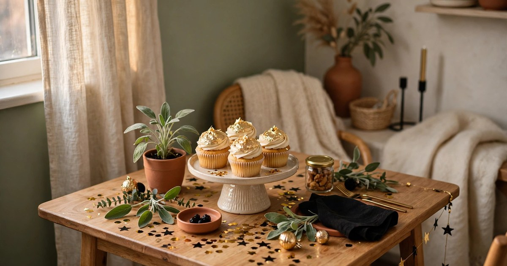

New Year's Eve is the easiest party of the year to decorate for, because the whole look is black, gold and candlelight — three things that cost almost nothing and need no drilling, no nails and no damage to a rented flat. A small table dressed in black and gold looks like a celebration, not a compromise, and every idea here packs away into a single box in January.

The palette does the heavy lifting, so keep it strict: black, gold, cream and one metallic accent, and nothing else. A table that sticks to two colours and candlelight looks expensive; a table with five colours and tinsel looks like a clearance sale. Work through these ten ideas, pick the five or six that suit your table, and leave the rest for next year. Everything here is removable, washable and landlord-proof.

### 1. The Black and Gold Table Runner

A black table runner with a gold edge is the fastest way to turn an ordinary table into a New Year's Eve table. It sets the colour scheme for everything else, protects a rented table from candle wax and spilled drinks, and folds away flat in January. Look for a runner in black velvet, satin or even heavy cotton — velvet reads as the most luxurious, but a $12 satin runner photographs beautifully under candlelight.

Measure before you buy: the runner should hang 15 to 30 centimetres over each end of the table, which for a small two- or four-seater usually means 180 centimetres or under. If you already own a plain black runner, add a narrow gold ribbon down the centre instead of buying a new one. Keep the runner flat and iron it the day before, because a creased runner is the first thing guests notice and the easiest thing to fix.

### 2. The Metallic Candle Cluster

Candles are the centrepiece, and a cluster beats a single candlestick every time. Group five to seven candles of different heights — gold pillars, black tapers, cream votives — down the centre of the table on a tray or a heatproof plate, and the table glows from within. The varying heights create depth, the tray catches the wax, and the whole arrangement costs less than a single bought centrepiece.

Use battery candles for the tallest tapers if you are nervous about flames near a tablecloth, and keep real flames in sturdy glass holders that cannot tip. Never place a candle directly on a rented table or a fabric runner — a plate, a tray or a thick folded cloth underneath is non-negotiable. Light the candles just before guests arrive so they burn down evenly, and keep a spare set of matches on the table for relighting.

### 3. The Champagne Coupe Centrepiece

A champagne coupe filled with fairy lights is the prettiest centrepiece on this list and one of the cheapest. Fill two or three vintage-style coupes or wine glasses with a short string of battery fairy lights, and they glow like captured starlight down the middle of the table. The glasses catch the light, the lights catch the gold, and the whole table sparkles without a single decoration bought for the purpose.

Use glasses you already own — charity shops sell coupes for $1–2 each — and coil the lights loosely so they fill the bowl without bulging over the rim. Battery fairy lights cost $3–5 a string and last for several parties, so buy warm white rather than cool white: warm light flatters the gold palette, cool light makes it look like a fridge. Tuck a sprig of evergreen or a single gold bauble beside each glass to finish the look.

### 4. Gold Charger Plates and Black Napkins

Charger plates are the rental decorator's secret weapon: they make a plain table setting look like a restaurant, they cost $2–3 each in gold plastic or thin metal, and they protect a rented table from hot plates at the same time. Layer a gold charger under a plain white or black dinner plate, add a black cloth napkin folded simply on top, and the place setting is done before a single decoration goes on the table.

Plastic chargers are light, cheap and washable, which makes them better for a small flat than heavy metal ones that chip and dent. Buy one per guest plus one spare, and store them flat in a drawer with a sheet of tissue between each one so they do not scratch. Black napkins hide stains better than white ones, which matters at midnight, and a simple fold — a rectangle, a triangle, a loose roll — looks better than a complicated swan.

### 5. Clock-Face Place Cards

Place cards shaped like little clock faces are the detail guests photograph, and they cost nothing but card and a pen. Cut small circles of black or gold card, draw a clock face showing midnight, write each guest's name underneath, and prop each one against a glass or tuck it into a napkin fold. They tell guests where to sit, they mark the occasion, and they give the table a handmade touch that no bought decoration can match.

Make them the day before so the ink is dry and the edges are neat, and keep the design simple — a circle, two hands pointing to twelve, a name. If your handwriting is not your strong point, print the names in a simple font and cut around them. Guests take their clock cards home as keepsakes, which is the best possible ending for a piece of table decor.

### 6. Fairy Lights Down the Table

A string of warm fairy lights run loosely down the centre of the table, weaving between the candles and the glasses, is the easiest decoration on this list and one of the most effective. It needs no arranging skill, it lights the food, and it makes every glass and gold surface on the table catch the light. Use one string for a small table and two for a longer one, and keep the battery pack hidden under a napkin or behind a candle.

Battery lights are the only sensible choice on a dining table — mains lights mean a cable across the room and a trip hazard. Choose lights with a timer function so they switch off by themselves at 2 a.m. if you forget, and tape the battery pack to the underside of the table with removable tape so it does not slide off mid-toast. Warm white is essential; cool white fairy lights make food look grey.

### 7. Velvet Napkins with Gold Rings

Velvet napkins in black or deep burgundy with a simple gold napkin ring turn an ordinary place setting into a celebration, and they are far cheaper than they look. A set of four velvet napkins costs $8–12, gold napkin rings cost $1–2 each, and both wash and store flat for next year. The velvet texture against a gold charger is the tactile detail that makes guests feel the evening is special before they have eaten anything.

If velvet napkins are beyond the budget, use plain black cotton napkins with a gold ribbon tied in a simple bow — the effect is almost the same and the ribbon costs pennies. Fold the napkin into a loose roll and thread it through the ring rather than folding it flat; a rolled napkin stands up on the plate and adds height to the setting. Keep one spare napkin and ring on the side table for the guest who arrives with a plus-one.

### 8. The Star Garland Across the Table

A gold star garland draped in a loose curve across the table, or hung from a shelf behind it, adds the party feeling that candles alone cannot. Buy a paper or foil star garland for $3–5, or cut stars from gold card and thread them on string in ten minutes. The garland should drape, not lie flat — hang it from two removable adhesive hooks on the wall behind the table, or lay it in a shallow curve across the table itself between the plates.

Paper garlands are light enough for adhesive hooks and cheap enough to replace every year, which makes them ideal for a rental. Avoid anything that needs pins or tape on painted walls, and keep foil garlands away from candles — foil conducts heat and paper burns, so the garland belongs on the wall or the table edge, never next to a flame. Take it down on New Year's Day and store it flat in a folder so it survives for next year.

### 9. The Mirror Tray Centrepiece

A mirror tray under the candle cluster doubles the candlelight, because every flame reflects in the glass and the table looks twice as bright. A rectangular mirror tray costs $10–15, or you can make one from a cheap picture frame with the glass left in and the backing removed. Set the candles, a few gold baubles and a sprig of evergreen on the tray, and the centrepiece is finished in one move.

The tray also protects the table from wax and heat, which is the practical reason to use one in a rental. Keep the tray to the centre third of the table so plates and glasses still have room, and wipe it with glass cleaner before guests arrive — a smeared mirror reflects smears. If you cannot find a mirror tray, a large gold or black serving tray does the same job with slightly less sparkle.

### 10. The Midnight Dessert Display

End the evening with a dessert display that doubles as decoration: a cake stand or a stack of two plates holding gold-topped cupcakes, chocolate truffles or a small pavlova, placed in the centre of the table where the candles were. It gives guests something to look at during the countdown, it saves you serving dessert separately, and it photographs beautifully at midnight.

Build the display on a cake stand you already own, or stack a dinner plate on top of an upturned bowl for a makeshift stand. Keep the desserts small and finger-food sized so nobody needs a plate and a fork at midnight, and add a few gold sprinkles or edible glitter for the New Year's Eve sparkle. Clear the candle cluster to the side table before the countdown so the dessert display has the centre of the table to itself.

## Frequently Asked Questions

### What colours work best for a New Year's Eve table in a rental?

Black, gold, cream and one metallic accent. The strict palette is what makes a small table look expensive rather than cluttered, and black and gold decorations are cheap, widely available and easy to store for next year. Avoid adding extra colours — tinsel in five colours is what makes a table look like a clearance sale.

### How do I decorate a New Year's Eve table without damaging my rental?

Use a tablecloth or runner to protect the table, candles on trays or plates, battery fairy lights instead of mains lights, and removable adhesive hooks for any garland on the wall. Nothing on this list needs drilling, nailing or tape on painted surfaces.

### What is the cheapest New Year's Eve table decor?

Candles and fairy lights. A cluster of candles in different heights and a string of warm battery fairy lights down the table cost under $15 together and create more atmosphere than any bought centrepiece. Clock-face place cards made from card and a pen cost nothing at all.

### How do I make a small table look festive rather than crowded?

Pick five or six ideas from this list, not all ten, and keep everything in the centre third of the table so plates and glasses have room. One centrepiece, one light source and one place-setting detail are enough — the rest is clutter.
