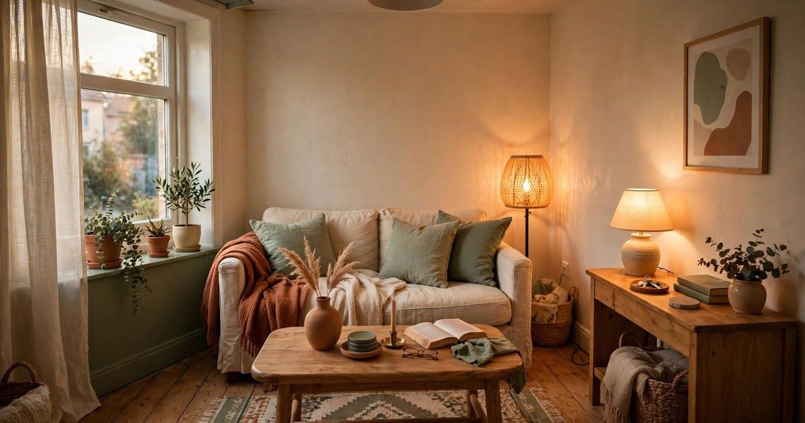
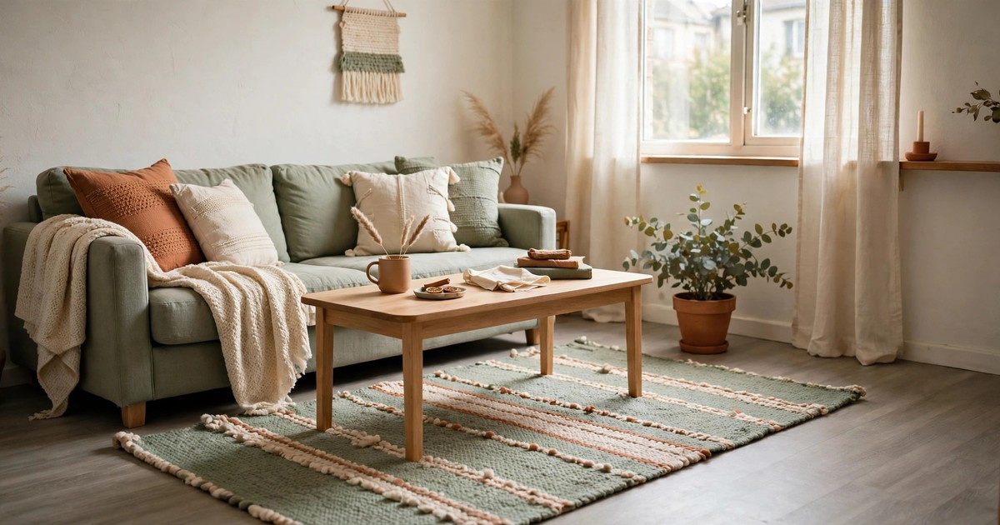
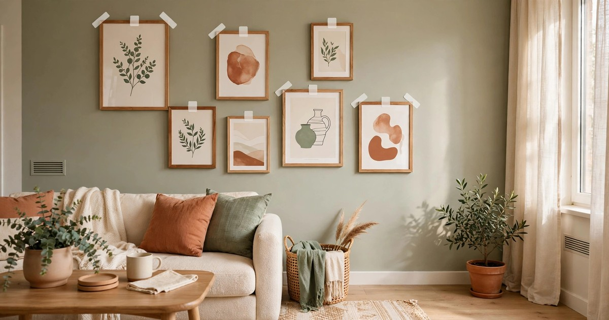
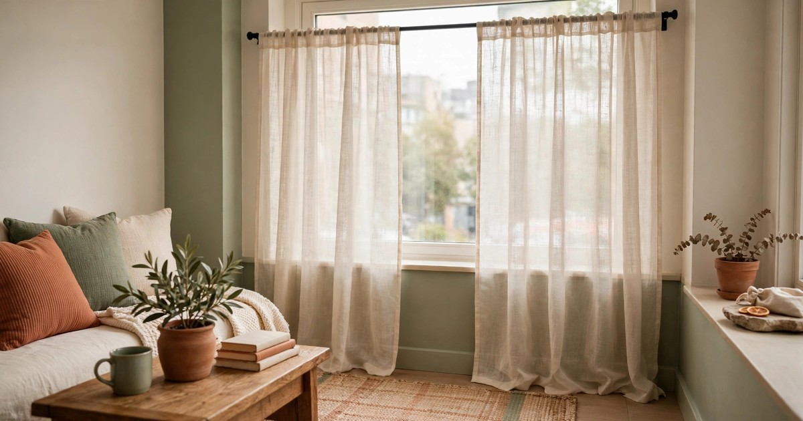
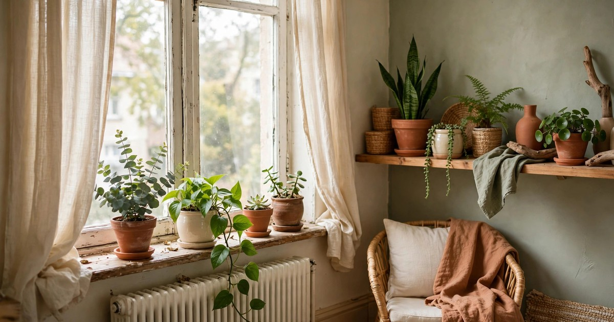
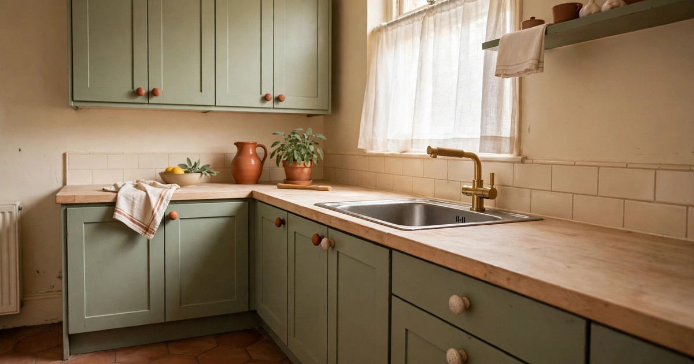
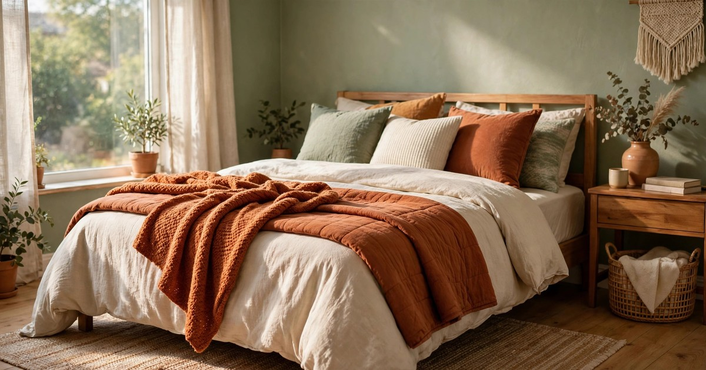
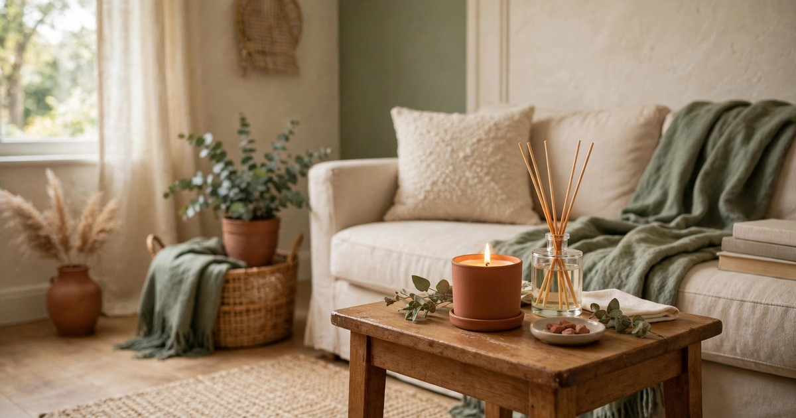
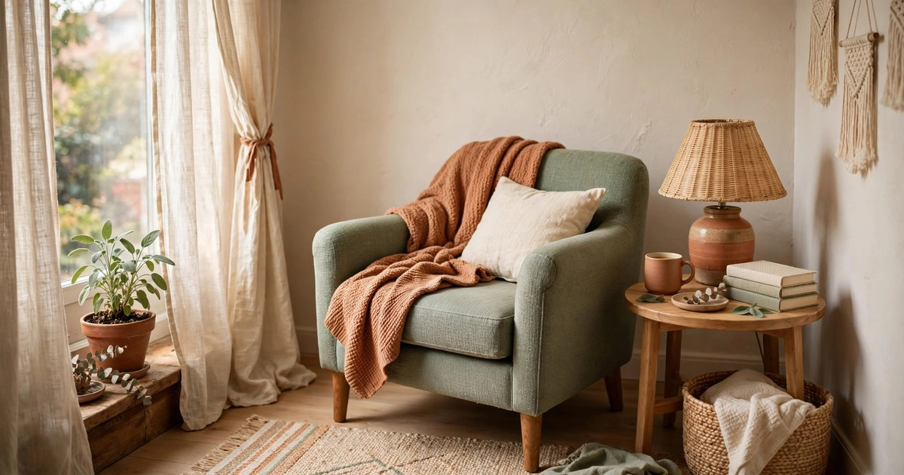
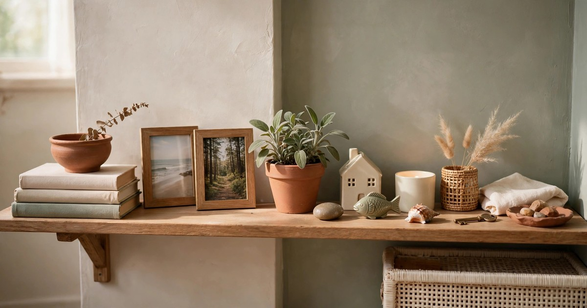

There is a particular feeling to a rental that has not been made yours yet: white walls, a landlord's sofa, a blankness that makes you live out of suitcases in your head even when your clothes are in the wardrobe. It is not the size or the layout that makes a rental feel temporary — it is the absence of your choices in it. And the fix is not a renovation. It is a series of small, reversible decisions that add up to a place that feels like yours the moment you walk in.

Every idea in this list passes the same three tests: it is removable without a trace, it costs very little, and it makes a real difference to how the flat feels rather than just how it looks. None of them needs your landlord's permission, and all of them come with you when you move. Start with the one that bothers you most — the blank wall, the harsh light, the cold floor — and work through the rest over a few weekends. A rental becomes a home one decision at a time.

### 1. Layer Lighting Until the Overhead Light Is Optional

The single fastest way to make a rental feel like home is to stop using the ceiling light. Overhead lighting in rentals is almost always harsh, cold, and positioned to light the room like an office. A floor lamp in the corner, a table lamp on a sideboard, and a string of warm fairy lights turn the same room into somewhere you actually want to spend an evening — and every one of them plugs in and leaves with you.

Aim for three light sources at different heights: one low (a table lamp), one mid (a floor lamp), and one warm accent (fairy lights, a candle-style lamp, or a salt lamp). Use warm-white bulbs, around 2700K, which read as candlelight rather than office light. The difference is dramatic enough that most renters say it is the one change they would do first if they started again.

Find it on Amazon: [warm white floor lamp for living room](https://www.amazon.com/s?k=warm+white+floor+lamp+living+room&tag={{AMAZON_TAG}})

### 2. Put Something Soft Under Your Feet

Rental floors are usually the cheapest option the landlord could find: cold laminate, thin carpet, or tiles that echo. A rug changes the whole feeling of a room in the time it takes to unroll it — it warms the floor, deadens the echo, defines the seating area, and adds the first layer of colour and pattern. It is also the largest single piece of "your taste" you can put in a room without touching a wall.

Go bigger than you think: a rug that sits under the front legs of the sofa and the chairs, rather than floating in the middle, makes the seating area feel intentional and the room feel larger. Layer a smaller patterned rug over a larger plain one if you want the look without the price of a big statement rug. And in a bedroom, a rug beside the bed means your feet never touch cold floor first thing in the morning — a small luxury that changes how a rental feels every day.

Find it on Amazon: [large area rug for living room washable](https://www.amazon.com/s?k=large+area+rug+living+room+washable&tag={{AMAZON_TAG}})

### 3. Hang Art With Removable Strips — Lots of It

Blank walls are the biggest reason a rental feels temporary, and they are also the easiest thing to fix. Removable adhesive strips hold framed prints, canvases and even light mirrors without a single hole, and they come off cleanly when you move — provided you follow the instructions and use the right weight rating for each frame.

Do not stop at one picture. A gallery wall of six or eight prints, mixed sizes, hung in a loose grid above the sofa, has ten times the impact of a single frame, and it is the single most personal thing you can put in a room: your photos, your prints, your taste. Start with what you already own — prints from old calendars, postcards, photos in cheap frames — and add to it over time. The wall that shows what you love is the wall that makes a rental yours.

Find it on Amazon: [picture hanging strips removable no damage](https://www.amazon.com/s?k=picture+hanging+strips+removable&tag={{AMAZON_TAG}})

### 4. Dress the Windows

Most rentals come with the cheapest possible window treatment: a flimsy blind, or nothing at all. Curtains change a room more than almost anything else — they soften hard edges, add colour and texture, improve privacy, and make a room feel finished in a way that blinds never do. And they need no drilling: a tension rod fits inside the window frame, and removable adhesive hooks hold a rod on the wall above it.

Hang the curtains high and wide — the rod a few inches above the window frame and extending past it on both sides — so the window looks bigger and the curtains frame it rather than covering it. Sheer linen-look curtains let light through while giving privacy; heavier curtains in winter add warmth and cut draughts. Either way, the moment curtains go up, a rental stops looking like a show flat and starts looking like a home.

Find it on Amazon: [tension rod for curtains no drilling](https://www.amazon.com/s?k=tension+rod+curtains+no+drill&tag={{AMAZON_TAG}})

### 5. Add Plants — Real Ones if You Can

A plant is the cheapest living thing you can put in a rental, and it does something no object can: it makes a room feel alive and cared for. A trailing pothos on a shelf, a snake plant in the corner, a small herb pot on the windowsill — each one adds green, softens a hard corner, and gives you something to tend, which is itself a way of putting down roots in a place that is not technically yours.

If you are worried about killing them, start with the unkillable three: pothos, snake plant, and ZZ plant, all of which survive low light and forgotten watering. Put them where you will see them daily — the kitchen windowsill, beside the sofa, on the desk — because a plant you see is a plant you remember to water. And if real plants genuinely will not survive your schedule, good faux plants in real pots still add the green and the softness, and nobody checks.

Find it on Amazon: [pothos plant in pot low light indoor](https://www.amazon.com/s?k=pothos+plant+in+pot+indoor&tag={{AMAZON_TAG}})

### 6. Swap the Hardware You Touch Every Day

Cabinet knobs, drawer pulls, and even a shower head are the things your hands touch dozens of times a day, and in a rental they are usually the cheapest, most worn-out version available. Swapping them is a five-minute job with a screwdriver, it is fully reversible — keep the originals in a labelled bag and put them back when you leave — and it changes how the kitchen and bathroom feel out of all proportion to the cost.

Pick one finish and use it everywhere: matte black, brushed brass, or warm wood all work, and consistency is what makes it look intentional rather than random. A matching set of knobs across the kitchen, plus a new shower head that actually gives decent pressure, costs less than a takeaway for two and is the upgrade renters most often say they wish they had done on day one.

Find it on Amazon: [matte black cabinet knobs pack](https://www.amazon.com/s?k=matte+black+cabinet+knobs+pack&tag={{AMAZON_TAG}})

### 7. Make the Bed Feel Like Yours

You spend a third of your life in bed, and in a rental the bed is often a landlord's mattress with the cheapest bedding. Layering is the fix: a mattress topper for comfort, bedding in a colour you chose, a throw folded across the foot, and two or three cushions that make the bed look made rather than just slept in. It costs less than most people expect and it changes both your sleep and how the bedroom feels.

The topper is the highest-impact piece — a two-inch memory foam topper turns a hard rental mattress into a comfortable one for the price of a dinner out, and it rolls up and moves with you. After that, choose bedding in a colour you love rather than the default white, because the bed is the largest surface in the bedroom and its colour sets the mood of the whole room.

Find it on Amazon: [memory foam mattress topper twin full](https://www.amazon.com/s?k=memory+foam+mattress+topper&tag={{AMAZON_TAG}})

### 8. Give Every Room a Scent

Smell is the sense most tied to the feeling of home, and it is the one renters most often ignore. Every rental has a smell when you move in — usually a mix of fresh paint, old carpet, and the previous tenant's cooking — and the fastest way to replace it with yours is a consistent scent: the same candle, diffuser, or wax melt in the rooms you use most. Within a week, that scent is what home smells like to you.

Pick one scent and stick to it rather than a different one in every room; consistency is what builds the association. Reed diffusers are the lowest-effort option — they work for weeks with no flame and no attention — while a candle on the coffee table doubles as a light source in the evening. Just keep candles away from curtains and never leave them burning unattended.

Find it on Amazon: [reed diffuser home fragrance long lasting](https://www.amazon.com/s?k=reed+diffuser+home+fragrance&tag={{AMAZON_TAG}})

### 9. Create One Proper Ritual Corner

A home is not just a place you sleep; it is a place where you do the things that make you you. Carve out one corner — it only needs a chair, a small table, and a light — and dedicate it to one ritual: morning coffee, evening reading, journaling, or just sitting with your phone off for ten minutes. A corner with a purpose feels like yours in a way that a whole room full of furniture does not.

The pieces do not need to match or be expensive. A second-hand armchair, a small side table for your mug, a lamp that throws warm light, and a basket for your book or knitting are enough. The point is that the corner is yours and it is used daily; a used corner is a lived-in corner, and a lived-in corner is what makes a rental stop feeling like a waiting room.

Find it on Amazon: [small side table for living room round](https://www.amazon.com/s?k=small+side+table+living+room+round&tag={{AMAZON_TAG}})

### 10. Display the Things That Are Unmistakably You

The final step is the most personal and the cheapest: put your things where you can see them. The books you actually read, the photos of your people, the souvenir from a trip, the mug you always reach for — displayed on a shelf, a sideboard, or a windowsill, not hidden in a box because "it is only a rental." The things that tell your story are the things that make a space yours, and hiding them is what keeps a rental feeling temporary.

A single shelf is enough to start: a floating shelf on removable brackets, or the top of a bookcase, arranged with three or four objects that mean something to you. Rotate them when you get bored. The goal is not a showroom; it is a room that could not belong to anyone else, because nobody else has your books, your photos, and your memories.

Find it on Amazon: [floating shelf no drill adhesive brackets](https://www.amazon.com/s?k=floating+shelf+no+drill+adhesive&tag={{AMAZON_TAG}})

## Frequently Asked Questions

### How can I make a rental feel like home without losing my deposit?

Stick to changes that are fully removable: adhesive hooks and strips instead of nails, tension rods instead of drilled curtain rods, freestanding furniture instead of fitted pieces, and anything you can unscrew and restore. Keep the original hardware in a labelled bag, photograph everything before you change it, and check your lease for the one or two things it actually forbids — usually painting and structural changes.

### What is the cheapest way to make a rental feel cozy?

Warm lighting is the cheapest and highest-impact change: a floor lamp and a table lamp with warm-white bulbs cost less than $30 together and transform a room more than any single piece of furniture. After that, a rug and a throw blanket add warmth and texture for very little money.

### Can I hang things on rental walls without nails?

Yes — removable adhesive strips and hooks hold frames, canvases, mirrors and lightweight shelves, and they remove cleanly if you follow the instructions and respect the weight rating. For heavier items, lean large frames against the wall on a sideboard or the floor, which looks intentional and needs no fixing at all.

### How do I personalize a rental with white walls I cannot paint?

Work with layers instead of paint: textiles, art, plants, and lighting all add colour and personality without touching the walls. A large rug, colourful cushions, a gallery wall on adhesive strips, and warm lamps together can make white walls disappear as a feature — they become a backdrop for your things rather than the room's defining feature.

### Should I ask my landlord before decorating a rental?

You do not need permission for anything removable, but it is worth asking about the two things that sometimes need it: painting (even one accent wall) and swapping fixtures like taps or light fittings. Many landlords say yes to improvements that add value, especially if you offer to restore them or leave them in place — ask in writing and keep the reply.

### How much should I budget to make a rental feel like home?

Most renters can transform the feeling of a flat for $100–200 spread over a few months: lighting ($30), a rug ($40–60), adhesive strips and frames ($20), and bedding or a throw ($30). You do not need to do it all at once — one change a month is enough, and the flat will feel more like home after each one.
