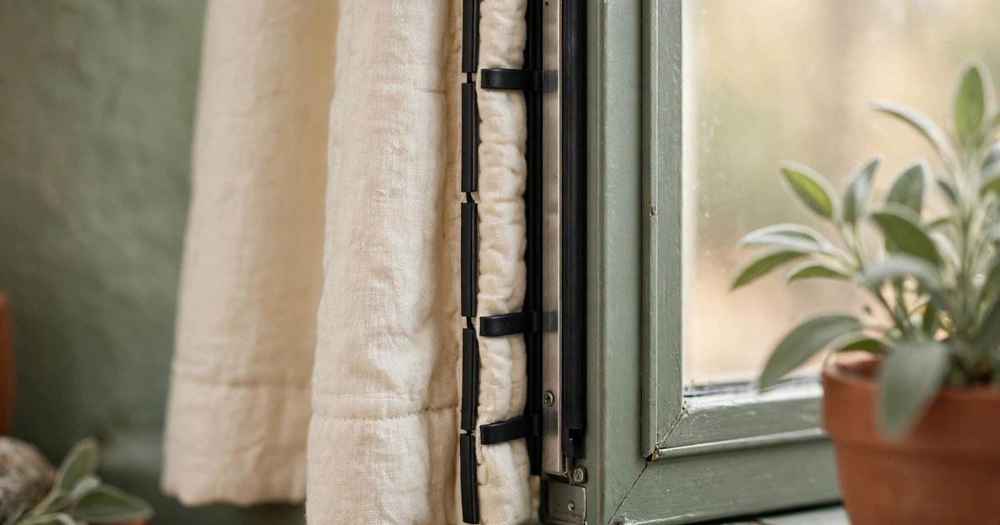

Windows are where a rental loses most of its heat. A single-glazed or draughty window can make a whole room feel cold no matter how high you turn the heating up, and in a rental you cannot replace the glass, add secondary glazing, or fit a new frame. What you can do — without a drill, a screw, or a word to the landlord — is hang a better curtain. The right curtain at the right length can cut the cold draught from a window dramatically, and it changes the look of the room at the same time.

Every idea below is removable, affordable, and deposit-safe. No drilling, no permanent fixings, and nothing that leaves a mark on the wall or the window frame. Most of them use things you already own or can buy for very little, and all of them come down in spring without a trace. Here are ten ways to make your rental's curtains work as hard in winter as your heating does.

### 1. Hang thermal curtains on a tension rod

A tension rod is the renter's best friend: it wedges inside the window frame with spring pressure, needs no screws, and holds a surprising amount of weight. Pair one with a set of thermal curtains — curtains with a thick woven backing or a foam-coated lining — and you have a draught barrier that installs in five minutes and removes in thirty seconds. Hang the rod as close to the glass as the frame allows, so the curtain seals the cold air behind it.

Choose curtains in a warm cream, sage or terracotta to match the room, and buy them long enough to reach the sill or the floor — a curtain that stops short of the sill lets cold air pour out underneath it. Thermal curtains are widely available at budget prices, and a single pair on the coldest window in the flat makes a noticeable difference to the whole room.

### 2. Add a thermal lining to curtains you already own

If you already love your curtains, do not replace them — line them. A thermal lining is a separate panel that clips or hooks onto the back of an existing curtain, adding the insulating layer without changing the look of the room at all. Clip-on linings attach with small rings or hooks to the curtain's own header, so there is nothing to sew and nothing to drill.

This is the cheapest way into thermal curtains, because a lining costs far less than a new pair, and it works with any curtain that has a header tape or eyelets. In spring, unclip the lining, fold it away, and your summer curtains are back exactly as they were. If your windows are particularly draughty, a lining plus a draught excluder at the sill is a combination that rivals double glazing for comfort.

### 3. Layer a sheer curtain behind a heavy one

Two layers trap more air than one, and trapped air is what insulation actually is. Hang a sheer curtain on a second tension rod behind your main curtains, and the pocket of still air between the two layers slows the cold coming off the glass. During the day the sheer lets light in while the heavy curtain stays open; at night both close, and the window is sealed by two barriers instead of one.

A double tension rod set costs very little and fits inside most window frames. Use a light, plain sheer — it disappears against the glass in daylight and never competes with the main curtain. This layering trick also solves the privacy problem in ground-floor rentals: the sheer stays closed all day, the heavy curtain only closes at night.

### 4. Let the curtains puddle on the floor

A curtain that ends at the sill leaves a gap, and a gap is a chimney for cold air. A curtain that reaches the floor — or better, puddles an inch or two onto it — seals the bottom of the window completely. The extra fabric pools on the floor, blocking the draught that would otherwise roll across the room at ankle height, which is exactly where you feel it most.

This only works if the floor below the window is clear, so it suits living rooms and bedrooms rather than windows above radiators or furniture. Buy curtains a size longer than you think you need, or add a cheap extension panel at the bottom. The puddle looks deliberately luxurious rather than too long, and it is the single easiest draught fix on this list.

### 5. Seal the sides with magnetic strips

Cold air does not only come under a curtain — it comes around the sides, where the curtain meets the wall. A simple fix is to seal the sides: sew or stick small magnets into the curtain hem and matching magnets onto the window frame or wall, so the curtain pulls itself flat against the frame when closed. On metal window frames the magnets stick directly; on wooden frames, a thin adhesive metal strip holds them.

Magnetic tape is cheap, removable, and leaves no mark if you use the adhesive kind designed for temporary fixing. The seal does not need to be airtight to work — even closing most of the side gap cuts the draught noticeably. This is the detail that turns a good curtain into a genuinely warm one.

### 6. Use a curtain pelmet made from a shelf

Warm air rises, and the gap above a curtain rod is where it escapes — over the top of the curtain, down the cold glass, and back into the room as a draught. A pelmet blocks that path, and a renter can make one from a plain shelf. Mount a narrow shelf above the window on Command strips or a tension-rod bracket, hang the curtain from a rod fixed beneath the shelf, and the shelf becomes a pelmet that stops the warm air escaping over the top.

Dress the shelf with a plant, a few books, or a string of fairy lights, and it looks like a styling choice rather than a draught fix. The shelf itself is removable and the fixing leaves no holes. If a shelf feels like too much, a simple fabric valance hung from the same rod achieves a similar effect for even less money.

### 7. Hang a blanket as a temporary winter curtain

When the cold snap arrives before the budget does, a blanket is a perfectly good winter curtain. A thick woven throw or a fleece blanket hung over a tension rod or a curtain rod is heavier and warmer than most budget curtains, and you almost certainly already own one. Drape it so it covers the whole window, tuck the bottom behind the sill or let it puddle, and the room will feel warmer within the hour.

This is a temporary fix, not a permanent look — but temporary is exactly what a rental needs in a cold week. Choose a blanket in a colour that suits the room, fold it neatly over the rod, and nobody will know it is not a curtain. When spring comes, the blanket goes back on the bed and the window goes back to its usual curtains.

### 8. Add a window film behind the curtain

Window film is a clear, removable sheet that sticks to glass with static — no adhesive, no residue, no landlord conversation. Applied behind the curtain, it adds a thin insulating layer to the glass itself, cuts condensation, and softens the cold radiating from the pane. A frosted or patterned film also adds daytime privacy, which means the sheer layer can stay open and the light can come in.

Cut the film to the size of each pane, smooth it on with a credit card, and peel it off in spring. It costs very little per window and is the only idea on this list that works even when the curtains are open. Pair it with a thermal curtain and the window is insulated twice over — once at the glass, once at the fabric.

### 9. Weight the curtain hems so they hang flat

A curtain that billows lets cold air behind it every time someone walks past. Weighting the hem stops the billow: sew small curtain weights into the bottom hem, or clip draught-stopping weights onto the hem, and the curtain hangs flat and still against the window. A flat curtain seals; a billowing one leaks.

You can buy curtain weights for very little, or improvise with a length of chain stitched into the hem — the old-fashioned solution that still works perfectly. This small detail makes every other idea on this list work better, because a curtain can only insulate if it stays where you put it. Check the hem after washing, as weights sometimes shift in the machine.

### 10. Close them at dusk, open them at dawn

The cheapest idea on this list costs nothing at all: close the curtains the moment the light starts to go, and open them again when the sun comes up. A curtain only insulates when it is closed, and an open curtain at night is an open window as far as your heating bill is concerned. Closing at dusk traps the day's warmth in the room; opening at dawn lets the sun warm it again for free.

Make it a habit rather than a chore — close them when you turn the lights on, open them when you make the morning coffee. In a small rental this one habit can make the difference between a room that feels cold at 9pm and one that feels cosy. It also protects the curtains themselves: sun-faded fabric is a deposit question nobody needs.

## Frequently asked questions

### Can I hang thermal curtains in a rental without drilling?

Yes. A tension rod wedges inside the window frame with spring pressure and needs no screws at all, and most thermal curtains are light enough for one. For heavier curtains, use a Command-hook rod holder rated for the weight, or a no-drill bracket that clamps onto the frame.

### Do thermal curtains actually keep a room warmer?

Yes — a lined thermal curtain can reduce heat loss through a window significantly, because the thick backing traps a layer of still air against the glass. They work best when they reach the floor, seal at the sides, and are closed at dusk. They do not replace heating, but they make the heating you already pay for go much further.

### What is the cheapest way to insulate rental windows in winter?

A tension rod, a blanket or a cheap thermal curtain, and a window film together cost less than one month of extra heating. Start with the coldest window in the flat, close the curtains at dusk, and add a draught excluder at the sill — that combination alone will make the room feel warmer.

### Will window film damage the glass or leave residue?

No. Static-cling window film uses no adhesive, so it peels off cleanly and leaves nothing behind. Avoid adhesive films in a rental — they can leave residue on the glass and are much harder to remove in spring.

### How long should winter curtains be?

To the floor, or an inch or two longer so they puddle. A curtain that stops at the sill leaves a gap underneath where cold air pours into the room. If the window sits above a radiator, the curtain should end just above the radiator instead, so the heat is not trapped behind the fabric.
