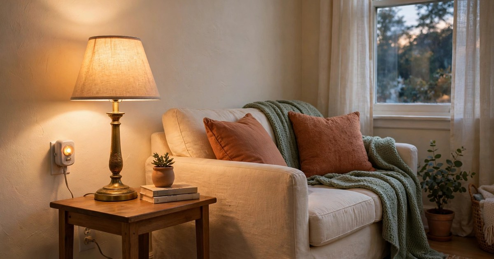
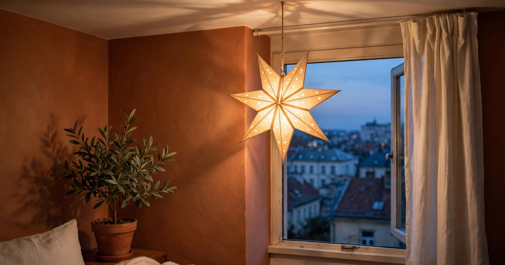
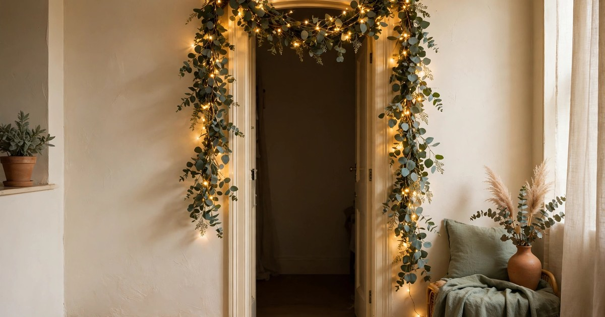
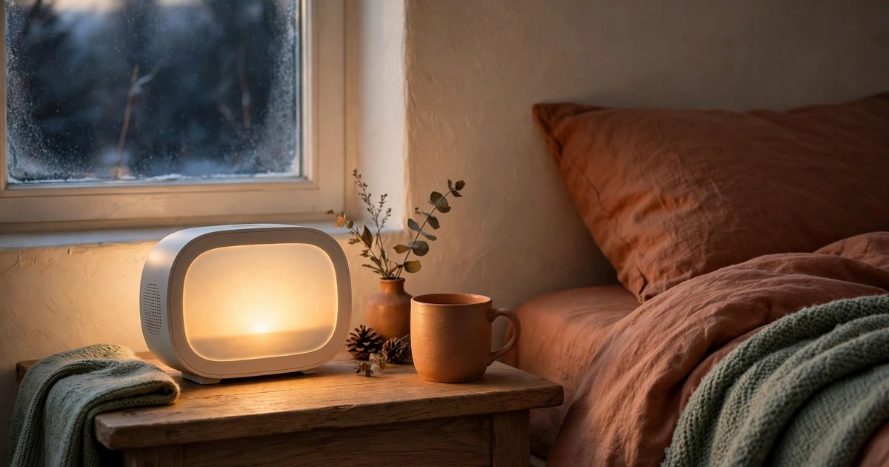

Winter light is the hardest thing about a small flat. The sun sets before you get home, the ceiling light is too harsh, and the whole place can feel grey by four in the afternoon. The fix is not a new lamp or an electrician — it is layers of small, warm light, placed low and spread around the room, so the flat glows instead of glaring. Every idea below is renter-friendly: no wiring, no drilling, no holes, and nothing your landlord could object to.

The rule for winter lighting is simple: several small lights beat one big one. A ceiling light flattens a room; a fairy light on a shelf, a candle on the table and a warm lamp by the sofa give it depth. Start with one or two ideas from this list and add more as the dark evenings settle in. Most of them cost less than a takeaway, and a few cost nothing at all.

### 1. Warm Fairy Lights Along a Shelf

Fairy lights are the first thing to try, because they are cheap, instant and impossible to get wrong. Drape a string of warm white fairy lights along the top of a bookshelf, around a window frame, or along a picture rail, and the whole room softens. Battery-operated strings are the renter's best friend: no plug needed, no cable trailing across the room, and most come with a timer that switches them on at dusk and off six hours later. A timer means the flat is already glowing when you walk in.

Choose warm white, not cool white — cool white fairy lights look like a hospital corridor, while warm white looks like candlelight. Tuck the battery pack behind a book or a plant so it disappears, and use small removable hooks or a little washi tape to hold the wire in place. One string is a decoration; three strings in different corners is a lighting scheme.

### 2. Battery Candles in Lanterns

Battery candles give you the flicker of real candlelight with none of the risk, which matters in a small flat full of cushions, throws and curtains. Put two or three in a lantern on the coffee table, or line them along a windowsill, and you have a centrepiece that glows all evening. The flickering ones look surprisingly real from across the room, especially inside frosted glass or a lantern, where the flame is diffused. Most come with a remote, so you can switch them on from the sofa.

Group candles in odd numbers and at different heights for the best effect — a tall lantern, a medium candle and a short one together look deliberate, while a single candle on its own can look lost. Battery candles are also the safest option if you have pets or children, and many tenancy agreements that ban real candles say nothing about battery ones. Keep a set of spare batteries in the drawer, because they always run out on the darkest night of the year.

### 3. A Salt Lamp on the Bedside Table

A salt lamp is a small block of pink Himalayan salt with a bulb inside, and it throws a soft amber glow that makes a bedroom feel warm the moment it switches on. It is the perfect bedside light for winter: dim enough to wind down with, warm enough to read by for a few pages, and pretty enough to leave on as a night light. The amber colour is flattering to skin and to walls, and it makes even a plain white rental bedroom feel like a cosy cabin.

Put it on a timer plug so it switches on before bedtime and off in the middle of the night. Salt lamps do need a little care — they can weep in damp air, so keep yours away from windows and wipe it with a dry cloth if it feels damp. A small lamp is enough for a bedroom; save the big ones for the living room, where the amber glow can fill the whole space.

### 4. A Plug-In Dimmer for Your Existing Lamp

You do not need a new lamp — you need a dimmer. A plug-in dimmer costs a few pounds, plugs into the wall socket, and lets you turn any ordinary table lamp down to a soft glow. It is the single best-value winter lighting buy for a renter, because it transforms the lamp you already own. A lamp at full brightness is a work light; the same lamp at half brightness is a mood light, and the difference in how the room feels is enormous.

Look for a dimmer with a simple slide or dial, and check that your bulb is dimmable — most LED bulbs say so on the box, and non-dimmable ones will flicker. If your bulb is not dimmable, swap it for a warm white dimmable LED, which costs less than a coffee. Put the dimmer on the lamp you use most, usually the one by the sofa, and you will wonder how you lived without it.

### 5. Paper Star Lanterns in the Window

A paper star lantern is a folded paper star with a small light inside, and it is one of the prettiest things you can hang in a window in winter. The points of the star throw soft shadows on the ceiling, the warm light spills onto the street, and the whole flat feels festive without a single Christmas decoration. They fold flat for storage, cost very little, and hang from a single removable hook, which makes them perfect for renters.

Hang one star in the living room window and one in the bedroom, at slightly different heights, so the flat glows from the outside too. Use a battery LED inside rather than a real candle — paper and flames do not mix — and choose warm white for the glow. A star lantern left up all winter, not just at Christmas, is a quiet reminder that light is a decoration in its own right.

### 6. A Light-Up Garland Over a Doorway

A garland with lights built in does two jobs: it decorates a doorway and it lights it. Drape a eucalyptus or pine garland with warm fairy lights over a door frame, along the top of a bookshelf, or across a mantelpiece, and you have a focal point that glows every evening. Battery-operated garlands are the renter's choice — no plug, no trailing cable, and a timer that handles the switching on and off. Hang it with removable hooks at each end and one in the middle so it does not sag.

Choose a garland in greenery rather than tinsel if you want it to last all winter: eucalyptus and pine look seasonal without screaming Christmas, so you can put it up in November and leave it until February. Fluff the branches when you hang it, because a squashed garland looks sad and a full one looks expensive. One garland over the living room doorway is enough to change the whole feel of the room after dark.

### 7. A Colour-Changing Bulb in One Lamp

A colour-changing smart bulb is a small splurge with a big payoff in winter. Screw one into the lamp by your sofa, and you can switch it from bright white for reading to warm amber for the evening to a soft rose for a film night, all from your phone. In a small flat, one bulb like this does the work of three different lamps. It is also completely renter-friendly — it is just a bulb, and you take it with you when you move.

You do not need a smart home hub for most colour-changing bulbs; many work over Bluetooth straight from your phone. Set a schedule so the bulb fades to warm amber at six in the evening, and the flat will feel cosy before you even think about the lights. Keep the rest of the room's bulbs warm white, so the coloured bulb is a feature rather than a competition.

### 8. A Lit Tray Centrepiece on the Table

A tray centrepiece is the easiest way to make a dining table glow. Take a shallow tray — a baking tray works, a wooden board works, a charity-shop find works — and fill it with three battery candles at different heights, a few pinecones, a sprig of eucalyptus and a string of fairy lights coiled between them. The tray keeps everything contained, so you can lift the whole display off the table when you need the space for dinner, and put it back afterwards in seconds.

The tray trick works because the light is contained and low, which makes the table feel intimate even in a small room. Change the contents with the season: pinecones and eucalyptus in winter, dried flowers in spring. A lit tray on the coffee table works just as well as one on the dining table, and it is the centrepiece that guests always comment on first.

### 9. A Backlit Bookshelf

A strip of warm LED lights stuck to the back of a bookshelf turns an ordinary shelf into a glowing display. The light spills around the books and objects, making the whole shelf look like it is lit from within, and the warm glow fills the corner of the room. Battery or USB-powered strips are the renter's choice — stick them with the adhesive backing, run the cable down the back of the shelf, and there is nothing to drill or wire. Most strips can be cut to length, so one strip does a whole bookcase.

Use warm white, around 2700K, and avoid the colour-changing modes unless you want your living room to look like a nightclub. The light should be hidden behind the books, so you see the glow but not the strip itself — that is what makes it look expensive. A backlit shelf is especially effective in a dark corner, where it turns the gloomiest spot in the flat into the prettiest one.

### 10. A Sunrise Alarm Clock That Doubles as a Lamp

Winter mornings in a small flat are dark, and a sunrise alarm clock fixes the worst part of them. It is a small lamp that slowly brightens over twenty or thirty minutes before your alarm, mimicking a sunrise, so you wake up to light instead of darkness. It doubles as a bedside lamp in the evening, with a warm glow that is perfect for reading before sleep. In a small bedroom, one object doing two jobs is exactly the kind of efficiency a renter needs.

Put it on the bedside table, set the wake-up time, and let it do its work. The gradual brightening is gentler than a sudden alarm, and on the darkest mornings it makes the difference between dreading the day and easing into it. It is the most expensive item on this list, but it is also the one that changes your mornings, not just your evenings — and in winter, that is worth more than any decoration.

## Layer It, Then Live In It

Winter lighting is not about buying ten new things. It is about layering the light you already have: a fairy light here, a dimmer there, a candle on the table, a lamp turned low. Start with the idea that solves your biggest annoyance — the harsh ceiling light, the dark corner, the gloomy mornings — and add one layer a week. By the time the shortest day arrives, your small flat will not just be lit. It will glow.

## Frequently Asked Questions

### How can I make a rental flat feel cosy in winter without drilling?

Use battery-operated lights, plug-in dimmers, removable hooks and adhesive strips. Fairy lights, battery candles, salt lamps and LED strips all work without a single hole in the wall, and everything comes down cleanly when you move out.

### What colour temperature is best for winter lighting?

Warm white, around 2700K, is best for living rooms and bedrooms in winter. It looks like candlelight and makes colours feel rich. Cool white, around 4000K or higher, is better for kitchens and workspaces, where you need to see clearly.

### Are battery candles safe in a small flat?

Yes — that is the point. Battery candles give you flickering light with no flame, no heat and no smoke, so they are safe around cushions, curtains, pets and children. Choose flickering LED candles inside a lantern or frosted glass for the most realistic effect.

### How many light sources should a small living room have?

Aim for three to five small sources at different heights: a lamp by the sofa, fairy lights on a shelf, candles on the table, and a light in the window or on a bookshelf. Several small lights beat one big ceiling light every time, because they give the room depth and let you light only the corner you are using.
