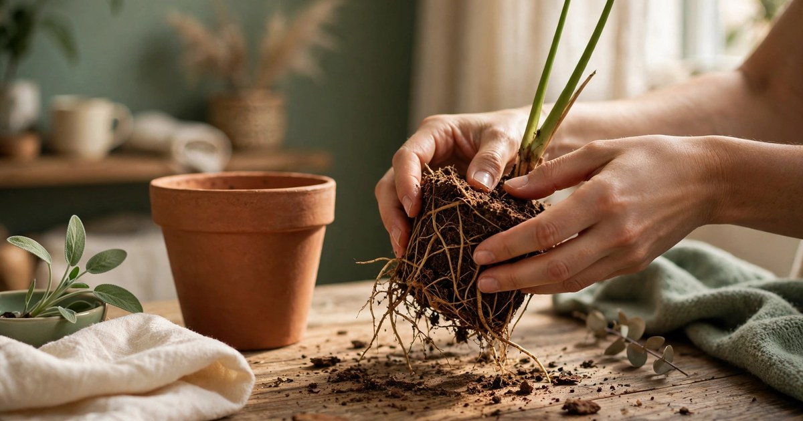
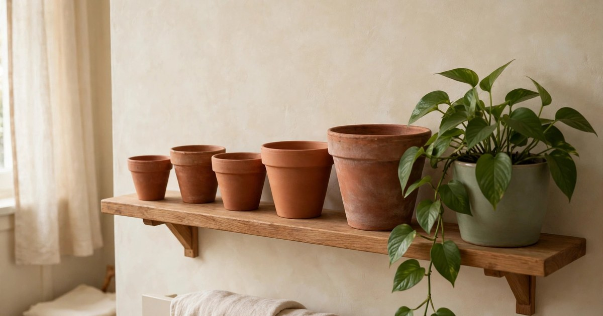
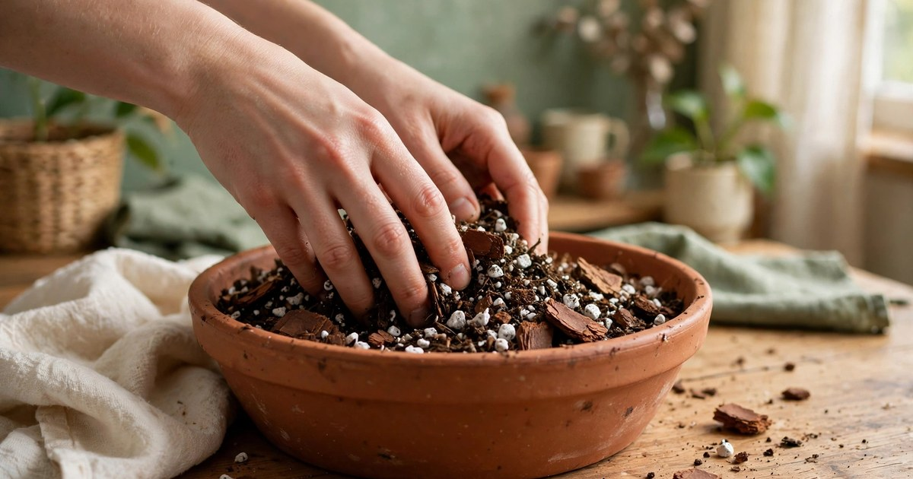
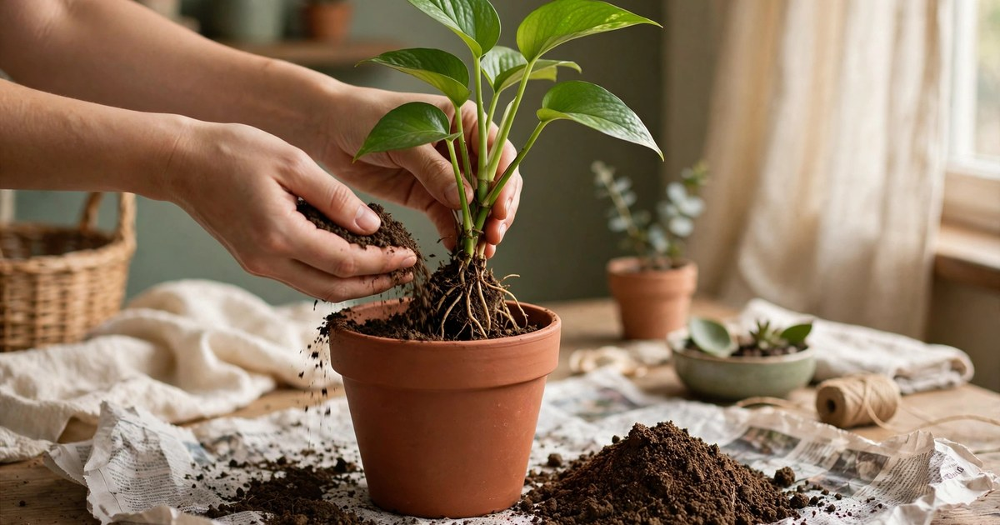
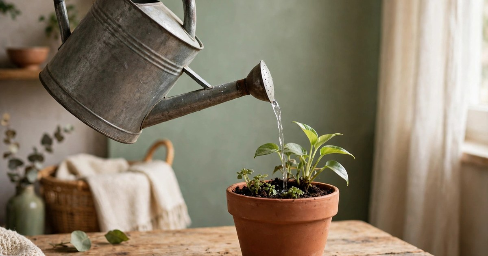
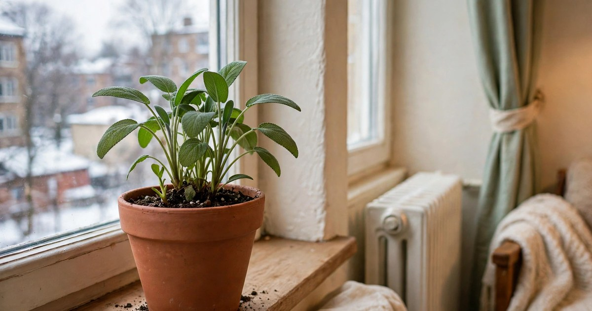
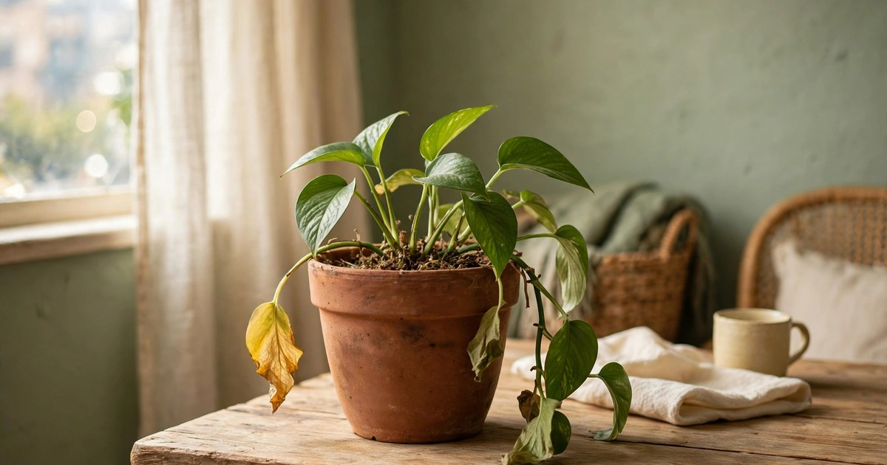
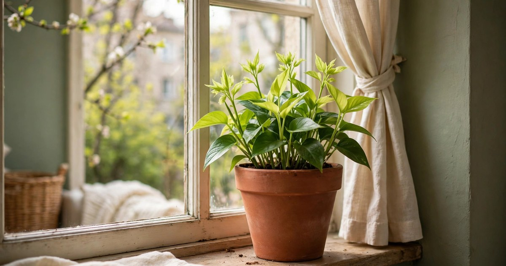

Every houseplant guide tells you the same thing: never repot in winter. Wait for spring, when the plant is growing fast and can bounce back. It is good advice — and like most good advice, it has exceptions. If your plant has root rot, if its pot has cracked, or if it is so rootbound that water runs straight through the soil without wetting it, waiting until March could kill it. A careful winter repot is far safer than leaving a plant to rot in cold, soggy soil for three months.

The reason winter repotting feels risky is real. In winter, most houseplants slow right down or stop growing altogether. Short days and weak light mean they drink less, photosynthesise less and heal more slowly, so any root damage from repotting takes longer to repair. A plant repotted in June recovers in a week; the same plant repotted in November may take a month. That does not mean you cannot do it — it means you need to be gentler, pick the right moment, and give the plant the aftercare it needs while it settles in.

This guide walks you through the whole process, step by step, in a small rented flat, on a budget, with nothing that risks your deposit. No special kit, no greenhouse, no expensive tools — just a pot, the right soil mix, and a bit of patience.

### 1. Decide Whether to Repot Now or Wait Until Spring

The first step is not reaching for a new pot — it is deciding whether the plant actually needs one. Winter is the season to be conservative. If the only problem is that the plant looks a little snug, or you fancy a prettier pot, wait. A healthy plant that is slightly rootbound will cope perfectly well until spring, and repotting it now adds stress it does not need.

Repot now if you spot one of the urgent signs. The biggest is root rot: soil that stays wet for weeks, a sour or musty smell when you lift the pot, black mushy roots, or leaves yellowing from the bottom up even though you have barely watered. Root rot only gets worse in cold, damp soil, so a plant in this state needs fresh, dry mix immediately. A cracked or broken pot is another clear reason — a plant with no pot is worse off than a plant repotted in December. So is a plant that has outgrown its home so badly that water runs straight out of the drainage holes without wetting the soil, or one so top-heavy with roots that it keeps tipping over.

There are also signs that look alarming but mean you should wait. A few roots poking out of the drainage hole are normal for a healthy plant and not an emergency on their own. Slow growth in winter is normal too — your plant is resting, not dying. And if the plant has just been moved, has a pest problem, or is already stressed, adding a repot on top will only make things worse. Deal with the pests first, let the plant settle for a week or two, and then decide.

If you are on the fence, do the lift test. Slide the plant gently out of its pot and look at the roots. If they are white or pale tan and holding the soil together in a firm ball, the plant is fine — put it back and wait for spring. If they are black, mushy, or smell bad, or the soil ball has collapsed into a soggy mess, repot now. This one check takes two minutes and saves you from guessing.

### 2. Choose the Right Pot Size

The single most common repotting mistake — in any season, but especially in winter — is choosing a pot that is far too big. A plant in a pot two sizes too large sits in a big mass of wet soil its roots cannot reach, and in a cold flat that soil stays soggy for weeks. Soggy soil in winter is exactly how root rot starts, which is often the very problem you were trying to fix.

The rule is simple: go only 2–5 cm wider than the current pot. If your plant is in a 13 cm pot, move it to a 15 cm one. That gives the roots room to grow without leaving a ring of empty, wet soil around them. Measure the old pot across the top before you shop, and take a tape measure with you — pots are often labelled by volume or by a vague size name, and guessing in the shop is how you end up with a pot twice the size you need.

A drainage hole is non-negotiable. No matter how pretty a pot is, if water cannot escape, it will pool at the bottom and rot the roots. If you fall in love with a pot that has no hole, use it as a decorative cover pot instead: keep the plant in a plain nursery pot with drainage inside it, and tip out any water that collects in the cover pot after watering. That trick also works brilliantly in a rental, because a cover pot protects wooden floors and windowsills from water rings.

Terracotta is the budget pick for winter repotting. The porous clay breathes, pulling moisture out of the soil so it dries evenly between waterings — exactly what you want when a cool flat slows evaporation. A plain terracotta pot costs a few pounds and looks good with almost any plant. Plastic nursery pots are even cheaper and lighter, which matters if the plant lives on a high shelf, and they are easy to find second-hand. Ceramic looks smarter, but check for a drainage hole and remember it is heavier and more expensive. Whichever you choose, add a matching saucer so water never reaches the floor.

[buy on Amazon](https://www.amazon.com/s?k=terracotta+pot+with+drainage+hole+saucer+small&tag={{AMAZON_TAG}})

### 3. Mix the Right Soil for Winter

Ordinary potting soil is the quiet villain of winter repotting. Straight out of the bag it is often dense and peaty, and in a cool, low-light flat it can stay wet for weeks after one watering. Roots sitting in cold, airless soil suffocate and rot, so the soil mix matters more in winter than at any other time of year. You need a mix that drains freely and lets air reach the roots.

The simplest winter mix is one you can make yourself for pennies: two parts ordinary houseplant compost, one part perlite, and one part orchid bark or coco coir chips. The compost holds moisture and nutrients, the perlite keeps the mix open and free-draining, and the bark creates air pockets that stop the soil compacting into a wet brick. For succulents and cacti, go heavier on the drainage — one part compost to one part perlite to one part coarse grit. For a monstera or other tropical plant, a chunkier mix works beautifully; our guide to [monstera care essentials](/monstera-care-essentials-small-apartments-under-25/) explains why chunky aroid soil is the best defence against winter root rot.

A bag of ready-made houseplant soil costs very little, but check the label before you buy: if it feels heavy and dense in the bag, it will be worse in the pot. You can always improve a cheap bag by mixing in a handful of perlite, which costs a couple of pounds and lasts for several repots. Never use garden soil indoors — it is too heavy, it compacts, and it can bring pests and weed seeds into your flat.

Two small winter tips make a real difference. First, keep your soil indoors for a day before repotting, so it is at room temperature rather than cold from a balcony or a shed. Cold soil shocks warm roots. Second, pre-moisten the mix before you use it: tip it into a bowl, add a little water, and mix until it feels like a wrung-out sponge — damp, not dripping. Dry mix is hard to water evenly afterwards, and bone-dry soil can pull moisture away from the roots instead of giving it to them.

[buy on Amazon](https://www.amazon.com/s?k=perlite+houseplant+soil+mix+orchid+bark&tag={{AMAZON_TAG}})

### 4. The Repot Itself, Step by Step

Pick a mild day for the job — not the coldest day of the year, and not right next to an open window or a freezing draughty door. Lay newspaper or an old towel on the table first. Repotting is messy, and in a rental the cheapest way to protect your deposit is to keep soil off the floor and out of the carpet.

Water the plant lightly the day before, not on the day. Slightly damp soil holds together and slides out of the pot in one piece, while bone-dry soil crumbles and falls away from the roots. On the day, tip the pot sideways and support the plant at the base of the stem with one hand while you ease the pot off with the other. Never yank a plant out by its stem — if it is stuck, squeeze a plastic pot gently, or run a butter knife around the inside edge of a terracotta one.

Once the plant is out, take a proper look at the roots. Healthy roots are white, cream or pale tan and firm. Rotten roots are black or dark brown, soft and mushy, and they often smell sour. Snip off anything rotten with clean, sharp scissors — wipe the blades with rubbing alcohol first so you do not spread infection. If the roots are circling tightly around the bottom of the soil ball, tease the outer ones loose with your fingers so they can grow outwards into the fresh soil. Do not be rough: in winter, every root you break takes weeks to regrow, so handle the root ball gently and only remove what is actually dead.

Now put a layer of fresh mix in the bottom of the new pot, set the plant in at the same depth it was before — the soil line should sit at the same place on the stem, never higher, because burying the stem invites rot — and fill in around the sides with fresh mix. Tap the pot on the table to settle the soil, and press it down lightly with your fingers. Do not ram it down hard: compacted soil holds water and squeezes out the air the roots need. Leave about 2 cm of space between the soil surface and the rim of the pot, so water stays in when you water rather than running over the edge.

### 5. Watering After Repotting — Less Is More

The instinct after repotting is to give the plant a big, generous drink. In summer, that is right. In winter, it is the fastest way to undo all your careful work. A freshly repotted plant in a cool flat drinks very little, and its damaged roots cannot take up water efficiently yet, so a heavy watering just leaves the new soil sitting wet around roots that are trying to heal.

Water lightly after repotting — just enough to settle the soil around the roots and wash away air pockets. A good guide is to water until a little trickles out of the drainage hole, then stop, and empty the saucer after 15 minutes so the pot never sits in standing water. If you pre-moistened your soil mix as suggested in step three, you may need even less than you think.

Then wait. In winter, the top few centimetres of soil need to dry out before you water again, and that can take two to three weeks in a cool flat. Always check with your finger before watering: push it 5 cm into the soil, and water only if it feels dry. A moisture meter costs a few pounds and takes the guesswork out entirely if you are unsure. Remember that overwatering in winter is far more dangerous than underwatering — a thirsty plant perks up within hours of a drink, but a rotted root system may never recover.

One more thing to skip: fertiliser. Do not feed a freshly repotted plant in winter. The roots are damaged and the plant is barely growing, so fertiliser salts just sit in the soil and can burn tender new root tips. Fresh soil mix already contains enough nutrients to carry the plant through to spring, when you can start feeding again.

### 6. Light and Warmth — Give It the Best Spot in the Flat

After repotting, where the plant lives matters as much as how you repotted it. A stressed plant needs light to recover, and winter is when light is scarcest, so give your repotted plant the brightest spot you have — ideally within a metre of a window, but not pressed against cold glass. A south- or east-facing window is best; a north-facing one may not be enough on its own.

Keep the plant away from radiators and hot-air vents. Central heating dries the air and the soil, and a plant sitting right above a radiator will dry out on one side while its roots sit in cold, wet soil on the other. At the same time, keep it away from cold draughts: the gap by a badly sealed window, the hallway by the front door, or a spot where a cold draught blows across it every time someone comes in. Most houseplants are happiest between 15°C and 24°C, and sudden swings between hot and cold are harder on them than steady coolness.

If your brightest window is also your coldest, a small grow light solves the problem: it lets you keep the plant in a warmer spot while still giving it the light it needs to recover. A clip-on LED bar costs around $15–$22, uses very little electricity, and clips to a shelf with no drilling — fully renter-friendly. Our guide to [grow lights for dark winter apartments](/grow-lights-dark-winter-apartments-under-25/) covers the best budget options. Once the plant is in its spot, leave it there. A recovering plant does not want to be shuffled around the flat while you decide where it looks best; every move is another small shock.

### 7. What to Do If the Plant Sulks

A week after a winter repot, your plant may look worse than before you started. A few leaves droop, one or two turn yellow, and the whole plant looks tired and sorry for itself. This is normal, and it is the step where most people panic and make things worse. It is called transplant shock, and in winter it can last two to four weeks while the roots re-establish themselves.

The golden rule is: do nothing drastic. Do not repot it again. Do not water it more — drooping leaves after a repot are usually caused by damaged roots struggling to take up water, not by thirst, and extra water will only rot the roots further. Do not move it to a darker corner "to rest", and do not feed it. The plant needs time, steady light and consistent conditions, not more interventions.

You can tidy up gently. Snip off leaves that have turned fully yellow or brown at the base of the stalk — they will not recover, and removing them lets the plant put its energy into new roots instead. Leave any leaf that is only partly yellow; it is still photosynthesizing and helping the plant recover. Wipe the remaining leaves with a damp cloth to clear dust, which helps them catch what little winter light there is.

Watch for the difference between normal sulking and real trouble. Drooping and a yellow leaf or two are normal. Black, mushy stems, a smell of rot from the soil, or leaves dropping in large numbers are not — they mean the rot has spread or the roots are still sitting wet, and you may need to check the roots again and remove any remaining rot. But give it at least two weeks before you investigate: digging a plant up a second time in winter is a last resort, not a first response.

### 8. Spring Follow-Up — Finish the Job When Growth Returns

A winter repot is a rescue, not a finished job — spring is when you complete it. As the days lengthen and the plant starts growing again, check how it has settled. Lift it gently and look at the roots: if they have filled the new pot with healthy white growth, your winter repot worked. If the soil has sunk noticeably, top it up with a little fresh mix. If the plant is still struggling after six to eight weeks, spring is the safe season to repot it again properly, when it can recover fast.

Spring is also when feeding resumes. Once you see new growth — a fresh leaf unfurling, a new shoot, or roots reaching the drainage hole — start feeding at half strength every two to four weeks, following the instructions on your fertiliser. A plant that was repotted in winter has fresh soil full of nutrients, so there is no rush; feeding too early or too strongly can burn the new roots you spent all winter protecting.

Use spring to fix anything you compromised on in winter. If you repotted into a plain nursery pot as a stopgap, move the plant into its proper decorative pot. If you skipped the moss pole or the support because the plant was too stressed, add it now while the plant is growing strongly. And make a note — on your phone, on a plant label, anywhere you will see it — of the date you repotted and the soil mix you used, so next winter you know exactly what worked. A plant that survives a winter repot is a tough plant, and with a spring feed and a brighter spot it will usually reward you with a burst of fresh growth.

## Frequently Asked Questions

### Can I repot houseplants in winter at all?

Yes, you can — the rule is that you should avoid it unless you have a good reason, not that it is impossible. If the plant is healthy and just a little snug, wait until spring, when it will recover in days rather than weeks. But if it has root rot, a cracked pot, or soil that no longer holds water, repotting in winter is the safer choice. Be gentler than you would be in summer, use a free-draining soil mix, water lightly afterwards, and give the plant the brightest, warmest spot you have while it recovers.

### How do I know if my plant has root rot?

Lift the plant out of its pot and look at the roots. Healthy roots are white, cream or pale tan and firm to the touch. Rotted roots are black or dark brown, soft and mushy, and they often smell sour or musty. Other warning signs are soil that stays wet for weeks, leaves yellowing from the bottom up despite very little watering, and a plant that wilts even though the soil is damp. If you find rot, cut away all the black, mushy roots with clean scissors, repot into fresh, dry mix, and water sparingly until the plant recovers.

### Should I water right after repotting in winter?

Yes, but lightly. Water just enough to settle the fresh soil around the roots — until a little trickles out of the drainage hole — then empty the saucer and wait. In a cool flat the soil may take two to three weeks to dry out again, so always check with your finger before watering a second time. A freshly repotted plant in winter drinks very little, and overwatering is the biggest risk after a winter repot. If you pre-moistened your soil mix before repotting, you may barely need to water at all.

### What size pot should I choose when repotting?

Only 2–5 cm wider than the current pot. A pot that is too large holds a mass of wet soil the roots cannot reach, and in winter that soil stays soggy and invites root rot. Always choose a pot with a drainage hole, and use a saucer underneath to protect floors and windowsills. Terracotta is the best budget choice for winter because the porous clay helps the soil dry evenly, but a plastic nursery pot inside a decorative cover pot works just as well — and it is easier to lift in a small flat.

### Why is my plant drooping after repotting?

Drooping after a repot is usually transplant shock, and it is normal — especially in winter, when the plant heals slowly. The roots were disturbed and cannot take up water as efficiently for a while, so the leaves droop even though the soil is damp. Do not water more, do not repot again, and do not feed it. Keep the plant in bright, indirect light, away from radiators and cold draughts, and give it two to four weeks. If only a leaf or two turns yellow, that is part of the process; if stems turn black and mushy or leaves drop in large numbers, check the roots again for rot.
