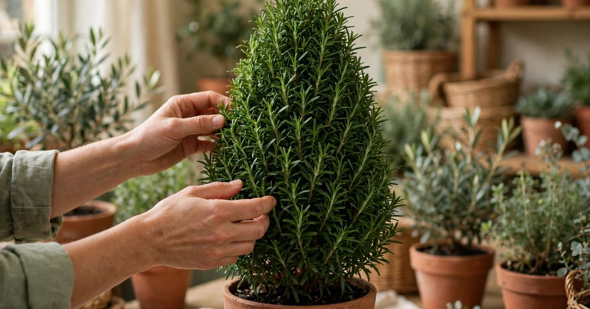
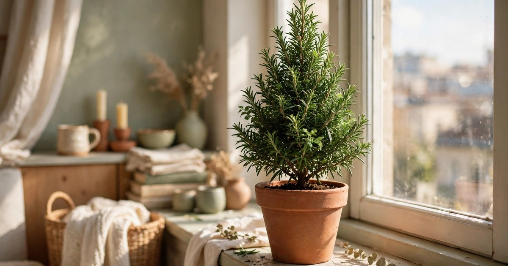
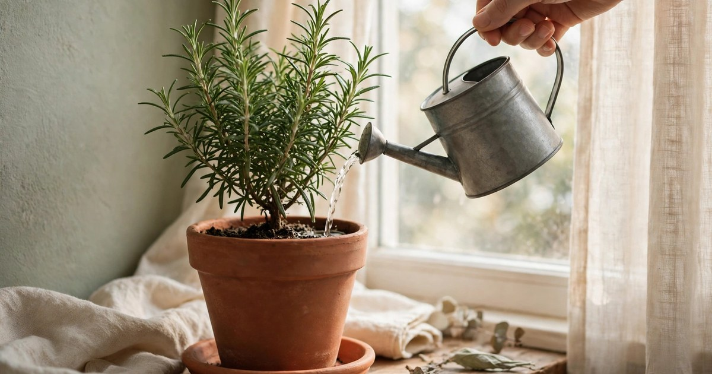
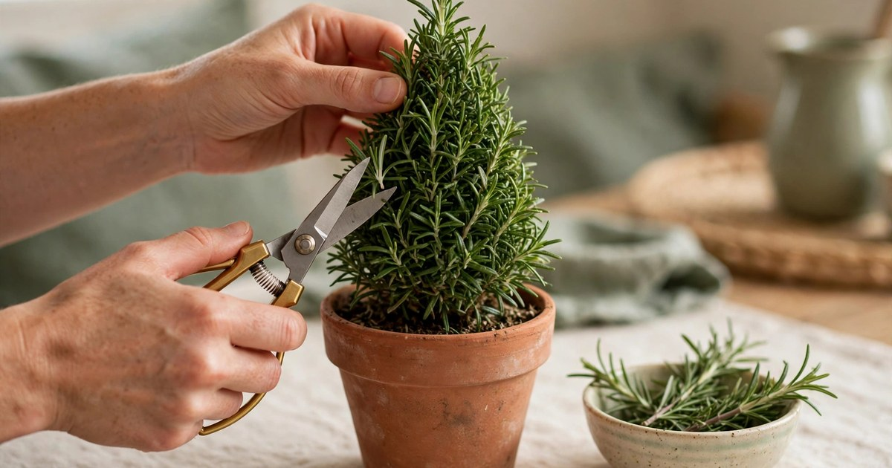
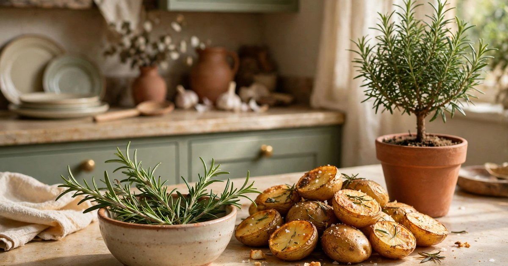

A rosemary Christmas tree is the cleverest festive trick a small flat can pull off. Instead of wrestling a cut tree up the stairs, finding floor space you do not have, and then watching it drop needles across the carpet for a month, you bring home a living plant shaped like a tiny cone, dress it up for December, and keep cooking with it long after the decorations come down. It smells wonderful, costs a fraction of a real tree, and takes up no more room than a large houseplant on a sideboard or windowsill.

For renters, the appeal is even stronger. There is nothing to screw into a wall, no heavy stand to store for eleven months, and no landlord to ask for permission. A potted rosemary topiary sits happily in a terracotta pot, moves from room to room in one hand, and looks just as good in January as it does on Christmas Eve. This guide walks you through the whole thing, step by step: choosing a healthy plant, potting it properly, giving it the light and water it actually wants, shaping the cone, decorating it without snapping its delicate branches, and keeping it alive through the driest, darkest weeks of winter. Get those basics right and your little tree will still be going strong next Christmas, bigger and bushier than before.

### 1. Choose a Healthy Cone-Shaped Rosemary Topiary

Start at a garden centre or nursery rather than a supermarket shelf if you can, because the plants there are usually better watered and less stressed. Look for a rosemary that has already been trained into a neat cone shape, with dense, deep-green foliage from the top of the trunk right down to the base. Run your fingers gently through the needles: they should feel firm and springy, not dry and brittle, and the plant should smell strongly of rosemary when you brush it. Avoid anything with yellowing lower leaves, bare woody patches, or a musty smell from the soil, all of which suggest the roots have been sitting wet for too long.

A cone-shaped topiary costs more than a bushy rosemary plant, usually somewhere between £8 and £20 depending on size, but it saves you a year of patient training and looks like a Christmas tree the moment it comes through the door. If your budget is tight, a bushy plant in a 15-centimetre pot is a perfectly good alternative: you can shape it yourself over a few weeks with the pruning method in step five, and the result will be a slightly looser, more rustic tree that suits a relaxed, cottage-style flat beautifully. Either way, check the size before you buy. A tree of 30 to 45 centimetres tall is ideal for a sideboard or shelf, while anything taller than 60 centimetres starts to dominate a small room and needs a sturdier pot to stop it toppling.

### 2. Pick the Right Pot and Well-Draining Soil

Rosemary comes from the dry, rocky hillsides of the Mediterranean, so the single most important thing about its pot is drainage. Choose a terracotta pot with a drainage hole in the bottom, roughly 2 to 3 centimetres wider than the pot the plant arrived in, and always use a saucer underneath to protect your furniture. Terracotta is ideal for two reasons: it is heavy enough to keep a top-heavy cone upright, and its porous walls let excess moisture evaporate instead of sitting around the roots. A pretty ceramic pot without a drainage hole might look tempting, but it is the fastest way to kill a rosemary indoors, so either drill a hole or use it as an outer cache pot with the terracotta pot hidden inside.

For soil, skip ordinary multipurpose compost on its own, as it holds far too much water for a Mediterranean herb. Mix roughly two parts multipurpose compost with one part horticultural grit or perlite, and a handful of coarse sand if you have it, so the mix feels loose and crumbly rather than dense and peaty. Repot gently, keeping the root ball intact, and set the plant at exactly the same depth it was growing at before — burying the stem deeper invites rot. Water once after repotting, let it drain fully, and then leave it alone for a few days while it settles in. A layer of small pebbles or decorative gravel on the surface finishes the look, keeps the compost from splashing, and suits the warm terracotta and cream palette of a cosy winter flat.

### 3. Give It the Brightest Spot You Have

Light is the other half of the rosemary equation, and it is the thing most small flats struggle with in December. Rosemary needs at least six hours of direct sunlight a day to stay dense and fragrant, so give it the brightest windowsill you own, ideally a south-facing one, and keep it as close to the glass as you can. In a north-facing flat, or one shaded by neighbouring buildings, a sunny spot near the window plus a cheap daylight grow bulb on a timer for a few hours each evening can make the difference between a thriving tree and a leggy, sparse one. Turn the pot a quarter turn every week so all sides get their share of light and the cone grows evenly instead of leaning towards the window.

Once the decorations go on, resist the temptation to move your tree into a dark hallway corner or the middle of a dining table for the big day. A day or two in low light will not hurt it, but a week in the gloom will, and the lower needles will start to drop. Keep it in its bright spot throughout December and bring the decorations to the tree, not the other way round. If your windowsill is draughty, that is fine — rosemary tolerates cool air far better than warm, stuffy air — but keep it away from radiators, which dry the foliage out fast. A cool, bright room between 15 and 20 degrees is close to perfect for a rosemary Christmas tree.

### 4. Water Carefully — Less Is Almost Always More

Overwatering is the number one way people kill a rosemary tree, and it happens because the plant looks thirsty when it is actually drowning. Rosemary prefers its soil on the dry side, so water only when the top 3 centimetres of compost feel dry to the touch, which indoors in winter usually means once every seven to ten days. When you do water, water thoroughly until it runs out of the drainage hole, then empty the saucer after fifteen minutes so the roots are never left standing in water. In a centrally heated flat the soil may dry out a little faster, but the test stays the same: poke your finger into the compost, and if it feels damp, wait another day or two.

The warning signs of overwatering are easy to spot once you know them. Needles turning yellow or brown from the bottom up, a musty smell from the soil, and stems that feel soft rather than woody all point to roots sitting wet. If you catch it early, stop watering, let the soil dry out completely, and move the plant somewhere with good air circulation. Underwatering is far more forgiving: a thirsty rosemary will droop slightly and its needles will feel dry, but it usually bounces back within a day of a good drink. As a rough rule for a small flat, a little neglect is safer than a little too much love, and a simple routine of checking the soil every Sunday will keep your tree on the right side of that line all winter.

### 5. Prune and Shape the Cone

A shop-bought topiary arrives with its cone shape already established, but it will not stay that way without a little maintenance. Every two to three weeks, stand back and look at the silhouette, then snip away any shoots that poke out beyond the cone with clean, sharp scissors or secateurs. Always cut just above a leaf joint, and never take off more than a third of the growth at once, because hard pruning into old wood can leave bare patches that take months to fill in. Work from the top down, keeping the tip slightly narrower than the base, and step back often to check the shape rather than snipping in one long session.

The trimmings are the best part of this job, because nothing goes to waste. Fresh rosemary sprigs are wonderful in the kitchen: tuck them under roast potatoes, into a tray of roasted vegetables, or into a jug of water on the stove with orange peel and cinnamon for a natural festive scent. If you bought a bushy plant instead of a ready-made topiary, the same technique builds the cone gradually — start by defining a clear trunk at the bottom, then trim the top growth into a rough triangle over several sessions, always leaving plenty of green on each branch so the plant can keep feeding itself. A light trim in late November gives you a tidy tree for December, and a second trim in early January tidies it up again once the decorations come down.

### 6. Decorate Lightly — Less Is More

This is the step where most rosemary trees come to grief, because rosemary branches are far more delicate than the branches of a pine or fir. Keep the decorations tiny and light: miniature baubles no bigger than a grape, a single short string of battery fairy lights, and a few dried orange slices or cinnamon sticks tied on with thread. Hang each ornament from a short loop of ribbon rather than a wire hook, which can cut into the stem, and spread them evenly around the cone instead of clustering them on one side, which pulls the tree off balance. If you want more sparkle, a tiny star or a small bow on top is lovely, but skip anything heavy, anything made of glass, and anything that needs to be pushed into the foliage.

A string of twenty warm-white LED fairy lights is about right for a 45-centimetre tree, and battery lights are better than mains ones because there is no heavy transformer to hide and no cable trailing across the sideboard. Drape the lights loosely rather than winding them tight, and check that the battery pack sits on the surface beside the pot rather than hanging from a branch. For a natural, scented look, dried citrus slices work beautifully alongside the rosemary — our [guide to drying citrus for winter decor](/dry-citrus-flowers-winter-decor-guide/) walks through the whole process — and a few sprigs of eucalyptus tucked into the pot add a lovely contrast. If you would like a fuller festive display, take a look at our [Norfolk pine decorating ideas](/norfolk-pine-decor-ideas-christmas/) and our [mini Christmas tree styling guide](/style-mini-christmas-tree-small-apartment-guide/) for inspiration that translates well to a rosemary tree.

### 7. Enjoy the Scent and Cook With It

A rosemary Christmas tree earns its keep in a way no cut tree ever can, because it is a working herb as well as a decoration. The scent is the first thing you will notice: every time you brush past the tree, or the heating kicks in and warms the needles, the room fills with a fresh, piney, slightly woody fragrance that no plug-in air freshener can match. You can make the most of it by placing the tree somewhere you pass often, like the hallway sideboard or the end of the kitchen counter, and by giving it a gentle shake each morning to release the oils. A few snipped sprigs in a small vase by the bed, or simmered in water with orange peel on the hob, will scent the whole flat for an evening.

In the kitchen, your tree is a genuinely useful ingredient all through December. Snip sprigs for roast potatoes, focaccia, roast chicken, and winter stews, or strip the needles and chop them into stuffing, shortbread, and even festive cocktails. Always snip from the back or the lower branches first, where a small gap will not show, and never strip more than a few sprigs at a time from one spot. The plant will replace what you take within a few weeks as long as it is healthy, which means your Christmas tree is still feeding you in February. That is the quiet magic of a living tree: it is decoration, air freshener, and herb garden in a single pot.

### 8. Keep It Alive Through Winter and After Christmas

When the decorations come down in January, your rosemary tree's second life begins, and a little care now decides whether it survives to next Christmas. First, remove every ornament and light gently, checking for any branches that got bent or broken under the weight, and trim away anything damaged with clean scissors. Then give the plant a proper assessment: is the soil dry or soggy, are the lower needles still green, and does it need a slightly bigger pot? If the roots are poking out of the drainage hole, repot it one size up in the same gritty mix, and if the top has grown leggy over the dark weeks, give it a light shaping trim to encourage bushy new growth.

Winter is the hardest season for an indoor rosemary, because central heating dries the air and short days limit the light. Keep the tree in its brightest spot, away from radiators, and resist the urge to water more often just because the air feels dry — the soil test from step four still applies. A light misting once a week can help the foliage, but it is no substitute for proper watering. From March onwards, when the days lengthen, you can move the tree outside to a balcony or doorstep during the day, bringing it back in at night until the frosts pass, and by late spring it can live outdoors full time. Feed it once a month through spring and summer with a weak liquid seaweed feed, and by next November you will have a bigger, bushier tree ready for another Christmas — a living decoration that gets better every year.

## Frequently Asked Questions

### How long will a rosemary Christmas tree last indoors?

A healthy rosemary topiary can live indoors for many years if it gets enough light and is not overwatered. Most people keep theirs going for two or three Christmases easily, and some rosemary plants live for a decade or more with a little care. The key is treating it as a plant first and a decoration second, especially in January when the temptation is to forget about it.

### Can I plant my rosemary tree outside after Christmas?

Yes, in milder areas rosemary is hardy outdoors, but wait until the last frost has passed in spring before planting it out. Harden it off gradually by putting it outside during the day for a week or two first. Choose the sunniest, best-drained spot in the garden or balcony, and it can grow into a large shrub over a few years.

### Why are the needles on my rosemary tree turning brown?

Brown needles usually mean too much water, too little light, or dry air from a radiator. Check the soil first: if it feels wet, stop watering and let it dry out completely. Move the plant to a brighter spot away from direct heat, trim off the worst-affected stems, and it will usually recover within a few weeks.

### Are rosemary Christmas trees safe around pets?

Rosemary is generally considered safe for cats and dogs, which is another point in its favour over some festive plants. That said, small ornaments, fairy lights, and dried citrus decorations can be a hazard if chewed or swallowed, so keep the decorations high, secure, and out of reach of curious paws.

### How do I keep my rosemary tree looking like a Christmas tree shape?

A light trim every two to three weeks is all it takes. Snip any shoots that stick out beyond the cone, always cutting just above a leaf joint and never removing more than a third of the growth at once. Regular little trims keep the shape neat without stressing the plant, and the trimmings go straight into the kitchen.
