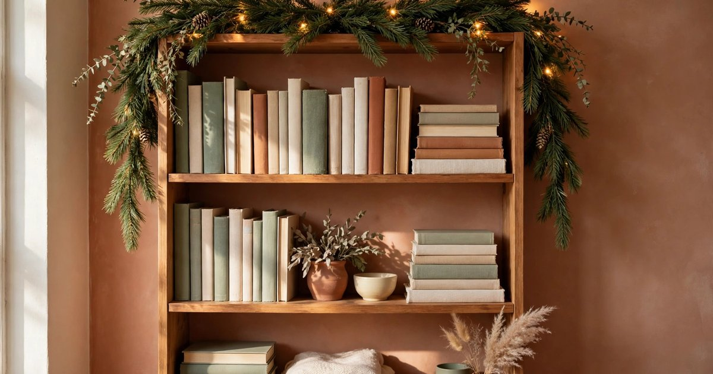
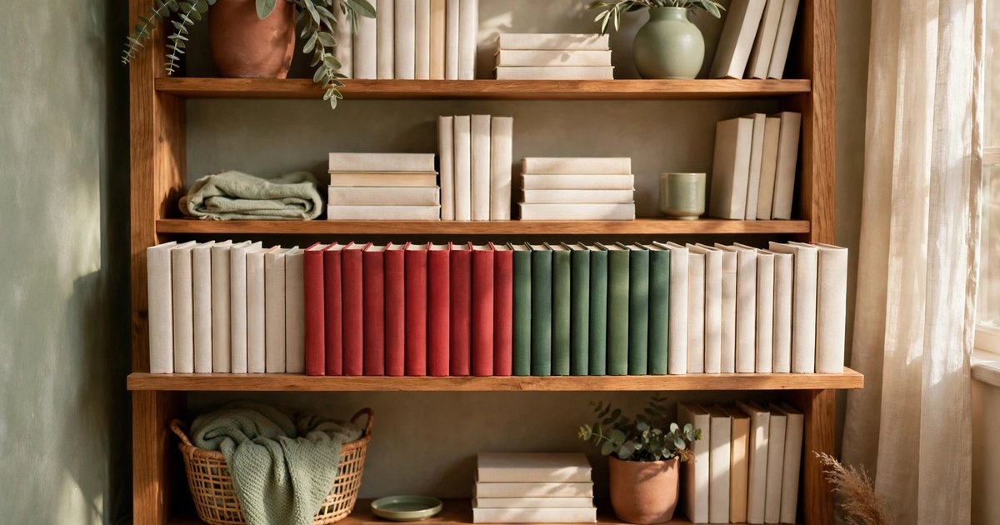
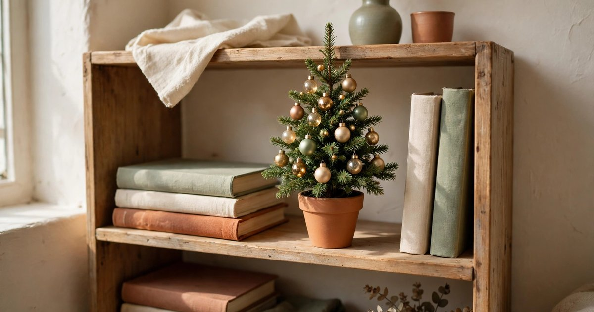
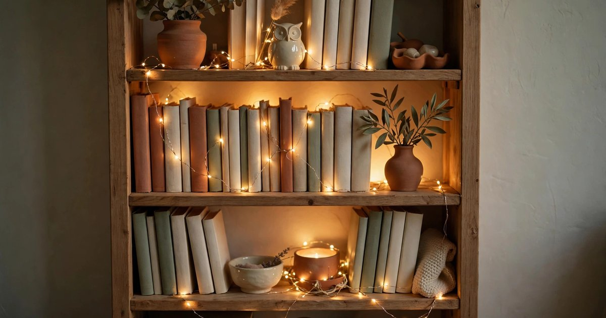
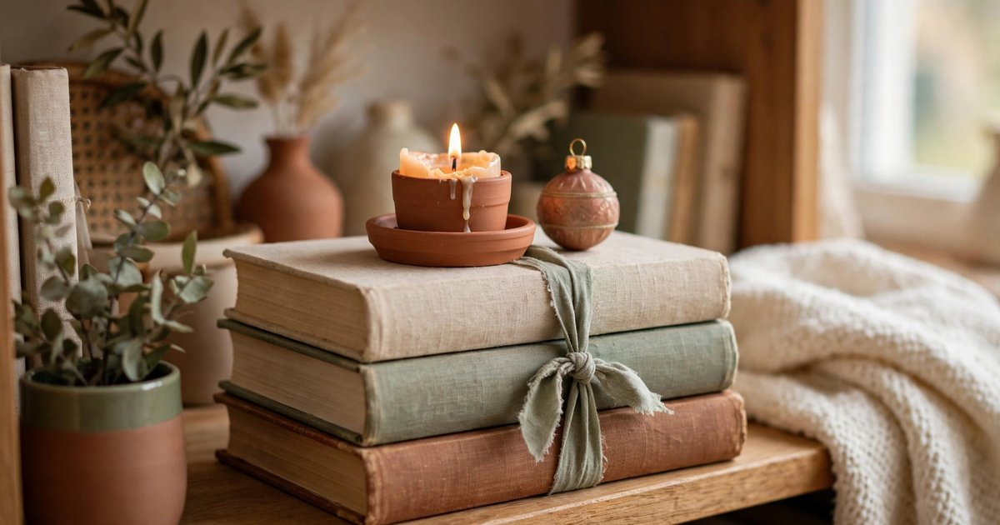
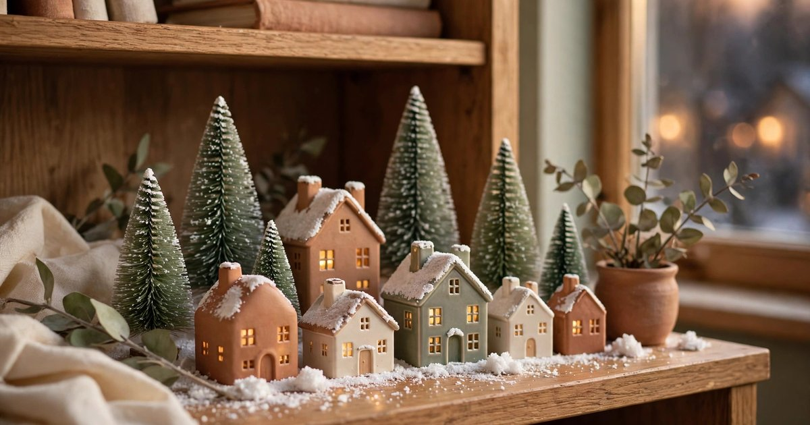
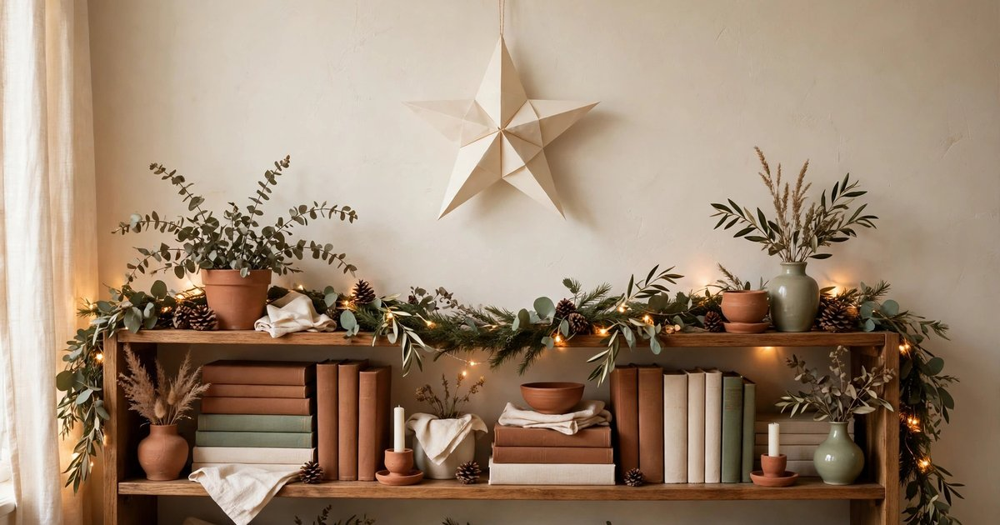
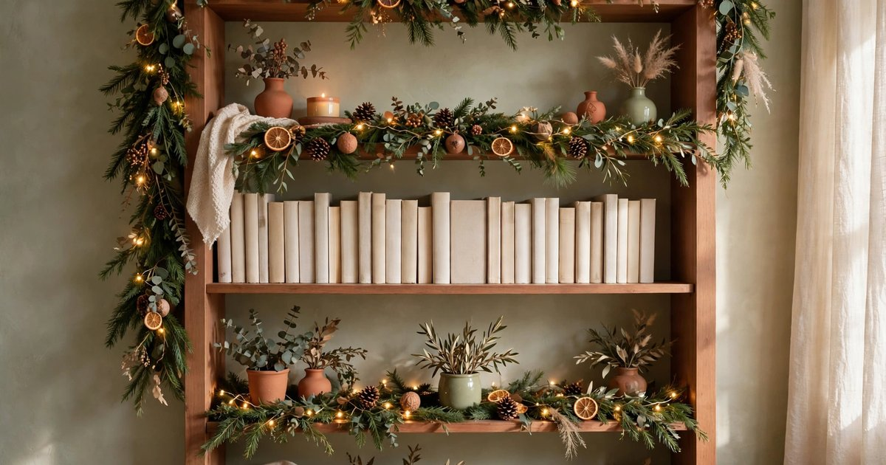

In a small apartment, the Christmas tree is a negotiation. There is rarely a spare corner, the floor space is spoken for, and a full-size tree can make the whole living room feel like a corridor. The bookshelf, though, is already there — already vertical, already styled, already the thing your eye lands on when you walk in. Dress it for Christmas and you get a festive focal point that costs almost nothing, takes up no floor space at all, and comes down in January with a single afternoon's work.

The trick is to treat the shelf like a mantel. Work in layers — something tall at the back, something glowing in the middle, something small and personal at the front — and let the books themselves do half the work. Pull the red and green spines forward, turn a few books spine-in for a calm cream block, stack a couple horizontally to make a plinth for a candle or a tiny tree. Every idea below is renter-friendly, costs little or nothing, and packs away into one small box. Here are ten ways to make a bookshelf the most Christmassy thing in a small apartment.

### 1. Drape a garland along the top shelf

A garland along the top shelf is the single fastest way to make a bookshelf read as Christmas. Lay a faux pine garland across the top edge and let it spill a little over each end, then weave a string of warm-white fairy lights through it. The top shelf is the perfect place because it frames everything below it — the garland becomes a valance for the whole bookcase, and you never have to move a single book to install it.

Choose a garland that matches the shelf's depth rather than its length, so it sits on the shelf instead of sliding off the front. A slim, flexible garland works better than a thick, stiff one in a small space, and battery lights with a timer mean you never have to reach behind the books to switch them off. If you own a real garland from a tree-trimming, use that — the smell alone is worth it — but faux lasts for years and sheds nothing onto your books.

### 2. Pull the red and green books forward

You already own Christmas decorations — they are just shelved spine-out and facing the wrong way. Pull every red, green, gold and deep burgundy book forward to the front edge of the shelf, and push the rest back half an inch. The colour block that appears is instantly festive, costs nothing, and takes about ten minutes. It works because books are already the shelf's main visual material; you are simply editing what is there.

Group the colours rather than scattering them: a run of reds on one shelf, greens on the next, and a small gold cluster where the two meet. If your collection leans neutral, pull the cream and tan spines forward instead and add a single red ribbon tied around a stack — the contrast does the festive work. When January comes, push everything back and the shelf returns to normal without a single decoration to store.

### 3. Add a mini tree on the middle shelf

A mini tree — a tabletop pine, a rosemary topiary, even a small Norfolk pine in a pot — turns a bookshelf into a Christmas display without the floor-space argument of a full tree. Set it on the middle shelf where it is at eye level, in a pot that matches your palette: terracotta, cream ceramic, or a woven basket that hides the nursery pot. Decorate it with miniature baubles, a few dried orange slices, or nothing at all — a bare little tree with a single string of fairy lights is the most elegant option in a small room.

The middle shelf matters because a tree on the top shelf disappears into the ceiling and a tree on the bottom shelf disappears behind the sofa. At eye level it becomes the thing you look at while you drink your coffee. Keep the pot small enough that the tree does not crowd the books beside it, and put a saucer underneath so watering never reaches the shelf below.

### 4. Weave fairy lights through the shelves

Fairy lights are the highest-impact, lowest-effort decoration in this whole list, and a bookshelf is the perfect place for them because the books hide the wire. Run one warm-white string along the back of each shelf, tucked behind the books, with a few loops spilling forward between the spines. The glow behind the books makes the whole bookcase look lit from within, and the effect at dusk is genuinely magical for the price of one string of lights.

Battery lights with a remote are worth the small extra cost: you can switch them on from the sofa, set a timer, and never fumble behind the bookcase. Keep the colour warm white rather than multicolour — it flatters the terracotta, cream and sage palette most small apartments already have, and it makes the book spines look richer rather than louder. One string per two shelves is usually enough; more than that and the shelf starts to look like a shop window.

### 5. Stack books horizontally as plinths

Horizontal stacks are the bookshelf stylist's oldest trick, and at Christmas they earn their keep twice over: they break up the vertical rhythm of the spines, and they create little plinths for the festive objects that would otherwise have nowhere to sit. Lay three or four books flat, largest at the bottom, and set a candle, a small ornament, or a tiny pinecone arrangement on top. The stack becomes a display stand that you already owned.

Vary the stack heights across the shelf — a tall stack on the left, a low one on the right — so the eye travels instead of stopping. Use books you do not reach for often, and keep the stacks stable: nothing heavier than a candle on top, and nothing that could topple onto the shelf below. A ribbon tied around the stack turns it from a pile of books into a deliberate decoration.

### 6. Hang tiny ornaments from the shelf edges

A few ornaments hung from the front edge of a shelf add Christmas at eye level without taking up a single inch of shelf space. Tie short lengths of ribbon or twine around small baubles, dried orange slices, pinecones or cinnamon sticks, and loop them over the shelf edge so they hang just in front of the books. Three or four per shelf is plenty — this is jewellery, not a curtain.

The trick is length: hang them at different heights, short in the middle and longer at the ends, so they read as a garland rather than a row. Lightweight ornaments only — a heavy bauble will drag the ribbon and eventually slide off. When the season ends, the ornaments go back in their box and the ribbon goes in the drawer, and the shelf shows no sign they were ever there.

### 7. Style one shelf as a tiny winter village

One shelf, styled as a miniature winter village, is the most charming idea on this list — and the most space-efficient, because a whole village fits on a single shelf. Line up three or four tiny ceramic houses, a couple of bottle-brush trees, and a pinch of fake snow or a folded white cloth as the ground. A battery tea light inside one house makes a window glow, and the whole scene reads as a story rather than a decoration.

You do not need a matching set. Charity shops and discount stores sell ceramic houses for very little, and a village built from mismatched pieces looks more handmade and more loved than a boxed set. Keep the village to one shelf so it reads as a scene, and leave the shelf above and below it calm — the contrast is what makes the village feel special.

### 8. Add a festive scent with dried oranges and cinnamon

A bookshelf is not only something you look at — in a small apartment it is something you walk past a dozen times a day, and a little scent makes that walk feel like Christmas. Set a small bowl of dried orange slices, cinnamon sticks and star anise on a shelf, or tuck a few orange slices between the books like bookmarks. The scent is subtle, natural, and costs almost nothing if you dry the oranges yourself in a low oven.

Dried citrus keeps for the whole season and looks as good as it smells — the amber rounds against the book spines are a decoration in their own right. Refresh the scent by adding a drop of cinnamon or clove oil to the bowl once a week. If you want more ideas for making a small space smell festive, our guide to [renter-friendly Christmas scent ideas](/renter-friendly-christmas-scent-ideas/) covers simmer pots, stove-top blends and more.

### 9. Frame the shelf with a paper star or wreath above it

A bookshelf styled for Christmas still needs something above it — a finishing touch that tells the eye the whole bookcase is the decoration, not just the shelves inside it. A paper star, a simple wreath, or a framed print with a festive image hung on the wall above the bookcase does exactly that, and none of them needs a nail: a Command hook or a length of washi tape holds a paper star perfectly well.

Keep it simple and light. A star made from folded paper or a small eucalyptus wreath is enough; the shelves below are already doing the heavy lifting. If you hang a wreath, our guide to [hanging a Christmas wreath without drilling](/no-drill-christmas-wreath-hanging-renters/) covers hooks and adhesives that come down without a trace in January.

### 10. Leave one shelf calm

The most important idea on this list is the one that asks you to do nothing. Leave one shelf — the bottom one, or the one you reach for most — completely calm: just books, no lights, no ornaments, no garland. The calm shelf is what makes the festive shelves look festive. Without it, the whole bookcase becomes noise; with it, the decorated shelves read as deliberate and the calm shelf reads as breathing space.

This is also the practical shelf: the one that holds the books you actually read in December, the one the children or the cat can reach without knocking a bauble onto the floor. Christmas decorating in a small apartment is an editing exercise, and knowing when to stop is what separates a styled shelf from a cluttered one.

## Frequently asked questions

### How do I decorate a bookshelf for Christmas without it looking cluttered?

Work in layers and leave breathing space. Dress two or three shelves and leave at least one calm, group decorations in odd numbers, and use the books themselves as the base — pull festive-coloured spines forward and let them do half the work. If a shelf looks busy, remove one thing rather than adding another.

### Will fairy lights damage my books?

No, as long as you use LED lights. LEDs stay cool, so they will not warm the paper or the shelf. Keep the wire behind the books rather than pressed against the pages, and use battery lights with a timer so they are not left on all night.

### What is the cheapest way to style a Christmas bookshelf?

Rearrange what you already own: pull red and green books forward, stack books horizontally as plinths, and hang ornaments you already have from the shelf edges on ribbon. A string of fairy lights is the only purchase worth making if you own nothing festive, and it will last for years.

### How do I keep decorations safe on a bookshelf with children or pets?

Keep ornaments high and lightweight ones low, avoid glass baubles on the bottom two shelves, and use battery tea lights instead of real candles. Hanging ornaments from the shelf edge keeps them out of reach of small hands, and a calm bottom shelf gives everyone something safe to touch.

### When should I take Christmas bookshelf decor down?

Early to mid-January, when the rest of the decorations come down. The garland, lights and ornaments pack into one small box, the books push back into place, and the shelf returns to normal in a single afternoon — which is the whole point of decorating a shelf instead of a room.
