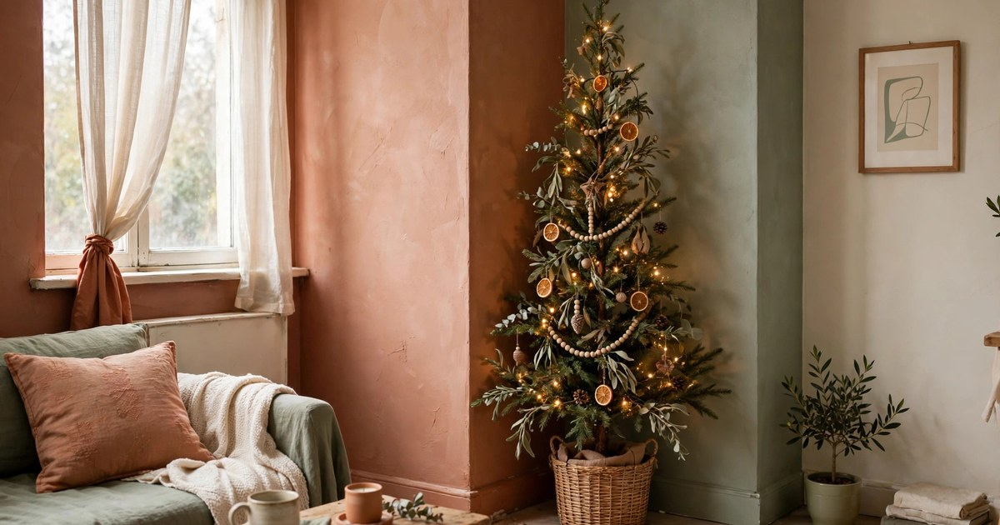
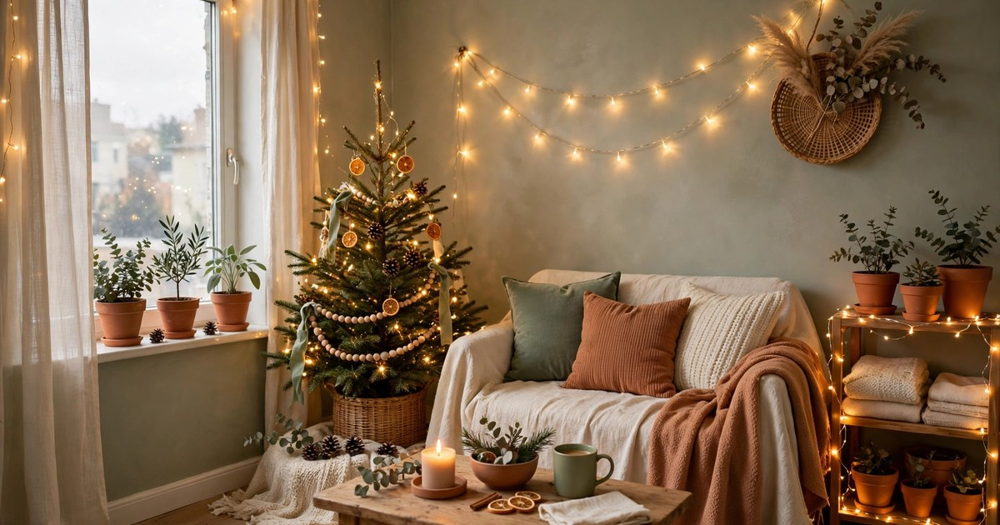
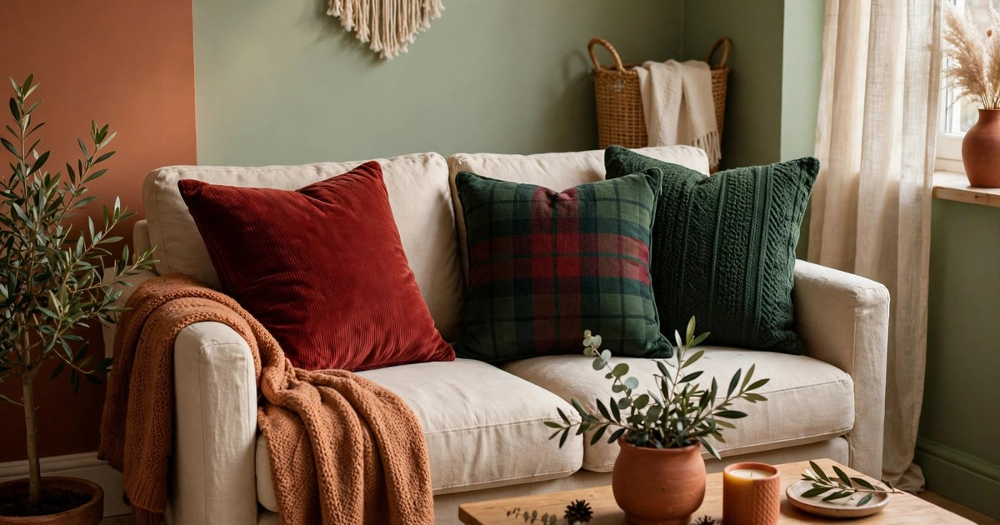
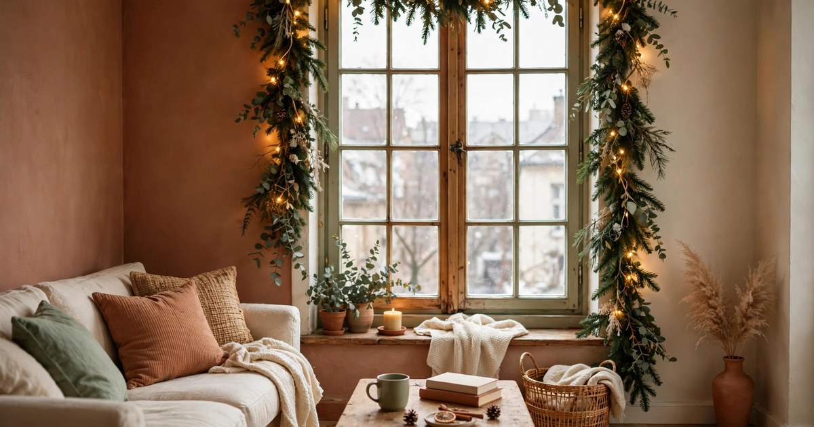
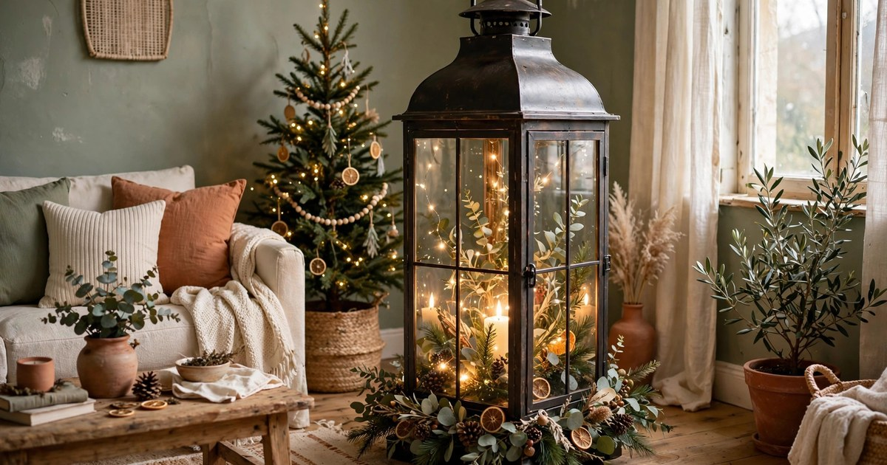
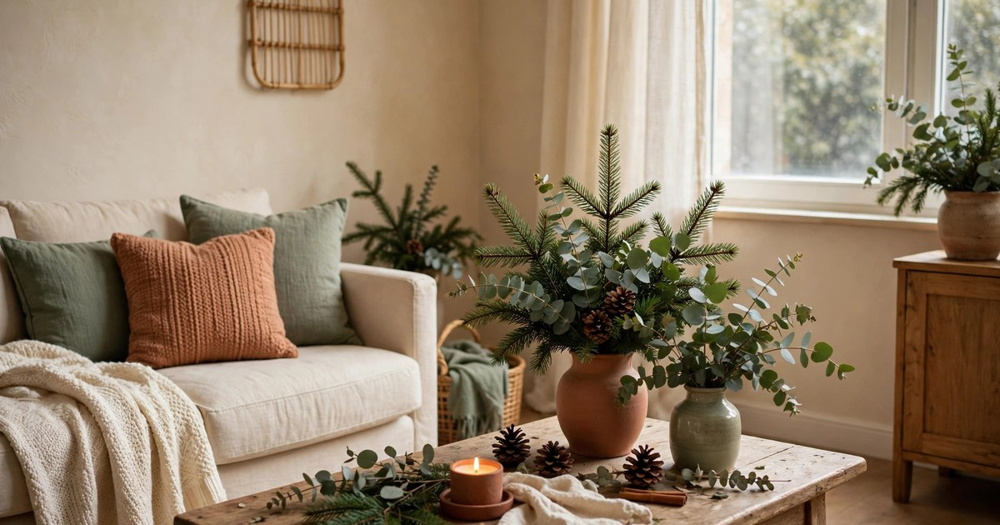
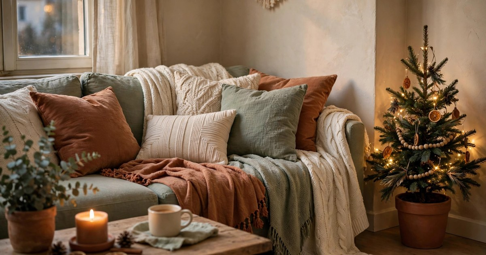
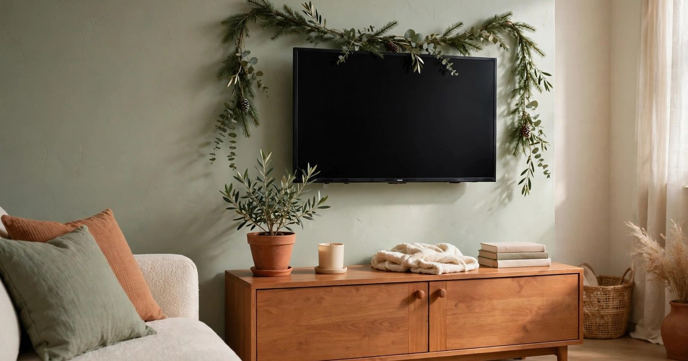
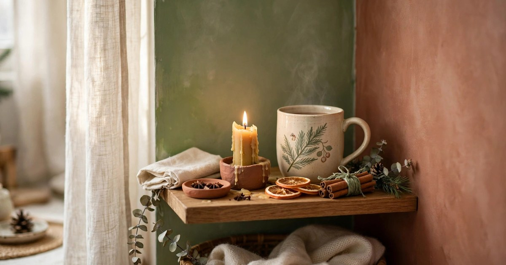

The living room is where Christmas actually happens in a small apartment: the tree, the lights, the evenings on the sofa with something warm to drink. It is also the room with the least room to spare. A full-size tree, a mantel display, a pile of presents and a coffee table covered in candles will swallow a small living room whole, and the result feels less like Christmas and more like a storage unit with fairy lights.

The good news is that a small living room is actually easier to make feel festive than a big one. Cheer is about density of warmth, not square footage: one well-lit corner, one cozy sofa, and a few deliberate touches will make the whole room glow, because there is nowhere for the atmosphere to escape to. Every idea below is budget-first, renter-friendly, and sized for a room where the sofa is also the guest bed and the coffee table is also the dining table. Here are ten that deliver the most Christmas per square foot.

### 1. Put the tree in the corner that wastes space anyway

Every small living room has a dead corner — the spot behind the door, the gap beside the bookcase, the awkward angle where two walls meet and nothing quite fits. That corner is your tree's home. A slim or pencil tree slots into it without stealing a single centimetre of usable floor, and because it sits against two walls, it looks deliberately placed rather than squeezed in.

Choose the tree by its footprint, not its height. A six-foot slim tree with a base under 60 centimetres wide gives you the full Christmas silhouette without the sprawling branches that eat a small room. If even that is too much, a half-tree that sits flat against the wall, or a wall-mounted branch tree, gives you the same glow with zero floor space at all. Angle the tree so its best side faces the sofa, string the lights before you add a single ornament, and the dead corner becomes the warmest spot in the flat.

### 2. Layer light instead of adding decorations

In a small room, light is a better decorator than objects, because light takes up no space. Switch off the overhead light in the evening and let the room be lit by layers instead: fairy lights on the tree, a string along a shelf, a candle cluster on the coffee table, and one warm lamp in the corner. The room instantly feels like Christmas, and you have added nothing that needs storing in January.

The trick is warmth and variety. Use warm white lights everywhere — mixing cool white and warm white is the fastest way to make a room feel like a shop display — and vary the heights: lights low on the coffee table, mid-level on the shelves, high on the tree. Battery-operated strings with timers are worth every penny in a small flat, because they remove the daily crawl behind furniture to find a plug, and they let you put light exactly where there is no socket at all.

### 3. Swap the cushions, not the sofa

A new sofa is out of the question; a set of festive cushion covers is under $20 and transforms the whole room. Swap your everyday covers for deep red, forest green, or a simple tartan, add one textured knit cushion for contrast, and the sofa — the biggest object in the room — suddenly reads as Christmas. When January comes, the covers fold flat into a drawer and the sofa goes back to normal.

Keep the palette tight. Two colours plus one texture is plenty in a small room; five different festive prints will make the sofa look like a clearance bin. If your sofa is already a strong colour, choose covers that complement it rather than fight it: cream and gold on a dark sofa, deep green on a grey one. A throw draped over one arm in the same palette ties the whole thing together and gives you something to pull over your knees on cold evenings, which is the whole point.

### 4. Dress the windows, not the walls

Wall space is precious in a small living room — it holds the shelves, the television, and the one piece of art you actually love — so leave it alone and decorate the windows instead. A garland draped along the top of the window frame, a string of lights down each side, or a few paper stars hung at different heights turns the window into a festive frame, and from outside the flat it looks wonderful too.

Windows are also the one place where decorations do not compete with furniture. Nothing sits in front of them except curtains, and a garland or light string adds no clutter to the floor or the surfaces. Use removable hooks or tension rods so nothing damages the frame, and keep the display light enough that you can still open the curtains and let the winter daylight in. In a small flat, daylight is a decorating asset too — do not block it with a heavy display.

### 5. One big statement piece beats ten small ones

Small rooms punish clutter more ruthlessly than any other space. Ten little ornaments scattered across every surface will make a small living room feel like a gift shop; one large statement piece — a big lantern with a candle inside, a tall vase of winter branches, a beautiful bowl of ornaments on the coffee table — gives the eye one place to land and leaves the rest of the room calm.

Pick your statement piece by footprint, not price. A tall, slim vase of bare branches takes up almost no surface area and draws the eye upward, which makes the ceiling feel higher. A lantern works because the candle inside it is protected and the glass throws light across the room. Whatever you choose, it should occupy no more space than one dinner plate, and it should be easy to move when you need the surface back. If decorating means you can no longer put a mug down, you have decorated too much.

### 6. Use the coffee table as a festive stage

The coffee table is the centre of a small living room, and at Christmas it can do double duty as the main display. Group your decorations on a single tray — a candle cluster, a small stack of festive books, a sprig of greenery, a bowl of ornaments — and the whole table reads as one intentional arrangement rather than a collection of unrelated objects. The tray is the secret: it contains the display, it protects the table, and it lifts off in one motion when you need the surface for dinner or a board game.

Keep the display low. Anything tall on a coffee table blocks conversation and sightlines to the television, and in a small room it will feel like a barrier. Flat greenery, low candles, and a shallow bowl are the right height; a tall candlestick or a big floral arrangement is not. When the display lives on a tray, the transition from "decorated" to "usable" takes ten seconds, which is exactly what a small living room needs on the nights when the room has to work hard.

### 7. Bring the outside in with real greenery

Nothing says Christmas faster than the smell of real pine, and in a small apartment that scent fills the whole flat within an hour. You do not need a real tree to get it: a few branches in a vase, a garland along a shelf, or a wreath on the wall brings the same fragrance and texture for a fraction of the cost and space. Offcuts from a [Christmas tree](/small-apartment-christmas-tree-ideas/) work for free, and a bunch of eucalyptus from the supermarket costs less than a takeaway coffee.

Real greenery also solves the small-room problem of decorations looking cheap. Plastic garlands in a tiny space are easy to spot; real branches are not, because they are imperfect in exactly the right way. Mix pine with eucalyptus or cedar for a fuller look, mist the branches every few days to keep them fresh, and compost them in January. Nothing to store, nothing to dust for eleven months, and the flat smells like a forest for the whole of December.

### 8. Make the sofa the cosiest seat in the flat

At Christmas, the living room's job is to be the place everyone wants to sit, and in a small flat that means the sofa has to work overtime. Layer it like a bed: a soft throw folded over the back, a second blanket in a basket beside it, cushions at both ends so two people can curl up properly. The goal is a sofa that looks so inviting that guests choose it over their phones.

This is also the cheapest way to make the room feel festive, because most of it uses things you already own. A throw you already have, in a warm colour, does more work than a bag of new ornaments. Add one new element — a festive cushion cover, a chunky knit throw — and the whole arrangement reads as intentional. Keep a basket of blankets by the sofa all December, and the room becomes the kind of place where people linger, which is the real test of Christmas decorating.

### 9. Let the television wall do festive work

In most small living rooms, the television wall is the biggest blank surface, and at Christmas it is criminally underused. A simple garland along the top of the unit, a string of lights behind the television that glows against the wall, or a few stockings hung from the shelf turns the wall into a festive backdrop without adding a single object to the floor. When the television is off, the wall still looks dressed; when it is on, the glow behind it makes the whole room feel warmer.

Keep it simple and symmetrical. A garland that sags in the middle or lights that only run halfway across the unit will draw the eye for the wrong reasons. Use removable hooks, measure before you buy, and leave the remote controls and consoles accessible — Christmas decorating should never mean you cannot find the remote. If you hang stockings here, use the same removable-hook logic as everywhere else in a rental: no nails, no damage, no deposit drama.

### 10. Create a tiny ritual corner

The most memorable part of a small living room at Christmas is rarely the biggest decoration. It is the tiny ritual corner: a candle on the windowsill you light every evening, a festive mug that only comes out in December, a small stack of Christmas books or a puzzle on the side table. These small, personal touches are what make the room feel like your Christmas, not a catalogue's.

Pick one corner — the windowsill, the end of a shelf, the side table by the sofa — and give it one job: the evening candle, the advent calendar, the place where the Christmas cards go. Keep it small enough that it never gets in the way, and make it something you actually use every day. A ritual corner costs almost nothing, takes up almost no space, and is the thing you will miss most when January comes and the decorations go back into their box.

## Small Room, Full Christmas

A small living room does not need less Christmas; it needs more considered Christmas. The thread through all ten ideas is the same: decorate with light and layers rather than bulk, give every decoration a job and a way to disappear, and let one or two considered pieces do the work of a dozen small ones. Start with the lights and the sofa — those two alone will make the room feel like Christmas — then add the greenery and the statement piece as December approaches.

The test worth applying to every decoration in a small room is simple: does it make the room feel warmer without making it feel smaller? If the answer is yes, it stays. If it blocks a walkway, crowds a surface, or cannot be lifted away in one move, it does not belong in a tiny living room, however festive it looks in the shop.

## Shop this look: small living room Christmas

- **Festive cushion covers** — swap the covers, not the sofa. [Shop cushion covers](https://www.amazon.com/s?k=christmas+cushion+covers&tag={{AMAZON_TAG}})
- **Warm fairy lights** — layered light instead of more decorations. [Shop fairy lights](https://www.amazon.com/s?k=warm+white+fairy+lights+indoor&tag={{AMAZON_TAG}})
- **Chunky throw blanket** — makes the sofa the cosiest seat in the flat. [Shop chunky throws](https://www.amazon.com/s?k=chunky+knit+throw+blanket&tag={{AMAZON_TAG}})
- **Tabletop mini tree** — a tree that fits the corner that wastes space. [Shop mini trees](https://www.amazon.com/s?k=mini+christmas+tree+tabletop&tag={{AMAZON_TAG}})
- **Artificial garland** — real greenery feel on windows and shelves. [Shop garlands](https://www.amazon.com/s?k=artificial+christmas+garland&tag={{AMAZON_TAG}})

## Frequently Asked Questions

### How do I fit a Christmas tree in a very small living room?
Choose a slim or pencil tree with a base under 60 centimetres wide, and place it in a dead corner where nothing else fits. If even that is too much, a half-tree against the wall or a wall-mounted branch tree gives you the full Christmas silhouette with zero floor space. Decorate with lights first, then ornaments, so the tree reads as festive even with fewer decorations.

### What is the cheapest way to make a small living room feel festive?
Switch off the overhead light and use layered warm light instead: fairy lights, candles, and one warm lamp. Add a set of festive cushion covers and a throw you already own, and the room will feel like Christmas for under $25. Light and textiles do more work in a small room than any collection of ornaments.

### How do I decorate a rental living room for Christmas without damage?
Use removable hooks, tension rods, and freestanding displays — nothing that needs nails, screws, or adhesive that damages paint. Garlands on windows, lights on shelves, and a tray-based coffee table display all come down in January without a trace, and your deposit stays safe. Check your tenancy agreement on open flames before using real candles.

### How do I stop Christmas decorations making a small living room feel cluttered?
Follow the one-statement-piece rule: one large, deliberate display instead of many small objects. Group decorations on trays so they read as a single arrangement, keep displays low so sightlines stay open, and make sure every decoration can be lifted away in one move when the room needs to work. If you cannot put a mug down, you have too many decorations.
