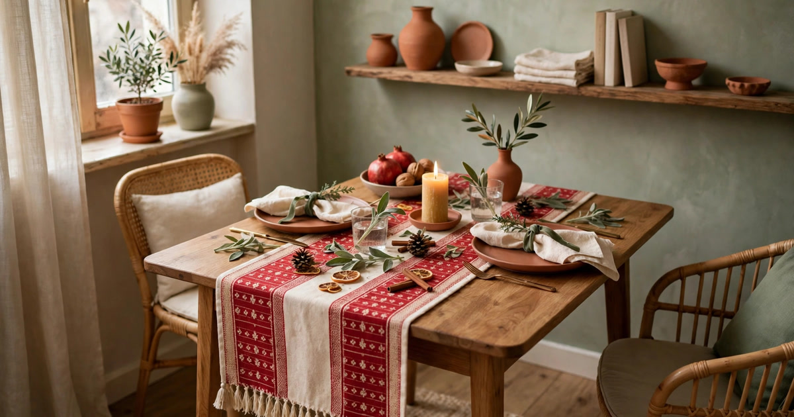
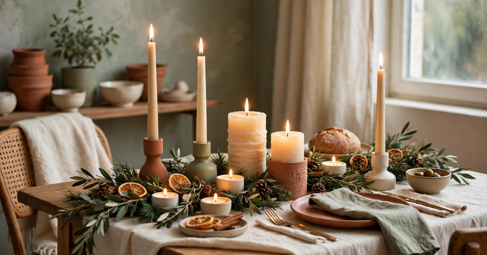
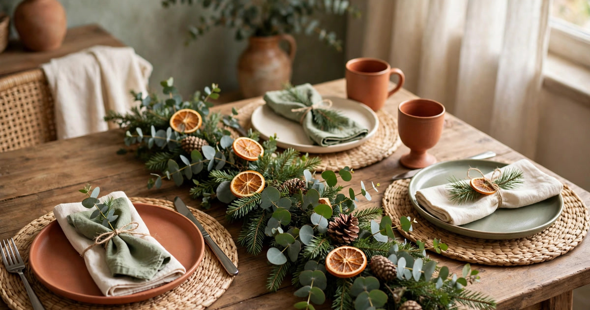
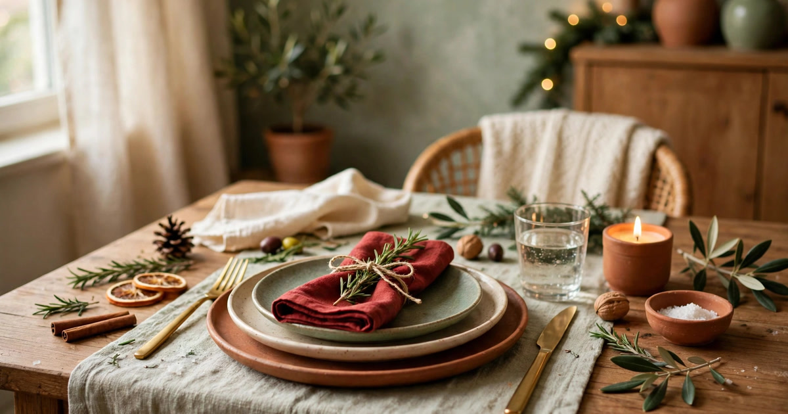
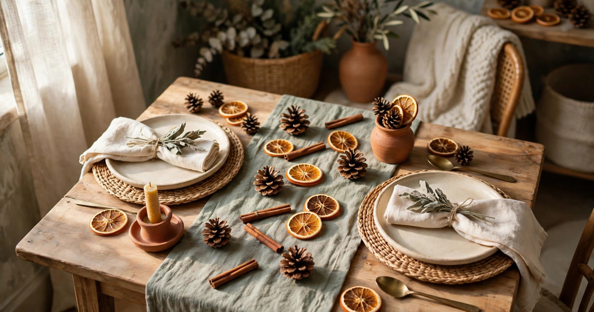
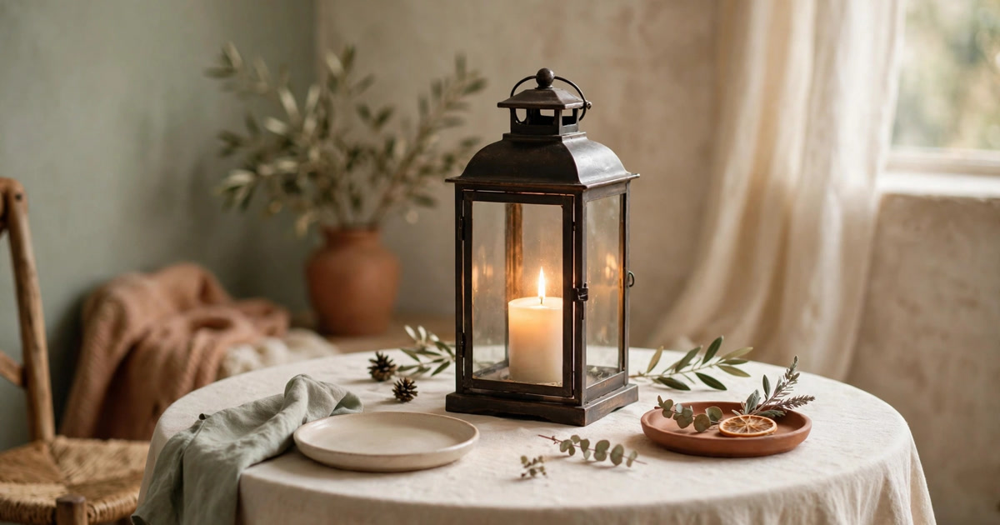
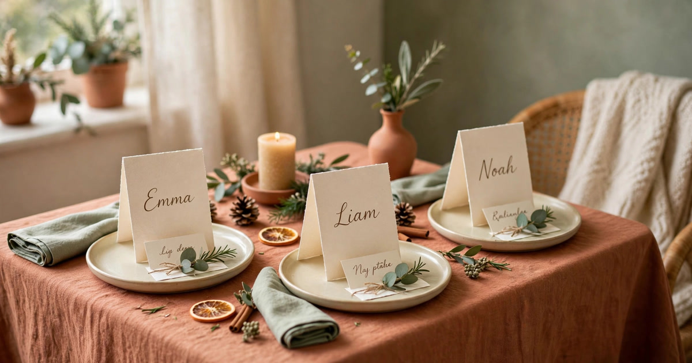
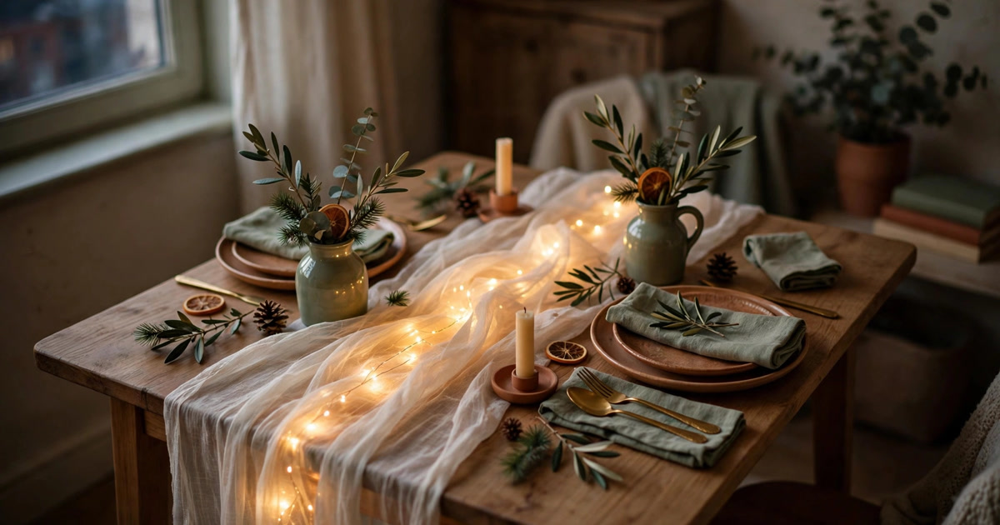
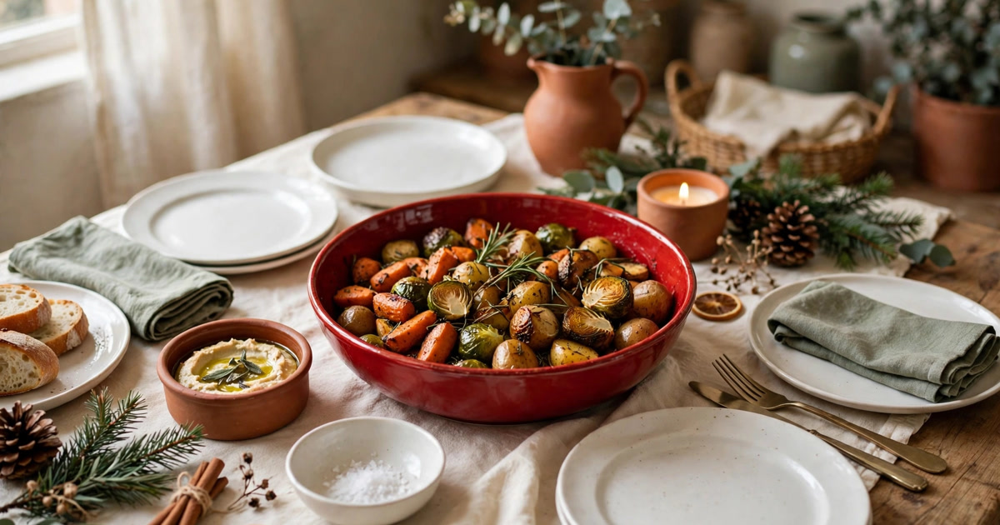
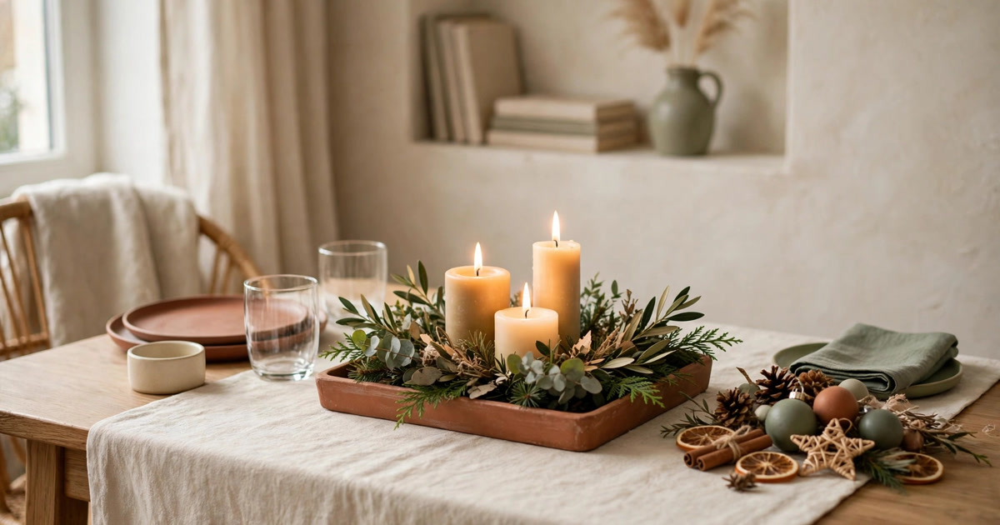

A tiny dining table is the hardest surface in a small apartment to decorate for Christmas. It has to hold dinner, drinks, elbows and conversation, and every decoration you add competes for the same few square centimetres. The temptation is either to skip the table entirely or to pile it so high with candles and garlands that nobody can see each other across it. Neither feels like Christmas dinner.

The trick to a festive small table is to decorate vertically and in layers, not with bulky centrepieces. A tablecloth or runner sets the scene, candlelight does the heavy lifting, and a few natural touches — greenery, citrus, pinecones — add the Christmas smell and colour without eating a single place setting. Everything below is renter-friendly, budget-first, and packs away into one small box in January. Here are ten ideas that make a tiny table feel properly dressed for Christmas dinner.

### 1. A runner instead of a full tablecloth

A full tablecloth on a tiny table tends to swallow it, pooling over the edges and making the whole setup feel fussy. A runner is the smarter move: it adds a band of festive colour down the centre, protects the tabletop from hot dishes, and leaves the wood or laminate visible at the sides so the table still looks like a table. Choose a runner in deep red, forest green, or a simple cream with a woven texture, and let it hang just a few centimetres over each end.

The runner also solves the storage problem that plagues small flats. It folds flat, weighs nothing, and slips into a drawer for eleven months of the year. If you do not own a festive runner, a length of inexpensive fabric, a wide ribbon, or even a folded throw works just as well. Layer it over a plain white cloth if you want extra formality, or let it run bare on the wood for a relaxed, cabin-style feel that suits a small apartment far better than stiff formality.

### 2. Candles at different heights

Candlelight is the single most effective decoration for a small table because light takes up no space at all. The trick is height: a cluster of candles at different levels — a tall taper in a simple holder, a couple of chunky pillars, a few tealights scattered low — creates a skyline of warm light that feels intentional rather than cluttered. Keep the palette to one colour, warm white or cream, so the group reads as a single display rather than a jumble.

In a small apartment, flameless candles are worth considering seriously. Many tenancy agreements restrict open flames, and a table crowded with plates and glasses is exactly where a real candle gets knocked. Battery-operated pillars and tapers now flicker convincingly, they run on a timer, and you can tuck them into spots — inside a lantern, behind a glass — where a real flame would be a risk. Mix one or two real candles with flameless ones if you like the ritual of lighting something, but let the battery ones do the bulk of the work.

### 3. A low greenery garland down the centre

A garland laid flat down the centre of the table is the classic Christmas centrepiece, and it works beautifully on a small table as long as you keep it low. Choose a slim garland — eucalyptus, pine or cedar — and let it snake gently between the place settings rather than running in a thick, tall ridge. Guests should be able to see each other over it, and serving dishes should sit comfortably alongside it.

Fresh greenery brings two things no shop-bought decoration can: scent and texture. The smell of pine or eucalyptus will fill a small apartment within an hour, and the soft, irregular shapes look far more expensive than they cost. A metre of garland from a florist or garden centre is usually under $15, and offcuts from a Christmas tree work for free. Tuck in a few dried orange slices or pinecones for colour, and skip the baubles — they roll, they catch on sleeves, and they belong on the tree.

### 4. Layered plates with a festive napkin

When the table itself is small, the place setting is the decoration. Layering does the work: a charger or a larger dinner plate underneath, your everyday plate on top, and a folded napkin in a festive colour tucked between them. The layers add height and formality without adding a single extra object to the table, and the whole setting looks considered even before anyone sits down.

You do not need to buy a Christmas dinner set. A set of plain cream or white plates looks festive the moment you add a deep red or forest green napkin — cloth if you have it, paper if you do not — and gold or brass-toned cutlery if you own it. Tie the napkin with a short length of twine and tuck in a sprig of rosemary or pine, and each place setting becomes its own tiny decoration. It costs almost nothing, it photographs beautifully, and guests notice the effort far more than they would notice a new set of plates.

### 5. Citrus and pinecones as natural confetti

A small table does not need a centrepiece if the surface itself is decorated. Scatter a handful of dried orange slices, pinecones and cinnamon sticks along the runner between the place settings, and the table looks dressed with almost no effort. These natural touches are flat, so they do not block sightlines or compete with serving dishes, and they cost next to nothing — dried oranges can be made in an oven from a single fruit.

The beauty of this idea is how forgiving it is. There is no arrangement to get wrong: scatter, step back, adjust one or two pieces, and you are done. The scent is a bonus — cinnamon and dried citrus release a gentle fragrance all evening, especially near candle warmth. When dinner is over, sweep the whole lot into a jar for next year or compost it. Nothing to store, nothing to break, and the table underneath stays completely usable.

### 6. One statement piece, not five small ones

Small tables punish clutter more than any other surface in the flat. Five little ornaments, three tiny trees and a scatter of baubles will make a tiny table look like a gift shop. One statement piece — a large lantern with a candle inside, a tall vase of winter branches, or a single beautiful bowl of ornaments — gives the eye one place to land and leaves the rest of the table calm.

Choose your statement piece by height and footprint, not by price. A tall, slim vase of bare branches takes up almost no table area and draws the eye upward, which makes the whole room feel taller. A lantern works because the candle inside it is protected and the glass reflects the light. Whatever you pick, it should occupy no more than the space of one dinner plate, and it should be easy to lift off the table entirely when the food arrives. If you have to move three things to serve dinner, you have too many things.

### 7. Place cards that double as favours

Place cards feel formal, but on a small table they are surprisingly practical: they stop the awkward shuffle over who sits where, and they let you plan the seating so the table works — tall guests opposite each other, the cook near the kitchen end. Make them yourself from card, fold them into tents, and write each name by hand. Tuck a sprig of greenery or a cinnamon stick behind the fold, and the card becomes part of the decoration.

The clever part is making the place card double as a favour. Write a short note on the back — a memory, a thank you, a joke — or attach a tiny treat: a chocolate, a mini ornament, a packet of seeds. Guests take them home, which means the decoration clears itself at the end of the night. In a small flat, anything that leaves with the guests is a gift. Keep the cards small, no larger than a credit card folded, so they sit neatly above each plate without crowding it.

### 8. Fairy lights under a sheer runner

If you want the wow factor of a lit table without losing a centimetre of surface, run a string of battery fairy lights underneath a sheer runner or a length of gauzy fabric. The light glows through the fabric, turning the whole centre of the table into a soft, warm ribbon, and the runner itself stays flat enough for plates and glasses to sit on comfortably.

This works best with warm white micro-lights on a thin copper or clear wire, which disappear into the fabric. Use a battery pack with a timer and tuck it under the runner at one end, out of sight. The effect is magical in a small, dimly lit apartment — especially in the evening, when the overhead light is off and the table becomes the warmest spot in the room. It costs under $10, it takes five minutes to set up, and it is the idea guests will ask about most.

### 9. Mix your everyday dishes with one festive piece

Nobody in a small apartment has room to store a full Christmas dinner service, and nobody needs one. The trick is to let your everyday dishes do the work and add exactly one festive piece: a red serving bowl, a patterned platter, a gold-rimmed salad plate at each setting. One bold piece signals Christmas; a whole matching set signals a storage problem.

Pick the piece that gets the most table time — usually the main serving dish — so it is visible throughout dinner rather than tucked away after the first course. A deep red or forest green bowl holding roast vegetables looks festive against plain white plates, and it earns its shelf space the rest of the year as an everyday serving bowl. This is the budget-first approach at its best: one purchase, used all year, that transforms the table every December.

### 10. A clearing plan built into the setting

The least glamorous idea on this list is the one that will save your evening. In a small apartment, the table has to convert from dinner to dessert to drinks to board games, often within an hour. Build the clearing plan into the setting itself: keep decorations flat, light and liftable, put the candle cluster on a single tray that lifts off in one move, and leave one clear corner of the table — or a nearby sideboard — as the landing zone for cleared plates.

A tray is the secret weapon here. Group your candles, greenery and any small ornaments on one shallow tray, and the entire centrepiece lifts off the table in a single motion when the food arrives or when dessert needs space. The table goes from dressed to cleared in ten seconds, and the tray can sit on a windowsill or side table until the evening ends. In a tiny flat, the best decoration is one that knows when to get out of the way.

## A Small Table, Properly Dressed

None of these ideas needs a large table, a large budget or a landlord's permission. The thread running through all ten is the same: decorate with light and layers rather than bulk, keep everything low and liftable, and let one or two considered pieces do the work of a dozen small ones. Start with the runner and the candles — those two alone will make the table feel like Christmas — then add the greenery and the place settings as the day approaches.

The best small-table Christmas setting is the one you notice when the candles are lit and forget about entirely when the food arrives. That is the test worth applying to every decoration: if it blocks a face, crowds a plate or cannot be lifted off in one move, it does not belong on a tiny table.

## Frequently Asked Questions

### How do I decorate a small dining table for Christmas without crowding it?
Decorate with light and flat layers rather than tall or bulky objects. A runner, candlelight at different heights and a low garland or scatter of natural touches will make the table feel festive while leaving every place setting usable. Keep the centrepiece to the footprint of one dinner plate, and make sure guests can see each other across it.

### What is the cheapest way to set a festive Christmas table?
Start with what you already own: everyday white plates, a plain cloth, and a string of fairy lights. Add one festive-coloured napkin per guest, a handful of pinecones or dried orange slices, and a sprig of greenery at each place. The whole table can be dressed for under $25, and most of it — the lights, the napkins, the pinecones — can be reused every year.

### Are real candles safe on a small, crowded Christmas table?
Real candles are beautiful but risky on a table packed with plates, glasses and sleeves. Battery-operated candles are the safer choice in a small apartment, and many tenancy agreements restrict open flames anyway. If you use real candles, keep them in stable holders, away from the greenery, and never leave the table while they are lit.

### How do I set a Christmas table in a studio apartment with no dining table?
Use whatever surface you have — a coffee table, a desk, a kitchen counter — and apply the same principles at a smaller scale. A folded runner or a festive tea towel becomes the tablecloth, one candle cluster replaces a centrepiece, and low seating with cushions turns a coffee table into a perfectly good Christmas dinner spot. The setting matters far more than the furniture.
