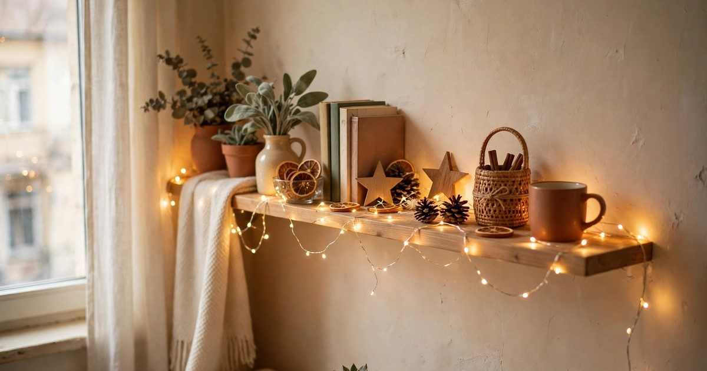
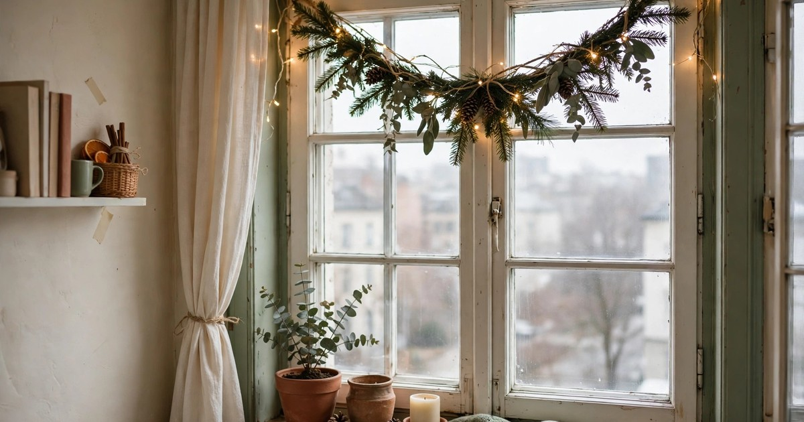
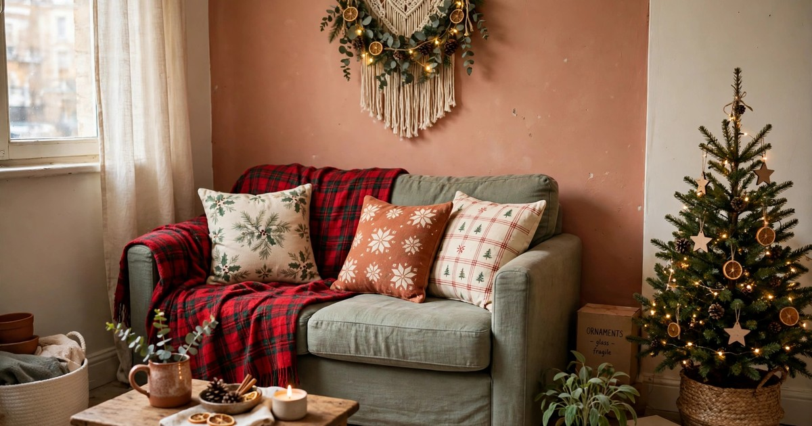

A Christmas tree is the default centrepiece of the season, but in a small apartment it is also the single biggest space problem December brings. A real tree needs a corner you do not have, a stand you will store for eleven months, and a daily sweep of needles off a floor you already vacuum twice a week. A fake tree is no better: it needs the same corner and a cupboard to live in for the rest of the year. Plenty of renters quietly skip the tree altogether — and then wonder why the flat still feels like an ordinary Tuesday in mid-December.

The good news is that a tree is only one ingredient in the feeling of Christmas, and it is not even the most powerful one. What your brain actually reads as "Christmas" is a bundle of small signals: the smell of pine and cinnamon when you walk through the door, warm low light in the early dark, soft textures under your hands, and greenery at eye level. None of those needs a tree, and none of them needs floor space. This guide walks you through seven steps that layer those signals into a small apartment, one affordable change at a time, so the place feels properly festive from the first weekend of December right through to New Year — and takes about an afternoon to put together.

### 1. Start with Scent, Not Decorations

Scent is the fastest way to make a room feel like Christmas, because it works before you see a single decoration. A simmer pot costs almost nothing: a saucepan of water, a sliced orange, two cinnamon sticks, a handful of cranberries and a few cloves, kept at the lowest heat for an hour. The steam carries the smell through a small flat in minutes, and you can top the water up and reuse the same pot for two or three evenings. If you would rather not watch a hob, a slow cooker on its lowest setting does the same job, and a small wax warmer or a reed diffuser with a pine or spiced-orange scent works while you are out.

Choose one signature scent and stick to it all season rather than mixing pine candles, cinnamon sprays and mulled-wine plug-ins at once, which quickly turns a small space into a headache. Pine, cedar, spiced orange and cinnamon are the classics because they read instantly as festive without being sweet. Put your scent source near the front door or in the hallway if you have one, so the smell greets you when you come home — that first breath is the moment the flat stops feeling ordinary. For renters, scent has another advantage: it leaves nothing behind. No holes, no marks, no storage, just a saucepan you already own.

### 2. Layer Warm Light at Eye Level

December afternoons are dark by four o'clock, and the single ceiling light in a rented living room makes everything look flat and tired. The fix is warm light at eye level, in several small pools rather than one bright source. A short string of battery fairy lights along a shelf, a second string around a window frame, and a couple of candles on the coffee table change the whole mood of a room for less than the price of a takeaway. Battery lights are the renter's best friend here: no trailing cables, no socket hunting, and you can tuck the little battery pack behind a book or a plant pot.

Keep the colour temperature warm white, around 2700K, and avoid the cold blue-white strings that read as office lighting. Cluster lights rather than spreading them thinly — a dense swirl of lights in a glass jar on the sideboard reads as a deliberate decoration, while a single sparse string looks like you gave up halfway. Add a timer plug or choose lights with a built-in six-hour timer so they switch themselves on at dusk and off before bed, which saves batteries and means the flat is glowing when you walk in. If your landlord bans real candles, the battery pillar candles with a flickering flame effect are genuinely convincing from across a room, and they are safe to leave on while you fall asleep on the sofa.

### 3. Dress the Windows Like a Shop Display

Your windows are the biggest blank surface in a small apartment, and they are free. A simple swag of fresh greenery across the top of the window, held up with two removable adhesive hooks, frames the view and reads as festive from both inside and out. Fresh pine, fir or cedar branches are cheap from a florist or a garden centre in December, and a single bunch is usually enough for one window. Tie the stems together with twine, drape the swag in a shallow curve, and tuck in a few dried orange slices or pinecones for colour.

If fresh greenery feels like too much upkeep, a paper snowflake garland or a string of wooden beads across the window does the same job for pennies and stores flat in an envelope. Hang your fairy lights along the window frame as well, so the window glows from the street and gives you a lit backdrop in the evenings. One caution for renters: never stick tape or adhesive directly onto double-glazed window seals, as it can damage them — hooks on the wall or the frame are safer, and suction-cup hooks work on the glass itself. A dressed window also does something a tree never could: it makes the flat look festive to everyone walking past outside.

### 4. Bring in Greenery, Just Not a Tree

You do not need a whole tree to get the look and smell of fresh evergreen. A few branches in a vase on the sideboard, a small wreath on the inside of the front door, and a sprig of eucalyptus tucked behind a picture frame give you greenery at eye level in three different spots, which is exactly how a decorated room reads. A florist will often sell offcuts and loose branches for a pound or two in December, and a single bunch of pine or fir can be split across two vases and a wreath if you are willing to trim it yourself.

The trick is to spread the greenery around rather than putting it all in one place. One branch on the mantelpiece, one on the dining table, one in the bathroom — your eye registers greenery everywhere and assumes the whole flat is decorated, even though you have used less foliage than a single tree branch. Keep the stems in water and mist them every couple of days, and they will last two to three weeks. When they start to drop, they compost or go in the green bin, and there is no tree to drag down the stairs in January. If you want more ideas for using loose branches, our guide to [fresh evergreen branch decor](/fresh-evergreen-branch-decor-ideas-small-apartments/) has ten ways to style them around a small flat.

### 5. Swap the Textiles, Not the Furniture

Textiles are the highest-impact, lowest-effort change you can make in a small room, because they cover the largest surfaces you actually touch. Swap two cushion covers for a festive pair — plaid, deep red, forest green or a simple cream with a stitched snowflake — and drape a soft throw over the arm of the sofa. Change the tea towels in the kitchen, put a festive runner on the dining table, and swap the hand towel in the bathroom. That is five changes, none of which needs a tool, and together they recolour the whole flat.

Buy cushion covers rather than whole cushions, so they fold flat into a drawer in January, and choose fabrics that wash well, because December is the season of spilled mulled wine. A single deep-red or forest-green throw is more versatile than a novelty print: it looks festive in December, cosy in January, and you will still be using it in February. The same logic applies to bedding — a flannel or brushed-cotton duvet cover in a warm tone makes the bedroom feel wintry without a single decoration. Keep the palette tight, two festive colours plus your usual neutrals, so the flat feels styled rather than cluttered.

### 6. Create One Focal Point That Is Not a Tree

Every decorated room needs one place the eye lands, and without a tree that job falls to a shelf, a sideboard or the top of a bookcase. Pick the spot you see first when you walk in, clear it completely, and rebuild it as a small festive display: a stack of books, a cluster of candles at different heights, a small wreath leaning against the wall, a few pinecones in a bowl, and one string of fairy lights woven through it. The cluster effect matters more than any single item — three candles together read as a display, one candle reads as a candle.

If you have no shelf to spare, the dining table can be the focal point instead: a runner, a low arrangement of greenery and candles down the centre, and a bowl of clementines. Or use the top of the television stand, which is usually the largest flat surface in a small living room. The point is to concentrate your decorations in one deliberate arrangement rather than scattering single items around the room, because a scattered look is what makes a treeless flat feel half-decorated. Spend your budget here — a few good candles and a small wreath beat ten cheap ornaments spread thin.

### 7. Add the Sounds and Rituals of the Season

The last layer is the one you cannot see at all: sound and ritual. A playlist of Christmas music, played quietly while you cook or wrap presents, changes the atmosphere of a room faster than any decoration. A stack of mugs ready for hot chocolate, a tin of biscuits on the counter, and a favourite Christmas film queued up for the evening all signal that the season has arrived. These are the things your guests will actually remember — nobody remembers whether there was a tree, but everyone remembers the smell of cinnamon and the sound of carols while the lights twinkle.

Build one small ritual into your December evenings: light the candles at the same time each night, put the fairy lights on a timer, make a proper hot chocolate on Fridays. Rituals are free, they need no storage, and they are what make a small flat feel like Christmas rather than look like it. And when January comes, the whole thing packs away into a single box: the lights, the cushion covers, the candles and the wreath. No tree to dispose of, no needles in the carpet, no storage unit required — just a flat that felt properly festive all month, and a deposit that is completely intact.

## Frequently Asked Questions

### Can a small apartment really feel festive without a Christmas tree?

Yes. The feeling of Christmas comes from scent, warm light, greenery and soft textiles far more than from one large tree. Layer those four signals and most guests will not even notice the tree is missing — and you keep your floor space all December.

### What is the cheapest way to make a flat feel like Christmas?

A simmer pot on the stove and a string of battery fairy lights, which together cost under £10. Scent and warm light do more than any single decoration, and both are reusable or consumable rather than things you have to store.

### How do I hang Christmas greenery in a rental without damage?

Use removable adhesive hooks on painted walls, suction-cup hooks on glass, and twine or ribbon to tie branches to existing fixtures like curtain rods. Never use nails, screws or tape on window seals, and test any adhesive hook in a hidden spot first.

### How long does fresh evergreen last indoors?

Cut pine, fir and cedar branches last two to three weeks indoors if the stems sit in water and you mist them every couple of days. Keep them away from radiators, which dry them out fast, and replace individual stems as they drop rather than the whole arrangement.

### What should I do with the decorations in January?

Everything in this guide packs into one small box: lights, cushion covers, candles and the wreath. Fresh greenery goes in the compost or green bin, and the textiles wash and fold flat. There is no tree to dispose of and no storage problem.
