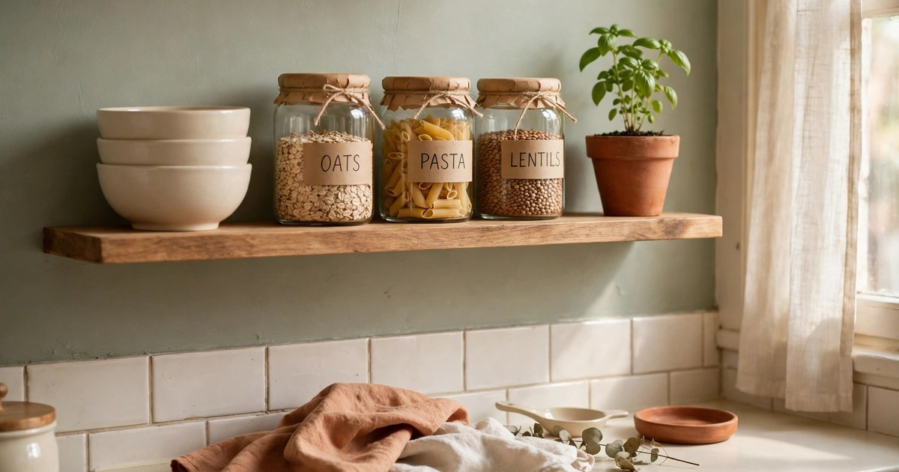
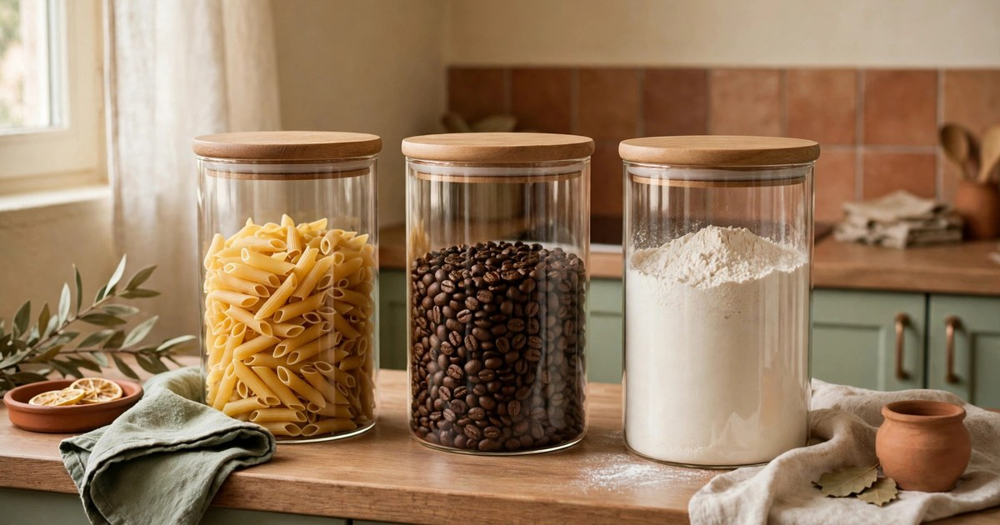
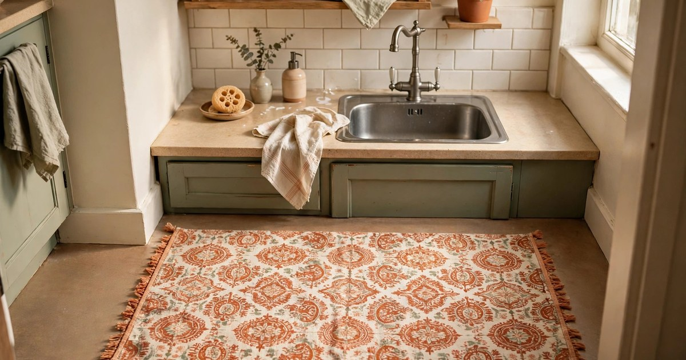
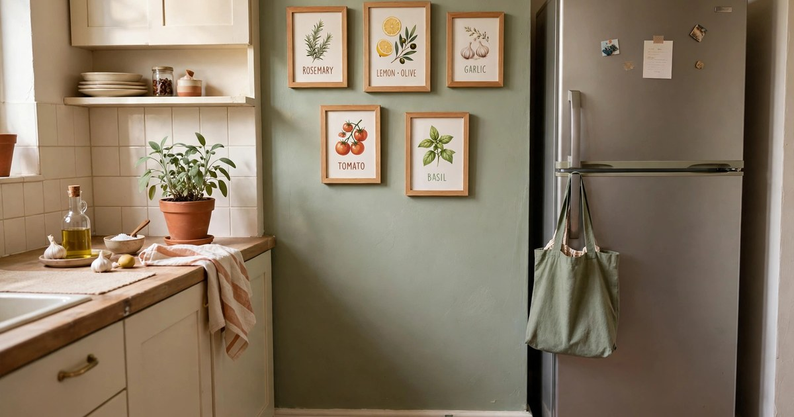
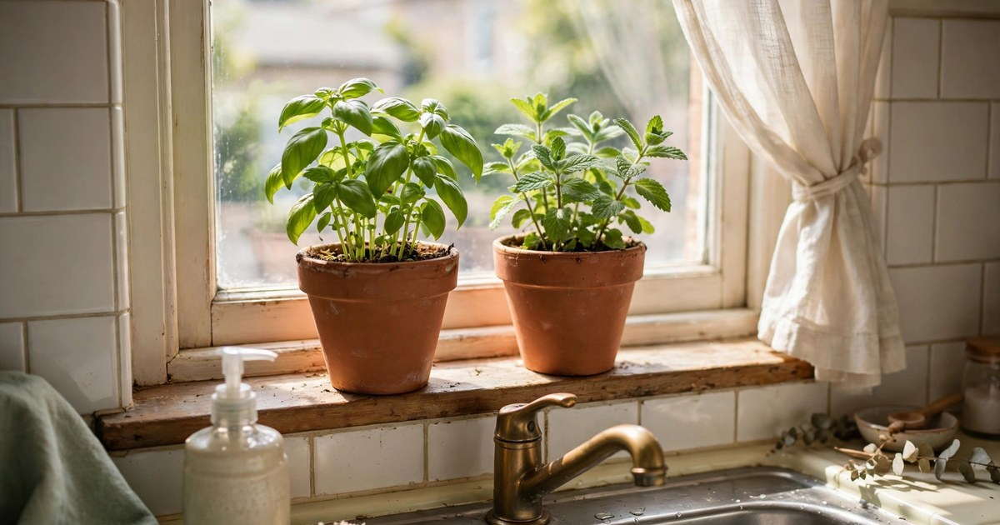
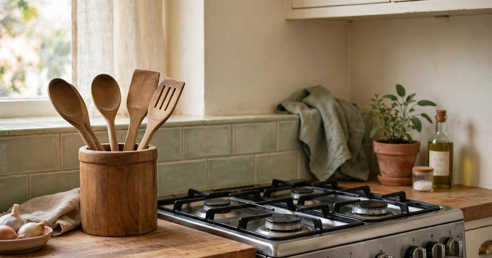
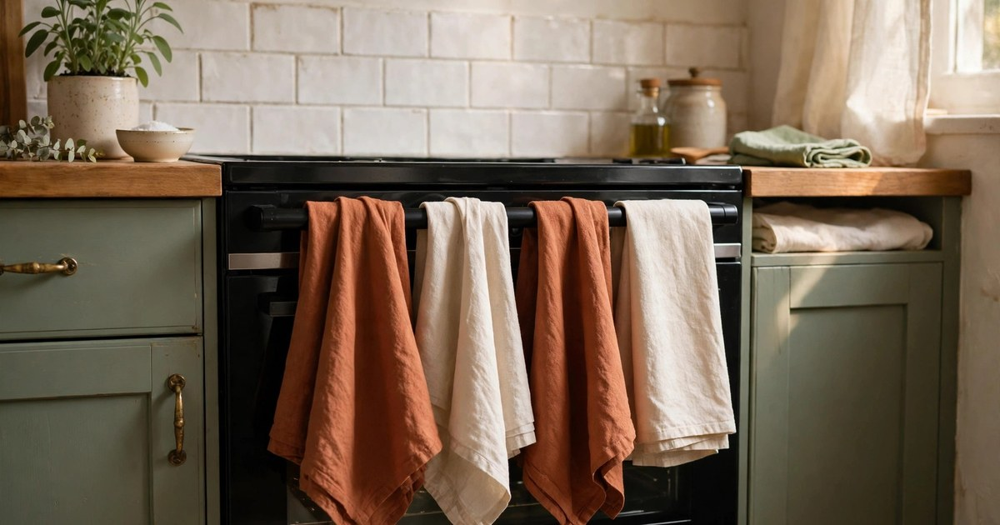
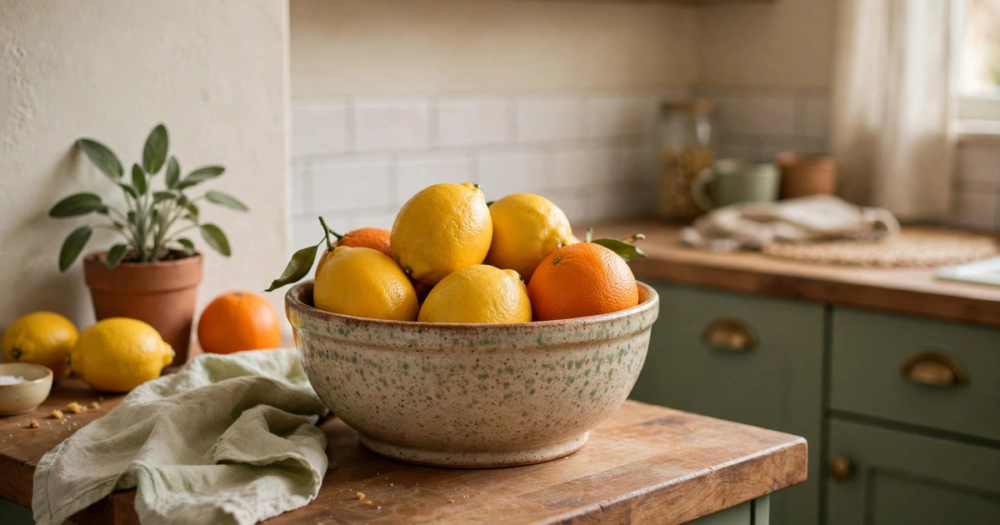
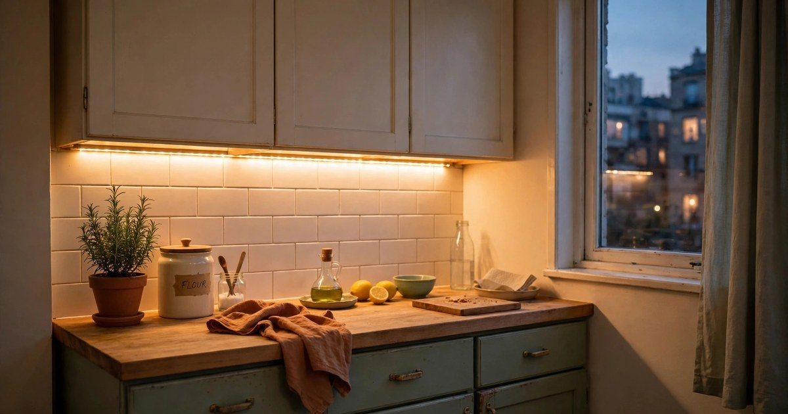

Most rental kitchens look the same: plain white cabinets, a beige countertop, a tired overhead light, and nothing on the walls. It is the room you use three times a day and the room landlords care about least, which is exactly why it is worth decorating. A small kitchen does not need a renovation to feel finished — it needs a few deliberate styling choices that work with the space you have instead of fighting it.

Every idea below costs under $25, and most cost far less. Every single one is reversible and deposit-safe: no drilling, no painting, no peel-and-stick wallpaper that takes paint off with it, nothing your landlord can object to. These are styling picks, not fixes — the kind of thing you take with you when you move, and that makes your kitchen feel like yours from the first week, not the last.

The trick with a tiny kitchen is to let the useful things do the decorating. A matching canister set, a row of herbs on the windowsill, a beautiful fruit bowl — these are not clutter, they are the decor. When storage is scarce and counter space is precious, the decor that earns its place is the decor that also works. Pick three or four ideas from this list, keep the colour palette warm and calm — terracotta, cream, sage, natural wood — and your kitchen will feel finished rather than full.

Budget comes first in every pick below, with an approximate price so you can plan. Prices are for the budget end of each item — a decent version, not the cheapest one that falls apart in a month. All nine together cost roughly $150, but you do not need all nine. Start with the one you will see every morning, and build from there.

### 1. An Open-Shelf Styling Set

If your rental kitchen has even one open shelf — or a stretch of wall where a small leaning shelf can sit — styling it is the single highest-impact move on this list. An open shelf turns the things you already own into the decor: a stack of matching bowls, two or three glass jars, a small potted herb, a wooden spoon jar. Nothing new needs to be bought if your dishes already match; the styling is in the editing. Keep it to two or three groups of objects, leave breathing room between them, and the shelf reads as intentional rather than storage that ran out of cupboard space.

The rule is one colour family plus one natural material. Cream bowls with terracotta jars and a wooden board, for example, or sage-green mugs with glass and brass. If your dishes are a mixed set of hand-me-downs, a [matching dish set on Amazon](https://www.amazon.com/s?k=matching+dish+set+cream&tag={{AMAZON_TAG}}) in a single plain colour — four bowls, four plates — costs under $25 and transforms the shelf overnight. Put the prettiest pieces on the shelf and hide the mismatched ones in the cupboard. Where it fits: the shelf above the counter, beside the stove, or the wall over the sink — anywhere at eye level where you will see it while you cook.

### 2. A Matching Canister Set

Nothing makes a rental kitchen look finished faster than getting the food out of its packaging. A row of matching canisters — flour, sugar, coffee, rice, pasta — turns a cluttered counter into a calm one, and the contents themselves become part of the look: golden pasta, dark coffee beans, pale flour. Glass canisters with wooden lids are the classic choice because they show the contents and suit almost every kitchen, but ceramic canisters in cream or sage work just as well if you prefer a solid look.

Buy the set, not individual jars, because matched pieces are what create the effect. A [glass canister set with wooden lids on Amazon](https://www.amazon.com/s?k=glass+canister+set+wooden+lids&tag={{AMAZON_TAG}}) with three or four jars typically costs $18–$25, and that is all you need for the whole counter. Keep the set on the counter near the stove or the coffee maker, where you actually reach for it — canisters you have to climb for are decoration, not storage. Where it fits: a corner of the counter, the top of a small shelf, or beside the sink. Label them if your household mixes up flour and sugar; a chalk pen on glass wipes off cleanly.

### 3. A Patterned Kitchen Mat

The floor is the largest empty surface in a small kitchen, and most renters ignore it completely. A patterned kitchen mat — the long runner in front of the sink or stove — is the cheapest way to add colour and pattern to the whole room in one move. It also does real work: it cushions your feet while you wash dishes, catches splashes, and warms up cold tile or linoleum that landlords never replace.

Choose a pattern that pulls the kitchen together rather than competing with it. A vintage-style rug pattern in terracotta, cream and sage works in almost any rental kitchen, and a low-pile, wipeable mat is the practical choice — look for one labelled kitchen runner or anti-fatigue, roughly 20 by 60 inches. A [patterned kitchen runner mat on Amazon](https://www.amazon.com/s?k=patterned+kitchen+runner+mat&tag={{AMAZON_TAG}}) in a warm vintage print costs about $20–$25. Where it fits: in front of the sink, in front of the stove, or down the middle of a galley kitchen. Shake it out weekly and it lasts for years — and it rolls up and moves with you.

### 4. Small Framed Art for the Kitchen Wall

Rental kitchens usually have one blank wall — beside the fridge, above a small table, or the end of a galley — and a small piece of framed art is all it takes to make the room feel like a room instead of a utility space. Food and herb prints suit a kitchen better than abstract art: a vintage lemon print, a simple herb illustration, a framed recipe card. Two small frames hung together read better than one large one in a narrow space, and small frames are easier to hang without damage.

Hang them with removable adhesive strips, not nails — a pair of small frames weighs almost nothing, and the strips come off cleanly at move-out. A [set of small kitchen art prints on Amazon](https://www.amazon.com/s?k=kitchen+art+prints+framed+set&tag={{AMAZON_TAG}}) with two or three food or herb prints in matching frames costs $15–$25, or buy the prints unframed and use thrifted frames for even less. Where it fits: the wall beside the fridge, above a breakfast table, or the narrow wall at the end of a galley kitchen. Keep the frames at eye level and the palette warm, and the whole kitchen suddenly looks considered.

### 5. A Herb Planter for the Windowsill

A windowsill herb planter is the one decor pick on this list that also feeds you. Basil, mint, parsley and chives grow happily on a sunny kitchen windowsill, and a row of green in terracotta pots is the prettiest thing in most rental kitchens. It costs almost nothing to start — a small planter, a bag of potting mix, and a few seed packets or starter plants — and fresh herbs make weeknight cooking feel like an event instead of a chore.

A [windowsill herb planter kit on Amazon](https://www.amazon.com/s?k=windowsill+herb+planter+kit&tag={{AMAZON_TAG}}) with three pots and a drip tray costs about $15–$20, or use three small terracotta pots in a row for a looser, collected look. Start with basil and mint, the two herbs that forgive beginners: basil wants sun and regular water, mint wants a pot of its own because it spreads aggressively. Where it fits: the windowsill above the sink is the classic spot, but any sunny sill or a small shelf by the window works. Snip what you need for dinner and the plant grows back — that is decor that pays rent.

### 6. A Wooden Utensil Crock

Every rental kitchen has a drawer full of tangled utensils, and every rental kitchen is better once the wooden spoons live in a crock on the counter instead. A wooden or ceramic utensil crock — a tall, sturdy jar that holds spoons, spatulas, whisks and tongs upright — clears a drawer, keeps the tools you reach for within arm's reach of the stove, and adds a warm natural material to a room full of white cabinets and steel appliances.

Choose a crock wide enough to hold your tools without tipping — about five inches across — and heavy enough to stay put when you pull a spoon out. A [wooden utensil holder crock on Amazon](https://www.amazon.com/s?k=wooden+utensil+holder+crock&tag={{AMAZON_TAG}}) costs $12–$20, and a matching set of wooden spoons costs a few dollars more if yours are a mismatched plastic collection. Where it fits: beside the stove, at the end of the counter, or on a shelf above the cooking area. Keep only the tools you use weekly in the crock; the rest stays in the drawer, and the counter stays calm.

### 7. A Linen Tea Towel Set

Tea towels are the smallest decor pick on this list and one of the most effective, because they are the one textile most rental kitchens already have — usually a faded, stained single towel on the oven handle. A matching set of linen tea towels in terracotta, cream or sage turns that sad detail into a deliberate one: one folded over the oven handle, one draped over a small hook, one in use. Linen looks better than cotton after a few washes, dries faster, and gets softer with age, which is why it is worth the small upgrade.

A [linen tea towel set on Amazon](https://www.amazon.com/s?k=linen+tea+towel+set&tag={{AMAZON_TAG}}) with three or four towels costs $15–$22, and it is the kind of purchase you will still be using in your next apartment. Choose a set with a simple stripe or a plain weave in a warm colour — busy patterns fight with everything else in a small kitchen. Where it fits: the oven handle, a hook beside the sink, or folded in a small stack on the counter. Swap the set seasonally if you like — a sage set in spring, a terracotta set in autumn — and the kitchen gets a refresh for free.

### 8. A Pretty Fruit Bowl

A fruit bowl is the oldest kitchen styling trick there is, and it still works because it does two jobs at once: it keeps fruit where you will actually eat it, and it puts a bowl of colour on the counter. Lemons, oranges and green apples are the best choices for a rental kitchen — they last for weeks, they do not bruise easily, and their colours warm up white cabinets instantly. A wooden bowl suits a rustic kitchen; a ceramic bowl in cream or sage suits a calmer one.

A [ceramic fruit bowl on Amazon](https://www.amazon.com/s?k=ceramic+fruit+bowl+kitchen&tag={{AMAZON_TAG}}) costs $12–$20, and the fruit inside costs whatever your weekly shop already includes. Where it fits: the centre of a small kitchen table, a corner of the counter, or on top of a shelf where it catches the light. Keep it to one bowl and one kind of fruit at a time — a single variety in a full bowl looks intentional, while a mixed handful looks like leftovers. Refill it with the weekly shop and the decor refreshes itself.

### 9. Under-Cabinet LED Strip Lights

Most rental kitchens have one harsh overhead light and nothing else, which is why they feel flat and unfriendly in the evening. Battery-powered or USB under-cabinet LED strip lights fix that for under $25, with no wiring and no drilling: the strips stick to the underside of the upper cabinets with adhesive backing, and they peel off cleanly when you move out. Warm white — around 2700K — is the colour to choose; cool white makes a kitchen feel like an office.

A [battery-powered under-cabinet LED strip light on Amazon](https://www.amazon.com/s?k=battery+under+cabinet+led+strip+light+warm+white&tag={{AMAZON_TAG}}) with a remote or motion sensor costs $15–$25, and one strip is usually enough for a small kitchen. Where it fits: under the upper cabinets above the counter, above the sink, or along the underside of a shelf. Switch them on in the evening and the kitchen glows — the counter suddenly looks like a place you want to cook in, and the whole room feels finished. Of all nine picks, this is the one that changes how the kitchen feels after dark.

## Frequently Asked Questions

### How can I decorate a rental kitchen without losing my deposit?

Stick to reversible styling: adhesive strips instead of nails, freestanding pieces instead of mounted ones, and textiles instead of paint. Every pick in this post — canisters, mats, framed art on adhesive strips, LED lights with adhesive backing — comes off cleanly or moves with you. Avoid peel-and-stick wallpaper and anything that needs a drill, and photograph the kitchen on move-in day so you have proof of its original condition.

### What is the best colour palette for a small rental kitchen?

Warm and calm works best: terracotta, cream, sage green and natural wood. These colours warm up white cabinets and beige countertops instead of fighting them, and they suit almost every rental kitchen regardless of the existing finishes. Pick one main colour, one secondary colour and one natural material, and repeat that combination across your picks so the room reads as a set.

### How do I keep a small kitchen counter from looking cluttered?

Give everything a home and keep it to one layer deep. A canister set in a row, a utensil crock beside the stove, a fruit bowl on the table — each pick earns its place by being useful as well as pretty. If a surface holds more than one layer of objects, move the extras into a cupboard. The goal is a counter you can wipe down in thirty seconds.

### Are under-cabinet LED lights safe in a rental?

Yes, as long as you choose battery-powered or USB strips with adhesive backing. There is no wiring, no drilling and no permanent change to the cabinets, and the adhesive peels off cleanly. Choose warm white light around 2700K, and check that the strip has a remote or a motion sensor so you are not reaching under the cabinet to switch it on.

### What should I buy first if I can only afford one pick?

Start with the matching canister set. It is the most visible change on the counter, it removes the visual noise of food packaging, and you will see it every time you cook. After that, add the under-cabinet LED lights for evening warmth, then the patterned kitchen mat for colour underfoot. Three picks, roughly $60, and the kitchen will feel like a different room.
