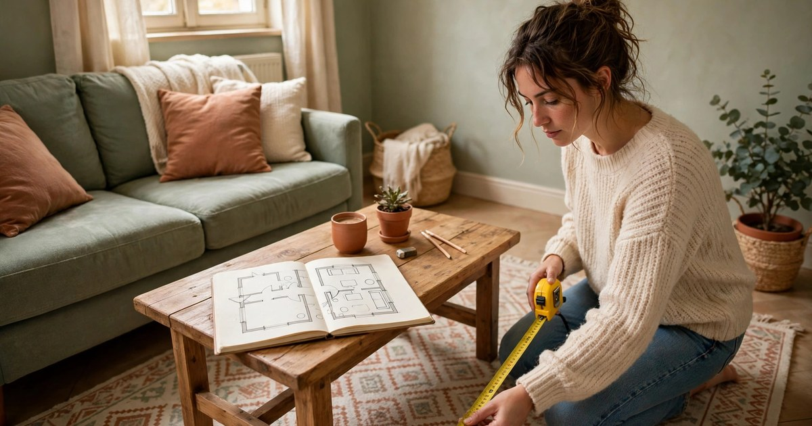
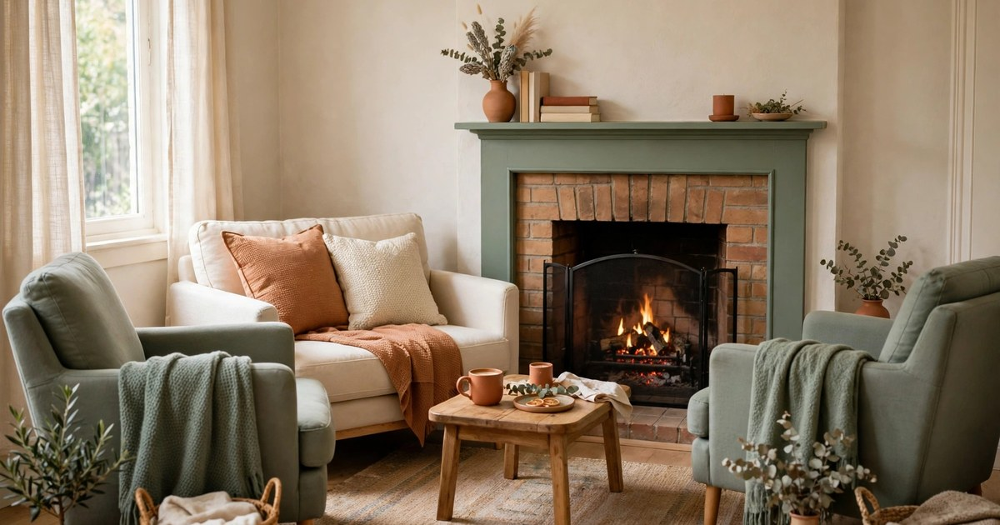
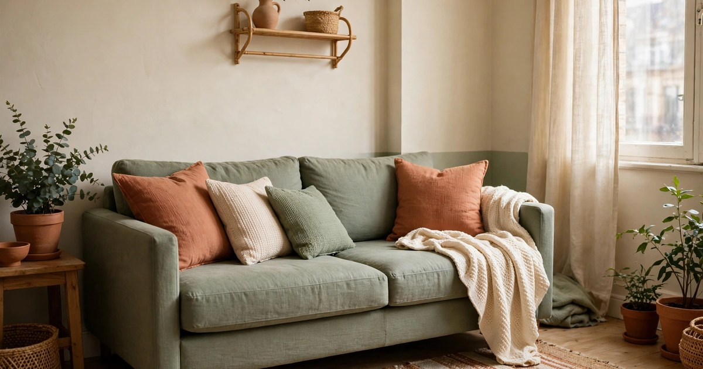
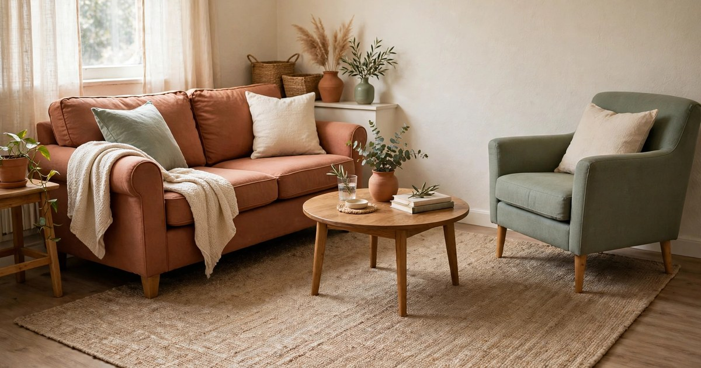
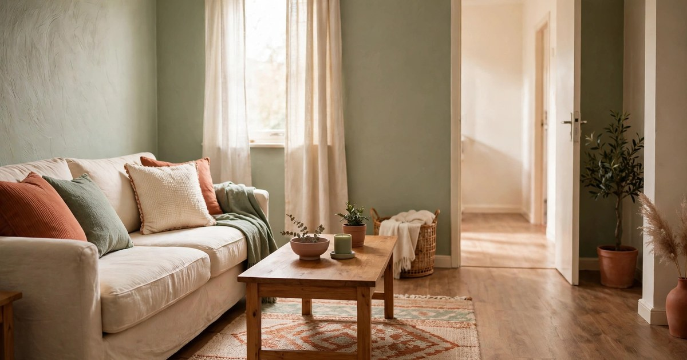
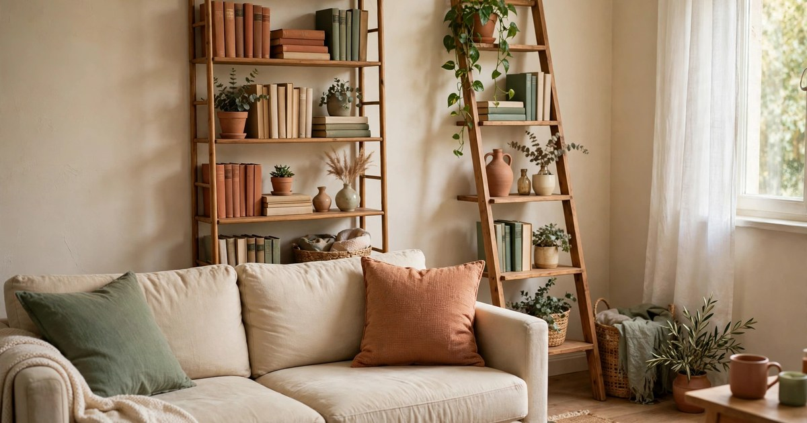
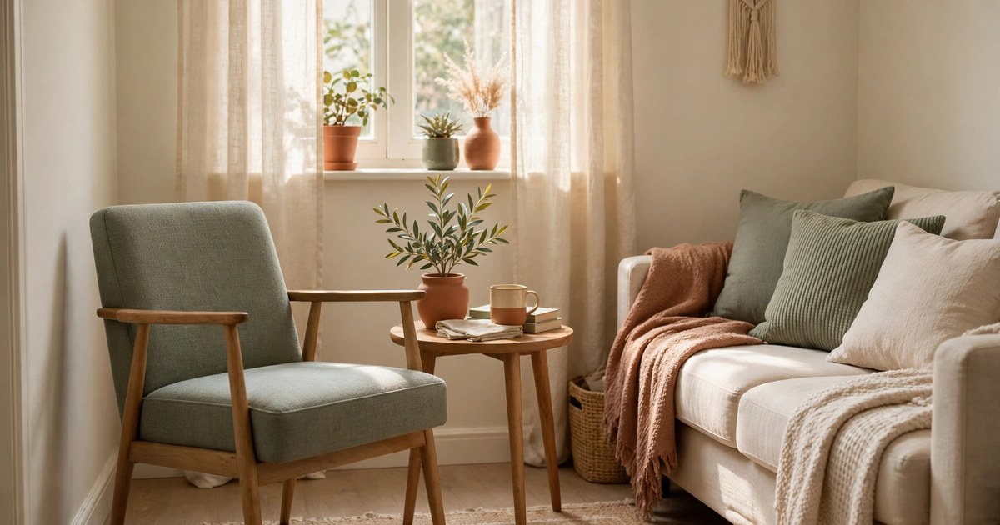
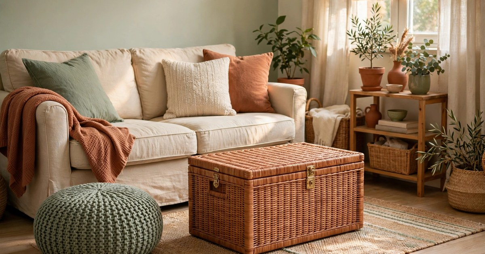
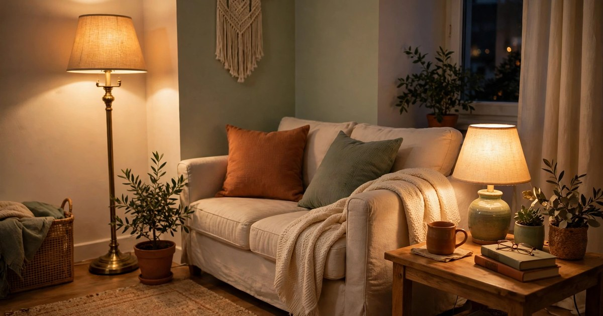
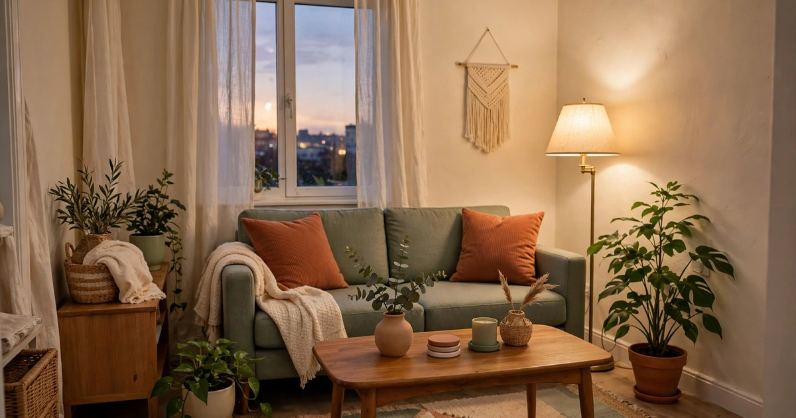

A small rental living room can feel like a puzzle with too many pieces: a sofa that eats the wall, a TV with nowhere sensible to go, a coffee table that blocks the path to the kitchen, and a landlord who would notice a single nail hole. The good news is that layout is free. Before you buy anything, before you move a single heavy piece twice, the arrangement itself does most of the work — and a well-arranged small room genuinely feels bigger than a badly arranged large one.

This guide walks you through arranging a small rental living room in ten practical steps, in the order that actually works. Every step is renter-friendly (nothing that needs drilling, painting, or permanent changes) and budget-first (most steps cost nothing at all, and the few that need a purchase stay under $50). The goal is a room with clear zones, easy traffic flow, and seating that invites people to sit down — not a showroom, a room you actually live in.

One thing to know before you start: there is no single "correct" layout for a small living room. The right arrangement depends on your room's shape, where the door and windows sit, and what you actually do in the room — watch TV, read, host friends, work from the sofa. So treat these steps as a sequence, not a template. Do them in order, test each one by living with it for a day, and stop tweaking when the room feels easy to move through and comfortable to sit in. That is the whole test.

### 1. Measure the room and sketch a rough plan first

Every layout mistake in a small living room starts with guessing. A sofa that is two inches too long for its wall, a rug that stops short of the front legs, a bookshelf that blocks a door swing — all of it is avoidable with ten minutes and a tape measure. Measure the length and width of the room, the position and width of every door, window, and radiator, and the dimensions of your biggest pieces: sofa, TV stand, coffee table, bookshelf. Write the numbers down on paper or in your phone notes.

Then sketch the room from above — it does not need to be pretty, a rectangle with doorways marked is enough — and draw your furniture to scale on it. A simple trick: use graph paper, or cut paper rectangles to scale (one square = one foot) and slide them around. This is how you discover, before any heavy lifting, that the sofa fits better on the long wall than under the window, or that the armchair you wanted simply has no home. Renters move often, so keep this sketch; it becomes your cheat sheet for the next apartment too.

[Shop a retractable tape measure](https://www.amazon.com/s?k=retractable+tape+measure+25ft&tag={{AMAZON_TAG}})

### 2. Pick one focal point and build the room around it

Every room needs a "where your eyes land first" spot, and in a small living room that focal point does the heavy lifting of making the arrangement feel intentional. In most rentals it is the TV wall, a fireplace, or the biggest window. Pick one — just one — and arrange your main seating to face it. When two things compete for attention (a TV on one wall, a fireplace on another), the room feels restless and no seat feels quite right.

If your focal point is the TV, keep the seating distance honest: roughly 1.5 to 2.5 times the screen's diagonal size. A 55-inch TV wants about 7 to 11 feet of viewing distance, which in a small room usually means the sofa goes on the opposite wall, not angled in a corner. If the fireplace is the focal point, pull the seating into a loose U or L around it and let the TV live on a side wall on a low stand. If the window is the star, float the seating to face it and keep the glass unobstructed — natural light is the best free decor a rental has.

[Shop a low profile TV stand for small living rooms](https://www.amazon.com/s?k=low+profile+tv+stand+small+living+room&tag={{AMAZON_TAG}})

### 3. Anchor the biggest piece first — usually the sofa

Start with the sofa, because it is the biggest, heaviest piece and everything else orbits it. In a small rental, the sofa almost always belongs on the longest uninterrupted wall. That single move frees the rest of the room: the wall opposite stays open for the TV or a console, and the floor in between becomes your living space rather than a traffic jam.

Resist the urge to push the sofa hard into a corner to "save space" — a sofa jammed into a corner actually makes a small room feel more cramped, because one side becomes unreachable and the room reads as stuffed rather than arranged. Give it a few inches of breathing room from the wall if you can, even two or three inches changes how the room feels. And if your sofa is a hand-me-down that is too big for the room, be honest about it: a loveseat or apartment-size sofa (72 inches or under) often fits a small rental far better than a full three-seater, and selling the oversized one can fund the swap. Measure first, then decide — that is what Step 1 was for.

[Shop an apartment size sofa under 72 inches](https://www.amazon.com/s?k=apartment+size+sofa+72+inch+small+living+room&tag={{AMAZON_TAG}})

### 4. Define zones with a rug — the cheapest room divider

In a small rental, one room usually does three jobs: living room, home office corner, and somewhere to eat. A rug is the cheapest, most renter-friendly way to say "this part is the living room." Place a rug under the seating area with the front legs of the sofa and chairs on it — that is the rule that makes a grouping look connected instead of scattered. A rug that is too small is worse than no rug at all: it shrinks the seating area visually and makes the furniture look like it is floating apart.

Size guide for small rooms: an 8x10 rug suits most small living rooms; a 5x7 works only if your seating is truly compact. If budget is tight, a flat-weave or low-pile rug in a warm neutral costs far less than a plush one and is easier to vacuum and move. Layering helps too — a large inexpensive jute rug underneath a smaller patterned one adds texture for about the same money as one mid-range rug. And since rentals often have tired flooring, a rug does double duty hiding the floor you cannot change.

[Shop an 8x10 area rug for small living rooms](https://www.amazon.com/s?k=8x10+area+rug+living+room+neutral&tag={{AMAZON_TAG}})

### 5. Leave clear traffic lanes — the 30-inch rule

This is the step that separates rooms that feel good from rooms that feel annoying, and it costs nothing. Every path people actually walk — from the door to the sofa, from the sofa to the kitchen, from the seating area to the balcony — needs about 30 inches of clear width. Less than that and people shuffle sideways; more than 36 inches in a small room is space you probably cannot spare.

Walk the routes yourself after arranging. Sit on the sofa and stand up: is there room to get past the coffee table without turning sideways? Can someone cross the room while someone else is seated without anyone moving their legs? The classic offender is the coffee table pushed too close to the sofa — aim for 14 to 18 inches between sofa and table, close enough to reach a drink, far enough to walk past. If a route keeps getting blocked, the furniture on that route is in the wrong place, not the people. Move the piece, not the path. Renters often inherit a layout from the previous tenant's furniture; your traffic lanes are yours to redraw.

[Shop a narrow rectangular coffee table for small spaces](https://www.amazon.com/s?k=narrow+rectangular+coffee+table+small+space&tag={{AMAZON_TAG}})

### 6. Use the wall behind the sofa and go vertical

Small living rooms run out of floor long before they run out of wall. The wall behind the sofa is prime real estate that most renters leave blank, and the space above eye level is almost always wasted. A tall, narrow bookshelf in a corner, a leaning ladder shelf, or a set of freestanding shelves against the sofa wall adds storage without eating floor space — and none of it needs a single screw in the wall.

The renter-friendly rule: everything should lean, stand, or stick with removable adhesive. Leaning ladder shelves, tall narrow bookcases, and freestanding etageres all work. Command-style removable hooks hold lightweight frames and small shelves up to their rated weight, and peel off cleanly at move-out. Keep heavy items low (books on the bottom shelves) and light, decorative things up high, both for safety and for looks. A tall plant in the dead corner behind the sofa's arm does the same job as a shelf — it fills vertical space and softens the room's hardest angle.

[Shop a leaning ladder shelf for small living rooms](https://www.amazon.com/s?k=leaning+ladder+shelf+5+tier&tag={{AMAZON_TAG}})

### 7. Choose furniture that fits the room's scale

The most common small-room mistake is furniture that is the right style but the wrong size. A deep, overstuffed armchair with rolled arms eats two feet of floor and visually swallows a small room; a slim-armed chair with visible legs does the same job in two-thirds of the footprint. The same goes for coffee tables (round or oval tables are kinder to shins and traffic in tight rooms), side tables (a slim C-table that slides over the sofa arm beats a chunky cube), and media consoles (low and long beats tall and wide).

A few scale rules that never fail: choose pieces with legs you can see under — visible floor beneath furniture makes a room read as larger. Keep the sofa's back lower than the window sill if it sits under a window, so light is not blocked. And match the visual weight of pieces: a heavy dark bookcase next to a light slim sofa looks unbalanced, while pieces in a similar weight class look like they belong together. If you are buying one new piece this year, make it the one that is currently the wrong size — that single swap changes the room more than five small accessories.

[Shop a slim arm accent chair with wooden legs](https://www.amazon.com/s?k=slim+accent+chair+wooden+legs+small+space&tag={{AMAZON_TAG}})

### 8. Add flexible seating that folds away

A small living room seats two or three people every day and six people twice a month — and buying a second sofa for those two evenings is the expensive mistake. Flexible seating is the budget answer: a storage ottoman that doubles as a coffee table and a seat, a pair of floor poufs that tuck under a console, folding stools that live in a closet, or a bench that slides under the window. When guests arrive, you pull them out; when they leave, the room goes back to its everyday size.

The storage ottoman is the hardest-working piece in this category. It holds blankets, board games, or the charging cables that otherwise colonize the coffee table, it serves as a footrest daily, and it seats an extra person at dinner. Floor poufs are the cheapest version of the same idea — under $30 each, lightweight, and easy to stack in a corner. Buy them in the room's palette (terracotta, cream, sage) so they look intentional rather than like camping gear. And keep one rule: flexible seating should take under a minute to set out and put away, or you will never actually use it.

[Shop a storage ottoman with lid for small living rooms](https://www.amazon.com/s?k=storage+ottoman+with+lid+living+room&tag={{AMAZON_TAG}})

### 9. Light the corners, not just the ceiling

Most rentals have one ceiling light in the middle of the room, and it is usually harsh, flat, and unflattering. A small living room arranged around a single overhead light always feels smaller at night, because the corners fall into shadow and the eye stops at the dark edges. Three small light sources at different heights — a floor lamp in a corner, a table lamp on a side table, and a warm string of fairy lights or a small lamp on a shelf — make the same room feel twice as big after sunset.

All of this is renter-safe and cheap: floor lamps and table lamps need no installation, and battery-operated or plug-in lights need no wiring. Use warm-white bulbs (2700K) everywhere for a cozy glow, and put the brightest lamp near the reading chair, not in the center of the room. A mirror opposite the window or the lamp doubles the light for free — lean a large mirror against the wall (no drilling) and it bounces daylight across the room all day and lamplight all evening. If your rental's ceiling light has an ugly fixture, a $15 plug-in pendant or a lampshade swap over the existing bulb changes the whole mood without touching the wiring.

[Shop a warm white arc floor lamp for living room](https://www.amazon.com/s?k=warm+white+floor+lamp+living+room+corner&tag={{AMAZON_TAG}})

### 10. Live with it for a week, then tweak once

Here is the step most guides skip: stop arranging. Live with the new layout for a full week before changing anything. Sit in every seat, walk every route, watch TV from the sofa, eat dinner on it, have a friend over. You will notice things a floor plan cannot show you — that the armchair faces away from the conversation, that the lamp is on the wrong side for reading, that the rug slides when you stand up (a $10 rug pad fixes that).

After a week, make one round of small tweaks: shift the rug two inches, swap the side table to the other arm, move the plant to the darker corner, angle the armchair five degrees toward the sofa. Small moves, big difference. Then stop again. A living room is never finished, it is adjusted — and the best small rental living rooms are the ones where the arrangement serves the life happening in them, not the other way around. When friends walk in and say "this feels bigger than I expected," you will know the layout did its job.

[Shop a non slip rug pad gripper for hardwood floors](https://www.amazon.com/s?k=non+slip+rug+pad+gripper+hardwood+floor&tag={{AMAZON_TAG}})

A small rental living room does not need a renovation, a big budget, or a landlord's permission to feel wonderful. It needs a measured plan, one focal point, the big pieces in the right place, clear paths to walk, and light in the corners. Work through the ten steps in order, spend money only where a step genuinely needs a purchase, and give the layout a week to prove itself. The room you already have — and the furniture you already own — is usually enough. The arrangement is what turns it into a living room you love coming home to.

## Frequently Asked Questions

### How do I arrange furniture in a small living room with a TV?

Start with the sofa on the longest wall facing the TV wall, keeping a viewing distance of roughly 1.5 to 2.5 times the screen size. Keep the TV low — eye level when seated — and avoid mounting it above a fireplace if you can help it, since that forces an uncomfortable upward viewing angle. If the only TV wall is also the only long wall, a low media console with the TV on it and the sofa opposite still works; just keep the console slim so it does not eat into your traffic lane.

### What is the best layout for a small rental living room with no focal point?

When there is no fireplace or standout window, create a focal point instead of hunting for one. A large piece of art, a leaning mirror, or a tall bookshelf on the main wall gives the eye somewhere to land, and you arrange the seating to face it. A rug under the seating group reinforces the focal wall. This is fully renter-friendly — lean the mirror, hang art with removable hooks, and use a freestanding shelf — so you can take the focal point with you when you move.

### How much space should I leave between the sofa and the coffee table?

Aim for 14 to 18 inches between the front of the sofa and the coffee table. That gap is close enough to set down a drink without stretching and far enough to walk past without turning sideways. In a very tight room, a smaller table or a round table helps: round tables have no corners to catch shins, and a table under 40 inches long leaves more room for the main traffic lane through the room.

### Can I put the sofa in front of a window in a rental?

Yes, as long as the sofa back sits below the window sill so it does not block light or the view, and you leave a small gap behind it for curtains to move and air to circulate. Avoid blocking a radiator under the window, and keep the sofa a few inches off the wall so condensation or cold draughts do not reach the fabric. In a small rental this is often the best wall for the sofa, because it frees the solid walls for storage and the TV.

### How do renters arrange furniture without damaging walls?

Use freestanding and leaning furniture instead of wall-mounted pieces: leaning ladder shelves, tall bookcases, and floor lamps need no screws at all. For lightweight art and small shelves, removable adhesive hooks and strips rated for the item's weight hold well and peel off cleanly. Furniture sliders under heavy pieces let you rearrange without scratching floors, and a rug pad stops rugs from sliding without any adhesive on the floor itself.

### What furniture should I buy first for a small rental living room?

Buy in this order: a rug sized to your seating group, because it defines the zone and hides tired rental flooring; a storage ottoman, because it is seating, a table, and storage in one; and a floor lamp, because it fixes the harsh overhead light problem for under $40. After those three, add a slim side table and flexible extra seating like poufs. Spend on the pieces that do two jobs at once — in a small rental, every piece of furniture should earn its floor space.
