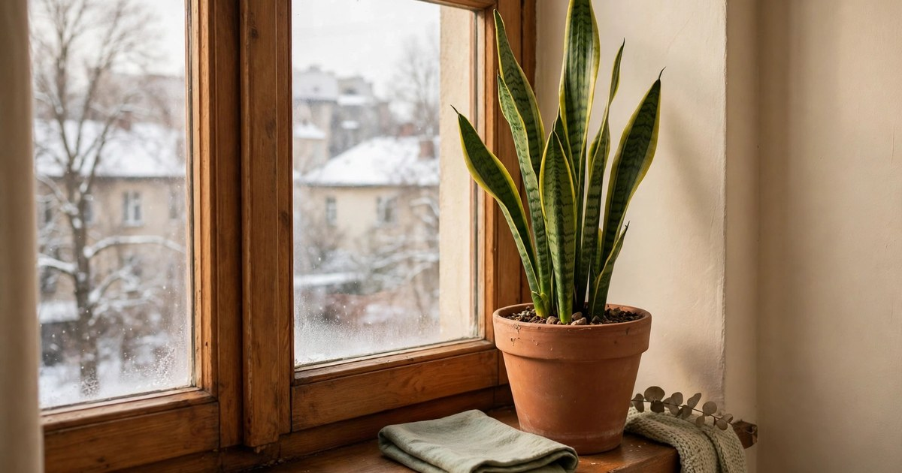
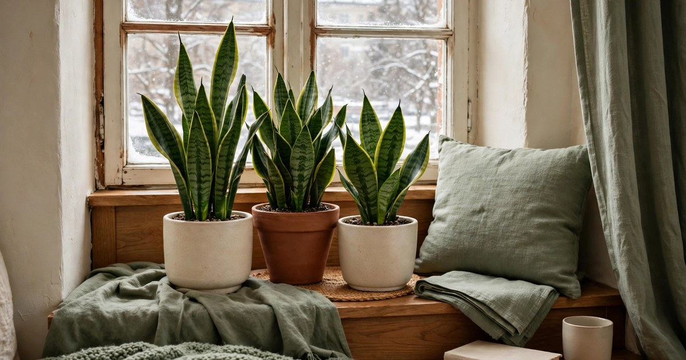
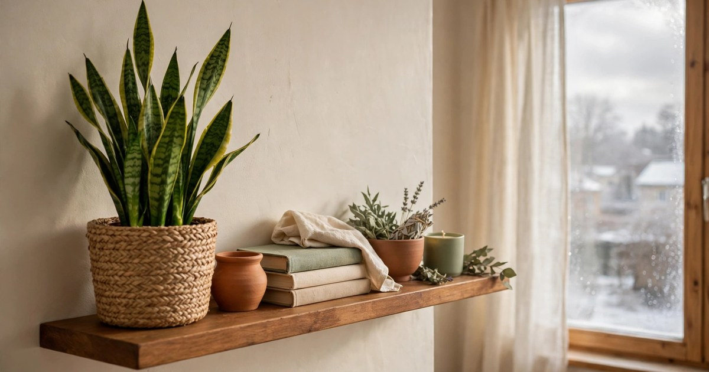
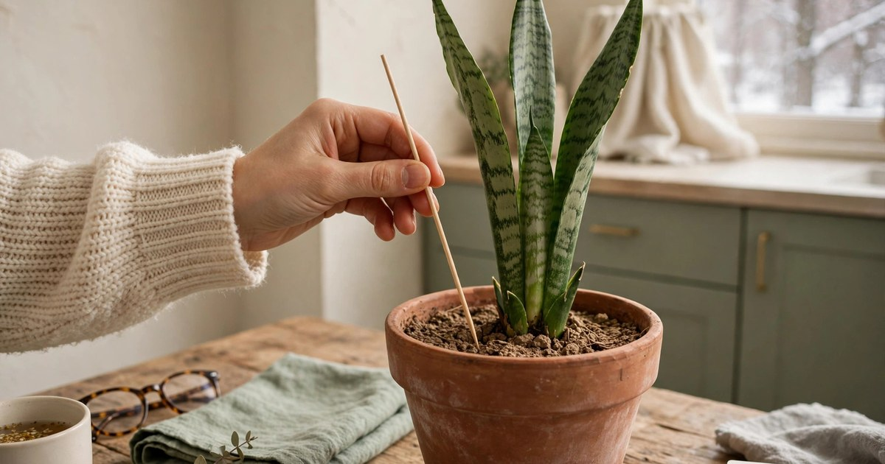
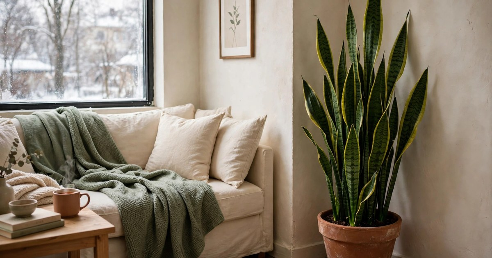
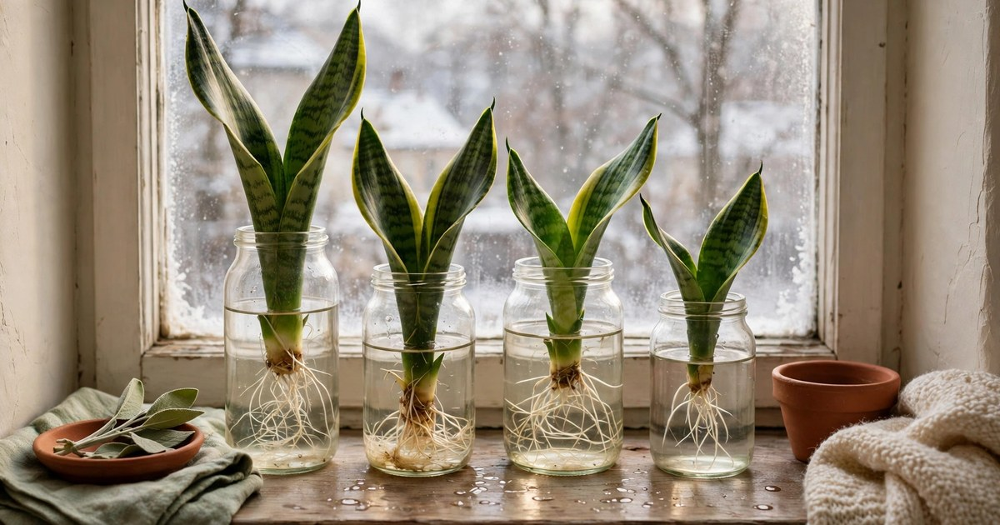
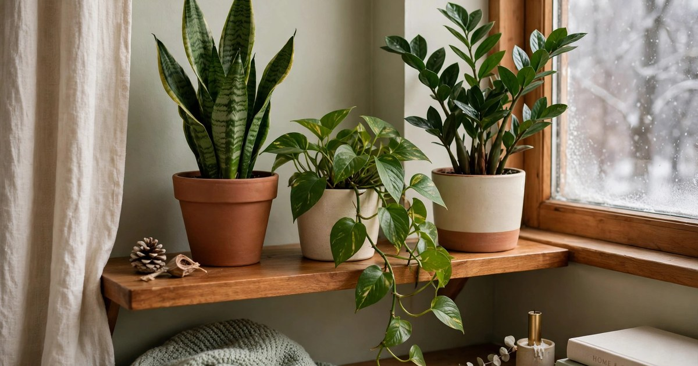
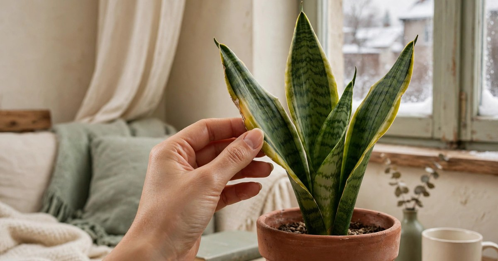
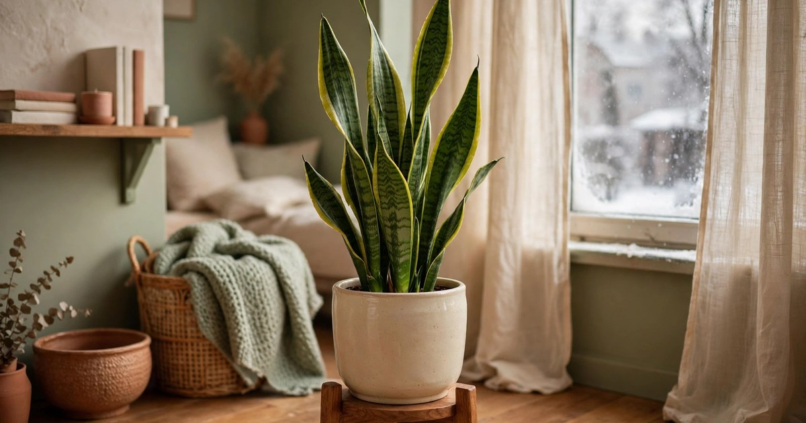
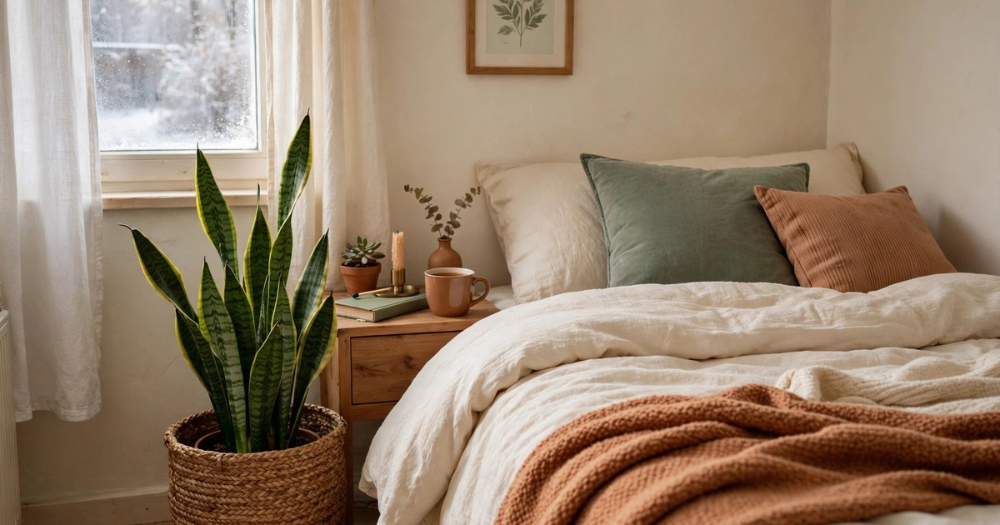

If there is one plant that was made for a rented flat in winter, it is the snake plant. Sansevieria — now officially Dracaena trifasciata, though nobody calls it that at the garden centre — is the near-un-killable houseplant: it tolerates low light, forgetful watering, dry radiator air and a draughty hallway, and it still looks like a piece of sculpture standing in the corner. In a small apartment in winter, when every other plant is sulking, the snake plant just carries on, tall and green and quietly architectural.

That toughness is exactly why it deserves a little winter care rather than total neglect. Snake plants do not die easily, but they do die — almost always from too much water in cold, dark months, or from a cold draught that chills their roots overnight. The ten ideas below cost almost nothing, need no drilling, no landlord permission and no floor space, and they work in the smallest rented flat. They cover winter watering, light, cold draughts and heating, styling ideas that make one plant do the work of three, and the free trick of propagation, so by spring you will have more snake plants than you started with — all for the price of a pot or two.

### 1. Water Once a Month — and Mean It

Winter watering is where snake plants are lost, and the rule is the simplest in this whole list: water once a month at most, and only when the soil is bone dry all the way down. A snake plant in a cool room in December is barely growing, so it barely drinks. Its thick, fleshy leaves are water tanks, storing moisture for weeks, and topping them up when the soil is still damp is the fastest route to root rot. Push a finger or a wooden skewer to the bottom of the pot; if it comes out with any dampness at all, wait another week or two.

When you do water, water thoroughly and then drain completely. Soak the soil until water runs out of the drainage hole, then tip every drop out of the saucer and never let the pot sit in a puddle. Morning is the best time, so any splashes dry before the cold night. A good habit is to water on the first of the month and ignore the plant the rest of the time — a snake plant can go six to eight weeks without water in winter and not even notice. If a leaf turns yellow and soft at the base, that is rot from too much water, not thirst, and the answer is to stop watering entirely, not to water more.

### 2. Give It the Brightest Spot You Have — It Will Cope with the Rest

Snake plants are famous for tolerating low light, and it is true that they will survive in a dim corner — but survive is not the same as thrive. In winter, when the days are short and the sun is low, move your snake plant to the brightest window you own, usually the south-facing one, or whichever window gets the most direct sun. Bright light keeps the leaves upright, the variegation crisp and the growth compact; a plant kept in gloom all winter grows slowly, its leaves pale, and it becomes more vulnerable to rot because the soil never dries.

That said, a snake plant is one of the few houseplants that will genuinely cope with a north-facing room or a spot a couple of metres from a window, which is why it is the classic renter's plant. If your flat has no bright window at all, a cheap clip-on [grow light](/grow-lights-dark-winter-apartments-under-25/) run for eight to ten hours a day keeps it happy through the darkest weeks. Keep the leaves a few centimetres off freezing glass on the coldest nights, wipe the window clean so maximum light gets through, and rotate the pot a quarter turn once a week so the leaves grow straight instead of leaning towards the glass.

### 3. Keep It Away from Cold Draughts and Blasting Radiators

Snake plants hate two winter extremes: the icy draught by a badly sealed window and the blast of dry heat from a radiator. A plant sitting on a windowsill directly above a radiator gets cooked from below and chilled from above, which is the worst of both worlds — leaves can develop brown, papery patches, and the roots can chill overnight when the heating goes off. Move the pot a few centimetres back from the glass on the coldest nights, and never park it right next to a door that opens onto a cold hallway or stairwell.

If the only bright spot in your flat is a draughty window, use a thick cork mat or a folded towel under the pot to insulate it from the cold sill, and a sheer curtain between plant and glass softens both the cold and the midday sun. Snake plants are fine down to about 10°C, but a night of freezing air through a gap in the frame can damage leaves overnight, and the damage shows up as soft, dark patches that never heal. A cheap draught excluder along the window frame helps the plant exactly as much as it helps your heating bill, and it costs nothing in deposit terms.

### 4. Let the Soil Dry Out Completely Between Waterings

The single most important winter habit after watering less is making sure the soil itself dries out fully. Snake plant roots need air as much as they need water, and in a cool flat ordinary potting compost can stay damp for weeks after a single watering. A gritty, free-draining mix — roughly half potting soil and half perlite, coarse grit or orchid bark — drains in minutes and dries between waterings, which is exactly what a snake plant wants in winter. A small bag of perlite from a garden centre costs a few pounds and lasts for years of repotting.

Do not repot in the middle of winter unless the plant is actively rotting; repotting is a spring job. Instead, manage the soil you have: if the top few centimetres stay damp for more than a fortnight, hold off watering until a skewer pushed to the bottom comes out dry, and move the pot to a warmer, brighter spot so the soil dries faster. A terracotta pot helps enormously, because the clay itself breathes and pulls moisture out of the soil — and if your pot has no drainage hole at all, use it as a cover pot with a plastic nursery pot inside, lifting the plant out to water and letting it drain fully before it goes back.

### 5. Style It as a Living Sculpture in a Tight Corner

A snake plant is one of the few houseplants that earns its floor space purely on looks. Its upright, sword-shaped leaves read like sculpture, so it does the work of a piece of decor in a corner that would otherwise hold nothing but a dead radiator or a pile of shoes. In a small flat, one tall snake plant in a handsome pot can anchor a whole corner: place it beside the sofa, at the end of a hallway, or flanking the television, and the room instantly looks more finished, more intentional, more grown-up.

Choose the pot as carefully as the plant. A terracotta pot is classic and cheap; a tall, narrow cylinder in cream or sage suits a modern flat; a woven seagrass basket hides a plain plastic pot and adds texture for the price of a takeaway. Raising the plant on a low stand or a stack of books lifts the leaves into the sightline and keeps it off a cold floor. Because snake plants grow vertically rather than spreading, they suit the narrow gaps beside wardrobes and bookcases that no other plant can use — the dead space of a small apartment, turned into a green focal point for under £20.

### 6. Propagate Free Plants from a Single Leaf Cutting

Winter is a fine time to propagate a snake plant, because it costs nothing and gives you a backup plant if the mother plant struggles. Cut one healthy leaf near the base with clean scissors, slice it into pieces about 8–10 cm long, and mark which end was the bottom — cuttings only root from the bottom end, and an upside-down piece will never grow. Let the cut ends dry for two or three days until they callus over, then stand the pieces in a jar of water or push them into damp, gritty soil.

Roots appear in three to six weeks in water, a little slower in soil, and tiny new shoots follow a few weeks after that. The new plant will usually be plain green rather than variegated, because the yellow leaf margins do not carry through leaf cuttings — if you want an exact copy of a variegated variety, divide the plant at the roots instead. Either way, a propagation jar takes up no more space than a mug, needs no special equipment, and turns one leaf into two or three plants by spring. Keep the jar on a bright windowsill out of direct midday sun, change the water weekly, and pot the cuttings up once the roots are a few centimetres long.

### 7. Pair It with Other Low-Light Plants for a Mini Jungle

Snake plants look even better in company, and grouping them with other tough, low-light plants turns a single pot into a layered display. Pair the upright swords of a snake plant with the trailing vines of a pothos, the glossy leaves of a ZZ plant, or the soft fronds of a spider plant, and you get height, drape and texture in one small footprint. Grouping also creates a tiny pocket of slightly warmer, slightly more humid air, which every plant in the group appreciates through a dry, heated winter.

The trick is to match watering needs: snake plants, ZZ plants and pothos all like to dry out between waterings, so they make natural flatmates and you will not accidentally drown one while watering another. Build the group on a tray so you can move the whole display in one lift when you need to wipe the shelf or pull the plants back from a cold night. Put the tallest plant at the back, the trailing one at the front edge so nothing shades its neighbour, and leave a finger-width gap between pots so air can move. A group of three plants in mixed pots — terracotta, cream ceramic, woven basket — looks like a deliberate collection rather than a row of lonely pots, and it costs no more than the plants themselves. If you are short on bright windows, our guide to [low-light indoor plants for dark apartments](/low-light-indoor-plants-dark-apartments/) lists the best companions for a snake plant in a dim flat.

### 8. Fix Yellow Leaves, Floppy Leaves and Root Rot Early

A snake plant rarely complains, so when it does, act quickly — the problem is almost always water, cold or both. Yellow, soft leaves at the base mean overwatering and the start of root rot: stop watering immediately, pull the plant out of its pot and trim away any black, mushy roots with clean scissors, then repot into dry, gritty soil and do not water for at least two weeks. Leaves that flop over and feel soft at the base are the same problem further along, and a leaf that has gone soft will not stand up again — cut it off at the base and let the plant put its energy into healthy growth.

Brown, crispy leaf tips are usually the opposite problem: dry air, salts building up in the soil, or a leaf touching a hot radiator. Trim the brown tip with clean scissors, following the natural pointed shape of the leaf, and flush the soil with plain water once to wash out accumulated salts. Wrinkled, curling leaves mean the plant is genuinely thirsty — rare in winter, but possible in a very warm, dry flat — so give it a thorough soak and drain. A five-minute check once a week, looking at the base of the leaves and feeling the soil, catches all of these while they are still fixable, and it beats a dead plant in February.

### 9. Choose a Pot and Stand That Suit a Rental

Snake plants like to be slightly snug in their pots — a pot only a few centimetres wider than the root ball is ideal, and a pot that is too big holds wet soil the roots cannot reach, which invites rot. Terracotta is the best choice for winter because it breathes and dries out, and it is cheap enough that a cracked pot is a shrug rather than a disaster. Always use a pot with a drainage hole and a saucer, or use a pretty pot without a hole as a cover pot with a nursery pot inside. A saucer or a cork mat underneath protects wooden floors and windowsills from water rings, which matters when a deposit is on the line.

A plant stand earns its keep in a small flat: it lifts the snake plant off a cold floor, brings the leaves up to eye level, and turns a plain pot into a piece of furniture. A simple wooden stand, a small stool, or even a sturdy side table all work, and none of them need a drill or a wall fixing. If you are dividing a snake plant, our winter [repotting guide](/repot-houseplants-winter-guide/) covers the timing and the soil mix in detail. The right pot and stand also make the plant easier to move — and in a rental, being able to pick up the whole display and carry it to a brighter window, or to your next flat, is worth more than any fixed installation.

### 10. Use It to Soften a Bedroom or Bathroom Corner

Snake plants are one of the few houseplants that genuinely suit a bedroom. They tolerate the low light of a north-facing bedroom, they release oxygen at night rather than during the day, and their upright shape fits the narrow strip of floor beside a bed or a wardrobe that nothing else can use. A snake plant in a bedroom also does quiet work for the room's feel: the green softens a small, boxy space, and a plant by the bed makes the room feel calmer and more finished, especially in winter when the world outside the window is grey.

Bathrooms work too, provided there is a window or a little borrowed light — snake plants cope with humidity and the occasional splash, and a tall plant beside the bath turns a plain rental bathroom into something that feels considered. Keep the plant out of the direct splash zone of the shower and off the coldest floor tiles; a small stand or a folded towel underneath is enough insulation. In a humid bathroom the soil dries even more slowly, so water even less often than the once-a-month rule — and if the room has no window at all, a bedroom spot is the better home. One plant, two rooms it can transform, and a pot that moves with you when the tenancy ends: that is the snake plant's real appeal for renters.

## Shop this look: snake plant winter care basics

- **Terracotta pots with drainage holes** — breathable pots that dry out between waterings. [Shop terracotta pots with drainage](https://www.amazon.com/s?k=terracotta+pots+with+drainage+holes+set&tag={{AMAZON_TAG}})
- **Cactus and succulent soil mix** — gritty, fast-draining, rot-proof. [Shop cactus soil mix](https://www.amazon.com/s?k=cactus+succulent+soil+mix&tag={{AMAZON_TAG}})
- **Perlite for houseplants** — mix into potting soil for drainage. [Shop perlite for plants](https://www.amazon.com/s?k=perlite+for+houseplants&tag={{AMAZON_TAG}})
- **Clip-on LED grow light** — the cheapest fix for short winter days. [Shop clip-on grow lights](https://www.amazon.com/s?k=clip+on+led+grow+light+indoor+plants&tag={{AMAZON_TAG}})
- **Wooden plant stand** — lifts the plant off cold floors and into the light. [Shop wooden plant stands](https://www.amazon.com/s?k=wooden+plant+stand+indoor+small&tag={{AMAZON_TAG}})
- **Small watering can** — a narrow spout for a once-a-month soak. [Shop small watering cans](https://www.amazon.com/s?k=small+watering+can+indoor+plants&tag={{AMAZON_TAG}})

## Frequently Asked Questions

### How often should I water a snake plant in winter?

Once a month at most, and only when the soil is completely dry all the way through. Snake plants store water in their thick leaves and barely grow in winter, so they barely drink. Overwatering is the most common cause of snake plant deaths in winter, so when in doubt, wait another week.

### Can a snake plant survive in a low-light apartment?

Yes — snake plants are one of the few houseplants that genuinely tolerate low light, and they will survive in a north-facing room or a few metres from a window. They grow more slowly and their variegation may fade in dim light, so move them to the brightest window you have in winter, or add a cheap clip-on grow light for eight to ten hours a day.

### Why are my snake plant leaves turning yellow?

Yellow, soft leaves at the base almost always mean overwatering or root rot. Stop watering, check that the pot has a drainage hole, and let the soil dry out completely. If the rot has spread, remove the plant, trim away black mushy roots, and repot into dry, gritty soil.

### Can I propagate a snake plant from a leaf cutting in winter?

Yes. Cut a healthy leaf into 8–10 cm pieces, let the cut ends dry for a few days, then stand them in water or push them into damp gritty soil. Roots appear in three to six weeks. The new plant will usually be plain green rather than variegated, so divide the roots instead if you want an exact copy.

### Is a snake plant safe in a bedroom?

Yes — snake plants are a popular bedroom plant because they tolerate low light, need very little care, and release oxygen at night. Keep the pot on a stand or mat rather than directly on a cold floor, and water even less often in a cool bedroom, since the soil dries more slowly.
