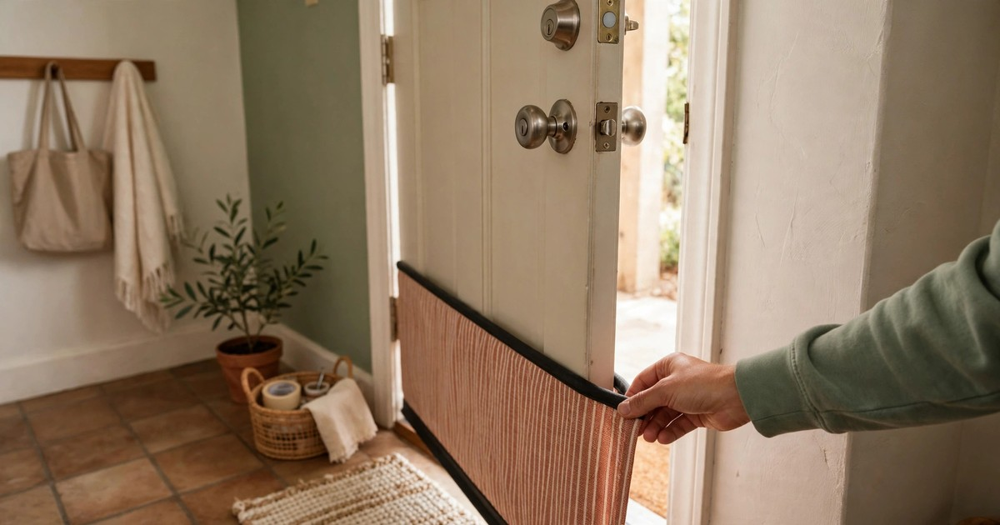
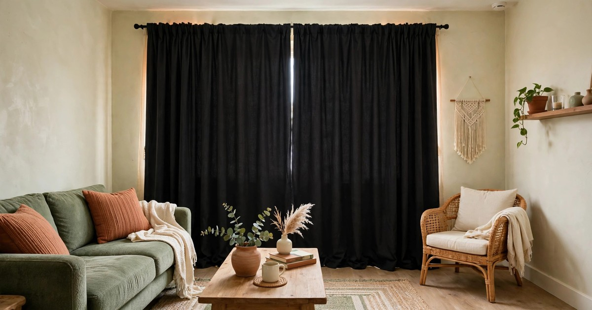
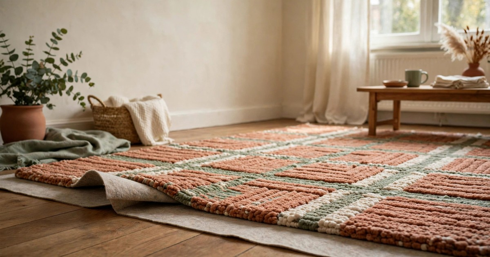
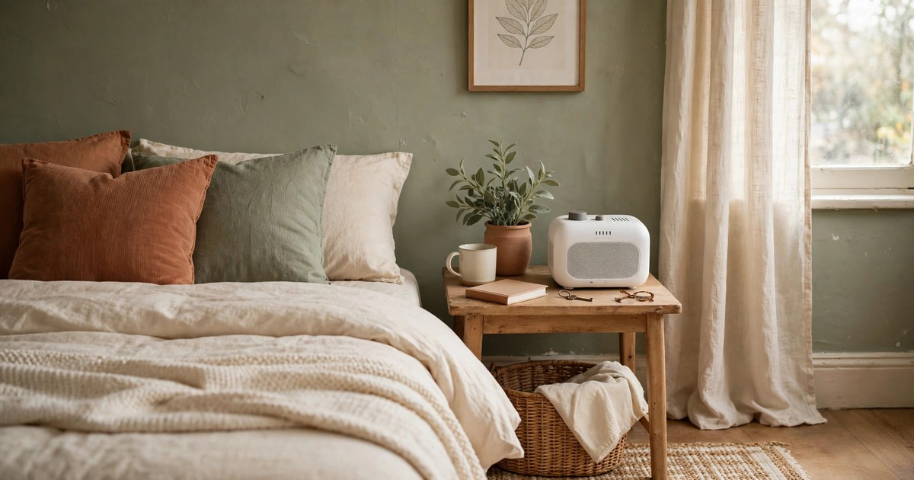

If you live in a rental, you already know the soundtrack: the neighbour's television through the wall, footsteps from above at 6 a.m., traffic humming through the window, the hallway echo every time someone comes home. Thin walls and hollow doors are the rule in rental buildings, not the exception, and the noise is one of the biggest reasons renters say they do not feel at home.

Here is the honest part first: you cannot make a rental apartment truly soundproof without construction — that takes mass, sealed air gaps, and building work your landlord will not approve. What you can do, for very little money and without touching the structure, is reduce noise by a lot: block the gaps where sound leaks in, add soft materials that absorb it, and mask what is left. Done in the right order, these seven steps can turn a flat where you hear every word next door into one where you only notice the noise when you listen for it.

### 1. Find the Gaps and Seal the Door First

Sound behaves like water: it finds the gaps. The biggest gap in almost every rental is the one under the front door and around the door frame, and it is also the cheapest to fix. Hold a torch on one side of the door at night and look from the other — if you can see light, sound is getting through that gap too.

A self-adhesive door seal strip around the frame and a draft excluder or door sweep at the bottom can cut hallway noise dramatically, and both are removable: the strips peel off, and the sweep hangs on the door or slides under it. Do the bedroom door too if noise from the rest of the flat bothers you. This step costs a few dollars, takes ten minutes, and is the highest-impact soundproofing you can do in a rental — skip it and everything else you add will underperform, because the sound is still pouring in through the gaps.

Find it on Amazon: [self adhesive door seal strip soundproof](https://www.amazon.com/s?k=self+adhesive+door+seal+strip+soundproof&tag={{AMAZON_TAG}})

### 2. Hang Heavy Curtains Over Windows and Thin Walls

Windows are the second-biggest leak: single glazing and thin frames let street noise straight in. Heavy curtains are the renter's answer, because they add mass and absorption right where the noise enters, and they need no drilling — a tension rod inside the frame or a removable adhesive-hook rod above it will hold them.

Choose the heaviest curtains you can find — blackout curtains are ideal, because the dense, multi-layer fabric that blocks light also absorbs sound far better than a sheer or a light cotton. Hang them floor to ceiling and wider than the window, so they cover the frame edges where sound leaks around the glass. The same trick works on a thin shared wall: a heavy curtain hung on the wall, like a tapestry, adds a layer of absorption between you and the neighbour's television. It looks like decor, which is the point — nobody needs to know it is soundproofing.

Find it on Amazon: [heavy blackout curtains sound absorbing](https://www.amazon.com/s?k=heavy+blackout+curtains+sound+absorbing&tag={{AMAZON_TAG}})

### 3. Cover Hard Floors With Rugs and Underlay

Hard floors are an echo chamber: every footstep, every chair scrape, every dropped object bounces off them, and the noise travels down to the flat below as well as around your own rooms. A thick rug with a dense underlay is the fix, and it works in both directions — it absorbs the sound in your flat and it muffles the impact noise your neighbours below hear from you.

Go thick rather than decorative: a high-pile or shaggy rug over a felt underlay absorbs far more sound than a flat-weave rug on bare floor, and the underlay is the part that does the most work, so do not skip it. Cover the main traffic areas — the route from the sofa to the kitchen, the space beside the bed, the hallway — rather than trying to carpet the whole flat. And if you have a downstairs neighbour, this step is also good neighbour diplomacy: it is the single kindest thing you can do for the person below you.

Find it on Amazon: [thick rug pad underlay sound absorbing](https://www.amazon.com/s?k=thick+rug+pad+underlay+sound+absorbing&tag={{AMAZON_TAG}})

### 4. Add Soft Furnishings to Kill the Echo

Empty rooms echo because sound has nothing to land on — it bounces from wall to wall until it fades. Every soft surface you add absorbs a little of it: cushions on the sofa, a throw over the armchair, an upholstered headboard, a fabric storage ottoman, even a pile of books on a shelf. It is not dramatic on its own, but combined with rugs and curtains it is what takes a flat from echoey to calm.

The most effective pieces are the big, soft ones: a fabric sofa absorbs far more than a leather one, a padded headboard quiets a bedroom noticeably, and a bookshelf full of books against a shared wall is one of the best sound absorbers a renter can own — the books add mass and the uneven spines break up sound waves. If you have a bare wall facing the noisy neighbour, a full bookcase against it is soundproofing disguised as furniture.

Find it on Amazon: [upholstered headboard for bed sound absorbing](https://www.amazon.com/s?k=upholstered+headboard+bed&tag={{AMAZON_TAG}})

### 5. Block the Shared Wall With Furniture, Not Foam

Acoustic foam panels look like the answer, but in a rental they are usually a mistake: they are designed to treat echo inside a room, not to block sound coming through a wall, and sticking them up with adhesive risks your deposit for very little benefit. Mass is what blocks sound, and furniture is the mass a renter already owns.

Push your heaviest furniture against the noisiest shared wall: a bookcase full of books, a wardrobe full of clothes, a chest of drawers. A wardrobe is particularly good — a wall of hanging clothes is dense, soft, and thick, which is exactly the combination that absorbs sound. Leave a small gap behind the furniture rather than pushing it flush, because an air gap between the furniture and the wall adds an extra layer of insulation. If the wall still bothers you, hang a thick tapestry or a moving blanket on it behind the furniture, where nobody sees it.

Find it on Amazon: [moving blankets thick for soundproofing wall](https://www.amazon.com/s?k=moving+blankets+thick+soundproofing&tag={{AMAZON_TAG}})

### 6. Mask What You Cannot Block With White Noise

Some noise you cannot block, and that is where masking comes in. A white noise machine — or a fan, or a phone app playing brown noise — produces a steady, even sound that your brain tunes out, and it covers the irregular noises that actually disturb you: the neighbour's footsteps, the traffic, the pipes. It does not make the flat quieter in decibels; it makes the noise less noticeable, which is what matters for sleep and concentration.

Brown noise works better than white noise for most people, because its lower frequencies cover the deep thuds and bass that leak through walls most. Put the machine between you and the noise source — near the shared wall or the window, not right next to your ear — and keep the volume low, just loud enough to blur the intruding sounds. For sleeping, a machine with a timer or an all-night mode is worth the small extra cost; for working from home, a fan gives you the same masking effect and keeps you cool at the same time.

Find it on Amazon: [white noise machine for sleep brown noise](https://www.amazon.com/s?k=white+noise+machine+sleep+brown+noise&tag={{AMAZON_TAG}})

### 7. Talk to the Neighbour — and Know Your Rights

The last step is not a product, and it is the one people skip: talk to the neighbour. Most noisy neighbours have no idea you can hear them — the person playing music at midnight often genuinely believes their walls are thicker than they are. A friendly conversation, at a calm moment rather than in the middle of the noise, solves more noise problems than any amount of foam, and it costs nothing.

Be specific and reasonable: name the noise, name the times, and suggest something concrete, like keeping the bass down after 10 p.m. or using headphones for late-night films. If talking does not work, check your lease and your local noise rules: most tenancy agreements include a quiet-hours clause, and most cities have noise ordinances that apply after a certain hour. Keep a simple log of dates and times if you need to involve the landlord — a dated note is far more persuasive than a general complaint.

Find it on Amazon: [sleep earplugs noise cancelling comfortable](https://www.amazon.com/s?k=sleep+earplugs+noise+cancelling+comfortable&tag={{AMAZON_TAG}})

## Frequently Asked Questions

### How much does it cost to soundproof a rental apartment?

The steps in this guide cost $60–120 in total: door seals ($5–10), heavy curtains ($25–40), a rug underlay ($15–25), and a white noise machine ($20–30). You can start with just the door seals and curtains for under $50 and add the rest over time. Full professional soundproofing costs thousands and needs construction, which is not an option in a rental.

### Can I soundproof a rental without damaging the walls?

Yes — every step here is damage-free. Door seals peel off, curtains hang on tension rods or adhesive hooks, rugs and furniture sit on the floor, and white noise needs no installation at all. Avoid acoustic foam panels stuck to walls with adhesive, which can peel paint and cost you part of your deposit.

### Do blackout curtains really help with noise?

They help noticeably, though they will not make a room silent. The dense, multi-layer fabric of a good blackout curtain absorbs sound at the window — the second-biggest noise leak in most flats — and hanging them floor to ceiling and wider than the frame covers the gaps around the glass. Expect a clear reduction in street noise, not total silence.

### What is the best way to block noise from noisy neighbours upstairs?

Impact noise from above — footsteps, dropped objects — is the hardest to block from below, because it travels through the structure itself. A white noise machine masks it best, and a thick rug in your own flat does nothing for the ceiling. If it is severe, speak to the neighbour about rugs and soft slippers in their flat, or raise it with the landlord, who can ask them to add rugs.

### Will a white noise machine help me sleep in a noisy apartment?

For most people, yes — brown noise in particular covers the low-frequency thuds and bass that leak through walls, and the steady sound gives your brain something even to tune out instead of the irregular noises that wake you. Keep the volume low, place the machine between you and the noise source, and try it for a week before deciding.

### Can my landlord stop me from soundproofing my rental?

No, as long as your soundproofing is removable and does not alter the structure. Door seals, curtains, rugs, furniture placement and white noise machines are all normal use of the flat. Anything that involves drilling, gluing panels to walls, or altering doors or windows needs the landlord's written permission — and is rarely worth it in a rental.
