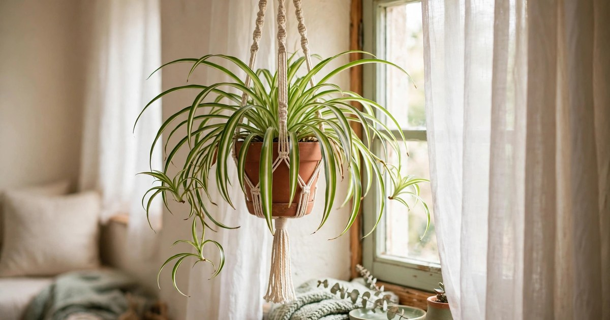
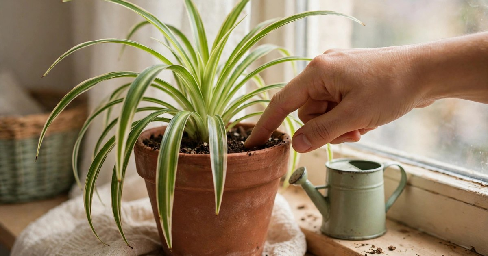
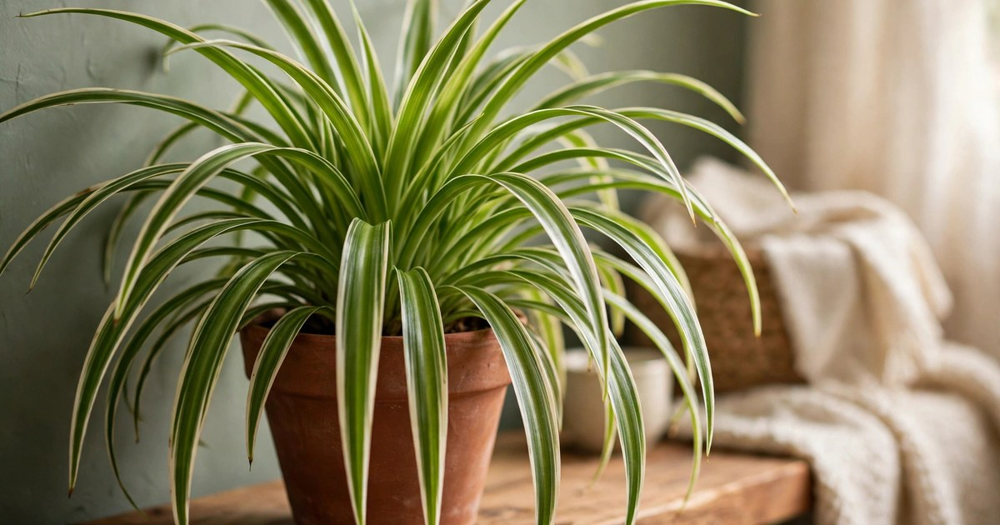
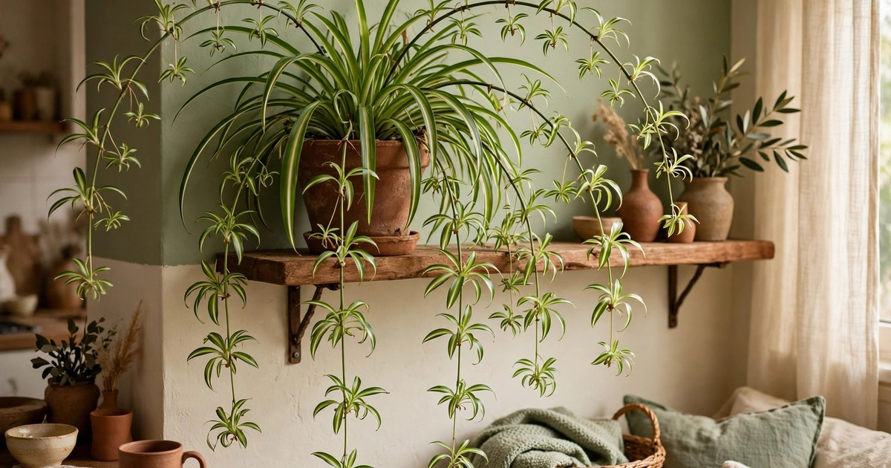
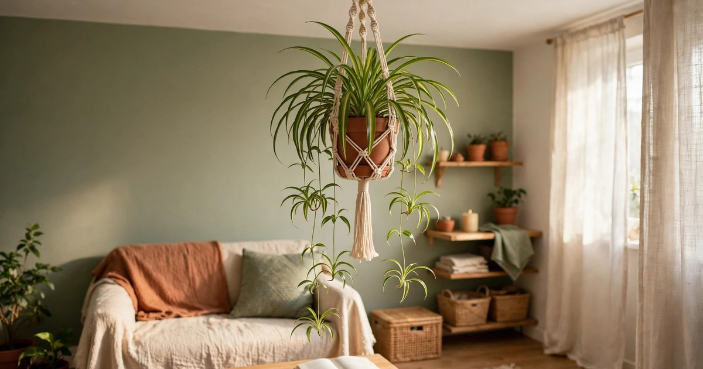
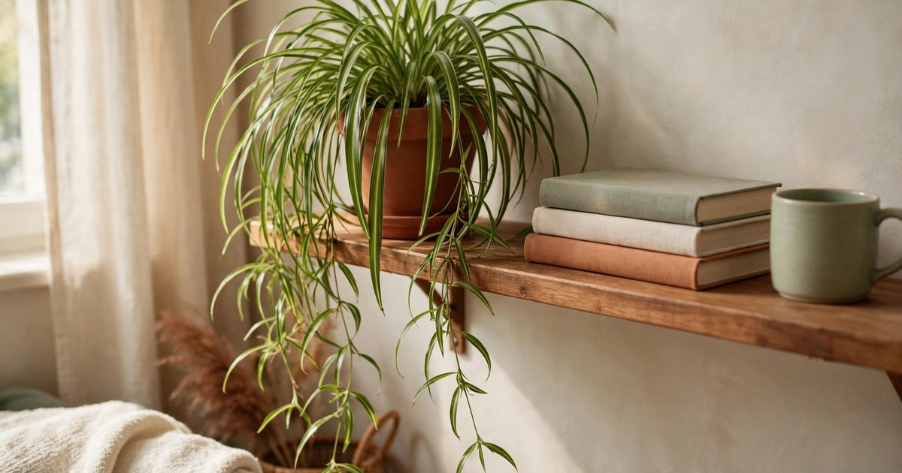
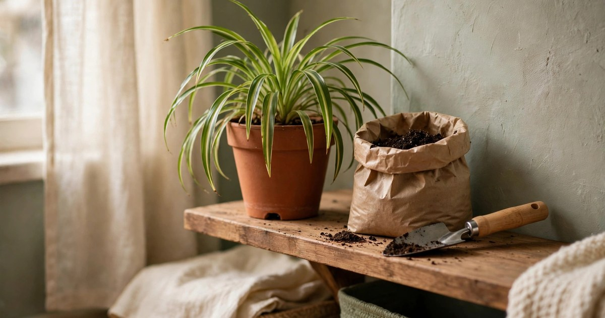
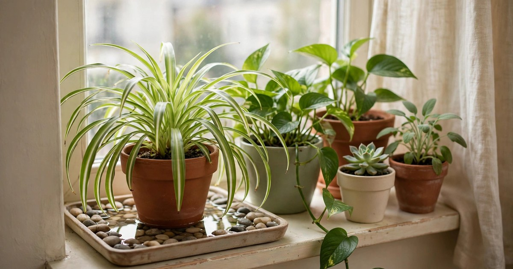
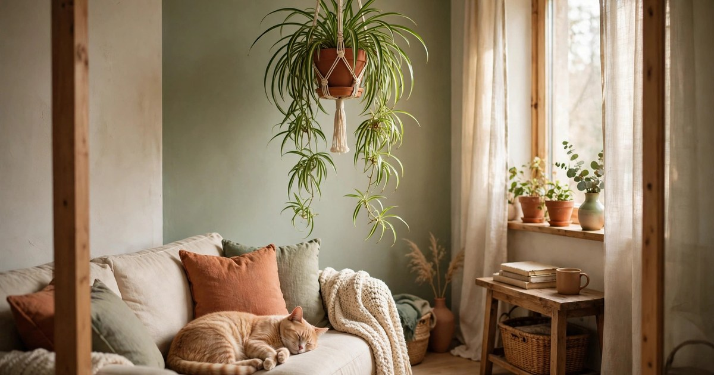
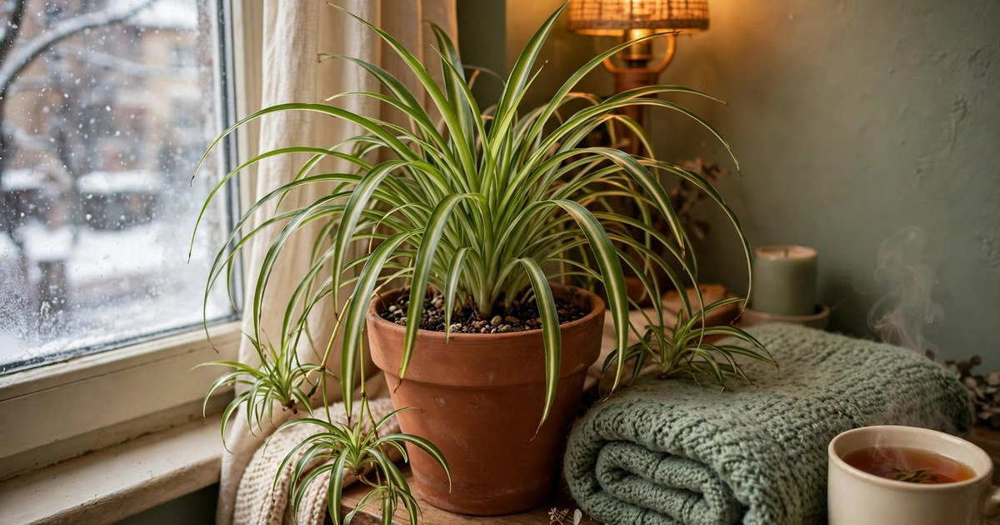

Few houseplants suit a small apartment as well as the spider plant. It is forgiving, fast-growing, endlessly generous with its babies, and it looks good doing almost nothing — a rosette of arching striped leaves that turns a bare shelf into a little green waterfall. It was the plant on every grandmother's windowsill for a reason: it survives the forgotten watering, the dim corner, the drafty sill, and still throws out a cascade of plantlets like it is showing off.

But "hard to kill" is not the same as "thriving." A spider plant that merely survives in a small flat tends to look it — brown, crispy leaf tips, pale washed-out stripes, a few scraggly leaves instead of a full fountain. In a small apartment, where every plant has to earn its square footage, that is a waste of one of the easiest and most beautiful houseplants there is. The good news is that the gap between surviving and thriving is small, and it costs almost nothing: the right light, a watering rhythm that matches your flat, and a few cheap habits that keep those famous striped leaves looking fresh.

This guide walks through ten practical spider plant care ideas built for small apartments: hanging planters that use vertical space instead of floor space, small pots that fit narrow shelves, and tricks for brown tips, babies, and propagation that cost next to nothing. Follow them and your spider plant will do what it does best — grow fast, look full, and hand you free plants for every shelf you own.

### 1. Give it bright, indirect light — not direct sun

Light is the single biggest factor in how a spider plant looks. Give it bright, indirect light and the leaves grow long and arching, the white or cream stripes stay bold, and the plant throws out baby plantlets on long stems. Give it too little light and the stripes fade to plain green, growth slows, and the plant stops making babies altogether. Give it harsh direct sun and the leaves scorch — pale bleached patches that never heal.

In a small apartment, the best spot is usually within a metre or two of a window, but not pressed against the glass. An east-facing window is ideal: gentle morning sun, then bright light for the rest of the day. A south- or west-facing window works too, provided the plant sits back from the glass or behind a sheer curtain that softens the afternoon sun. A north-facing window is the weakest option, but a spider plant will still grow there — just more slowly, with greener leaves and fewer babies.

The small-apartment trick is to use height. Spider plants love a hanging planter or a high shelf near a window, where they catch the light that reaches the upper part of the room and their leaves can arch down freely. A plant hanging near a window also gets better light along its whole rosette than one sitting low on the floor in the shadow of furniture. Rotate the pot a quarter turn every couple of weeks so all sides get their share of light and the plant grows evenly instead of leaning hard toward the window.

If your only window is dim, a simple daylight bulb in a desk lamp aimed at the plant for a few hours a day makes a real difference. You do not need a dedicated grow light for a spider plant — a bright white LED bulb in a lamp you already own is enough to keep the stripes vivid and the babies coming. And remember that the most variegated varieties, like 'Vittatum' with its wide cream centre stripe, are the fussiest about light: if the stripes are fading, move the plant closer to the window before you change anything else.

Find a sheer curtain or light-diffusing setup on Amazon: [sheer window curtain panels for houseplants](https://www.amazon.com/s?k=sheer+window+curtain+panels+light+filtering&tag={{AMAZON_TAG}})

### 2. Water when the top soil dries — and use the right water

Spider plants like a steady drink, but they hate wet feet. Overwatering is the fastest way to a sick spider plant: the roots sit in soggy soil, they rot, the leaves turn yellow at the base and drop, and by the time the plant looks ill the damage is already done. The fix costs nothing — water only when the top few centimetres of soil feel dry. Push your finger into the soil up to the second knuckle. If it feels damp, wait. If it feels dry, water thoroughly until it runs out of the drainage holes, then empty the saucer so the pot never sits in standing water.

How often that means watering depends on your flat. In a warm, bright room in summer, a spider plant in a small pot might need water every week. In a cool, dim flat in winter, it might go two or three weeks between waterings. The calendar is useless; the finger test is everything. Small pots dry out faster than big ones, which is actually an advantage in a small apartment — a 4- or 6-inch pot is much harder to overwater than a large one, because the soil dries out between waterings instead of staying soggy at the bottom.

Here is the spider-plant-specific secret: the water itself matters. Spider plants are famously sensitive to fluoride and salts in tap water, which is one of the main causes of those brown leaf tips. If your tap water is heavily treated, let it sit uncovered overnight before watering so the chlorine dissipates, or use filtered water or rainwater when you can. Water slowly and evenly around the base of the plant rather than dumping it all in one spot, and make sure the water reaches the whole root ball — a quick splash that only wets the surface leaves the lower roots dry while the top looks wet. In winter, cut back sharply: a spider plant barely grows in the cold months and needs far less water.

A simple moisture meter takes the guesswork out of the finger test. Keep one by your plants and check before you water — it is the cheapest insurance against root rot you can buy, and it pays for itself the first time it stops you watering a plant that did not need it.

Pick up a moisture meter on Amazon: [houseplant soil moisture meter](https://www.amazon.com/s?k=houseplant+soil+moisture+meter&tag={{AMAZON_TAG}})

### 3. Fix brown tips for good

Brown leaf tips are the spider plant's signature complaint, and almost every owner sees them sooner or later. The tips go dry, brown and crispy while the rest of the leaf looks perfectly healthy, and the plant slowly starts to look ragged. The good news is that brown tips are almost never a disease — they are a message about water, salts, or humidity, and each cause has a cheap fix.

The most common culprit is the water. Fluoride and dissolved salts in tap water build up in the leaf tips, where the water evaporates and leaves the minerals behind. Switch to filtered water, distilled water, or rainwater for a few weeks and watch the new leaves: if they come in clean, you have found your answer. Letting tap water sit uncovered overnight helps with chlorine, though it does not remove fluoride, so a basic filter jug is a worthwhile investment if your water is heavily treated. Flushing the soil every couple of months helps too — run plain water slowly through the pot for a minute, let it drain fully, and you wash out the salt build-up before it reaches the leaves.

The second culprit is low humidity. Spider plants come from the forests of southern Africa, where the air is moist, and a dry centrally-heated flat in winter dries the leaf tips out. Grouping your plants together helps — they create a small pocket of humidity around each other — and a pebble tray under the pot (a shallow dish of pebbles with water just below the top of the stones) raises the humidity right around the plant without wetting the roots. Misting the leaves occasionally helps a little, but a pebble tray or grouping plants together does far more.

For the brown tips already there, snip them off with clean scissors, following the natural pointed shape of the leaf so the trim looks invisible. Do not pull the brown bits off by hand — that tears healthy tissue and leaves a ragged edge. And resist the urge to over-fertilise in response: too much fertiliser is itself a cause of brown tips, so if you have been feeding heavily, skip feeding for a couple of months and flush the soil.

Get a filter jug or pebble tray supplies on Amazon: [water filter pitcher for houseplants](https://www.amazon.com/s?k=water+filter+pitcher+for+houseplants&tag={{AMAZON_TAG}})

### 4. Let the babies dangle — then propagate them

The baby plantlets — the little spiderettes dangling from long arching stems — are the spider plant's party trick, and they are the reason one plant becomes many in a small apartment. A healthy, mature spider plant throws out stems covered in miniature versions of itself, each one a complete new plant waiting for a pot. Letting them dangle is not just beautiful: it is the sign your plant is genuinely happy.

Babies appear when the plant is getting enough light and is slightly snug in its pot. If your spider plant never makes babies, the usual reason is too little light or a pot that is far too big — the plant spends its energy filling the pot with roots instead of producing plantlets. Move it closer to the window, and do not rush to repot into a larger pot: spider plants bloom and produce babies best when they are a little root-bound. Short days also trigger baby production, which is why spider plants often throw out their best stems in autumn.

Propagating a baby is almost embarrassingly easy, and it is the cheapest way to fill a small apartment with greenery. The simplest method is to leave the baby attached to the mother plant and set a small pot of soil beside it, pinning the baby's base gently onto the soil surface with a hairpin or a bent paperclip. It roots in a week or two while still fed by the mother plant, and once it is anchored you snip the stem. Alternatively, snip the baby off and put it straight into a small pot of damp soil, or into a jar of water until white roots appear — spider plant babies root happily in all three ways.

One mother plant can supply plantlets for every shelf, every hanging planter, and every housewarming gift you will ever need to give. Keep a few small pots on hand and a baby becomes a present that costs nothing and means more than anything bought. Hanging a plant with a full cascade of babies is also one of the most striking looks in a small flat — a living curtain that costs nothing and grows more dramatic every month.

Stock up on small pots for babies on Amazon: [small terracotta pots with drainage holes for propagation](https://www.amazon.com/s?k=small+terracotta+pots+drainage+holes+propagation&tag={{AMAZON_TAG}})

### 5. Hang it high — the small-apartment display trick

In a small apartment, floor space is the scarcest resource you have, and a spider plant is one of the few houseplants that actually prefers to live in the air. Its arching leaves and dangling babies are made for hanging: suspended from a ceiling hook or a wall bracket, a spider plant becomes a living chandelier that takes up zero floor space and zero shelf space, and looks better from below than it ever could sitting on a table.

A macramé hanger is the classic choice and fits the warm, cozy palette of a small flat — cream cotton cord, a terracotta or ceramic pot, and the green-and-white leaves spilling over the edge. A simple ceiling hook screwed into a joist holds a spider plant easily, and because the plant is light, even a small hook does the job. If you cannot drill into the ceiling, a tension-rod plant hanger across a window, a wall-mounted bracket, or an over-the-door hook all work, and all are renter-friendly: no permanent holes, no damage to get your deposit back over.

Hanging also solves two of the spider plant's practical problems at once. Up high near a window, the plant gets the bright indirect light it loves, and the leaves and babies can arch and dangle freely instead of being squashed against a wall or a shelf. It also keeps the plant safely out of reach of curious cats — spider plants are pet-safe, but a dangling baby is an irresistible toy, and a hanging plant keeps the batting to a minimum.

Watering a hanging plant needs a small adjustment: lift it down to water it, let it drain fully in the sink, and hang it back up. Watering in place risks drips on the floor and a saucer that never empties. A lightweight plastic pot inside a decorative hanger makes the lift-down easy, and a plant that is watered properly in the sink is a plant that never gets root rot from a saucer full of standing water.

Find a macramé hanger on Amazon: [macrame plant hanger for hanging spider plants](https://www.amazon.com/s?k=macrame+plant+hanger+hanging+planter&tag={{AMAZON_TAG}})

### 6. Shelf styling: let it spill, don't crowd it

If hanging is not an option, a shelf is the spider plant's natural second home — but the way you style it makes all the difference. A spider plant needs room for its leaves to arch and its babies to dangle. Crammed between books on a crowded shelf, with its leaves pressed against the wall, it looks stunted and sad. Given the edge of the shelf and a little breathing room, it becomes the best-looking plant in the room.

The rule is simple: give the spider plant the end of the shelf. Its leaves arch outward and downward, so a plant at the end of a shelf spills beautifully into the open air, while a plant in the middle gets its leaves bent and broken by its neighbours. A floating wall shelf in a bedroom or a kitchen shelf above the counter are both perfect — high enough to catch the light, with open space below for the babies to cascade. A stack of books under the pot lifts the plant a few centimetres and gives the leaves even more room to spill, and it looks intentional rather than accidental.

Keep the styling light. A spider plant is a statement on its own, so pair it with one or two simple objects — a small stack of books, a ceramic mug, a candle — rather than a crowded collection. In a small apartment, a shelf with one thriving spider plant and a little empty space looks far more expensive than a shelf crammed with five struggling plants. And because the plant grows fast, leave room for it: a spider plant that looks perfect today will be twice as wide in six months, so do not style the shelf tight around it.

Rotate the pot a quarter turn every couple of weeks so the plant grows evenly, and check the leaves that touch the wall — they can collect dust and go pale where the light never reaches. A quick wipe with a damp cloth every few weeks keeps the stripes bright and the plant looking like it just came from the nursery.

Find floating wall shelves on Amazon: [floating wall shelves for plants small apartment](https://www.amazon.com/s?k=floating+wall+shelf+for+plants+small+apartment&tag={{AMAZON_TAG}})

### 7. The right pot and soil for small spaces

The pot matters more than most people think, because it decides how wet the roots stay between waterings. The single most important feature is a drainage hole. A pot without one turns every watering into a gamble: water collects at the bottom, the roots sit in it, and rot follows. If you fall in love with a decorative pot that has no hole, use it as a cover pot — keep the spider plant in a plain plastic nursery pot with holes inside it, and lift the inner pot out to water, letting it drain fully before putting it back.

Terracotta is the best material for a spider plant in a small apartment. The porous clay breathes, letting excess moisture evaporate through the walls of the pot, which makes overwatering much harder. It is also heavy enough to anchor a hanging plant or a plant on a high shelf, and its warm, earthy colour fits the terracotta-and-cream palette of a cosy flat. Plastic pots are lighter and cheaper and hold moisture longer, which can be useful if you tend to underwater, but they make overwatering easier — and a lightweight plastic pot is easier to lift down from a hanging planter.

Size matters too. A spider plant likes to be slightly snug: a pot one size up from the nursery pot is right, with about two to three centimetres of fresh soil around the root ball. A pot that is far too big holds a large volume of soil that stays wet long after the plant has drunk its fill, which is the classic recipe for root rot — and it delays the babies, because the plant spends its energy filling the pot with roots instead of producing plantlets. In a small apartment, snug pots are also a practical win: they fit on narrow shelves, hang neatly, and let you keep more plants in less space.

For soil, a standard houseplant potting mix with a handful of perlite mixed in is exactly right. Spider plants want soil that holds some moisture but drains freely — heavy, dense soil stays soggy, while pure perlite dries out too fast. A bag of potting mix and a small bag of perlite will last a whole collection of plants for a year or more, and repotting once a year in spring, into a pot just one size up, is all the maintenance the roots ever need.

Get potting mix and perlite on Amazon: [houseplant potting mix with perlite for spider plants](https://www.amazon.com/s?k=houseplant+potting+mix+perlite&tag={{AMAZON_TAG}})

### 8. Humidity without a humidifier

Spider plants come from the moist forests of southern Africa, and while they tolerate dry indoor air better than most tropical plants, they still show it when the air gets very dry — brown leaf tips, curling leaves, and slower growth. In a small apartment with central heating or air conditioning, the air in winter can be dry enough to stress a spider plant, and a humidifier feels like overkill for a single plant. The good news is that there are cheaper ways to raise the humidity right around the plant.

The simplest is grouping. Plants release moisture through their leaves, so a cluster of plants creates a small pocket of more humid air around itself. Put your spider plant next to two or three other houseplants on the same shelf or windowsill and they will all benefit — the group stays healthier than any one plant alone, and a little cluster of greenery looks far better than a single lonely pot. In a small flat, a grouped shelf is also the most efficient use of space: one shelf, several plants, one shared microclimate.

The second trick is a pebble tray. Take a shallow dish or saucer, fill it with pebbles or small stones, add water until it sits just below the top of the stones, and stand the pot on top. As the water evaporates it humidifies the air immediately around the plant, without ever wetting the roots. A pebble tray costs a few dollars, needs topping up once or twice a week, and doubles as a drip tray that protects your shelf from water marks.

The third trick costs nothing: keep the plant in the most naturally humid room. A spider plant thrives in a bright bathroom, where the steam from the shower keeps the air moist all day, and a kitchen windowsill above the sink is almost as good. If your bathroom has a window, even a small one, a spider plant hanging there will often look better than any other plant in the flat. Misting the leaves occasionally helps a little, but grouping, a pebble tray, or a bathroom spot does far more than any amount of misting.

Find pebble tray supplies on Amazon: [decorative pebbles for plant humidity tray](https://www.amazon.com/s?k=decorative+pebbles+plant+humidity+tray&tag={{AMAZON_TAG}})

### 9. Pet-safe greenery you don't have to worry about

For pet owners in small apartments, the spider plant is a gift. It is one of the few genuinely beautiful houseplants that is non-toxic to cats and dogs — the ASPCA lists Chlorophytum comosum as safe for both — so a chewed leaf is a mess, not a vet visit. In a small flat, where a cat can reach every shelf and a dog can nose every floor-level pot, that safety is worth more than any amount of exotic foliage.

That said, safe does not mean chew-proof. Cats in particular love spider plants: the long, dangling leaves move like toys, and the babies swinging from their stems are irresistible. A cat that chews a spider plant will usually be fine — it may drool or vomit a little from the rough leaf fibres — but the plant will look ragged, and a determined cat can strip a young plant bare. The practical fix is placement, not worry: hang the plant high, or put it on a shelf the cat cannot easily reach, and give the cat something better to chew, like a pot of cat grass on the floor. A spider plant hanging from the ceiling is a plant the cat can admire from below without destroying.

Dogs are usually less of a problem, but a puppy will chew anything at floor level. Keep spider plants on shelves or in hanging planters rather than on the floor, and the plant stays safe while the dog keeps its own space. And because spider plants are safe, you can relax about the babies that dangle within reach: a baby that gets batted off the stem is not a hazard, it is a free cutting you can pot up.

This is also why spider plants are the perfect first plant for a household with pets and children. You get the full, lush, trailing look of a tropical plant with none of the anxiety that comes with lilies, pothos, or philodendrons, all of which are toxic if eaten. A small apartment shared with animals needs plants that forgive a nibble, and the spider plant forgives more than most.

Get cat grass for distraction on Amazon: [cat grass seeds kit for indoor cats](https://www.amazon.com/s?k=cat+grass+seeds+kit+indoor+cats&tag={{AMAZON_TAG}})

### 10. Feed lightly, repot rarely, and let it rest in winter

Spider plants are not hungry plants, and in a small apartment the most common fertiliser mistake is giving them too much. Overfeeding burns the leaf tips brown, builds up salts in the soil, and can do more damage than never feeding at all. The rule is simple: feed lightly, only while the plant is actively growing, and always at half the strength printed on the bottle.

Start in early spring, when the days lengthen and you see new leaves unfurling and fresh baby stems appearing. Use a balanced liquid houseplant fertiliser diluted to half strength, once a month through spring and summer, and stop entirely in autumn and winter when growth slows. Water the plant first, then feed — applying fertiliser to dry soil can scorch the roots. If you prefer a low-effort option, a slow-release fertiliser applied once in spring does the job for the whole season, though liquid feeding gives you more control.

Repot rarely. Spider plants actually prefer to be slightly root-bound — a snug pot is what triggers the best baby production — so resist the urge to repot every year. Repot only when the roots are visibly circling the drainage holes, pushing the plant up out of the pot, or the plant dries out within a day or two of watering. When you do repot, go up just one pot size in spring, and expect a short pause in growth while the plant settles: it will spend a few weeks filling the new pot with roots before it gets back to making leaves and babies.

Winter is when most spider plant problems happen, and almost all of them come from doing too much rather than too little. Growth slows dramatically as the days shorten, and a plant that is barely growing needs barely any water and no fertiliser at all. Cut watering back hard, keep the plant away from cold draughts and radiators, and resist the urge to repot, prune hard, or move it around. Let it rest, keep it warm, water it sparingly, and it will come back in spring with a burst of new growth and a fresh cascade of babies that makes the quiet winter months worth it.

Stock up on liquid fertiliser on Amazon: [balanced liquid houseplant fertilizer](https://www.amazon.com/s?k=balanced+liquid+houseplant+fertilizer&tag={{AMAZON_TAG}})

A spider plant is the rare houseplant that rewards a little attention with a lot of growth — and then pays you back in free plants. Give it bright indirect light, water it only when the soil dries, fix the brown tips by changing the water rather than the plant, and let the babies dangle. In a small apartment, where every plant has to earn its place, a well-cared-for spider plant earns it many times over: hanging from the ceiling, spilling from a shelf, or filling a windowsill with plantlets that cost nothing and grow into gifts. Start with one small plant, follow these ten ideas, and by this time next year you will be giving spider plant babies away.

## Frequently Asked Questions

### Why does my spider plant have brown tips?

Brown tips are usually caused by fluoride or salts in tap water, low humidity, or over-fertilising. Switch to filtered or rainwater, flush the soil every couple of months to wash out salt build-up, and raise humidity with a pebble tray or by grouping plants together. Trim the brown tips with clean scissors, following the leaf's natural point, and the new leaves should come in clean.

### How often should I water a spider plant in a small apartment?

Water only when the top 3–5 centimetres of soil feel dry, which is usually every one to two weeks in summer and every two to three weeks in winter. Small pots dry out faster than large ones, so always check the soil with your finger rather than watering on a fixed schedule. Overwatering is the most common cause of yellow leaves and root rot in spider plants.

### Can spider plants grow in low light?

Yes — spider plants will survive in low light, but they grow more slowly, the white stripes fade to plain green, and the plant stops producing babies. For the fullest growth and the most plantlets, keep your spider plant within a metre or two of a window with bright, indirect light. Variegated varieties need the most light to hold their stripes.

### When should I cut off the spider plant babies?

You can leave the babies dangling on the mother plant for as long as you like — they are part of the display. Cut one off when it has a few small roots forming at its base and you want a new plant: snip the stem close to the baby, pot it in damp soil, and water it well for the first couple of weeks. You can also pin a baby onto a neighbouring pot of soil while it is still attached, and snip the stem once it has rooted.

### Is a spider plant safe for cats and dogs?

Yes. The spider plant (Chlorophytum comosum) is listed by the ASPCA as non-toxic to both cats and dogs, which makes it one of the safest houseplants for a small apartment shared with pets. Cats may still chew the dangling leaves, so hanging the plant high keeps it looking its best, but a nibbled leaf is a mess, not a vet visit.

### Why is my spider plant not producing babies?

A spider plant that never makes babies is usually short on light or sitting in a pot that is too big. Move it closer to a bright window, and do not repot into a larger pot — spider plants produce babies best when they are slightly root-bound. Shorter days in autumn also trigger baby production, so a young plant may simply need another season to mature before it starts throwing out plantlet stems.
