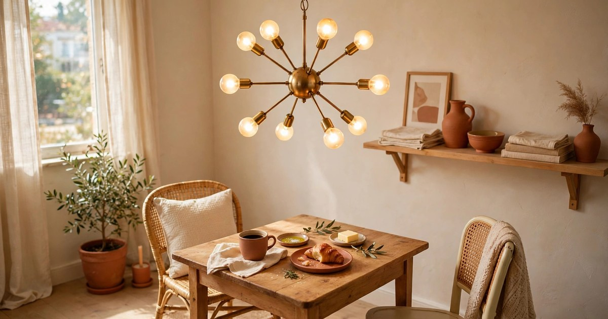
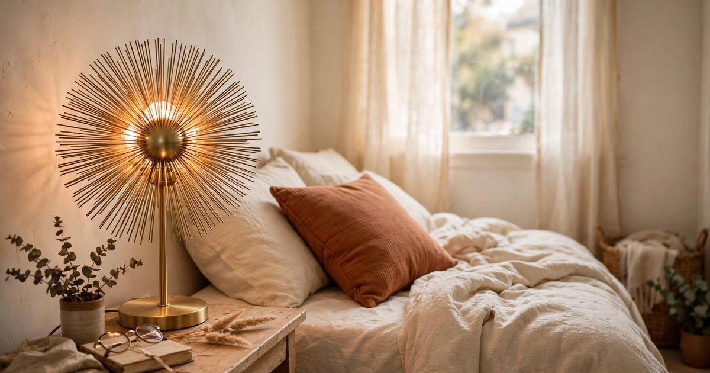
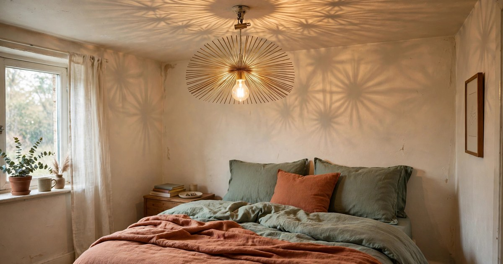
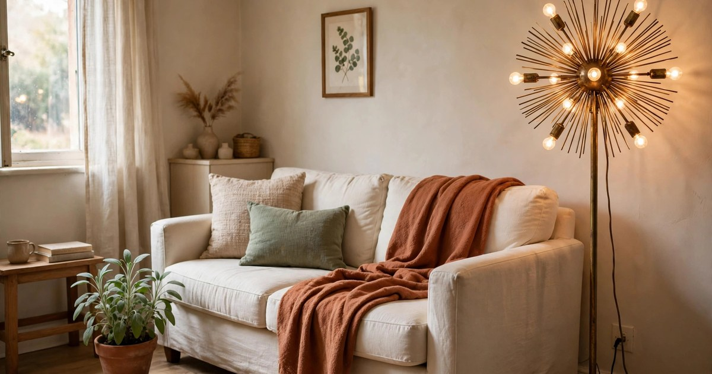
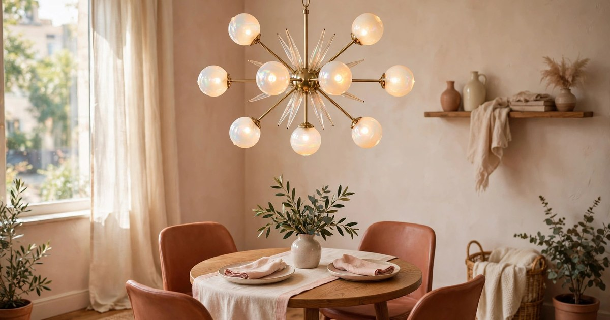
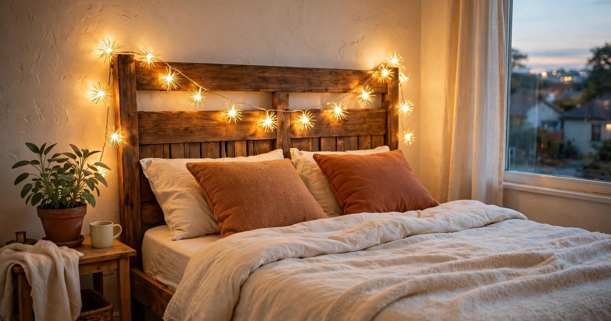
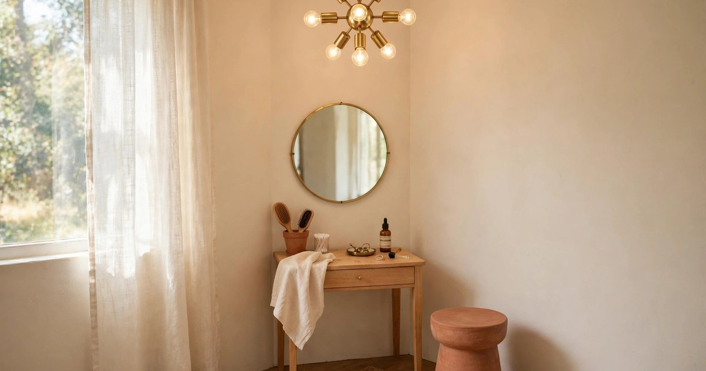
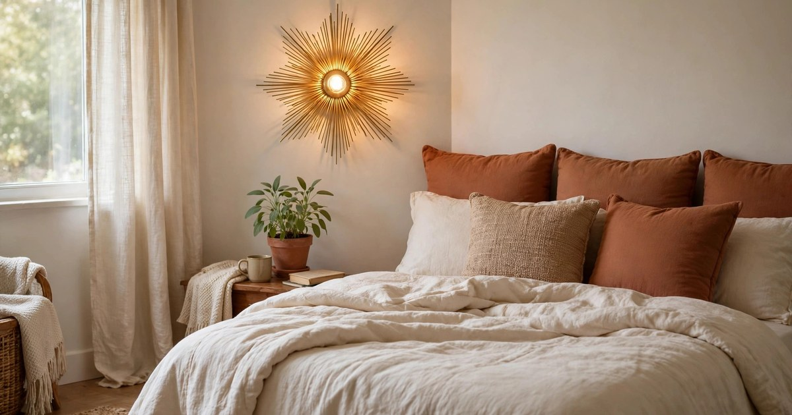
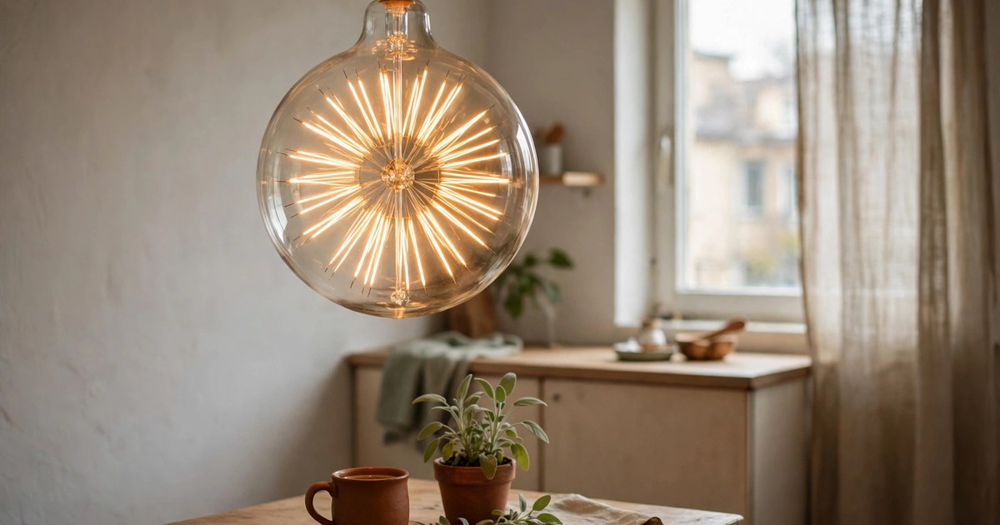

There is a particular kind of magic that happens when a plain rental ceiling gets a starburst light. The room does not just get brighter — it gets a focal point, a little mid-century drama, a constellation you can switch on. Starburst and sputnik fixtures are the centrepiece of the celestial lighting trend Pinterest flagged for 2026, and they suit small rentals beautifully: they draw the eye upward, they make a low ceiling feel intentional, and — crucially for renters — most of the affordable ones need no hardwiring at all.

Every pick below costs under $25, hangs or sits without an electrician, and comes back down again without a trace when you move. Plug-in cords, battery power, clip-on shades and simple bulb swaps: that is the whole toolkit. Each pick includes a why-it-works note and a where-it-fits note, so you buy with a plan rather than a hope. If you are already thinking about warm metals in your space, our [brass light fixtures for small spaces](/brass-light-fixtures-small-spaces/) pair well with everything here — brass and starburst are natural partners.

## 1. Plug-in sputnik pendant with brass arms

The classic move, and the one that delivers the most drama per pound: a plug-in sputnik pendant ($19–25) with six to eight slim brass arms, each tipped with a small globe bulb, on a long cord you drape from a ceiling hook. It hangs from a single adhesive or screw-in hook — no ceiling wiring, no junction box — and the cord runs down the wall to the nearest outlet, ideally tucked behind a curtain or a tall plant. Warm white bulbs (2700K) keep the glow cosy rather than clinical, and a dimmer plug in the socket gives you evening mood lighting for about $6 extra.

**Why it works:** a sputnik reads as a deliberate design choice, not a compromise. The branching arms fill the empty air above a coffee table or dining table, which is exactly where small rooms feel bare, and the multiple bulbs spread light evenly instead of pooling it in one hot spot.

**Where it fits:** above a small dining table, over a reading chair, or centred in a living room with a ceiling hook. [Shop starburst plug-in chandeliers](https://www.amazon.com/s?k=starburst+plug+in+chandelier&tag={{AMAZON_TAG}})

## 2. Battery-powered starburst table lamp

A tabletop starburst lamp ($15–22) is the zero-commitment version of the look: a spiky gold sphere on a small base, lit from within by battery-powered LEDs, with a timer you set once and forget. There is no cord at all, which makes it the easiest pick on this list to place anywhere — and to move when you rearrange. The best versions use warm white LEDs and a metal frame rather than plastic, so the rays catch real light during the day even when the lamp is off.

**Why it works:** it gives you the starburst silhouette at eye level, where you actually see it, without touching the ceiling. On a bedside table or a bookshelf it reads as sculpture by day and as a night light by evening, which is two jobs for one purchase.

**Where it fits:** bedside tables, bookshelves, entryway consoles, or a desk corner that needs warmth. [Shop battery starburst table lamps](https://www.amazon.com/s?k=battery+starburst+table+lamp+gold&tag={{AMAZON_TAG}})

## 3. Clip-on starburst shade for an existing bulb

If your rental already has a bare bulb hanging from the ceiling — the classic landlord fitting — a clip-on starburst shade ($12–18) is the fastest transformation available. The shade clips directly onto the bulb or the socket, its radiating spokes fanning out like a sunburst, and the whole job takes under a minute with the power switched off. When you move out, it unclips just as fast and goes in the moving box. Choose a shade slightly wider than you think you need: a small shade on a big bulb looks apologetic, while a generous one looks intentional.

**Why it works:** it fixes the single ugliest feature of most rentals — the naked bulb — for the price of a takeaway. The spokes throw patterned shadows on the ceiling, which turns a flat white expanse into something worth looking at.

**Where it fits:** bedrooms and hallways with existing pendant sockets, kitchens with a single ceiling bulb. [Shop clip-on starburst lampshades](https://www.amazon.com/s?k=clip+on+starburst+lampshade&tag={{AMAZON_TAG}})

## 4. Plug-in starburst floor lamp

A starburst floor lamp ($20–25) does the work of a pendant without asking anything of your ceiling. The base sits on the floor, a slim pole rises beside the sofa, and the starburst head — a cluster of arms with small bulbs — throws light in every direction at once. Because it plugs into a wall outlet, the only installation is standing it up. Look for a tripod or weighted base so it survives a bump from a pet or a vacuum cleaner, and a head that tilts so you can aim the glow at the ceiling for soft, indirect light.

**Why it works:** uplighting makes a small room feel taller, and a starburst head does it with style. It also solves the dark-corner problem — the corner behind the sofa that no overhead light ever reaches — without a single hole in the wall.

**Where it fits:** beside the sofa, in a dark living room corner, or flanking a reading chair. [Shop starburst floor lamps](https://www.amazon.com/s?k=starburst+floor+lamp+plug+in&tag={{AMAZON_TAG}})

## 5. Opalescent glass starburst pendant

This is the celestial trend at its prettiest: a plug-in pendant ($18–25) whose starburst arms end in small opalescent or pearl-finish glass globes that shift between cream, blush and pale aqua as the light moves. It is the same opalescent finish we love in our [iridescent decor accents](/iridescent-decor-accents-under-25/), now doing the lighting. By day the glass catches sunlight and throws faint rainbows; by night it glows like a small moon. Keep the bulbs warm white and low wattage so the glass, not the glare, is the star.

**Why it works:** opalescent glass softens the hard geometry of a sputnik, so it suits renters who find plain brass too sharp or too retro. It also harmonises with almost any palette, because it contains several colours at once — it picks up the terracotta in your cushions and the sage in your plants simultaneously.

**Where it fits:** above a small dining table, in a bedroom with a ceiling hook, or over a vanity. [Shop opalescent starburst pendant lights](https://www.amazon.com/s?k=opalescent+starburst+pendant+light+plug+in&tag={{AMAZON_TAG}})

## 6. Starburst fairy light string with clips

A string of fairy lights with starburst or star-shaped clips ($10–15 for a 5–10 metre string) is the renter's chandelier in miniature. Drape it along a headboard, around a mirror, or across a bookshelf, using the clips the set includes — no nails, no hooks, no damage. Battery or USB power means no hunting for outlets behind the bed, and a timer function means it switches itself off at 2 a.m. The gold-toned wire reads as a decorative element even in daylight, which plain copper wire never manages.

**Why it works:** it puts starlight at eye level, exactly where a small bedroom needs warmth, for the lowest price on this list. It also layers beautifully: string it above the battery starburst lamp from pick two and the two read as one intentional installation.

**Where it fits:** headboards, mirrors, bookshelves, window frames, or along a curtain rod. [Shop starburst fairy lights](https://www.amazon.com/s?k=starburst+fairy+lights+gold&tag={{AMAZON_TAG}})

## 7. Mini sputnik chandelier for a nook or vanity

Full-size sputniks can overwhelm a tiny room, so the mini version ($16–24) is the smarter buy for most rentals: a compact plug-in chandelier, roughly 30–40 cm across, with six short arms and small globe bulbs. It is made for the spots other lights ignore — a vanity corner, a reading nook, the space above a small desk. Hang it from a ceiling hook or a tall tension rod, and keep the cord tidy with a couple of adhesive cord clips running down the wall.

**Why it works:** scale is everything in a small space, and a mini sputnik gives you the full silhouette without eating the room. Over a vanity it doubles as task lighting, throwing even light across your face instead of the single harsh bulb most rentals provide.

**Where it fits:** vanity corners, reading nooks, above a small desk, or in a hallway. [Shop mini sputnik chandeliers](https://www.amazon.com/s?k=mini+sputnik+chandelier+plug+in&tag={{AMAZON_TAG}})

## 8. Starburst wall sconce with adhesive mount

A battery-powered starburst sconce ($14–21) mounts with heavy-duty adhesive strips — no drilling, no wiring, no landlord conversation. The half-burst design fans out from a small round base, and the built-in LEDs run for weeks on a set of batteries, with a remote or touch control for brightness. Place a pair flanking the bed or the sofa for symmetry, or a single one above a console for a focal point. When you move, warm the adhesive with a hairdryer and it peels off cleanly.

**Why it works:** wall light at eye level flatters a room in a way ceiling light never does — it softens faces, warms the walls, and makes a small bedroom feel like a boutique hotel. The starburst shape means even the unlit fixture is decoration.

**Where it fits:** beside the bed, flanking a sofa, above an entryway console, or in a hallway. [Shop battery starburst wall sconces](https://www.amazon.com/s?k=battery+starburst+wall+sconce+adhesive&tag={{AMAZON_TAG}})

## 9. Starburst Edison bulb with filament rays

The simplest pick on the list is also one of the cleverest: a starburst or sputnik-style Edison bulb ($8–14 for a single bulb, $12–20 for a pair) whose filament is arranged in radiating spokes inside an oversized globe. Screw it into any existing socket — a pendant, a clip lamp, a floor lamp — and the bulb itself becomes the starburst. No fixture, no fitting, no installation at all. Pair it with a cheap plug-in pendant cord and you have a complete starburst light for under $20 total.

**Why it works:** it is the only pick here that costs less than a takeaway and takes ten seconds to install. The filament design throws beautiful spoked shadows on the ceiling, and because it is just a bulb, it moves with you from flat to flat, socket to socket.

**Where it fits:** any existing pendant socket, clip lamps, plug-in pendant cords, or bedside lamps. [Shop starburst Edison bulbs](https://www.amazon.com/s?k=starburst+edison+bulb+filament&tag={{AMAZON_TAG}})

## Making it work in your rental

Start with one statement piece — the plug-in pendant or the mini sputnik — and let the smaller picks layer around it. Keep all your bulbs the same warm colour temperature so the room glows evenly, and use adhesive hooks and cord clips rather than anything that marks the wall. A starburst light does its best work when it is the only bold thing in the room, so let the rest of the decor stay calm: cream walls, terracotta cushions, a sage plant or two, and the light becomes the jewellery. When moving day comes, everything here unplugs, unclips or unscrews in minutes, and your deposit stays safe.

## Frequently Asked Questions

### Can I hang a starburst chandelier in a rental without hardwiring?

Yes. Every fixture in this roundup is plug-in, battery-powered, or a bulb swap, so none of them needs hardwiring. Plug-in pendants hang from a single ceiling hook and run a cord to the nearest outlet; adhesive hooks work for lighter fixtures, while a screw-in hook is best for heavier sputniks — always check your lease first, and fill any small hook hole with a dab of filler when you leave.

### Will a sputnik chandelier overwhelm a small room?

Not if you match the scale. For rooms under about 12 square metres, choose a mini sputnik (30–40 cm across) or a tabletop starburst lamp rather than a full-size fixture. Hang pendants high enough that nobody walks into them — at least 2 metres from the floor in walkways — and keep the arms slim rather than chunky so the fixture reads as airy, not heavy.

### What bulb colour temperature works best with starburst lights?

Warm white, around 2700K, is the cosiest choice and flatters the brass and gold finishes most starburst fixtures use. Cool white makes the metal look harsh and the room feel clinical. If your fixture takes smart bulbs, a dimmable warm white bulb gives you the most flexibility, from bright task light to soft evening glow.

### Are battery-powered starburst lights bright enough for a living room?

On their own, no — a battery sconce or table lamp is accent lighting, not room lighting. Use them to layer warmth and focal points, and pair them with a plug-in pendant or floor lamp for the main light. Rechargeable batteries or a timer function keep running costs low, and LED bulbs mean a set of batteries lasts for weeks of evening use.
