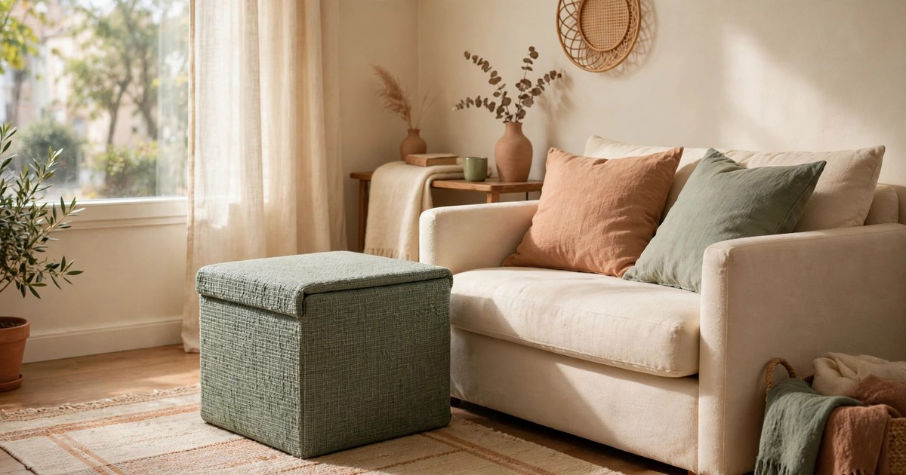
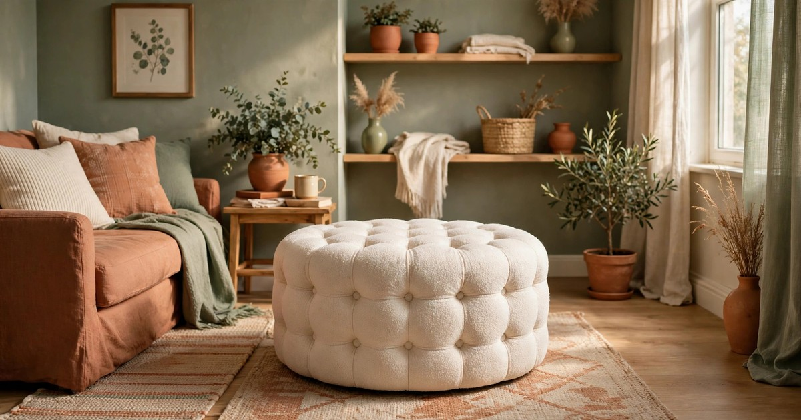
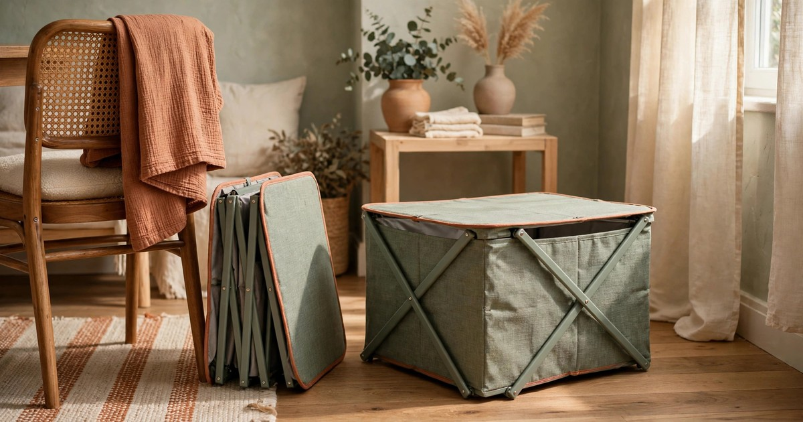
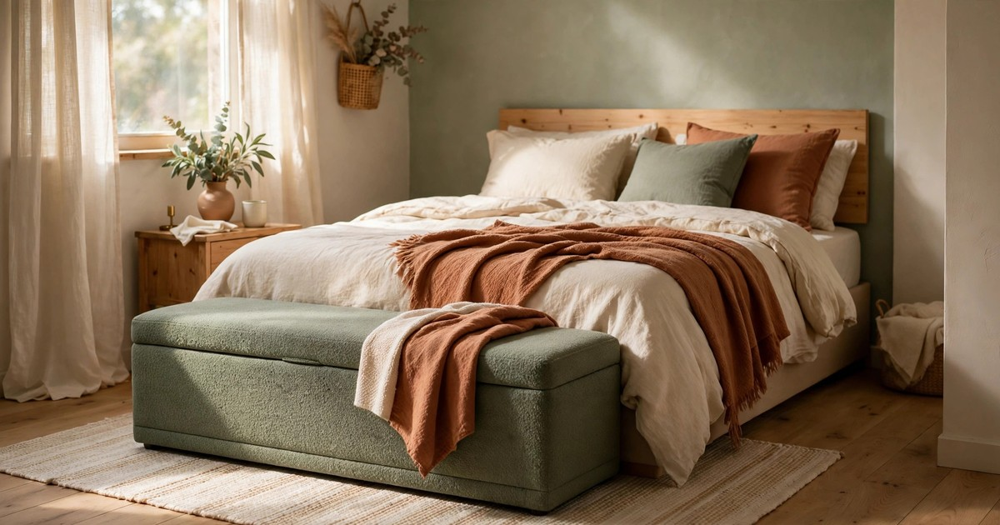
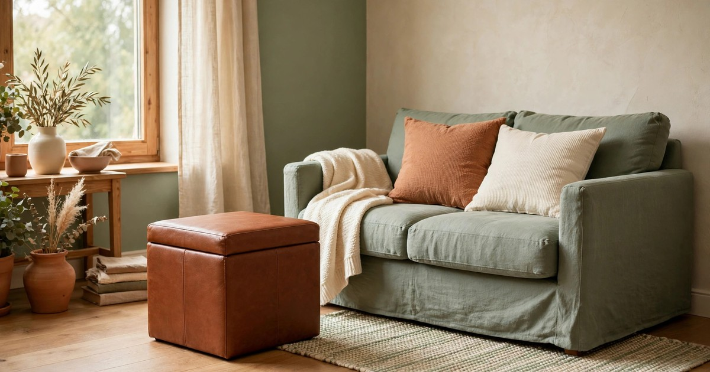
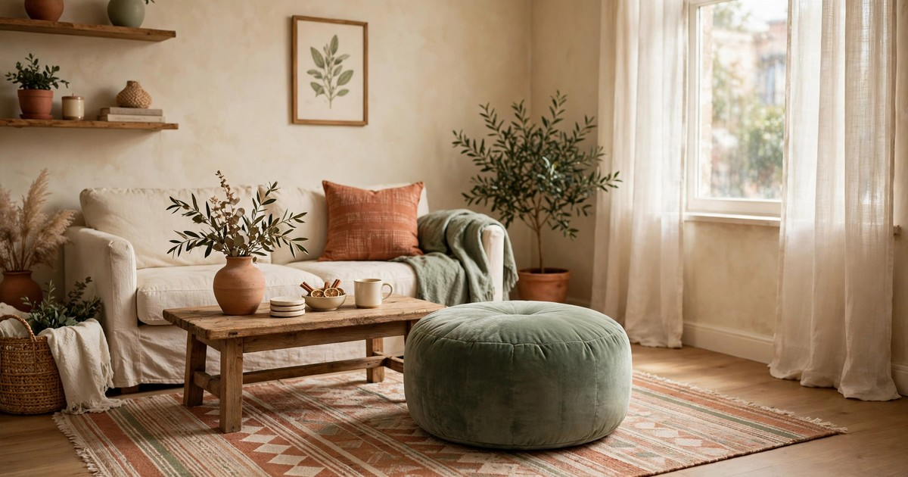
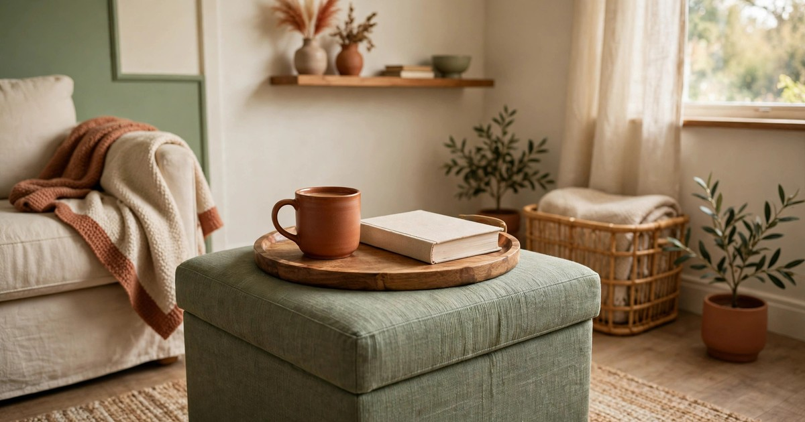
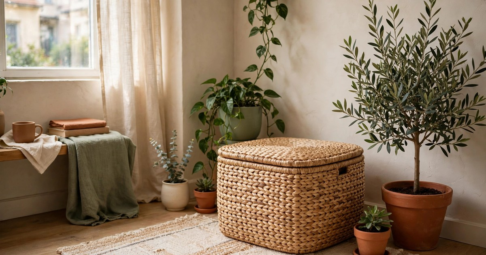
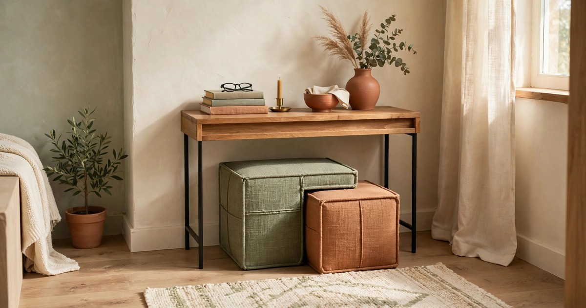

A storage ottoman is the rare piece of furniture that solves three small-apartment problems at once. It is a footrest, an extra seat when friends come over, and a hidden storage box for the blankets, magazines, chargers and clutter that otherwise live on every surface. In a flat where every square foot has to earn its keep, a piece that does three jobs for under $25 is hard to beat.

The trick is picking the right one for your space, because ottomans come in more shapes than you would expect and the wrong one is just a box you trip over. A cube suits a square corner; a round one softens a room full of straight edges; a bench-style one doubles as a coffee table; a folding one disappears when guests leave. This roundup covers all nine types, each under $25, each genuinely useful in a small flat — with the honest trade-offs, because at this price point there always are some.

### 1. The Classic Storage Cube

The storage cube is the default for a reason: a 15-inch cube that holds a folded throw blanket, a couple of magazines and the remote controls, with a padded lid you can sit on or rest your feet on. It fits under a console table, beside an armchair, or at the foot of the bed, and when you have two they stack into a side table. Faux linen and microfibre versions in cream, grey and sage are the easiest to live with — they hide dust and match almost any sofa.

Why it works: it is the cheapest way to add both seating and hidden storage, and its square shape wastes no space in a corner. Where it fits: beside the sofa as a footrest, at the foot of the bed for spare bedding, or in the hallway for shoes. The trade-off is the lid: on the cheapest cubes it is thin and sags under a heavier sitter, so check the weight rating if adults will sit on it regularly.

Find it on Amazon: [folding storage cube ottoman with lid](https://www.amazon.com/s?k=folding+storage+cube+ottoman&tag={{AMAZON_TAG}})

### 2. The Round Tufted Ottoman

If your living room is all straight lines — a boxy sofa, a rectangular rug, a square coffee table — a round ottoman is the single fastest way to soften it. The tufted top adds a touch of texture that reads far more expensive than the price, and the round shape means no sharp corners to catch your shin on in a tight walkway. Inside, most hold a folded throw and a few books, which is enough for the everyday clutter.

Why it works: it breaks up the geometry of a small room and doubles as a coffee table with a tray on top. Where it fits: the centre of a small seating area, where it can be a footrest, a table, and a spare seat in rotation. The trade-off is capacity: a round ottoman holds noticeably less than a cube of the same footprint, so it is a styling piece first and storage second.

Find it on Amazon: [round tufted storage ottoman cream](https://www.amazon.com/s?k=round+tufted+storage+ottoman&tag={{AMAZON_TAG}})

### 3. The Folding Ottoman

The folding ottoman is the one for renters who move often or host rarely: it collapses flat to a couple of inches thick, slides under a bed or behind a wardrobe, and pops open in seconds when you need an extra seat. It is also the cheapest type on this list, often under $15, which makes it the easiest to justify buying two of.

Why it works: it gives you extra seating on demand without permanently taking up floor space, which is exactly what a small flat needs. Where it fits: stashed under the bed for guests, or unfolded as a footrest during a film night and folded away after. The trade-off is sturdiness: folding ottomans are light by design, so they are better as footrests and occasional seats than as everyday furniture for heavier sitters.

Find it on Amazon: [folding collapsible ottoman footrest storage](https://www.amazon.com/s?k=folding+collapsible+ottoman+footrest+storage&tag={{AMAZON_TAG}})

### 4. The Bench-Style Ottoman

A bench ottoman is the longest type here — usually 30 to 40 inches — and that length is its superpower. At the foot of a bed it holds spare bedding and out-of-season clothes; in a hallway it is a bench for putting shoes on, with shoe storage inside; in a living room it is a coffee table that seats two. One long piece replaces a bench, a storage box, and a coffee table in one go.

Why it works: it turns dead space — the foot of the bed, the hallway wall — into seating and storage at the same time. Where it fits: the foot of a bed, an entryway, or under a window as a reading bench. The trade-off is that it needs a long, clear stretch of wall, so measure before you buy; a bench that blocks a walkway is worse than no bench at all.

Find it on Amazon: [bench storage ottoman foot of bed](https://www.amazon.com/s?k=bench+storage+ottoman+foot+of+bed&tag={{AMAZON_TAG}})

### 5. The Faux-Leather Cube

Faux leather is the practical choice if you eat on the sofa, have pets, or just do not want to worry about spills. A wipe-clean surface shrugs off coffee, muddy paws and the occasional red-wine incident, and the leather look adds a warm, grown-up note to a room full of soft fabrics. Cognac and dark brown are the most forgiving colours; black shows every speck of dust.

Why it works: it is the easiest ottoman to keep clean, and it looks more expensive than fabric at the same price. Where it fits: beside a sofa as a footrest and side table, or in a hallway for shoes and bags. The trade-off is comfort in summer — faux leather can feel sticky against bare legs — and the cheapest ones can peel after a year or two, so read the reviews for durability before buying.

Find it on Amazon: [faux leather storage ottoman cube](https://www.amazon.com/s?k=faux+leather+storage+ottoman+cube&tag={{AMAZON_TAG}})

### 6. The Velvet Pouf Ottoman

A velvet pouf is the softest, most decorative pick on this list — a low, round, squishy seat that reads as pure comfort. The storage versions have a zip-off top or a lift-off lid hiding a small compartment, enough for a throw blanket or a couple of books. Sage, blush and mustard are the colours that work hardest in a small space, adding a pop of colour without shouting.

Why it works: it adds colour and texture to a neutral room for very little money, and it is genuinely comfortable to sit on. Where it fits: as an accent seat in a reading corner, or pulled up to the coffee table when you need a fourth seat. The trade-off is that velvet shows marks and needs a quick brush now and then, and the storage space is the smallest on this list — think one blanket, not a whole linen cupboard.

Find it on Amazon: [velvet pouf ottoman with storage sage green](https://www.amazon.com/s?k=velvet+pouf+ottoman+storage&tag={{AMAZON_TAG}})

### 7. The Ottoman With a Tray Top

The tray-top ottoman solves the one problem every other ottoman has: you cannot put a drink on a soft, padded lid. A reversible lid — cushion on one side, hard tray on the other — turns the ottoman into a coffee table in one flip, and the tray stops mugs from tipping and books from sliding. It is the best single-piece coffee table replacement for a small flat.

Why it works: it is a coffee table, a footrest, a seat and a storage box in one piece, which is four jobs for the price of one. Where it fits: the centre of a seating area where a coffee table would normally go, especially in flats too small for both a table and an ottoman. The trade-off is the tray itself: it is usually wood-effect rather than real wood, and it can scratch, so use coasters even on the tray side.

Find it on Amazon: [storage ottoman with tray top reversible lid](https://www.amazon.com/s?k=storage+ottoman+tray+top+reversible&tag={{AMAZON_TAG}})

### 8. The Woven-Look Ottoman

A woven or seagrass-look ottoman adds the natural texture that makes a small room feel warm and layered, and it pairs beautifully with plants, rattan and wooden furniture. Most are fabric over a frame with a woven pattern printed or stitched in, so they are lighter than they look and easy to move around. They are the best pick if your style leans boho, coastal, or earthy.

Why it works: texture is what stops a small neutral room from feeling flat, and this ottoman adds it while hiding clutter. Where it fits: beside a plant stand, at the foot of a bed with linen bedding, or in a reading nook as a footrest. The trade-off is cleaning — woven textures trap dust more than smooth fabric — so a quick vacuum with the brush attachment once a week keeps it looking fresh.

Find it on Amazon: [woven seagrass storage ottoman boho](https://www.amazon.com/s?k=woven+seagrass+storage+ottoman&tag={{AMAZON_TAG}})

### 9. The Nesting Ottoman Set

A nesting set — two small ottomans that tuck one inside the other, or slide under a console table — is the smartest buy on this list for the smallest flats. Together they are a coffee table and a spare seat; apart they are two footrests or two extra seats for guests. When the evening is over they nest back into the footprint of one, which is the whole point in a flat where floor space is the scarcest resource.

Why it works: it gives you two seats for the space of one, and it hides completely when you do not need it. Where it fits: under a console table in the hallway, beside the sofa as a pair of footrests, or pulled out for a games night. The trade-off is that each ottoman is smaller than a standalone one, so the storage inside each is modest — but two small compartments are often more useful than one big one, because you can sort by category.

Find it on Amazon: [nesting ottomans set of 2 storage](https://www.amazon.com/s?k=nesting+ottomans+set+of+2+storage&tag={{AMAZON_TAG}})

## Frequently Asked Questions

### What size storage ottoman is best for a small apartment?

A cube between 15 and 17 inches square is the sweet spot for most small living rooms: big enough to hold a folded blanket and sit on comfortably, small enough to tuck beside a sofa or under a console table. Measure your spot before buying — and remember to leave a couple of inches of clearance so the lid opens fully.

### Can a storage ottoman replace a coffee table?

Yes, especially the tray-top and bench-style types. A tray-top ottoman holds drinks and books on its hard side and works as a footrest on its soft side, while a bench ottoman gives you the surface of a coffee table plus seating and storage. In a flat under 500 square feet, one ottoman often does the job of both.

### How much weight can a storage ottoman under $25 hold?

Most budget ottomans are rated for 200 to 250 pounds as a seat, but the cheapest folding types are rated lower — sometimes 150 pounds. Check the product listing for the weight rating before buying if adults will sit on it regularly, and avoid standing on any ottoman regardless of rating.

### Are storage ottomans good for hiding clutter?

They are one of the best clutter-hiders in a small flat, because the storage is invisible — a closed lid looks like a piece of furniture, not a storage box. The trick is to give each ottoman one job: one for blankets, one for magazines and remotes, one for shoes. A mixed, unlabelled ottoman fills up with random things and becomes a junk drawer with a lid.

### What is the best storage ottoman material for pets?

Faux leather is the easiest to clean after muddy paws, and tightly woven fabric hides pet hair better than velvet or loose weaves. Avoid light-coloured velvet if you have a shedding pet, and look for removable, washable covers — some fabric ottomans have zip-off covers that go straight in the washing machine.

### How do I keep a storage ottoman from looking cheap?

Match it to your room on purpose: pick a colour already in your rug or cushions, add a folded throw draped over one corner, and put a tray or a small stack of books on top. An ottoman that looks styled reads as a design choice; an ottoman sitting bare in the middle of the floor reads as a storage box.
